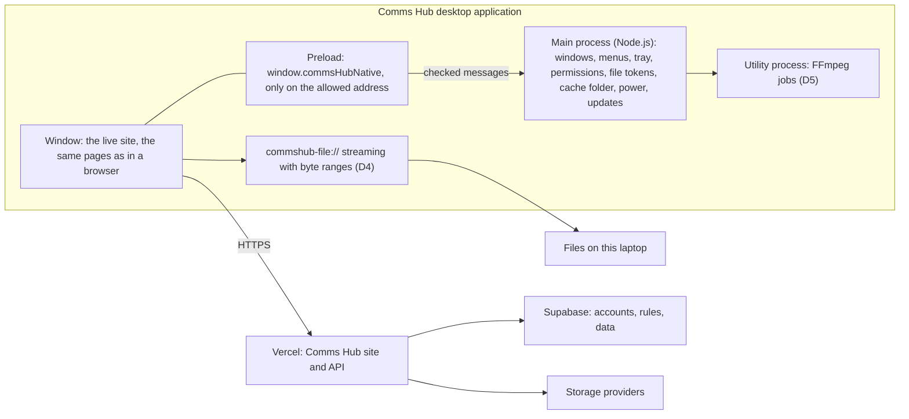

# Comms Hub as a desktop application: research and build plan

Research and plan of 2026-10-20, from the owner's request of the same day: "research a plan of how
we can make this application into a desktop application, so we can use the extra resources for
editing and other future features; it would be used on laptops (Windows, Mac)".

Status: **accepted by the owner on 2026-10-20, with the notes of section 11.1.** The first target is
Windows x64 alone. Nothing is built, installed, bought or deployed by this document. It revises one
earlier direction (the desktop shell, section 4).

Companion documents: `Studio_Feasibility_and_App_Path.md` (research of 2026-10-15, section 7.4 and
section 12), `Studio_Build_Plan.md` (section 7, "Desktop application (Tauri)" deferred),
`Settings_Integrations_Plan.md` (E-1: nothing scheduled in the site), `AGENTS.md` (rules),
`MVP_draft.md` section 62 (the studio), `Mobile_Apps_Plan.md` (the phone applications, the three clients together, and one roadmap for all three in its section 9).

## Contents

1. [The answer in short](#1-the-answer-in-short)
2. [What "extra resources" really means](#2-what-extra-resources-really-means)
3. [What in the current code decides the design](#3-what-in-the-current-code-decides-the-design)
4. [The options, and why Electron](#4-the-options-and-why-electron)
5. [Architecture](#5-architecture)
6. [What changes in the website](#6-what-changes-in-the-website)
7. [Packaging, signing, updates and distribution](#7-packaging-signing-updates-and-distribution)
8. [Phases](#8-phases)
9. [Security](#9-security)
10. [Costs](#10-costs)
11. [Decisions for the owner](#11-decisions-for-the-owner)
12. [Tests and evidence](#12-tests-and-evidence)
13. [Risks](#13-risks)
14. [Method and sources](#14-method-and-sources)

---

## 1. The answer in short

**Build an Electron application for Windows and macOS that opens the live Comms Hub site in its
own window and adds a small, locked native layer, used first by the studio.**

- It is not a rewrite. Every page, rule and check stays the website's: Vercel serves it, Supabase
  decides who sees what, approval and publishing are untouched. The browser remains a full client.
- The application gives the studio what a browser tab withholds. Exports keep running when the
  window is minimised or covered, and the laptop does not sleep during one. The tab is never
  discarded, and storage is not cleared by the browser. Files from «هذا الجهاز» are used where
  they are instead of being copied. Later come proxies for heavy footage, formats the browser
  cannot open (through FFmpeg), and a preview on a second screen.
- It does not make the laptop faster, does not render while the laptop sleeps or is off, does not
  replace the agent computer (E-1), does not change who may open the studio (the Admin and the
  director only), and adds no AI.
- Electron, not Tauri, because the studio was built and qualified on Chromium. On macOS, Tauri runs
  pages in Safari's engine, where the canvas filter behind video adjustments and blur covers is
  still off by default (section 4). This reverses the earlier leaning toward Tauri and is
  decision D-1.
- Fixed costs: the Apple Developer Program (99 USD a year) if any Mac is used, and a Windows
  code-signing route (section 10). Vercel and Supabase costs do not grow; library traffic through
  Vercel can fall.
- Work is in phases D0 to D8. D1 and D2 alone deliver most of the editing gain to a pilot of the
  Admin and the director. Signing, updates and wider rollout come in D3.

---

## 2. What "extra resources" really means

A browser tab already uses the laptop's processor, graphics card and hardware video encoder.
Chromium's WebCodecs, which the studio uses through Mediabunny, encodes on the hardware where the
operating system offers it. What a browser adds is **policy**: it slows, freezes or discards pages
that are not in front, rations storage, hides file paths, and cannot run native programs. The
application removes those policies for this one site. The table lists each limit with the place
in the code where it shows today.

| Limit in a browser today | Where it shows in the code | What the application changes | Phase |
|---|---|---|---|
| An export slows or stops when its tab is hidden; the person must keep the page in front. | `src/lib/studio/export.ts` header: "the person keeps the page visible until it ends"; `export-panel.tsx` holds only a screen wake lock. | The window is never throttled (`backgroundThrottling: false`). The system is kept from sleeping during an export (`powerSaveBlocker`). Closing the window during an export hides it to the tray and says so, then a native notice reports the end. | D2 |
| Edge "sleeping tabs" and Chrome "memory saver" can discard an inactive tab and its editor state. | Recovery relies on the crash draft in IndexedDB (`persist.ts`). | The application's window is not a tab and is not discarded. | D1 |
| The device cache lives in the browser's private storage (OPFS), under a quota, and the browser may clear it; `persist()` is only a request. | `cache.ts` asks `persist()`, `support.ts` reports `persisted` and `quota`. | Storage belongs to the application's own profile: «مسح بيانات التصفح» in a browser does not touch it. In D4 the cache moves to a folder the person chooses (another disk if wanted), with a size limit. | D1, D4 |
| A file from «هذا الجهاز» is copied whole into private storage before use. | `cache.ts` `putLocal`, the `studio-local/` folder. | The file is used where it is, through a token and a streaming address with byte ranges. A 20 GB camera file costs no extra 20 GB and no copy time. | D4 |
| Where private storage is missing, an export is built in memory and refused above 1.6 GB. | `target.ts` `MEMORY_CEILING`. | Never applies: the application always has disk storage, and an export can be written straight to a folder the person picks. | D2, D4 |
| Formats the browser cannot decode are refused. | `media.ts` «هذا المتصفح لا يفك ترميز هذا الفيديو». | FFmpeg, run by the application, converts such a source into an editable copy (ProRes, DNxHR, some HEVC 10-bit, MTS, MXF; the list follows the corpus test). | D5 |
| Several 4K tracks make the preview stutter; today the answer is a lower preview resolution. | `MVP_draft.md` 62.2, preview resolutions 1/2 to 1/32. | Light copies for preview (proxies) are made once and kept on disk. The export still reads the originals. | D5 |
| Every library read passes through Vercel (`/api/media/[id]/content`, `no-store`). | `src/app/api/media/[id]/content/route.ts`. | The same one copy per version, but kept on a larger, unrationed disk cache, so fewer copies are fetched again. Vercel traffic can only fall. | D4 |
| One browser window. | The studio's floating windows live inside the page (`workspace.tsx`). | The preview, later any window, can open as its own window on a second screen. | D6 |
| A laptop with two graphics chips may run the page on the weaker one. | Not visible to the page today. | A device panel «معلومات الجهاز» shows the graphics chip in use and whether the video encoder is on hardware. The setup guide says how to choose the strong chip. | D2 |
| Notices arrive only while a tab is open and in front. | `notices.tsx` reloads every minute only when `visibilityState === 'visible'`. | The application can stay in the tray, and new tier-one notices become native notices with a badge. This needs a small site change: keep loading while hidden when inside the application. | D2 |

What the application does **not** change:

- It does not lift the browser engine's own limit on one page's JavaScript memory. Decoded video
  frames mostly live outside that limit anyway, in graphics and decoder memory. The gains come
  from the rows above, not from "more RAM".
- It does not keep working while the laptop is asleep or off. Work that must finish with the
  laptop closed belongs to the agent computer (E-1), phase D7.
- It does not change the studio's output. The same compositor and the same WebCodecs encoder make
  the same file in the browser and in the application, so a parity check (D2) can hold them equal.

---

## 3. What in the current code decides the design

| Fact | Evidence | Consequence |
|---|---|---|
| The site is rendered on the server and reads the session from cookies on every request. | 47 route handlers in `src/app` (43 under `src/app/api`); `src/proxy.ts` refreshes the Supabase cookie on each page request; `src/app/[[...slug]]/page.tsx` checks `canOpenRoute` on the server; 31 files read the session through `serverClient()` or cookies. | The site cannot be packed into the application as static files. The Next.js 16.3 guide `static-exports.md` ("Unsupported Features") lists Proxy, Cookies, Server Actions and dynamic route handlers as unsupported. |
| The server holds secrets. | `GMAIL_APP_PASSWORD`, `MAIL_SERVER_KEY`, `WHATSAPP_SERVER_KEY`, Drive and Vault access (`AGENTS.md`, "Prototype boundary"). | The server cannot ship inside a downloaded application either. The application must **open the site**. |
| The studio engine is plain TypeScript, kept apart from React and Next on purpose. | `Studio_Build_Plan.md` Phase 3: "so it can later move into a desktop or phone shell"; `src/lib/studio/` (about 6,000 lines). | The engine needs no change to run in the application. Native features plug in at a few points (`support.ts`, `cache.ts`, `media.ts`, `target.ts`, `export-panel.tsx`). |
| The studio depends on Chromium behaviour and was qualified only on Chromium. | `support.ts` (WebCodecs including `AudioEncoder`), `cache.ts` and `target.ts` (OPFS `createWritable`), `supportsFilter()` in `compose.ts` and `canFilter()` in `cover.ts` (canvas `filter`), `recorder.tsx` (microphone), `photo.ts` (worker); `qa/studio-*.cjs` run in headless Edge. | The desktop shell should carry the same engine: section 4. |
| Outside connections are browser redirects with a state cookie. | `src/app/api/drive/connect/route.ts` sets `drive_oauth_state`; the callback checks it and the session; OneDrive and platform connections work alike. | Google refuses sign-in inside embedded browsers (`disallowed_useragent`). These few administrator flows open in the system browser (section 5.1). |
| The notifications drawer reloads only while visible. | `src/components/notices.tsx`. | Tray notices need a site change (section 6). |
| Pages send no Content-Security-Policy; only file routes do. | `Content-Security-Policy` appears only in the six file and link routes. | Before the application lets the page reach local files (D4), the pages get a policy (Next.js guide `content-security-policy.md`), because a script injected into the site would otherwise reach the bridge. |
| No web app manifest exists. | Nothing in `src/app` or `public`. | Installing the site as a web app (option A below) needs a manifest first. It is cheap, but it adds none of section 2. |
| `tsconfig.json` includes only `src/**`. | `"include"` in `tsconfig.json`. | A new `desktop/` folder, like `bridge/whatsapp/`, stays outside the site's typecheck and build. |

---

## 4. The options, and why Electron

| Option | What it is | Verdict |
|---|---|---|
| A. Installed web app (PWA) | Edge or Chrome installs the site with its own icon and window. | Free and quick, but it is still a browser tab: no change to any row of section 2. Acceptable as a stopgap only. |
| **B. Electron, opening the live site** | Chromium and Node.js in one application, with a native layer the site can call. | **Recommended.** |
| C. Tauri, opening the live site | Uses the system's web engine with a Rust native layer. On Windows that is WebView2 (Chromium); on macOS it is WKWebView (Safari's engine). | Small and well designed, but on macOS it runs the studio in another engine (table below). |
| D. The site packed inside the application | Static export, or a Next.js server running inside the application. | Impossible without moving secrets into the application or rewriting 47 server routes (section 3). |
| E. A native editor | The studio rewritten in Rust, C++ or Swift. | Years of work, and the one compositor that draws preview and export alike would be lost. |

### 4.1 The engine question, with evidence

MDN's browser compatibility data, version 8.1.6 of 2026-10-15, downloaded and queried for this
plan:

| What the studio uses | Where | Chromium (Electron; Tauri on Windows) | Safari's engine (Tauri on macOS) |
|---|---|---|---|
| Canvas `filter` | `compose.ts` video brightness, contrast, saturation; `cover.ts` blur covers | Since Chrome 52 | Only behind the "Canvas Filters" preference since Safari 18: **off** in an application |
| `filter` on an off-screen canvas | Off-screen drawing | Since Chrome 69 | Not supported |
| `AudioEncoder` (AAC and Opus) | `support.ts`, the export's sound | Since Chrome 94 | Safari 26 only |
| `createWritable` on a private file | `target.ts` streamed export, `cache.ts` | Since Chrome 86 | Safari 26 only |
| `VideoEncoder` | The export's picture | Since Chrome 94 | Since Safari 16.4 |
| WebGPU (future effects) | Not used yet | Yes | Safari 26 |

On a Mac, a Tauri application would export without video adjustments or blur covers: the code
detects the missing filter and skips it, silently (`supportsFilter()` in `compose.ts`; finding F-1 of `Mobile_Apps_Plan.md`). On a Mac whose system WebKit is older
than Safari 26, it would also lose AAC sound and streamed export. That means two engines to
qualify and two possible outputs from one project. Electron carries one known Chromium, pinned by
the application, on both systems. The studio's existing fixture checks can then run inside it
unchanged.

Tauri's Chromium backend (its `cef-rs` work) was not found as a stable release in this research.
If it ships and matures, option C can be reconsidered without touching the site, because the
bridge (section 5.2) is the only application-specific surface.

### 4.2 What Electron costs

- **Size.** About 100 MB to download and a few hundred MB installed per platform (to be measured
  in D1). Tauri would be a few MB.
- **Updates are an obligation.** The application contains Chromium and shows web content, so it
  must follow Electron's security releases. Electron ships a major version every eight weeks and
  supports the latest three (schedule of 2026-10-20: 45.0.0 stable today, 44 and 43 supported,
  42 ending today). In practice the application updates at least every three to four months, and
  sooner for a Chromium security fix.
- **Pinning.** Following the rule in `Studio_Build_Plan.md` (the newest release at least fourteen
  days old), D1 starts on the newest 44.x patch and moves to 45 once it has been out fourteen days.
- **Memory.** One more Chromium on the laptop. In use it replaces a browser tab, so the difference
  is small.

---

## 5. Architecture

### 5.0 Principles

1. **The site stays the only authority.** The application adds no page of its own except an Arabic
   connection-error screen and «حول التطبيق». Every permission is still decided by the server and
   by row level security.
2. **No secret in the application.** Sign-in is the site's own form. The session is the site's
   cookie inside the application's private profile, encrypted at rest (cookie encryption fuse).
   There is no service key, no stored token, no stub session, and no sign-in bypass, including for
   tests.
3. **A small bridge, only for the allowed address.** The preload exposes `window.commsHubNative`
   only when the top-level page is on an address in the compile-time list. Every main-process
   handler checks the sender's address again, and frames inside the page get nothing. No method
   accepts a file path or a command line: files are tokens the main process issued after the
   person chose them, and media work is a fixed list of job types.
4. **The browser stays a full client.** Each native feature is detected. Without it the page does
   what it does today, so an older application keeps working against a newer site.
5. **Nothing is scheduled in the site.** E-1 is untouched. The application's own housekeeping (the
   ten-day cache sweep, update checks) runs on the laptop while the application is open, just as
   the sweep runs today "when the studio opens".
6. **Approval and publishing are untouched.** The studio still approves nothing and publishes
   nothing.
7. **Arabic and right to left.** Menus, dialogs, tray items and notices are Arabic, right to left,
   using the established terms. No emoji.

### 5.1 The window and its rules

| Rule | Behaviour |
|---|---|
| Allowed addresses | The production address, decided in D-5. A development build also allows `http://127.0.0.1:3000`. The list is compiled in, with no setting to widen it in a release build. |
| Leaving the site | A link or `window.open` to any other address opens in the system browser. |
| Outside connections | `/api/drive/connect`, `/api/onedrive/connect` and `/api/platforms/connect/*` open in the system browser with a note: «يكتمل الربط في المتصفح. سجّل الدخول إلى المركز هناك إن طُلب منك، ثم ارجع إلى التطبيق.» Reasons: Google refuses embedded sign-in, and the state cookie must sit in the same browser as the callback. These are rare administrator actions. |
| Email links | Invitations and password links keep opening in the browser. A `commshub://` link that opens the application is optional, later (D8). |
| Permissions | Granted only to the allowed address: microphone (studio voice-over, voice notes in messaging), notifications, clipboard, full screen, and file system access (`showSaveFilePicker`, which Electron supports). Everything else is refused: camera, location, USB, serial, HID, Bluetooth, MIDI. |
| Downloads | Go to the Downloads folder or a chosen folder through the system dialog, for library downloads and studio exports alike. |
| One instance | A second launch brings the open window forward. |
| Window | Size, position and screen are remembered. A native menu in Arabic: «ملف»، «تحرير»، «عرض»، «نافذة»، «مساعدة». |
| No connection | An Arabic screen with «إعادة المحاولة». Version 1 keeps no offline copy of the site. |
| Identification | The user agent gains ` CommsHubDesktop/<version>` so support can see which version someone runs. The page learns its features from the bridge, never from the user agent. |

### 5.2 The bridge, `window.commsHubNative`

The desktop implementation of the native contract shared with the phone applications
(`Mobile_Apps_Plan.md` 5.2): the site calls `src/lib/native/`, which finds `platform: 'desktop'` here.

Versioned: `bridge` is an integer, and the site checks each method before use.

| Group | Methods | For | Phase |
|---|---|---|---|
| `info` | `version`, `bridge`, `platform`, `arch`, cores, memory, free disk at the cache folder, graphics chip | «معلومات الجهاز», support | D2 |
| `power` | `keepAwake(reason)` returns an id, `release(id)` | An export, a long upload | D2 |
| `life` | `busy(reason)` and `idle()`: while busy, closing the window hides it to the tray and quitting asks first | An export in progress | D2 |
| `notify` | `show({title, body, go})`, `badge(n)` | Notices while hidden; the end of an export | D2 |
| `files` | `pick(kinds)` and `fromDropped(file)` return tokens `{token, name, size, type, modified}`; `url(token)`; `forget(token)` | Files from «هذا الجهاز» used in place | D4 |
| `cache` | `where()`, `choose()`, `usage()`, `limit(bytes)`, `clear()` | The disk cache | D4 |
| `media` | `probe(token)`, `proxy(token, {height})`, `convert(token)`, with progress events and `cancel(job)` | Heavy and unsupported sources | D5 |
| `windows` | `popOut(panel)`, `screens()` | The preview on a second screen | D6 |
| `update` | `status()`, `restart()` | «إعادة التشغيل للتحديث» | D3 |

### 5.3 Processes

- **Main process.** Small, never touches media. It owns windows, tokens, permissions, updates and
  the tray.
- **The window (renderer).** The site, with the studio's compositor and WebCodecs export exactly as
  in a browser. This keeps one output.
- **Utility process (D5).** FFmpeg jobs and file fingerprints, so heavy work never blocks the main
  process or the window. A crash there ends one job, not the application.

### 5.4 What is kept on the laptop

| Data | Where | Removed by |
|---|---|---|
| The site's session cookie | The application's profile, encrypted with the system keychain (Windows DPAPI, macOS Keychain) | The site's sign-out; «مسح بيانات هذا الجهاز» |
| Studio cache and drafts | D1 to D3: the same private storage as today, inside the application's profile. From D4: the chosen folder, with a size limit | The ten-day sweep, «حذف ملفات المعاينة المؤقتة», «مسح بيانات هذا الجهاز» |
| File tokens | A small store in the main process: token, path, size, modified time, fingerprint. The page sees name and size only. | `forget`, «مسح بيانات هذا الجهاز» |
| Proxies (D5) | The cache folder, named by source version, recipe and tool version (`Studio_Feasibility_and_App_Path.md` 10.4) | Same as the cache |
| The application's log | The profile, rotated | Never holds cookies, tokens, addresses with query strings, or paths of personal files |

Library copies on a laptop are organisational media. Laptops that keep them should have disk
encryption on (BitLocker, FileVault): decision D-11.

---

## 6. What changes in the website

Small and additive. The browser path stays as it is.

| Change | Files | Phase |
|---|---|---|
| The bridge's types, detection and version comparison, plain TypeScript with tests | `src/lib/native/` (shared with the phones), `tests/native.test.mjs` | D2 |
| The studio's support report gains `desktop` | `src/lib/studio/support.ts` | D2 |
| Export: keep awake, mark busy, notify at the end, and an Arabic line «يمكنك تصغير النافذة أثناء التصدير» in place of the keep-visible message | `src/components/studio/export-panel.tsx` | D2 |
| Notices keep loading while hidden inside the application and pass new tier-one notices to `notify` | `src/components/notices.tsx` | D2 |
| «معلومات الجهاز»: graphics chip, hardware encoder (`VideoEncoder.isConfigSupported` with `prefer-hardware`), cores, memory, free disk | A studio window or the help menu | D2 |
| «تطبيق سطح المكتب»: download links, the current version, and a notice when an installed application is older than the site needs | A page under «الحساب» or «مساعدة» | D3 |
| A Content-Security-Policy for the pages | `src/proxy.ts` (or the Next.js mechanism the guide prescribes) | Before D4 |
| Local files through tokens; the media pool reads them through `UrlSource` | `src/lib/studio/cache.ts`, `media.ts` | D4 |
| Proxy use in preview, originals in export | `src/lib/studio/media.ts`, `preview.ts`, `export.ts` | D5 |
| Specification and rules | `MVP_draft.md` new section 63, an `AGENTS.md` paragraph (the desktop application as a real exception), help blocks in `Help_Content_Matrix.md` drafted for review | D0, then each phase |

No database change is needed for D1 to D6. D7 would need one, under its own plan.

---

## 7. Packaging, signing, updates and distribution

### 7.1 What is built

| System | Build | Notes |
|---|---|---|
| Windows 10 and 11 | x64; arm64 if a target laptop is a Snapdragon | NSIS installer per user: no administrator rights, Start menu shortcut, automatic updates |
| macOS 12 Monterey or newer (Electron's current floor; confirm for the pinned version) | Apple silicon; Intel only if a target laptop needs it | DMG for the first install, ZIP for updates (both needed by the macOS updater). Apple has said macOS 26 is the last release for Intel Macs. |

The code lives in `desktop/` with its own `package.json` and lockfile, like `bridge/whatsapp/`.
Tools: `electron` (pinned), `electron-builder` and `electron-updater`, `@electron/fuses`.

### 7.2 Signing

**macOS, required.** Since macOS Sequoia, an unsigned or un-notarised application can be opened
only after the person approves it in «الخصوصية والأمن» in System Settings. The macOS updater also
needs a signed application. What is needed:

- Apple Developer Program membership (99 USD a year), as an individual or as an organisation (an
  organisation needs a D-U-N-S number): decision D-8.
- A "Developer ID Application" certificate, the hardened runtime, notarisation and stapling.
- The microphone entitlement (`com.apple.security.device.audio-input`) and an Arabic
  `NSMicrophoneUsageDescription`, because the studio records voice-over and messaging records
  voice notes.

**Windows, recommended before rollout.** Unsigned installers show the SmartScreen warning, and
Smart App Control, where it is on, may block them (to be tested).

| Route | Cost | Fit |
|---|---|---|
| Azure Artifact Signing (formerly Trusted Signing), supported directly by electron-builder | About 9.99 USD a month (Basic) | Open to organisations in listed countries (the United States, Canada, the EU, the UK and some others) and to individuals in the United States and Canada only. Saudi Arabia is not in the lists found, so this is likely unavailable unless the organisation is registered in an eligible country. |
| OV code-signing certificate from a public authority (DigiCert, Sectigo, GlobalSign, SSL.com and others), key on a hardware token or a cloud key service | A yearly fee; get quotes | The general route. An EV certificate no longer gives instant SmartScreen trust (changed in 2024): reputation builds over weeks with either. |
| Microsoft Store (MSIX: the Store signs and hosts) | Free registration for individuals since September 2025 | Individual accounts are meant for personal projects. Updates go through the Store, not our updater, and each release waits for review. Not recommended for an internal tool. |
| Unsigned, pilot only | None | Acceptable for the Admin and the director in D1 and D2 («مزيد من المعلومات» then «تشغيل على أي حال»). Not for rollout. |

Signing secrets (certificates, Apple credentials, Azure credentials) live only in the build
system's secret store, never in the repository.

### 7.3 Builds

GitHub Actions builds both systems: a Windows runner, and a macOS runner because signing and
notarising a Mac application needs a Mac and the owner works on Windows. The workflow starts by
hand only. A release is published only when the owner asks, as with pushes today. Versions are
pinned and the lockfile is committed, so a build can be repeated.

### 7.4 Updates

- `electron-updater` with a generic feed: `latest.yml` and `latest-mac.yml` beside the installers
  on a static host. The binaries contain no secret, only the site's address, so the host may be
  public: a public "releases only" GitHub repository, a public bucket in the `comms-hub` Supabase
  project, or another (decision D-6).
- The application checks when it starts and every few hours while open. It downloads in the
  background and installs on quit, or on «إعادة التشغيل للتحديث». Never during an export.
- On Windows the updater checks the publisher's name in the signature, and on macOS the code
  signature. That is one more reason to sign: without it a replaced update file is not detected.
- The site is always the newest. The application can be older, which is why every bridge method
  is feature-detected (section 5.0).

### 7.5 Who installs it

- Pilot: the Admin and the director, the studio's only users (decision D-3).
- Then optional for every role, for the tray, notices and the badge. For those roles the studio
  gains do not apply.
- The download page is inside the site, for signed-in people only.

---

## 8. Phases

Each phase ends as the project's phases do. The site's `npm run typecheck`, `npm run build` and
`npm test` pass, along with the application's own tests (`desktop/tests`). The phase's browser or
application check is saved under `qa/` as a script and its JSON result. Then a local commit and a
dated `progress.md` entry with numbers. Nothing is pushed, released or bought unless the owner
asks. Sizes are relative (S, M, L), not dates.

### D0. Decisions and specification (owner, then agent), S

Accept or amend this plan and decisions D-1 to D-11 (section 11). Then write `MVP_draft.md`
section 63 (the desktop application), the `AGENTS.md` paragraph, and the `Roadmap.md` and
`Status.md` lines. Gate: the owner's acceptance recorded in `progress.md`.

### D1. The shell, unsigned, M

- `desktop/`: `src/main.ts`, `src/preload.ts`, `src/origins.ts`, `src/navigation.ts`,
  `src/permissions.ts`, `src/menu.ts` (Arabic), `src/offline.html`, `tests/*.test.mjs`.
- The site in a persistent private profile; the address list; links and outside connections to
  the system browser; the permission policy; downloads; one instance; window memory; the Arabic
  menu.
- Fuses: `RunAsNode` off, `EnableNodeOptionsEnvironmentVariable` off,
  `EnableNodeCliInspectArguments` off, `EnableCookieEncryption` on,
  `EnableEmbeddedAsarIntegrityValidation` on, `OnlyLoadAppFromAsar` on.
- Window settings: `contextIsolation` and `sandbox` on, `nodeIntegration` off, no `webview` tag.
- Gate: unit tests of the address, navigation and permission rules. `qa/desktop-shell.cjs` uses
  Playwright's Electron support against a local `next start`: the sign-in page renders right to
  left, the bridge exists on the allowed address and not on a foreign test page, a foreign link
  goes to the system browser, refused permissions are refused. Then the owner's first signed-in
  use, recorded as pending until done.

### D2. The studio at full strength, S to M

- `backgroundThrottling: false`. Bridge version 1: `info`, `power`, `life`, `notify`.
- Site: `src/lib/native/`, the `desktop` field in `support.ts`, the export panel's
  messages and hooks, notices while hidden, «معلومات الجهاز».
- Gate: the studio's existing fixture checks (`qa/studio-engine.cjs`, `qa/studio-export.cjs`) run
  inside the application with the same expectations as in Edge, saved as
  `qa/desktop-studio-parity.json`. A ten-minute 1080p fixture export with the window minimised
  completes, and ffprobe reads it the same as the Edge export. Timing is recorded both ways.

### D3. Signing, installers, updates, download page, M

- `electron-builder` configuration; `.github/workflows/desktop.yml` (manual start); the update
  feed; the site's «تطبيق سطح المكتب» page and the "please update" notice.
- Gate: on one Windows and one Mac laptop, install, update from version N to N+1, and uninstall.
  Signature checks recorded (`signtool verify /pa`, `codesign --verify --deep --strict`,
  `spctl -a -vv`, `xcrun stapler validate`). A tampered update file is refused.

### D4. Local files in place and the disk cache, M

- Before it: the pages' Content-Security-Policy (section 6).
- File tokens. The `commshub-file://` scheme, registered with `stream: true`: byte ranges,
  read-only, token-only, no path in the address, revocable. The media pool reads it as a URL.
- The cache folder chooser and size limit, with the same ten-day rule (`cache.ts` `dueForSweep`
  kept). Exports go straight to a chosen folder.
- Gate: tests of the range arithmetic, a refused path escape, an unknown or revoked token. A
  fixture seeks in and exports a local video larger than 4 GB with no copy made (disk use
  measured before and after). A project opened on another device still shows «على هذا الجهاز
  فقط».

### D5. Native media tools (FFmpeg), L

- FFmpeg built under the LGPL, pinned per platform, without GPL or "nonfree" parts. Encoders are
  limited to the operating system's own: Media Foundation on Windows, VideoToolbox on macOS. NVIDIA's
  NVENC needs FFmpeg's "nonfree" switch, so it is not shipped.
- Runs in the utility process with fixed jobs only: `probe`, `proxy` (720p or 1080p), `convert`
  (sources Chromium cannot decode). Each result is named by source version, recipe and tool
  version.
- Studio: «إنشاء نسخة خفيفة للمعاينة» per clip, offered automatically for heavy sources. The
  preview uses the light copy, the export the original, or the converted copy when the original
  cannot be decoded.
- `THIRD_PARTY_NOTICES.md`: FFmpeg's LGPL notice, the exact configure line, where its source is
  offered, and Electron and Chromium notices.
- Gate: a corpus (ProRes 422, DNxHR, HEVC 10-bit, MTS, MXF) opens in the studio. Cuts land on the
  same frame in the light copy and the original. Exports from originals pass ffprobe. The licence
  audit is recorded.

### D6. Windows on more than one screen, M

«فتح في نافذة مستقلة» for the preview, then any studio window: a second application window on the
same address, kept in step through the bridge, full screen on the second display. Gate: a
two-window fixture keeps the playhead within one frame.

### D7. The agent computer, gated on hardware and an owner directive, L

The same application in «وضع حاسوب المعالجة» on the office computer of E-1. It would hold the
WhatsApp bridge's loop (folding in `bridge/whatsapp/`), render jobs claimed from the site (so an
export can finish after its editor closes), the NAS provider and the scheduled backups of
`Owner_Handoff.md` part D. It would pull only, with one server key whose hash alone is stored, as
the bridge does now. It needs its own plan and a database change, and it starts only when the
computer exists.

### D8. Later features the application makes possible, gated on owner decisions

- Editing a prepared project without a connection, with server checks repeated on reconnect
  (`Studio_Feasibility_and_App_Path.md` 12.2).
- On-device AI: captions from speech, background removal. Version 0 has no AI (owner answer of
  2026-10-20), so this waits for a decision.
- Recording the screen into the studio (for guides and tutorials).
- Dragging an export out of the application into another program.
- Watch folders, or import from a camera card.
- `commshub://` links that open the application at a work or a project.

---

## 9. Security

| Threat | Control |
|---|---|
| A script injected into the site reaches the bridge. | The bridge is narrow (section 5.2): no paths, no commands, read-only access to files the person chose. Plus the pages' Content-Security-Policy before D4. |
| A crafted project document names a path or a foreign token. | Documents hold tokens, which are meaningless outside the profile that issued them. The main process accepts only tokens it issued. |
| The window is steered to another site that then calls the bridge. | The compiled address list, navigation and new-window handlers, and a sender check in every handler. Frames get nothing. |
| The application's files are tampered with on disk. | Code signing, ASAR integrity and `OnlyLoadAppFromAsar`. |
| The application is started as a plain Node.js runtime. | The `RunAsNode`, `NodeOptions` and `NodeCliInspect` fuses off. |
| An outdated Chromium shows web content. | The update cadence of section 4.2. The site can show «حدّث التطبيق» below a minimum version. |
| A lost or stolen laptop. | Cookie encryption, OS disk encryption (D-11), and the site's own sign-out and account suspension, which act on the server. |
| A replaced update file. | Signed builds, verified by the updater. |
| Secrets leak through logs. | The log keeps no cookies, tokens, query strings or personal file paths, the same rule as `AGENTS.md` for platform tokens. |
| A grant gives someone the studio through the application. | Impossible: the application has no access logic. `motion.studio` stays fixed (`CAP_FIXED`) and is checked by the server and the database. |

---

## 10. Costs

| Item | Cost | When |
|---|---|---|
| Apple Developer Program | 99 USD a year | D3, only if any target laptop is a Mac |
| Windows code signing | Azure Artifact Signing about 9.99 USD a month if eligible; otherwise an OV certificate (quote, a yearly fee) | Before rollout beyond the pilot |
| Build machines | GitHub Actions minutes. macOS minutes are charged at a higher rate than Linux; a release is a few tens of minutes | D3 onward |
| Update and download hosting | Within free tiers for a department: about 100 to 200 MB per platform per release | D3 onward |
| Vercel and Supabase | No increase; library traffic can fall (section 2) | None |
| Hardware | None. Testing uses the pilot users' own laptops | None |
| FFmpeg | No licence fee under the LGPL. For a public product, ask legal advice on H.264, HEVC and AAC patents; internal use is a lower exposure | D5 |

---

## 11. Decisions for the owner

| ID | Decision | Recommendation |
|---|---|---|
| D-1 | Electron instead of Tauri. This revises `Studio_Feasibility_and_App_Path.md` 1.1 and 5.1 and `Studio_Build_Plan.md` section 7. | Yes, for the reasons of section 4. |
| D-2 | The whole Comms Hub in the application, or the studio only | The whole site. It costs nothing extra, since the application opens the site, and every role gets notices and the tray. |
| D-3 | Who first | A pilot with the Admin and the director, then optional for everyone. |
| D-4 | Which laptops (exact models, Windows x64 or arm64, Mac Apple silicon or Intel) | Needed before D1, to decide builds and the Apple cost. |
| D-5 | The address: keep the current Vercel address, or move to the organisation's own domain first | Decide before D3. The address is compiled into the application. Moving later needs an application update first, and signs everyone out once (cookies belong to an address). The phone applications' links bind to it too (`Mobile_Apps_Plan.md` 5.6). |
| D-6 | Where installers and updates are hosted | A public bucket in the `comms-hub` Supabase project or a public releases-only repository. The binaries hold no secret. |
| D-7 | The Windows signing route and its budget | Unsigned for the pilot; an OV certificate (or Artifact Signing if the organisation is eligible) before rollout. |
| D-8 | Apple membership as an individual or an organisation | An organisation shows the organisation's name to users, but needs a D-U-N-S number. |
| D-9 | FFmpeg in D5: an LGPL build with the operating system's encoders only | Yes. |
| D-10 | Closing the window: quit, or stay in the tray | Stay in the tray only during an export, or when the person turns on «إبقاء التطبيق في شريط المهام». |
| D-11 | Laptop data rules: disk encryption required where library copies are kept; what «مسح بيانات هذا الجهاز» removes | Require disk encryption. The clear removes the session, cache, tokens and proxies. |

### 11.1 The owner's answers of 2026-10-20

The owner accepted every recommendation of the table above, with these notes and answers:

| ID | Answer | What it changes |
|---|---|---|
| Scope | **Windows x64 first, and only, until it is fully running.** Then the other platforms (Windows arm64, macOS). | D1 to D6 are built and proven on Windows x64. macOS items (Apple membership, notarisation, entitlements, the macOS runner) wait. Windows builds run on the owner's laptop; a build workflow is needed only when macOS arrives. |
| D-4 | The pilot laptops are the Admin's and the director's, **both Windows x64**. | The pilot needs only the Windows build. |
| D-5 | **Keep the Vercel address for now:** `https://comms-hub-three.vercel.app` (answered 200 on 2026-10-20). | The address list holds this origin, plus `http://127.0.0.1:3000` in development builds only. A later move to the organisation's own domain needs an application update first. |
| D-6 | The recommendation stands; the default is a **public bucket in the `comms-hub` Supabase project**. | Needed only at D3. |
| D-7 | **Unsigned for the pilot**; a certificate before rollout. | D1 and D2 install with one SmartScreen screen. |
| D-8 | Deferred with macOS. | None now. |
| Name | Windows shows **«مركز الاتصال المؤسسي»**, the site's own title. | Used in the Start menu, the taskbar, the installer and the file details. A fixed internal id keeps the data folder stable if the display name ever changes. |
| Order | **D1 now, D2 after.** Another session is building the studio's third round in the main checkout. | D1 touches only `desktop/` and the records. D2's changes to the studio's export panel, `support.ts` and `notices.tsx` wait until the studio round has finished with those files. |
| Menu | **No native menu bar on Windows.** | The site and the studio keep their own menus and keys (Ctrl+Z, the studio's shortcuts). The application handles only zoom (Ctrl with plus, minus and zero), full screen (F11) and reload (F5), without taking any key the site uses. |

Facts checked on the owner's laptop on 2026-10-20, read-only:

- Windows 11 Home 64-bit (10.0.26300), AMD Ryzen 5 6600H, 15 GB of memory.
- Two graphics chips: AMD Radeon (in the processor) and NVIDIA GeForce RTX 3050 Laptop. The
  graphics-chip check of section 2 applies here: D2 records which chip runs the studio and how to set
  the application to the NVIDIA chip in Windows' graphics settings.
- Smart App Control is off, so an unsigned pilot build runs after SmartScreen's "More info", then
  "Run anyway".
- D-11 on Windows 11 Home: that edition has no BitLocker management, only "Device encryption" where
  the hardware supports it (Settings, Privacy & security, Device encryption). The owner checks it on
  both laptops, and also Smart App Control on the director's laptop (Windows Security, App & browser
  control, Smart App Control). If Smart App Control is on there, the unsigned build is blocked and
  that laptop waits for a signed build.

---

## 12. Tests and evidence

| ID | Test | Required result | Phase |
|---|---|---|---|
| DT-01 | Address list, navigation, new windows | Allowed stays; anything else goes to the system browser | D1 |
| DT-02 | Bridge exposure | Present on the allowed address; absent on a foreign page and in frames | D1 |
| DT-03 | Permissions | Microphone, notifications and file access granted only to the allowed address; all others refused | D1 |
| DT-04 | Fuses | Read back from the packaged binary and recorded | D1 |
| DT-05 | Studio parity | `qa/studio-engine.cjs` and `qa/studio-export.cjs` give the same results in the application as in Edge | D2 |
| DT-06 | Export with the window minimised | Completes; ffprobe equal to the visible export; time recorded | D2 |
| DT-07 | Notices while hidden | A tier-one notice raises a native notice and the badge | D2 |
| DT-08 | Install, update, uninstall | On one Windows and one Mac laptop | D3 |
| DT-09 | Signatures | `signtool`, `codesign`, `spctl`, `stapler` outputs recorded; a tampered update refused | D3 |
| DT-10 | Local file streaming | Correct byte ranges; path escape and unknown or revoked tokens refused | D4 |
| DT-11 | A file over 4 GB used in place | Seek and export with no copy; disk use measured | D4 |
| DT-12 | Proxies | Same frame at cut points as the original; export from originals | D5 |
| DT-13 | Licence audit | FFmpeg configure line and notices recorded | D5 |
| DT-14 | Two windows | Playhead in step within one frame | D6 |

The owner's signed-in walkthrough (no agent may sign in, by rule): sign in inside the
application; open the studio as the Admin and as the director; export a ten-minute 1080p video
from Drive with the window minimised, then save it to the library; confirm that the director's own
approval is still refused on the review screen; connect a provider from «الإعدادات» and see it
finish in the browser; sign out and confirm the studio cache and session are gone after «مسح
بيانات هذا الجهاز».

---

## 13. Risks

| Risk | Effect | Mitigation |
|---|---|---|
| Updates are not shipped | An old Chromium shows web content | The cadence of section 4.2; a minimum version enforced by the site |
| The signing accounts take time | D3 waits | D1 and D2 run unsigned for the pilot |
| The application and the browser drift apart | Two behaviours | One site; only the bridge differs; the parity check DT-05 each phase |
| FFmpeg licence or patent questions | D5 blocked | LGPL build, operating-system encoders, recorded configure line; legal advice before any public release |
| Supabase's live connection in a hidden window | Notices late | DT-07; the site's minute reload as a fallback |
| Laptops with two graphics chips | The weaker chip renders | «معلومات الجهاز» shows it; the setup guide shows the setting |
| Company antivirus flags a new or unsigned build | Installation blocked | Signing before rollout; an exception for the pilot |
| The organisation changes its address later | Everyone signed out; an application update needed first | Decide D-5 before D3 |

---

## 14. Method and sources

### 14.1 What was done for this plan

- The repository was read: `package.json` (Next.js 16.3.8, React 19.3.0, Mediabunny 1.61.2),
  `src/proxy.ts`, `src/app/[[...slug]]/page.tsx`, the 47 route handlers in `src/app`, `src/lib/studio/`
  (`support.ts`, `cache.ts`, `target.ts`, `export.ts`, `media.ts`, `compose.ts`, `cover.ts`),
  `src/components/studio/export-panel.tsx`, `src/components/notices.tsx`,
  `src/app/api/drive/connect` and `callback`, `src/app/api/media/[id]/content/route.ts`,
  `tsconfig.json`, `bridge/whatsapp/`, and the plans and records named at the top.
- The Next.js 16.3 guides in `node_modules/next/dist/docs` were read: `static-exports.md` and the
  presence of `content-security-policy.md`.
- MDN's browser compatibility data, version 8.1.6 (2026-10-15), was downloaded to a scratch folder
  and queried for the APIs in section 4.1.
- Electron, electron-builder and Tauri documentation was read through Context7. Electron's release
  schedule, and the signing, Gatekeeper and OAuth sources below, were read on the web.
- Not done: nothing was built, installed, signed or measured. No laptop, no Electron build, no
  FFmpeg build. Sizes, timings and speed gains in this document are expectations to be proven by
  the gates of section 8, not results.

### 14.2 External sources

| Topic | Source |
|---|---|
| Electron versions and support policy | [Release schedule](https://releases.electronjs.org/schedule), [timelines](https://www.electronjs.org/docs/latest/tutorial/electron-timelines) |
| Electron security | [Security checklist](https://www.electronjs.org/docs/latest/tutorial/security), [fuses](https://www.electronjs.org/docs/latest/tutorial/fuses), [ASAR integrity](https://www.electronjs.org/docs/latest/tutorial/asar-integrity) |
| Electron features used | [protocol](https://www.electronjs.org/docs/latest/api/protocol), [utility process](https://www.electronjs.org/docs/latest/api/utility-process), [webUtils](https://www.electronjs.org/docs/latest/api/web-utils), [session permissions and file system access](https://www.electronjs.org/docs/latest/api/session), [web preferences](https://www.electronjs.org/docs/latest/api/structures/web-preferences), [deep links](https://www.electronjs.org/docs/latest/tutorial/launch-app-from-url-in-another-app) |
| Packaging, signing, updates | [electron-builder](https://github.com/electron-userland/electron-builder) (Windows Azure signing, macOS notarisation, auto-update) |
| Electron platform floor | [electron on npm (Socket overview)](https://socket.dev/npm/package/electron/overview/43.5.1) |
| Tauri | [Capabilities and remote URLs](https://tauri.app/security/capabilities), [capability reference](https://tauri.app/reference/acl/capability), [Tauri with Next.js](https://tauri.app/start/frontend/nextjs/) |
| Browser support data | [MDN browser-compat-data](https://github.com/mdn/browser-compat-data) 8.1.6; [canvas filter](https://developer.mozilla.org/en-US/docs/Web/API/CanvasRenderingContext2D/filter); [createWritable](https://developer.mozilla.org/en-US/docs/Web/API/FileSystemFileHandle/createWritable); [AudioEncoder](https://developer.mozilla.org/en-US/docs/Web/API/AudioEncoder); [WebKit canvas filter bug](https://bugs.webkit.org/show_bug.cgi?id=198416) |
| Google sign-in in embedded browsers | [Google Developers Blog](https://developers.googleblog.com/upcoming-security-changes-to-googles-oauth-20-authorization-endpoint-in-embedded-webviews/) |
| macOS Gatekeeper since Sequoia | [9to5Mac](https://9to5mac.com/2024/08/06/macos-sequoia-makes-it-harder-to-run-apps-that-dont-follow-apples-security-rules/) |
| Windows signing | [Artifact Signing quickstart](https://learn.microsoft.com/en-us/azure/artifact-signing/quickstart), [code signing options](https://learn.microsoft.com/en-us/windows/apps/package-and-deploy/code-signing-options), [SmartScreen reputation](https://textslashplain.com/2024/11/15/best-practices-for-smartscreen-apprep/), [pricing summary](https://www.gdgsoft.com/faq/azure-trusted-signing-cost-effective-exe-code-signing) |
| Microsoft Store | [Free registration for individuals](https://blogs.windows.com/windowsdeveloper/2025/09/10/free-developer-registration-for-individual-developers-on-microsoft-store/), [getting started](https://learn.microsoft.com/en-us/windows/apps/publish/faq/get-started-with-the-microsoft-store) |
| FFmpeg licensing | [FFmpeg legal](https://ffmpeg.org/legal.html); Electron's [release build arguments](https://github.com/electron/electron/blob/main/build/args/release.gn) (FFmpeg built with proprietary codecs, as a shared library) |
