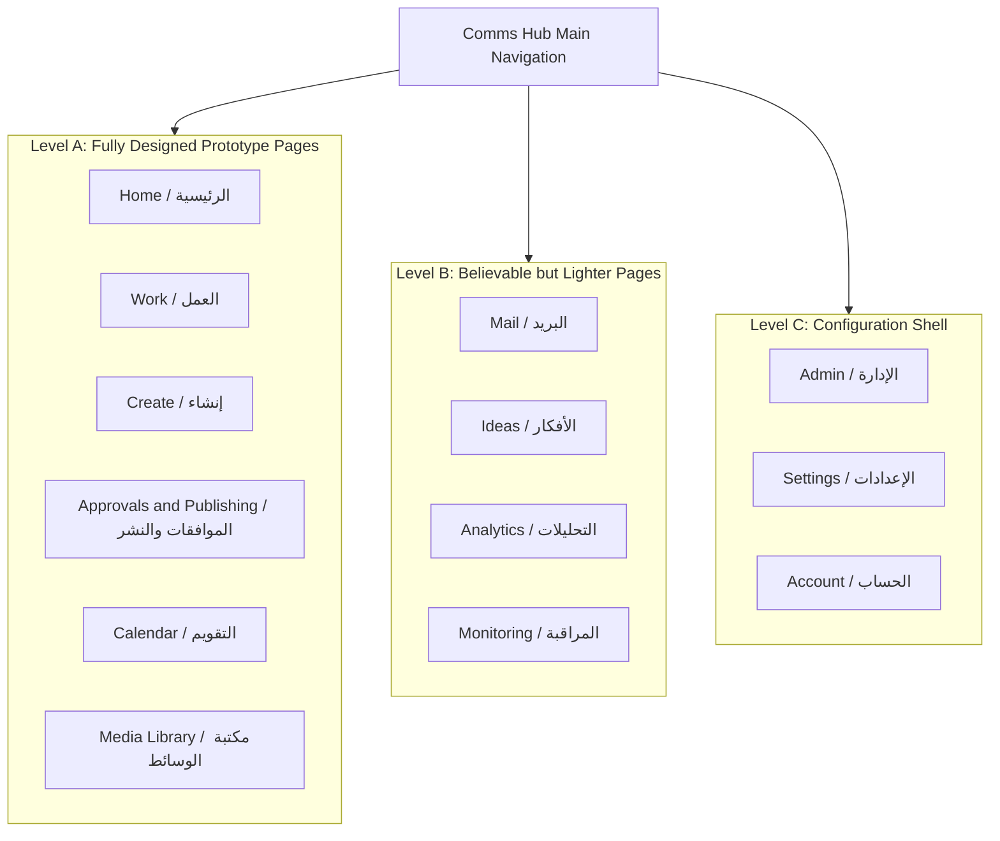
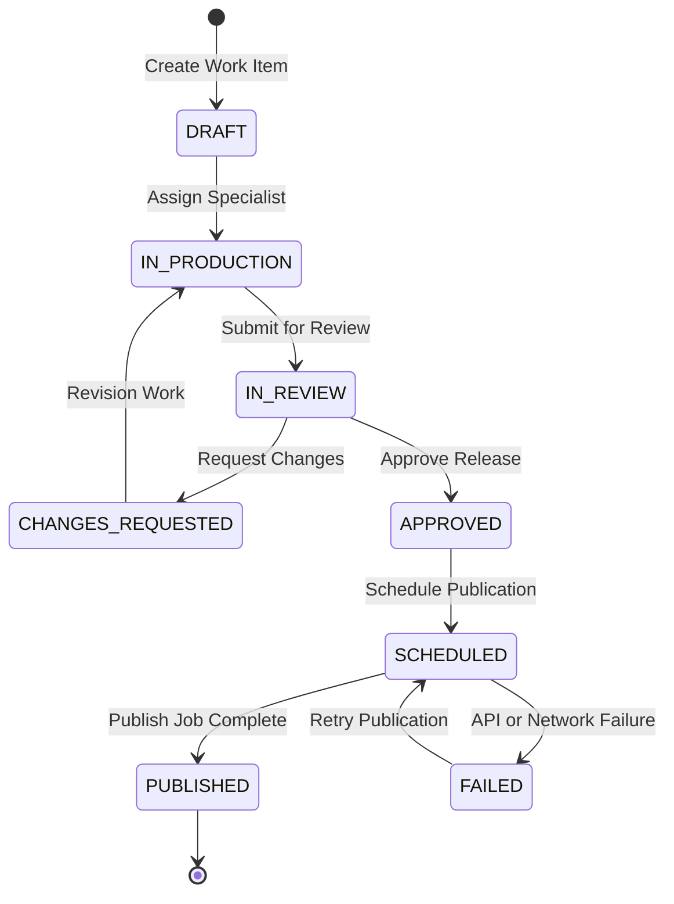
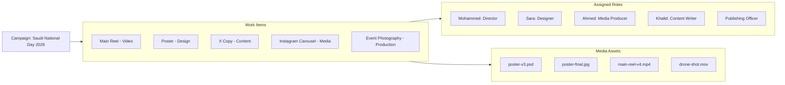
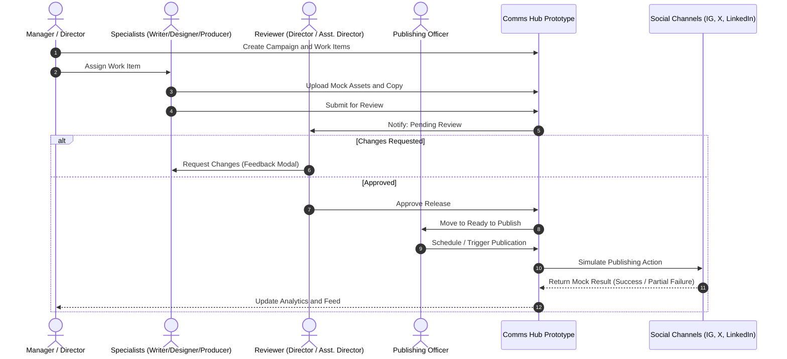
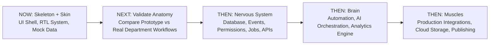

[[projects/ideas/Comms_Hub/Comms Hub|Comms Hub Overview]] | [[Original_Idea|Original Concept]] | [[discussions_list|Discussions Index]]

---

# Comms Hub — MVP UI Shell Draft

> [!note] Status: Prototype MVP draft — UI/UX only
> **Status: Prototype MVP draft — UI/UX only**
>
> This document defines the first MVP as the **skeleton and skin** of the Communication Hub.
>
> It intentionally excludes the real backend logic, database, integrations, automation, authentication enforcement, and external services.
>
> The goal is to validate the product structure, pages, navigation, workflows, role experiences, terminology, and responsive UI before building the system’s “nervous system” and “brain.”

---


## Structure Tree & Document Map

- [[#Comms Hub — MVP UI Shell Draft|Overview & Prototype Scope]]
- **Part I: Strategic Foundations & Boundaries**
  - [[#1. Goal of This MVP|1. Goal of This MVP]]
  - [[#2. MVP Definition|2. MVP Definition]]
  - [[#3. Explicitly Out of Scope|3. Explicitly Out of Scope]]
  - [[#4. Mock Data|4. Mock Data]]
  - [[#5. Prototype “View As” Role Switcher|5. Prototype “View As” Role Switcher]]
- **Part II: User Experience Shell & Roles**
  - [[#6. Role-Specific Home Experience|6. Role-Specific Home Experience]]
  - [[#7. Main Information Architecture|7. Main Information Architecture]]
  - [[#8. Page Priority|8. Page Priority]]
  - [[#9. Main Application Shell|9. Main Application Shell]]
  - [[#10. Visual Direction|10. Visual Direction]]
  - [[#11. Sidebar|11. Sidebar]]
  - [[#12. Global Top Bar|12. Global Top Bar]]
- **Part III: Core Operational Screens**
  - [[#13. Home Page|13. Home Page]]
  - [[#14. Specialist Home|14. Specialist Home]]
  - [[#15. Work Page|15. Work Page]]
  - [[#16. Work List|16. Work List]]
  - [[#17. Work Item Detail|17. Work Item Detail]]
  - [[#18. Create Page|18. Create Page]]
  - [[#19. Social Post Form|19. Social Post Form]]
  - [[#20. Platform Variants|20. Platform Variants]]
  - [[#21. Media Attachment UI|21. Media Attachment UI]]
- **Part IV: Approval, Publishing & Operations**
  - [[#22. Approvals / Publishing Page|22. Approvals / Publishing Page]]
  - [[#23. Approvals Tab|23. Approvals Tab]]
  - [[#24. Review Screen|24. Review Screen]]
  - [[#25. Publishing Tab|25. Publishing Tab]]
  - [[#26. Mock Publishing Interaction|26. Mock Publishing Interaction]]
  - [[#27. Calendar|27. Calendar]]
  - [[#28. Media Library|28. Media Library]]
  - [[#29. Media Card|29. Media Card]]
  - [[#30. Asset Detail|30. Asset Detail]]
- **Part V: Secondary & Administrative Modules**
  - [[#31. Mail Page|31. Mail Page]]
  - [[#32. Ideas Page|32. Ideas Page]]
  - [[#33. Analytics Page|33. Analytics Page]]
  - [[#34. Monitoring Page|34. Monitoring Page]] (since 2026-10-15 the team panel of «سجل النشاط»)
  - [[#35. Admin Page|35. Admin Page]] (dissolved 2026-10-15 into «الحسابات» and «الإعدادات»)
  - [[#36. Users Page|36. Users Page]]
  - [[#37. Integrations Page|37. Integrations Page]]
  - [[#38. Settings Page|38. Settings Page]] (since 2026-10-15 the system's page only: six tabs)
  - [[#39. Account Page|39. Account Page]] (since 2026-10-15 opened from the name badge; carries the appearance choices)
- **Part VI: Cross-Cutting Interactions & Mobile**
  - [[#40. Notification Center|40. Notification Center]]
  - [[#41. Global Search|41. Global Search]]
  - [[#42. UI States to Prototype|42. UI States to Prototype]]
  - [[#43. Responsive Targets|43. Responsive Targets]]
  - [[#44. Mobile Priorities|44. Mobile Priorities]]
  - [[#45. Mobile Work Item|45. Mobile Work Item]]
  - [[#46. Prototype Interactions|46. Prototype Interactions]]
- **Part VII: Verification Scenario & Standards**
  - [[#47. One Coherent Demo Scenario|47. One Coherent Demo Scenario]]
  - [[#48. Use Real-Looking Arabic Content|48. Use Real-Looking Arabic Content]]
  - [[#49. Keep Clean Internal Status Vocabulary|49. Keep Clean Internal Status Vocabulary]]
  - [[#50. Features Not Worth Deep Prototyping Yet|50. Features Not Worth Deep Prototyping Yet]]
  - [[#51. Provisional End-to-End Demo Workflow|51. Provisional End-to-End Demo Workflow]]
  - [[#52. What Success Looks Like|52. What Success Looks Like]]
  - [[#53. Recommended Prototype MVP 0.1 Boundary|53. Recommended Prototype MVP 0.1 Boundary]]
  - [[#54. Development Sequence|54. Development Sequence]]
  - [[#55. Relationship With Astra Workflow Discovery|55. Relationship With Astra Workflow Discovery]]
  - [[#56. Core MVP Principle|56. Core MVP Principle]]

---

# 1. Goal of This MVP

The purpose is **not** to prove Supabase, Google Drive, social APIs, automation, or publishing.

The purpose is to answer:

> **Does this feel like the correct working environment for the Communication Department?**

The prototype should be realistic enough that the Director, Assistant Director, Writer, Designer, Media Producer, Publishing Officer, Members, and Admin can navigate it and give meaningful feedback.

The prototype should help us discover:

- Which pages matter
- Which pages are unnecessary
- Which workflows feel natural
- Which actions take too many clicks
- Which terminology is wrong
- Which roles need different views
- Which information belongs together
- Which screens need to work better on mobile
- Whether the approval and publishing experiences make sense
- Whether the Work page matches real department operations

---

# 2. MVP Definition

This MVP is a **high-fidelity operational prototype**.

It contains:

```text
Pages
Navigation
Layouts
Cards
Tables
Forms
Modals
Drawers
Tabs
Filters
Search UI
Empty states
Loading states
Error states
Status chips
Role-specific UI
Mobile layouts
Mock notifications
Mock files
Mock tasks
Mock approvals
Mock campaigns
Mock publishing
Mock analytics
```

Buttons should work visually.

Example:

```text
[Create Task]
```

opens a realistic modal.

The user can fill it out and click:

```text
[Create]
```

and the mock task may appear in the UI.

But the prototype does not need permanent data storage.

A refresh may reset the mock state.

---

# 3. Explicitly Out of Scope

> [!important] Scope Enforcement & Deferred Systems
> See architectural context in [[disscussios/security_discussion|Security Architecture]] and [[disscussios/First_idea_darft|First Idea Draft]].

The prototype must **not** accidentally become a backend implementation project.

The following are explicitly excluded:

```text
NO Supabase

NO Vercel production integration

NO Google Drive API

NO real authentication

NO real authorization enforcement

NO production database

NO social-media APIs

NO real publishing

NO real email sending/receiving

NO background workers

NO real automation engine

NO real AI API

NO OAuth

NO secret storage

NO NAS integration

NO production analytics

NO real push/email notifications

NO backup system

NO disaster-recovery implementation
```

All of these may be simulated visually where useful.

---

# 4. Mock Data

The prototype should use static/mock data for concepts such as:

```text
Users
Campaigns
Tasks
Assets
Approvals
Publications
Notifications
Integrations
Analytics
```

Example users:

```text
Mohammed
Role:
مدير الاتصال المؤسسي

Ahmed
Role:
المنتج الإعلامي

Sara
Role:
المصمم

Khalid
Role:
كاتب المحتوى
```

Example campaign:

```text
Saudi National Day 2026

Status:
Active

Progress:
72%

Team:
5 members

Content:
8 pieces

Pending approvals:
2
```

---

# 5. Prototype “View As” Role Switcher

> [!tip] Role Architecture
> Complete role models, permissions, and operational duties are defined in [[disscussios/organizational_role_discussion|Organizational Role Discussion]].

A development-only role switcher should allow the prototype to show different role experiences.

Example:

```text
VIEW AS

[مدير الاتصال المؤسسي ▼]
```

Options:

```text
مدير الاتصال المؤسسي
مساعد مدير الاتصال المؤسسي
كاتب المحتوى
المصمم
المنتج الإعلامي
مسؤول النشر وإدارة الحسابات
عضو
Admin
```

This is not real authorization.

It is a prototype tool for answering:

> What should this role see and prioritize?

---

# 6. Role-Specific Home Experience

## Director

Home should emphasize:

```text
Pending approvals
Department workload
Today's publishing
Needs Attention
Campaign status
```

## Assistant Director

Home should emphasize:

```text
Operational queue
Approvals
Assignments
Workload
Upcoming deadlines
```

## Content Writer

Home should emphasize:

```text
Copy tasks
Requested revisions
Upcoming deadlines
Awaiting review
```

## Designer

Home should emphasize:

```text
Design tasks
Requested revisions
Assets awaiting review
Upcoming deadlines
```

## Media Producer

Home should emphasize:

```text
Production tasks
Uploads
Media processing
Deadlines
Review status
```

## Publishing Officer

Home should emphasize:

```text
Ready to publish
Scheduled today
Publishing failures
Connected account health
```

## Member

Home should emphasize:

```text
Assigned work
Deadlines
Comments
Calendar
```

## Admin

Home should emphasize:

```text
System health
Users
Integration health
Storage
Security events
```

---

# 7. Main Information Architecture

The prototype should keep the current navigation structure:

```text
Home

Work

Create

Approvals / Publishing

Calendar

Mail

Media Library

Ideas

Analytics

Monitoring

────────────────

Admin

Settings

Account
```

Not every page needs equal depth in this first prototype.

---

# 8. Page Priority

## Level A — Fully Designed Prototype Pages

These are the core of the MVP:

```text
Home
Work
Create
Approvals / Publishing
Calendar
Media Library
```

These should feel genuinely usable.

## Level B — Believable but Lighter

```text
Mail
Ideas
Analytics
Monitoring
```

These should look complete enough to test layout and workflow assumptions.

## Level C — Configuration Shell

```text
Admin
Settings
Account
```

These only need enough UI to establish structure and future configuration direction.

### Information Architecture & Priority Map



---


# 9. Main Application Shell

Desktop structure:

```text
┌─────────────────────────────────────────────────────────┐
│ Top Bar                                                 │
│ Search        Notifications       Help        User      │
├─────────────┬───────────────────────────────────────────┤
│             │                                           │
│ Sidebar     │                                           │
│             │              PAGE CONTENT                 │
│ Home        │                                           │
│ Work        │                                           │
│ Create      │                                           │
│ Approvals   │                                           │
│ Calendar    │                                           │
│ Mail        │                                           │
│ Media       │                                           │
│ Ideas       │                                           │
│ Analytics   │                                           │
│ Monitoring  │                                           │
│             │                                           │
│ Admin       │                                           │
│ Settings    │                                           │
│ Account     │                                           │
└─────────────┴───────────────────────────────────────────┘
```

The prototype should be **RTL-first**.

Arabic should be the primary UI direction.

The component system should still be designed so English/LTR can be supported later.

### Shell Architecture & Responsive Diagram

```mermaid
flowchart TB
    subgraph Viewport [Desktop Application Shell - RTL Direction]
        TopBar[Top Bar: Global Search | Quick Create | Notifications | Profile]
        
        subgraph MainBody [Main Workspace Layout]
            Sidebar[Sidebar Navigation: Home, Work, Create, Approvals, Calendar, Mail, Media, Ideas, Analytics, Monitoring, Admin, Settings, Account]
            ContentArea[Page Content Viewport]
            DrawersModals[Contextual Drawers and Modals: Work Item Details, Asset View, Creation Forms]
        end
        
        TopBar --- MainBody
        Sidebar --- ContentArea
        ContentArea -.-> DrawersModals
    end
```

> [!note] Technical Framework References
> - [Next.js App Router Documentation](https://nextjs.org/docs)
> - [Tailwind CSS Direction & RTL Guide](https://tailwindcss.com/docs/hover-focus-and-other-states#rtl-support)
> - [Radix UI Accessible Primitives](https://www.radix-ui.com/primitives)
> - [Lucide Icons Library](https://lucide.dev/icons)
> - [Mermaid.js Documentation](https://mermaid.js.org/)

---


# 10. Visual Direction

The target feel should be:

> **Professional operational dashboard for a Communication Department**

Characteristics:

```text
Light background
White cards
Soft borders
Moderate corner radius
Green primary accent
Clear status colors
Strong Arabic typography
Comfortable whitespace
Dense enough for real work
Modern but restrained
```

The UI should feel:

```text
Official
Calm
Efficient
Modern
Professional
Saudi organizational software
```

Avoid:

```text
Gaming aesthetics
Overly futuristic styling
AI-first visual identity
Excessive animation
Social-media-app styling
Extreme minimalism
```

---

# 11. Sidebar

Potential Arabic navigation:

```text
الرئيسية

العمل
إنشاء
الموافقات والنشر
التقويم
البريد
مكتبة الوسائط
الأفكار
التحليلات
المراقبة

────────────────

الإدارة
الإعدادات
الحساب
```

**Amendment of 2026-10-15** (owner directive after the health check, `progress.md`, `Action_Plan.md`
Part B). The list above is the first sketch; the sidebar is now: الرئيسية، العمل، إنشاء،
الموافقات والنشر، التقويم، المشاريع، الطلبات، مكتبة الوسائط، المهام، سجل النشاط، استوديو الحركة،
البريد، «حسابات المنصات»، الأفكار، التحليلات، الحسابات، الإعدادات. «المراقبة» لم تعد صفحة: صارت لوحة «الفريق» في «سجل النشاط» (`/monitoring` يفتح السجل) لمن يرى السجل كاملاً.
«الإعدادات» is the system's page only (six tabs); the appearance choices are on «الحساب».
«الإدارة» no longer exists (`/admin` opens «الحسابات»). «الحساب» is opened from the name badge at
the foot of the sidebar. «التحليلات» is back in the menu since 2026-10-15, reading the database (flow of work, review, platforms; publishing numbers are the simulation's). The component gallery page was removed with the prototype's sample model. «الحسابات المرتبطة»
is called «حسابات المنصات». Each person sees only the pages their role, page grants and capabilities
allow (`src/lib/access.ts`).

### Access by role (generated 2026-10-15, `Action_Plan.md` B4)

What a new account of each role sees and may open, computed from `src/lib/access.ts` and the
capability templates by `qa/access-matrix.mjs` (result in `qa/access-matrix.json`) and held by
`tests/access-matrix.test.mjs`. «نعم» is in the menu and opens; «بالعنوان» opens by address only; «لا» is
refused. It is the default: an account's own page list and grants change it, and inside a page the
database decides which rows come back.

| الصفحة | Admin | مدير الاتصال المؤسسي | مساعد مدير الاتصال المؤسسي | كاتب المحتوى | المصمم | المنتج الإعلامي | مسؤول النشر وإدارة الحسابات | عضو | كيف تُفتح |
|---|---|---|---|---|---|---|---|---|---|
| الرئيسية | نعم | نعم | نعم | نعم | نعم | نعم | نعم | نعم | القائمة |
| العمل | نعم | نعم | نعم | نعم | نعم | نعم | نعم | نعم | القائمة |
| إنشاء | بالعنوان | نعم | نعم | نعم | لا | نعم | لا | لا | القائمة |
| الموافقات والنشر | نعم | نعم | نعم | نعم | نعم | نعم | نعم | نعم | القائمة |
| التقويم | نعم | نعم | نعم | نعم | نعم | نعم | نعم | نعم | القائمة |
| المشاريع | نعم | نعم | نعم | نعم | نعم | نعم | نعم | نعم | القائمة |
| الطلبات | نعم | نعم | نعم | نعم | نعم | نعم | نعم | نعم | القائمة |
| مكتبة الوسائط | نعم | نعم | نعم | نعم | نعم | نعم | نعم | نعم | القائمة |
| المهام | نعم | نعم | نعم | نعم | نعم | نعم | نعم | نعم | القائمة |
| سجل النشاط | نعم | نعم | نعم | نعم | نعم | نعم | نعم | نعم | القائمة |
| التحليلات | نعم | نعم | نعم | نعم | نعم | نعم | نعم | نعم | القائمة |
| استوديو الحركة | نعم | نعم | نعم | نعم | نعم | نعم | نعم | نعم | القائمة |
| البريد | نعم | نعم | نعم | نعم | نعم | نعم | نعم | نعم | القائمة |
| حسابات المنصات | نعم | نعم | نعم | لا | لا | لا | نعم | لا | القائمة |
| الأفكار | نعم | نعم | نعم | نعم | نعم | نعم | نعم | نعم | القائمة |
| الحسابات | نعم | نعم | نعم | لا | لا | لا | لا | لا | القائمة |
| الإعدادات | نعم | نعم | لا | لا | لا | لا | لا | لا | القائمة |
| الاستوديو | نعم | نعم | لا | لا | لا | لا | لا | لا | تبويب في «استوديو الحركة» |
| الحساب | نعم | نعم | نعم | نعم | نعم | نعم | نعم | نعم | الاسم أسفل القائمة |
| المراقبة | - | - | - | - | - | - | - | - | يفتح «سجل النشاط» |
| الإدارة | - | - | - | - | - | - | - | - | يفتح «الحسابات» |

Reading it:

- **What differs by role, by default, is small:** «إنشاء» (the director, the assistant, the writer and the
  producer; the designer and the member are given it, section 70; never the publisher, and not offered to the
  administrator), «حسابات المنصات» (administrator, director, assistant, publisher; with «الموافقات والنشر»),
  «الحسابات» (the administrator, the director and the assistant, by the capability «فتح صفحة الحسابات»
  their templates carry since Step P2; the table of 2026-10-15 first listed it for the administrator
  alone because the interface's mirror of the templates was out of date: corrected the same day), and what
  «سجل النشاط» shows (the whole log and the team panel for the administrator and the director, by the
  capability «عرض سجل النشاط كاملاً», which either can give to anyone, section 66; everyone else sees their own
  actions and the files they reach).
- **«الإعدادات» is the administrator's and the Director's by default** (decisions of 2026-10-15, B4b and
  B9). The Director opens it because the template carries «settings.view», «settings.manage»,
  «platforms.manage», «integrations.secrets», «storage.manage» and «whatsapp.system.manage»: the Director
  connects the platforms, the mail, Drive and the WhatsApp bridge from the site (tab «الاتصالات», tab
  «المنصات», tab «واتساب النظام»). Another person has the page only with the page grant, or by holding
  «settings.view» or «settings.manage». The assistant has none of these. Backups and moving files stay
  the administrator's (`backups.*`, `storage.migrate`).
- **An administrator viewing as a role** (`عرض بصفة`) still opens every page; only «إنشاء» and «الحسابات»
  follow the viewed role (leaders see «الحسابات», the publisher does not see «إنشاء»).
- **«الاستوديو»** (`/motion/studio`, section 62) is a tab of «استوديو الحركة», the Admin's and the director's only
  (fixed capability `motion.studio`, owner decision of 2026-10-19), together with the page of «استوديو الحركة». An
  administrator viewing as another role sees the tab only as the Admin or the director; the address still opens.
- **The member and the designer start without «إنشاء»** (decision of 2026-11-02, section 70, replacing B4b of
  2026-10-15): the capability `page.create` can be given to them, as a role or one by one; the publisher
  stays without it.

Selected state:

```text
green accent
light tinted background
clear icon
```

Desktop may support a collapsed icon-only mode.

Mobile can use:

```text
Bottom Navigation
+
More Drawer
```

---

# 12. Global Top Bar

Suggested items:

```text
Global Search

Quick Create [+]

Notifications

Needs Attention indicator

Profile
```

Example:

```text
[ ابحث في مركز الاتصال... ]

                         [+ إنشاء]
                         [الإشعارات 3]
                         [محمد ▼]
```

Prototype search can operate entirely on mock data.

---

# 13. Home Page

The Home page should answer:

> **What matters to me right now?**

It should not try to show every metric.

## Director Example

Header:

```text
صباح الخير، محمد
الخميس، 18 سبتمبر
```

KPI cards:

```text
بانتظار الموافقة      4
متأخر                  3
مجدول اليوم            6
يحتاج انتباه           2
```

### Needs Attention

Example items:

```text
LinkedIn needs reconnection
National Day Reel awaiting approval
Video task overdue
```

### Today's Work

```text
11:00  Event photography
14:30  Review campaign
18:00  Instagram publication
```

### Approval Queue

```text
National Day Reel
Sara
18 min ago

Event Poster
Ahmed
1h ago
```

### Active Campaigns

```text
National Day
72%

Volunteer Campaign
46%

Annual Report
89%
```

---

# 14. Specialist Home

A specialist homepage may show:

```text
MY WORK

Due today               3
Changes requested       1
Awaiting review         2
Completed this week     6
```

Then sections such as:

```text
My Tasks
Recent Comments
Upcoming Deadlines
```

Avoid management-heavy dashboards for specialist roles.

---

# 15. Work Page

This should be one of the strongest screens in the prototype.

Header:

```text
العمل

[+ مهمة جديدة]
[+ حملة]
```

Possible tabs:

```text
الكل
مهامي
الحملات
طلبات
متأخر
مكتمل
```

Views:

```text
List
Board
```

Timeline can be postponed.

---

# 16. Work List

Columns:

```text
Title
Type
Campaign
Owner / Assignee
Status
Priority
Due Date
```

Example:

```text
National Day Main Reel

Video

National Day Campaign

Ahmed

In Production

High

22 Sep
```

Clicking a row should open a Work Item detail drawer/page.

---

# 17. Work Item Detail

Example header:

```text
National Day Main Reel

VIDEO

IN PRODUCTION
```

Information:

```text
Campaign
National Day 2026

Due
22 Sep

Priority
High

Owner
Ahmed — Media Producer
```

Participants:

```text
Ahmed       Media Producer
Sara        Designer
Khalid      Content Writer
```

Tabs:

```text
Overview
Files
Comments
Activity
Approval
```

Mock production checklist:

```text
Script              ✓
Filming             ✓
Editing             In progress
Graphics            Waiting
Final review        Waiting
```

Buttons:

```text
[Add File]
[Comment]
[Submit for Review]
```

### Work Item Lifecycle State Diagram



---


# 18. Create Page

The Create page should begin by asking:

> **What are we creating?**

Possible creation types:

```text
Social Post
Video
Design
Announcement
Email
Press Release
Event Coverage
```

Selecting a type changes the form.

---

# 19. Social Post Form

Possible fields:

```text
Title

Campaign

Main Content

Platforms
☑ Instagram
☑ X
☑ LinkedIn

Media

Schedule

[Save Draft]
[Submit for Review]
```

---

# 20. Platform Variants

Tabs:

```text
MASTER
Instagram
X
LinkedIn
```

Example:

```text
MASTER
Main Arabic copy
```

Then:

```text
X
Shortened platform variant
```

A future AI button may already be placed:

```text
[اقتراح بالذكاء الاصطناعي]
```

In this MVP it may:

```text
show a mock result
```

or:

```text
show “Coming later”
```

The goal is to test placement and workflow.

---

# 21. Media Attachment UI

Prototype interaction:

```text
Drag files here

or

[Browse Files]
```

Mock results:

```text
national-day-image.jpg
2.8 MB

national-day-video.mp4
1.4 GB
```

Actions:

```text
Preview
Remove
Replace
```

No real cloud upload is required.

---

# 22. Approvals / Publishing Page

> [!note] Policy Reference
> See comprehensive approval criteria and multi-stage sign-off rules in [[disscussios/approval_policy_design|Approval Policy Design]].

Use two major tabs initially:

```text
الموافقات
النشر
```

Approval and publishing remain different concepts but are closely related enough to share a page in the prototype.

---

# 23. Approvals Tab

Possible sections:

```text
Needs My Review
Submitted by Me
Completed
```

Example card:

```text
National Day Reel

Submitted by:
Ahmed

Campaign:
National Day

Channels:
Instagram
X
LinkedIn

Submitted:
18 min ago

[Review]
```

---

# 24. Review Screen

Header:

```text
YOU ARE REVIEWING

National Day Reel
Release 4
```

Display:

```text
Copy
Media
Channel variants
Schedule
Destinations
Previous revisions
Comments
```

Actions:

```text
[Request Changes]
[Reject]
[Approve]
```

Mock Request Changes modal:

```text
Reason:
___________________

[Send]
```

---

# 25. Publishing Tab

Sections:

```text
Ready to Publish
Scheduled
Published
Failed
```

Example:

```text
National Day Reel

Approved ✓

Instagram
X
LinkedIn

Scheduled:
23 Sep — 18:00

[View]
```

Another:

```text
Volunteer Story

Approved ✓

No schedule

[Publish]
[Schedule]
```

---

# 26. Mock Publishing Interaction

Click:

```text
[Publish]
```

Show confirmation:

```text
CONFIRM PUBLICATION

Instagram @organization
X @organization

[Cancel]
[Confirm]
```

Then simulate:

```text
Publishing...
```

followed by:

```text
Instagram ✓
X ✓
LinkedIn ✕
```

This lets us test partial-failure UX before APIs exist.

> [!warning] Asynchronous Queue & Failure Handling
> Background failure recovery, retry policies, and worker queues are analyzed in [[disscussios/failure_handling_background_jobs|Failure Handling Background Jobs]].

---


# 27. Calendar

Views:

```text
Month
Week
Day
```

Filters:

```text
Tasks
Publications
Campaigns
Events
Deadlines
```

Example entries:

```text
18:00
Instagram Post

14:00
Video Deadline

10:00
Event Coverage
```

Clicking an entry opens a detail drawer.

A date-level create action may offer:

```text
Create:
Task
Event
Publication
Reminder
```

---

# 28. Media Library

Header:

```text
مكتبة الوسائط

[Upload]

Search...

Filters
```

Tabs:

```text
All
Images
Videos
Documents
Design
Archived
```

Views:

```text
Grid
List
```

---

# 29. Media Card

Example:

```text
[Thumbnail]

National Day Hero Image

IMAGE

National Day Campaign

v5

Approved
```

Clicking opens the asset detail view.

---

# 30. Asset Detail

Example:

```text
National Day Hero Image

[large preview]

Current Version:
v5

Approved Version:
v5
```

Metadata:

```text
Campaign
National Day

Created by
Sara

Type
Image

Status
Approved
```

Sections:

```text
Versions
Used In
Comments
Activity
```

Storage placeholder:

```text
Cloud
Available
```

Later this can be backed by Google Drive, Supabase Storage, or NAS.

> [!note] Storage Architecture
> See storage tiers, quotas, and NAS/Cloud replication details in [[disscussios/storage_lifecycle_disaster_recovery|Storage Lifecycle & Disaster Recovery]].

---


# 31. Mail Page

The MVP does not need real email.

Prototype layout:

```text
Inbox
Sent
Assigned
Waiting
Archived
```

Message list on one side.

Thread/conversation on the other.

Example:

```text
Subject:
Media coverage request

From:
Department X

[Reply]
[Assign]
[Create Work Item]
```

The important workflow interaction is:

```text
[Create Work Item]
```

which opens a mock Work Item creation modal.

---

# 32. Ideas Page

Simple cards:

```text
Idea title
Author
Tags
Related campaign
Status
```

Actions:

```text
[+ New Idea]
[Turn into Campaign]
[Turn into Work Item]
```

Visual transitions only.

---

# 33. Analytics Page

Use mock data only.

Example:

```text
Last 30 Days

Posts Published        28
Total Reach            142K
Engagement             8.3K
Top Platform           Instagram
```

Sections:

```text
Content Performance
Campaign Performance
Platform Performance
```

The goal is to discover what metrics management actually wants.

---

# 34. Monitoring Page

Monitoring should focus on workflow and workload, not surveillance.

Example:

```text
TEAM WORKLOAD

Ahmed
4 active
1 overdue

Sara
3 active
0 overdue

Khalid
5 active
2 awaiting review
```

Workflow summary:

```text
Awaiting Review       5
Changes Requested     3
Scheduled             6
Overdue               4
```

Avoid:

```text
productivity score
mouse movement
screen surveillance
```

---

# 35. Admin Page

Prototype sections:

```text
Users
Roles & Permissions
Integrations
System Health
Storage
Security
Automation
Notification Policy
```

Only UI shells are needed.

---

# 36. Users Page

Example:

```text
Ahmed
Media Producer
Active

Sara
Designer
Active

Mohammed
Director
Active
```

User detail may show:

```text
Role
Status
Campaign access
Additional permissions
```

No real enforcement yet.

---

# 37. Integrations Page

Mock cards:

```text
Instagram
Connected

X
Connected

LinkedIn
Reconnect Required

Google Drive
Not Configured

Mail
Connected

NAS
Not Configured
```

Clicking:

```text
[Connect]
```

opens a mock connection flow.

> [!note] Secret Management & OAuth Architecture
> Token refreshing, scopes, and credential isolation are detailed in [[disscussios/connected_account_secrets_management|Connected Account Secrets Management]].

---


# 38. Settings Page

Possible sections:

```text
Organization
Appearance
Language
Notifications
Publishing Defaults
Approval Defaults
AI & Automation
Storage
```

Visual configuration only.

---

# 39. Account Page

Possible sections:

```text
Profile

Name
Role
Email
Language

Notification preferences

Active sessions
```

Sessions are mock data.

---

# 40. Notification Center

> [!note] Notification Framework
> Category definitions, mute rules, and channel routing are outlined in [[disscussios/notification_model|Notification Model]].

Use the notification model already discussed.

Tabs:

```text
All
Actions
Attention
Mentions
```

Examples:

```text
ACTION
National Day Reel needs your approval

ATTENTION
LinkedIn requires reconnection

MENTION
Sara mentioned you

INFO
Publication completed
```

Clicking should deep-link to the relevant mock screen.

---

# 41. Global Search

Search can operate entirely on the mock dataset.

Example:

```text
national day
```

Results:

```text
Campaign
National Day 2026

Work
National Day Reel

Asset
National Day Hero Image

Publication
National Day Instagram Post
```

This allows search UX to be validated before building a real search index.

> [!note] Metadata Taxonomy & Indexing
> Entity search queries, tagging hierarchies, and filtering schemas are documented in [[disscussios/search_and_metadata|Search and Metadata]].

---


# 42. UI States to Prototype

Important components should include:

```text
Normal
Hover
Selected
Disabled
Loading
Empty
Success
Warning
Error
Needs Attention
```

Examples:

```text
No tasks yet

No approvals waiting

Upload processing...

Publishing failed

Integration disconnected

Search returned no results
```

The MVP should not show only perfect/happy-path states.

---

# 43. Responsive Targets

The design should deliberately support at least:

```text
Desktop
1440 px

Laptop
1280 px

Tablet
768–1024 px

Mobile
~390 px
```

The goal is to establish a reliable responsive system, not optimize for every possible device immediately.

---

# 44. Mobile Priorities

Primary mobile navigation:

```text
Home
My Work
Create
Calendar
Notifications
```

Then:

```text
More
```

opens:

```text
Approvals
Mail
Media
Analytics
Settings
```

Role-specific priorities may alter this.

---

# 45. Mobile Work Item

Avoid squeezing desktop tables into a phone.

Example card:

```text
National Day Reel
VIDEO

In Production

Due:
22 Sep

Owner:
Ahmed

[Open]
```

Mobile should rely heavily on cards, drawers, and focused actions.

---

# 46. Prototype Interactions

The following should work visually:

```text
Navigate between pages
Open/close sidebar
Open drawers
Open modals
Switch tabs
Switch list/grid
Search mock data
Filter mock data
Change View As role
Toggle mock settings
Add mock task
Edit mock task
Submit mock approval
Approve/reject mock release
Schedule mock publication
Show simulated publish result
Show notifications
Preview mock assets
Responsive navigation
```

Client-side state is enough.

No persistence is required.

---

# 47. One Coherent Demo Scenario

The prototype should contain one polished, realistic campaign that connects multiple pages.

Recommended example:

```text
Saudi National Day 2026
```

Campaign:

```text
Saudi National Day 2026
```

Work Items:

```text
Main Reel
Poster
X Copy
Instagram Carousel
Event Photography
```

Participants:

```text
Content Writer
Designer
Media Producer
Publishing Officer
Assistant Manager
Director
```

Assets:

```text
poster-v3.psd
poster-final.jpg
main-reel-v4.mp4
drone-shot.mov
```

Approval:

```text
Main Reel awaiting review
```

Calendar:

```text
23 Sep
18:00 publish
```

Analytics:

```text
Older mock publication data
```

Everything should tell one coherent story.

### Saudi National Day 2026 Demo Topology



---


# 48. Use Real-Looking Arabic Content

Avoid placeholder text such as:

```text
Lorem ipsum
Task 1
Campaign test
User A
```

Use believable Arabic departmental data.

Example:

```text
الحملة:
اليوم الوطني السعودي

المهمة:
إعداد الفيديو الرئيسي

الحالة:
قيد الإنتاج

الموعد:
22 سبتمبر
```

This will produce much better feedback from real users.

---

# 49. Keep Clean Internal Status Vocabulary

User-facing Arabic:

```text
قيد المراجعة
```

Internal mock state:

```text
IN_REVIEW
```

User-facing:

```text
بحاجة إلى تعديل
```

Internal:

```text
CHANGES_REQUESTED
```

This makes future backend implementation cleaner.

---

# 50. Features Not Worth Deep Prototyping Yet

Do not spend much time on:

```text
Complex automation builder
Advanced disaster-recovery UI
Detailed secret-management UI
Incident simulation platform
Semantic AI search
NAS administration
Full analytics suite
Advanced employee monitoring
Custom workflow designer
Complex taxonomy administration
```

These have already been discussed conceptually and can be implemented later.

> [!note] Emergency Protocol Handling
> Kill switches, urgent publishing overrides, and crisis modes are addressed in [[disscussios/emergency_workflows|Emergency Workflows]].

---


# 51. Provisional End-to-End Demo Workflow

Until Astra completes real workflow mapping, use this provisional flow:

```text
Manager creates campaign
       ↓
Creates Work Item
       ↓
Assigns Writer / Designer / Producer
       ↓
Specialists create mock work
       ↓
Submit for Review
       ↓
Assistant / Director reviews
       ↓
Changes requested OR Approved
       ↓
Publishing Officer sees Ready to Publish
       ↓
Schedules publication
       ↓
Calendar displays it
       ↓
Mock publication result
       ↓
Activity / Analytics update visually
```

Once real workflow discovery is complete, this flow should be revised to match actual department practice.

### End-to-End Workflow Sequence Diagram



---


# 52. What Success Looks Like

The prototype succeeds when it can be placed in front of actual department users and they can:

> **Pretend this is the real system and show how they would do their job.**

The prototype should reveal:

```text
Which pages matter?
Which do not?
What terminology feels wrong?
Which roles need different experiences?
Which actions are missing?
What takes too many clicks?
What information belongs together?
Does mobile work?
Does approval feel natural?
Does Work match the department?
Does Create match real content creation?
Does Publishing expose the right information?
```

The main output of the MVP is **validated product knowledge**.

---

# 53. Recommended Prototype MVP 0.1 Boundary

```text
Application shell
RTL design system
Responsive navigation

Home
Work
Create
Approvals / Publishing
Calendar
Media Library

Light versions:
Mail
Ideas
Analytics
Monitoring
Admin
Settings
Account

Mock role switcher
Mock data
One coherent demo campaign
Client-side interactions only
No persistence
No external integrations
```

---

# 54. Development Sequence

The recommended sequence is:

```text
NOW
Skeleton + Skin

NEXT
Validate anatomy against real workflows

THEN
Nervous System
Database / events / permissions / jobs / APIs

THEN
Brain
Automation / AI / analytics

THEN
Muscles
Real integrations / publishing / storage
```

The MVP should remain intentionally UI-first.

### Development Sequence Flowchart



---


# 55. Relationship With Astra Workflow Discovery

Astra should map real department workflows using the confirmed organizational roles.

Then compare:

```text
Prototype assumed workflow
           VS
Real department workflow
```

The prototype should be revised before backend architecture is frozen.

This prevents the product from encoding theoretical workflows that employees do not actually use.

---

# 56. Core MVP Principle

> **Build enough of the product visually that the department can meaningfully criticize it before we spend time building the backend.**

And:

> **The prototype should look like the future Communication Hub, but it should not pretend that its integrations, security, publishing, automation, storage, or analytics are real yet.**

This document defines the MVP shell only. It is not yet the Version 1 technical specification or implementation roadmap. ^core-mvp-boundary

# 57. Motion studio addition, 2026-10-08 (revised after first review)

User-requested extension to Version 0: add **استوديو الحركة** at `/motion`, next to the media library in the shared navigation. It uses Direction A's Arabic RTL shell, tokens and controls, with Direction B's larger preview treatment. The first integration was reviewed the same day and revised; this section describes the revised scope.

**Inventory.** Twenty-six templates: eight number animations, eight Repine lower-thirds and ten video frames. Sixteen come from `motion_design/numbers-library` and are preserved; ten are Hub additions. Four additions are new (المخطوطة, الهلال المضيء, أبواب المشربية, طيف التلاوة) and six replace the first integration's basic versions with full designs (مقياس الأثر, محطات الإنجاز, الشريط التحريري, مدار الهوية, بوابة الأثر, إطار التغطية). Badges: "جديد" and "مُحدَّث".

**Layout.** Operate mode, one workbench: category tabs, a horizontal template rail with live thumbnails, then the preview stage beside a tabbed settings panel, then the download panel. The settings panel stays in view while the page scrolls. At 1000px and below the panel moves under the stage. The stage is dark with a checkerboard only where transparency is being shown.

**Preview.**
- Transport: play/pause, restart, loop, scrubber, readout. A strip under the scrubber shows the proportional lengths of entry, showcase and exit.
- Numbers and Repine: backdrop choice (scene, transparent, dark, light). Frames: what shows in the window (sample footage, the user's own clip loaded locally for preview only, key green, transparent) and Reels safe zones at 9:16. The backdrop and clip are never part of an export.
- Frames: ratio chooser (9:16, 4:5, 1:1, 16:9) with a glyph of the true shape, and the explicit output width and height at 1080p.
- Starts playing on selection unless the user prefers reduced motion; then it starts paused with idle motion and particles off.

**Settings (restored from the source library).**
- Content: text per design, number value (slider and exact box), contact and social details revealed by their own switches.
- Colors: per-design pickers with Arabic names; restore original colors.
- Elements (frames): logo, verse, waveform, particles, background fade.
- Timing: entry, showcase (up to 180 seconds by slider, 900 exact), exit (0 keeps the frame to the end), speed. Numbers: hold and speed.
- Motion (Repine and frames): entry, exit and showcase motion intensity, 0 to 100 percent.
- Edits are kept per design while the page is mounted and reset on refresh.

**Download.** Four formats: MP4 on a key color (WebCodecs; real-time recording when the browser lacks it), transparent MOV (PNG codec), PNG sequence in ZIP, single PNG. Short side 720, 1080 or 4K; 24, 30 or 60 frames per second. PNG frames use a built-in encoder over `CompressionStream`, with four encodes in flight. The panel states output size, duration, frames and an approximate file size, warns about heavy files, refuses estimates above 1.6 GB, shows progress with time remaining, can be cancelled, and keeps a working save link after completion in case the automatic download is blocked. Nothing is uploaded.

**Boundaries.** Contact defaults are empty and hidden: the source library's numbers belong to another organization. Templates containing the Hedayah logo and verses say so. Chart trajectories and waveform decoration are illustrative. Downloads do not attach to work, enter the media library or publish. Access restrictions, persisted settings, asset upload and storage are deferred; the page is open to every prototype persona and implies no authentication or RBAC.

The immutable architecture records remain unchanged. This addition does not satisfy or bypass the department-validation gate.

# 58. Second design behind a toggle, 2026-10-10

Owner directive: the proposed identity «الهوية الجديدة لمركز الاتصال» (Roadmap Checkpoint 0.3) is available in the prototype as an option, not as a replacement. Direction A (`DESIGN.md`) remains the default.

**Switch.** A double-click on the logo at the top of the sidebar switches between the current design and the second design. A status message confirms the result: «التصميم: الهوية الجديدة لمركز الاتصال» or «التصميم: التصميم الحالي». A single click on the logo still opens Home. The choice is remembered in that browser only and is restored before the page first paints. There is no visible control and no keyboard path; the switch is for comparing the two designs, not a user setting. On phone widths the sidebar, and so the logo, is hidden, so a phone shows whichever design that browser last chose.

**What changes.** Colour tokens, type faces (Reem Kufi for headings, IBM Plex Sans Arabic for text, both served by the app), the emerald-depth sidebar with the lattice texture and a gold marker on the active item, rounder surfaces with soft elevation, pill status chips with a dot, a gold campaign action, and short motion that is off when the user asks for reduced motion.

**What does not change.** Pages, layout, navigation, roles, statuses, Arabic terms, version-bound approval, and the local-simulation boundary. Evening mode, the Aref Ruqaa accent word and the decision screens of Checkpoint 0.3 are not built.

# 59. Round 1 corrections from the Director's response, 2026-10-11

Phase 0.2.3 corrections built on findings of response R01 (`validation/responses/R01-2026-10-10-director.md`), severities confirmed by the owner (D-03). Each subsection names its finding. They apply to both designs.

## 59.1 Scenario date, overdue and due soon (F-R01-02, task 0.2.3.5)

- The prototype has a fixed "today": **Monday 21 September 2026**, two days before the campaign. Every page header states it: «اليوم في النموذج: الاثنين 21 سبتمبر 2026». Dates are never read from the viewer's clock.
- **Overdue (متأخر):** delivery is still outstanding (draft, in production, in review, changes requested or rejected) and the delivery date is before the scenario date. Approved, scheduled and published work is delivered and never counts as overdue.
- **Due soon (قريب الموعد):** outstanding and due today or within two days.
- The Director's and Assistant Director's Home show both counts. Each count is a link to Work filtered to exactly those items.
- Work has a delivery filter (كل المواعيد، متأخر، قريب الموعد). Each row says how late or how close it is, for example «متأخر يومين» or «يستحق غداً».
- The seed now holds eleven work items in a realistic mix: three overdue, three due soon, three on time, plus the approved and scheduled ones.

## 59.2 Named people, team view and load (F-R01-01, F-R01-17, task 0.2.3.6)

- Work is assigned to a **named person**, not to a role. The department in the prototype: محمد (Director), ريم (Assistant Director), خالد and لمى (writers), سارة and فهد (designers), أحمد and ماجد (producers), نورة (Publishing Officer), عبدالله (member). The role still decides authority; "View As" simulates the first person of each role.
- A specialist edits and submits only work assigned to them; leadership may edit any work. «مهامي» shows only the simulated person's work.
- Work states its purpose under the title: «قائمة عمل الفريق: من يعمل على ماذا، وفي أي مرحلة، وما المتأخر، وما ينتظر المراجعة أو الاعتماد». The section name «العمل» is unchanged until terminology item T6 has a verdict.
- Work has three tabs: «الفريق» (team view), «الكل» (list) and «مهامي». Leadership opens on «الفريق», unless arriving from a Home count, which opens the filtered list.
- **Team view:** one card per person, with counts (works, overdue, due soon, awaiting review), then each item with its status, its **stage** and its delivery note. The stage says where the work stands: the next production step, «تعديل بعد المراجعة», «بانتظار المراجعة والاعتماد», «معتمد · بانتظار الجدولة», «مجدول للنشر», and so on.
- **Home for the Director and Assistant Director** shows «حمل الفريق»: active work per person with overdue and awaiting-review counts and a bar, red when the person has late work.
- The Composer's «المسؤول» chooses a person; the role follows from the person.

## 59.3 Stale channel versions (F-R01-05, task 0.2.3.7)

- Each channel version (Instagram, X, LinkedIn) remembers the main text it was written against. When the main text changes afterwards, that version is flagged «تحتاج مراجعة: كُتبت قبل تعديل النص الأساسي».
- The flag shows on the version in the work page, in the release the reviewer sees, and in the release history. In the composer the channel tab reads «X · تحتاج مراجعة» and the main-text tab lists the flagged versions.
- The flag clears when the version is rewritten, or when the writer presses «تأكيد الصياغة» to confirm it is still right. Either change is saved as a new version, like any other edit.
- An empty channel version uses the main text and is never flagged.

## 59.4 Highlighted version difference (F-R01-06, task 0.2.3.8)

- When a version under review has an earlier submitted version, the review screen opens with «ما الذي تغيّر منذ الإصدار N»: the main text with added words highlighted and underlined, removed words struck through, and a list of other changed fields (title, media and its version, channels, each channel version, delivery date, content type), each shown as old struck through, then new.
- The same comparison appears inside each later revision of the release history, so the writer sees what changed between their own versions. The first revision has nothing to compare with and shows none.
- The comparison is by word, so it works for Arabic text. Punctuation stays attached to its word.
- Seed example: «منشور شكر المتطوعين», revision 1 (changes requested) and revision 2 (in review), with new text and the poster moved from v4 to v5.

## 59.5 Early reconnect warning (F-R01-07, task 0.2.3.9)

- Each channel account carries the time its publishing authorization runs out (Riyadh time). In the seed, Instagram is valid until 2 November, X runs out at 12:00 on the campaign day, and LinkedIn has already expired.
- **At scheduling:** as soon as a time is chosen, the scheduling dialog lists every selected channel whose authorization is expired or runs out before that time, with the reason: «تفويض X ينتهي … قبل موعد النشر. أعد ربط الحساب قبل الموعد.» The warning follows the chosen time. Scheduling is still allowed; the confirmation message says what is at risk and the notice is raised as «يحتاج انتباه».
- **Publishing Officer's Home:** a panel «مواعيد معرضة للخطر» lists every scheduled item whose channels will not be authorized at its publication time, with the reason per channel. The publishing package on the approvals page shows the same warning.
- Reconnecting remains a simulation; nothing contacts the channels.

## 59.6 Timestamped video review notes (F-R01-03, task 0.2.3.10)

- A video version under review has «ملاحظات زمنية على الفيديو»: notes bound to a time such as 01:30, listed in time order with the reviewer's name. Notes belong to the asset version they were written on.
- Playback stays deferred, so the time is **typed** in the form minutes:seconds; the panel says so. An invalid time is refused with the expected format.
- Reviewers and the person assigned to the work may add notes. Notes appear on the review screen and on the producer's work page.
- «طلب تعديل» offers the notes on the version under review, all ticked; the reviewer may untick any. The chosen notes are appended to the change request, in time order, under «ملاحظات زمنية», and so reach the producer's comments and the release history.
- Only video work takes these notes.

# 60. Second design: screens and evening mode, 2026-10-11

Extends section 58. Everything here appears only while the second design is on; Direction A is unchanged by it. The switch is the logo: at the top of the sidebar on wider screens, and at the top of the bar on phones, where a double tap switches.

- **Evening mode.** The second design follows the device's dark preference. Text pairs keep at least 4.5 to 1 in both modes. The Motion Studio keeps its own light panels.
- **Accent word.** The name in the Home greeting is written in Aref Ruqaa, in gold: one accent word per page, as the proposal asks.
- **Home.** «قراراتك الآن» lists what waits for this person with a count and direct actions: «اعتماد الإصدار N» (the exact version), «مراجعة», «جدولة» for the Publishing Officer, «فتح» for others. The campaign card gains the **campaign pulse**: five stations (المحتوى، التصميم، المراجعة، الجدولة، النشر), how many works stand at each, the current station and overall progress. Leadership and the Publishing Officer see an attention strip when a scheduled item's channel will not be authorized in time.
- **Approvals.** Above the decision, a note binds it to the exact version: «الاعتماد مرتبط بالإصدار N تحديداً. أي تعديل بعده يُلغيه تلقائياً.» Approving shows the gold **approval stamp** for about two seconds; it does not animate when the user prefers reduced motion.
- **Phone approval sheet.** On phones the decision buttons sit in a bottom sheet fixed above the navigation bar from the first moment, at least 44 px tall, approval on its own row. The page keeps space at its end so the sheet never hides content.
- **Notification tiers.** The notification centre groups by «قرارك», «انتباه», «للعلم», with counts, decisions first (`disscussios/notification_model.md`).
- **Calendar week.** The calendar opens on the week of the scenario date, with a lane per channel (Instagram, X, LinkedIn) and one for internal delivery dates, and a load bar under each day. Dragging a scheduled item to another day, or choosing a new time in its dialog, records a **requested time** only. Requests are listed with the channel risks of the new time and notify the Publishing Officer, who alone confirms («تأكيد النقل»); the Publishing Officer or the requester may cancel. Requests are kept while moving around the app (they reset with the page, like all prototype state). Month and agenda views remain.
- **Motion from the work.** A poster or video work offers «أنشئ حركة» with three suggested templates; the studio opens on the template with the work's title in its title field and names the work it was opened from.
- **Component page.** `/components`, outside the navigation, shows every shared component in each state, for whichever design is on.
- Not built: the command palette (only if the Director wants it).

# 61. «التقويم», «المشاريع» and «الطلبات» on the work-cycle database, 2026-10-13

Step 5 of `Reference_Build_Plan.md`, after «النموذج المرجعي للمركز» version 5 (`reference/comms-hub-reference-v5.html`). These pages read and write the database (`supabase/migrations/*work_cycle*`); every write is a database function, and who sees what is row level security. Publishing stays a simulation, and the calendar says so. This section replaces the calendar of section 60 (a browser mock with a request list that reset with the page), which is removed.

## 61.1 «التقويم» (`/calendar`)

- **Views.** Day, week (Sunday to Saturday, Riyadh time), month, and a two-week list. On a phone the page opens on the list. Previous, today, next; the heading names the range. `?date=`, `?view=` and `?project=` open it on a day, a view or a project.
- **What shows.** Filters for publishing, deliveries, stages, tasks, events, projects and «تذكيراتي», «عملي فقط», and a project. Publishing appears on each account's lane: «مجدول», «معتمد · لم يُجدول», «مقترح · لم يُعتمد بعد», a requested move as «موعد مطلوب» with the held time «معلّق حتى القرار», and «نُشر» with each account's result. The shared mailbox has its own lane, then events, then deliveries, stages, tasks and reminders. A key under the calendar names every colour.
- **Across days.** Project bands across the week (each opens its project) and month stripes; open stages with a start and an end, and tasks with a start, as bars with the person's name (dashed while waiting, red when late). The team's load under each day counts deliveries, stages and tasks, red when one is late.
- **Warnings that do not block.** An account whose authorisation will not cover the time; two works on one account within two hours; a day with seven or more entries («يوم مزدحم»). The lane of an expired or nearly expired account says so under its name.
- **The entry panel.** Opens from any entry: the day and time, the work and its status, each account and whether its authorisation covers the time, and only this role's actions. Escape closes it.
- **Moving.** A publish date is moved by a request («طلب نقل الموعد»), by the leaders, the work's owner or the publisher; only «موعد النشر» goes back to review and the current time is held until the decision. The new date is approved from the panel or «الطلبات» when it is the only part waiting, by a leader who did not ask for it; the asker, a leader or the publisher may withdraw it. Leaders move deliveries and stage dates directly; a stage never ends before an open stage it waits for ends, nor after the delivery, and the delivery never before an open stage ends. Dragging an entry to another day does the same (by mouse or finger); a press that does not move opens the panel.
- **«إضافة» from a day.** A work due that day (or a request, for a member) and an event coverage, both opening «إنشاء» with the date; scheduling an approved work on that day (publisher); a task (one day, days in a row, or chosen days each with its person; leaders and the producer give tasks to others, with the least busy person in the kind's role suggested); an event (leaders); a private reminder. A past day cannot take a new delivery.
- **Tasks** are managed in «المهام»; the panel offers an extension request to the task's person. Everyone but the leaders sees only the tasks given to them or by them.

## 61.2 «المشاريع» (`/projects`)

- A card per project: type, «جارٍ» or «قادم» or «منتهٍ», dates and length, owner, description, progress (done stages and tasks over all), works and how many are late, the next date, and the people on it.
- **«مشروع جديد»** (the director and the assistant): name, type, dates, owner, description, and an optional **works plan**: per work a title, a type and a due date. Each planned work gets its stages from its type, given to the least busy person in each role (counting what the plan itself has given out) and dated back from its due date; its owner is the least busy in the type's main role. A post goes on the active accounts that are not YouTube. The preview under each row shows who and when. The project and all its works are created in one step (`project_create`): if any work is refused, nothing is created. The «مشروع» card in «إنشاء» opens the same dialog.

## 61.3 The project page (`/projects/<id>`)

- Header with type, dates, state, owner, counts and progress; «عمل في المشروع» (opens «إنشاء» linked to it, due its end), «مهمة», and for leaders «حدث» and «تعديل المشروع»; «في التقويم» opens its week filtered to it.
- **الجدول الزمني:** a row per open work (with its delivery and publish marks) and its stages as bars by state, then the project's tasks and events, today as a gold line. **من يعمل على ماذا:** each person's stages and tasks in order, what each waits for and whom it hands over to. **الأعمال:** the works list. **المهام:** the project's tasks, with an extension request for one's own. `?tab=` opens a view.

## 61.4 «الطلبات» (`/requests`)

- Tabs «بانتظار قراري» (with a count), «طلباتي», «المنتهية», «التفويض». `?tab=` opens one.
- **Kinds.** Extension of a stage or a task, with what moves after it computed by the database before the decision and, when the plan would pass the delivery, «مدّ التسليم النهائي أيضاً»; folder access («منح «عرض فقط»»); publish-date moves; work requests without an owner («إسناد»); outside mail held for approval and ask-first publish confirmations, as links to «البريد» and «النشر» where they are decided.
- **Who decides.** Not the sender. A stage extension: the leaders and the work's owner. A task extension: the leaders and the person who gave the task. Folder access: the leaders and whoever manages the folder. The sender withdraws a pending request. A decline takes an optional reason; the sender is told either way.
- **«طلب جديد»:** extension of one of my open stages or tasks, access to a restricted folder that shows in my library, or a new work.
- **Delegation while away** is not built (owner decision of 2026-10-12: it waits for the work on giving the right to approve to other people). Its tab says so.

## 61.5 Home

Home now reads the database: tiles per role (leaders: waiting for review, late, late stages, requests without an owner; publisher: ready, scheduled, waiting for confirmation, partial or failed; makers: active work, ready stages, late, open tasks; member: open requests, waiting for an owner, tasks), each opening the page it counts; the works that need this person; the next seven days from the calendar; the team's load for the leaders; and an attention strip when a scheduled account's authorisation will not cover its time. The sample campaign and its sample work numbers are gone from Home.

## 61.6 Navigation and access

«المشاريع» and «الطلبات» are in the sidebar after «التقويم». They are not separate grants: «المشاريع» opens with «العمل» or «التقويم», and «الطلبات» with «العمل», «مكتبة الوسائط» or «المهام», so existing accounts need no change (`src/lib/access.ts`, tested). Notices about requests open «الطلبات», and about a project its page. Every one of the sixteen pages of the reference now has its guide.

# 62. «الاستوديو»: the studio tab of «استوديو الحركة», 2026-10-19

Owner request and decisions of 2026-10-19; build order in `Studio_Build_Plan.md`. A photo and video studio added as a second tab of «استوديو الحركة». Section 57 still describes the template tab, which is unchanged; the studio is a separate tab and section 57's boundary "downloads do not enter the media library" applies to the template tab only.

**Where and who.**
- «استوديو الحركة» gains a tab bar in its title row: «قوالب الحركة» (`/motion`, section 57) and «الاستوديو» (`/motion/studio`). The bar is shown only to those who may open the studio; everyone else sees the page as before.
- The studio is the Admin's and the director's only (مدير الاتصال المؤسسي), by the fixed capability `motion.studio` (group «مقفلة بقواعد المركز»: it cannot be granted, requested or switched on for anyone else) together with the page grant of «استوديو الحركة». The server refuses the address to anyone else; the database refuses every studio record and function.
- An administrator viewing as another role (`عرض بصفة`) sees the tab only while viewing as Admin or as the director; the address still opens, as with «الحسابات».

**Studio home.** The projects shared by everyone who may open the studio: title, kind (فيديو، صورة), owner, last save, and who is editing now. «مشروع فيديو جديد», «مشروع صورة جديد». A project is archived by a long press, never deleted.

**Video project.** A preview with transport above a timeline whose time runs left to right inside the right-to-left page; the sources («المكتبة», «هذا الجهاز», «قوالب الحركة», نص, «علامات الهوية»); an inspector for the selected clip. On a computer each is a window of the workspace (62.1).
- Shape 9:16, 16:9, 1:1 or 4:5; 24, 25, 30 or 60 frames per second. Up to three tracks of video and pictures, one of graphics, one of text, up to three of sound.
- Clip actions: move, trim, split at the playhead, delete, duplicate, snap, ripple delete. Clip settings: place, size, turn, opacity, crop, fit or fill, brightness, contrast, saturation, fade in and out, volume, mute, a transition from the neighbouring clip and entry and exit movements (62.3).
- Text and captions in Arabic or English, in the fonts the site serves itself (62.4); SRT captions can be imported.
- The 26 templates of section 57 are clips: their texts, colours and switches are edited in the inspector, the clip's length sets the showcase time, and a frame template shows the video beneath through its window.
- Undo and redo of the studio's own edits; Ctrl+Z in the studio never reaches the library's undo.
- Export: MP4 (or WebM where the browser cannot make MP4) at 720p, 1080p or 4K with an estimate, progress and cancel; downloaded, or saved to the library as a new file in a folder the person may create in, or as a new version of a file. The current frame as PNG. While exporting the page asks to stay visible: the export runs in this browser.

**Photo project.** One canvas (1080x1080, 1080x1350, 1080x1920, 1920x1080 or chosen) with layers of pictures, text, shapes, templates at their settled moment and brand marks; move, size, turn, crop, flip, opacity, blend, order, lock, hide, align; brightness, contrast, saturation, warmth, blur. PNG, JPEG or WebP, downloaded or saved to the library.

**Saving.** Projects are saved in the database, never as files in the library: an autosave every few seconds while the project is open and changed, and «حفظ نسخة» for a numbered version that is kept. One person edits a project at a time; the other sees «يحرره {الاسم} الآن» and may take over by a long press. A project keeps the exact library file and version of each source; a new version in the library never changes an existing cut.

**Sources and the device.** Library files are copied to this browser once and removed ten days after their last use; «حذف ملفات المعاينة المؤقتة» removes them now. A file from «هذا الجهاز» is marked «على هذا الجهاز فقط» until uploaded to the library; a project with such files says it will not open complete on another device.

**Phones.** The projects, the preview, trim and split, text and template edits, and export; photos: crop, adjust, text. Other tools are shown disabled with their reason, and nothing a phone cannot edit is removed from the project.

**Review.** The studio approves nothing. A studio export enters the work cycle as any library file does: a new version of a reviewed file returns to «قيد المراجعة»; a published file takes no new version; nobody approves what they uploaded, so the director's export is approved by the assistant (or the Admin while testing). The timed notes of section 59.6 written on an exported file are shown in the studio and move the playhead to their time.

**Boundaries.** No rendering after the page closes, no shared temporary storage, no desktop or phone application, no editing together at once; each waits for what `Studio_Build_Plan.md` section 7 names. Publishing remains a simulation.

## 62.1 Windows and workspaces, 2026-10-20

Owner request of 2026-10-20 (the layout of a desktop video editor). On a computer every part of an editor is a window: «الوسائط», «قوالب الحركة», «النصوص والعلامات», «الانتقالات والحركات» (video), «المعاينة», «الخط الزمني» (video) or «الطبقات» (photo), «الإعدادات», «المشروع», «التصدير», «المراجعة» and «السجل».
- Windows sit in tab groups. A tab dragged onto another window joins its tabs; onto a highlighted edge of a window it opens beside it; onto an edge of the whole workspace it docks there; outside the windows it becomes a floating window, which is moved by its header and resized from its edges. The border between two windows is dragged to resize them (a double click shares the space equally; the arrow keys move a focused border).
- A window is closed from its tab and opened again from «النوافذ», returning beside the windows it belongs with. A window is maximised with ` or a double click on its tab, and restored the same way.
- Ready-made workspaces in the middle of the menu bar: video «التحرير», «التجميع», «المؤثرات», «الرسوميات», «التصدير»; photo «التحرير», «الرسوميات», «التصدير». «إعادة ضبط مساحة العمل» rebuilds the chosen one. The arrangement is remembered on this device only; it is a convenience, never project data.
- The editor fills the browser window below the site's header, and «ملء النافذة» (Ctrl+Shift+F) gives it the whole browser window. The editor chrome is dark by default and light on request; the preview stays dark in both.
- A window's content keeps running while the window moves or waits behind another tab: an export continues, a canvas keeps its picture.
- Phones keep the layout of the phone section above: the preview and one panel at a time.

## 62.2 Menus, tools and keys, 2026-10-20

- A menu bar: «ملف» (حفظ نسخة، إعادة تسمية، التصدير، العودة إلى المشاريع), «تحرير» (تراجع، إعادة، قص، نسخ، لصق، تكرار، حذف، حذف وسد الفراغ، إلغاء التحديد), «المقطع» or «الطبقة» (cut at the playhead, cut every track, a default transition, mute, add a track, the tool; photo: order, lock, hide), «عرض» (preview resolution, safe zones, snapping, timeline zoom, filling the window, the dark chrome), «النوافذ» (every window with its shortcut, the workspaces) and «مساعدة» (the shortcuts sheet, the page guide). Each item shows its shortcut.
- Tools: selection (V), razor (C: a click cuts the clip there), hand (H: scrolls the timeline) and text (T: a click on the preview adds a text there).
- Keys are matched by their position on the keyboard, so they work with an Arabic layout; Ctrl is Command on a Mac. Playing: Space, J, K, L, the arrows (frame, with Shift a second), Up and Down (the previous and next cut), Home, End. Editing: Ctrl+Z, Ctrl+Shift+Z, S and Ctrl+K (cut the selected clip; with none selected, every track), Ctrl+Shift+K, Delete and Shift+Delete, Ctrl+D, Ctrl+C, Ctrl+X, Ctrl+V (at the playhead), Escape, Shift+D (a default transition), Shift+S (snapping). Viewing: = and - (timeline zoom), \ (the whole timeline), ` (maximise), Shift+G (safe zones), ? (the shortcuts sheet). Windows: Shift and a digit, 1 to 9. File: Ctrl+S (a numbered version), Ctrl+M (export), F2 (rename). Photo: the arrows move the selected layer by one pixel, with Shift ten; Ctrl+] and Ctrl+[ move it up and down the stack, with Shift to the top and bottom. Keys typed into a field stay the field's.
- The timeline: Ctrl and the wheel zoom about the pointer; a gold line shows where a move snapped; a right click opens the clip's menu; files, templates, texts and marks are dragged from their windows onto a track at the time pointed to, or onto the preview at the playhead. «السجل» lists the steps of the session and goes back or forward to any of them.

## 62.3 Transitions and entry and exit movements, 2026-10-20

- Sixteen transitions between two clips that meet on a track: مزج متداخل، عبور بالأسود، عبور بالأبيض، four wipes (from the right, the left, below and above), slides from the right and the left, pushes from the right, the left, below and above, تكبير متداخل، دائرة، تمويه. A transition overlaps the two clips by its length (at most half of the shorter clip) and mixes their sound with equal power. It is set from «الانتقالات والحركات» (dragged onto a clip near its start or its end, or applied to the selected clip), from the inspector («الانتقال»: kind and length) or with Shift+D. The older cross-fade is «مزج متداخل» and looks as before.
- Seventeen entry and exit movements for any visual clip: تلاشٍ، صعود خفيف، هبوط خفيف، four slides, تكبير، تصغير، قفزة، دوران، تمويه، three wipes of the clip itself, and for texts «كتابة حرفاً حرفاً» and «كلمة كلمة» (Arabic letters joined, each line growing from its start). Each has a length; when the entry and exit together are longer than the clip they are shortened together. An exit leaves the way its entry would have continued. «تلاشٍ» is the clip's own fade, which also fades its sound; the other movements are of the picture only. A text's earlier entry and exit settings are kept and shown until changed.
- The preview, the export and the small moving pictures of «الانتقالات والحركات» are drawn by the same calculation, so what is seen is what is exported.

## 62.4 Fonts, 2026-10-20

- Beside the site's three fonts (IBM Plex Sans Arabic, Reem Kufi, Aref Ruqaa), twelve Arabic fonts (Cairo، Tajawal، Almarai، Readex Pro، Noto Kufi Arabic، Changa، Amiri، Noto Naskh Arabic، Markazi Text، El Messiri، Lalezar، Rakkas) and ten English ones (Inter، Montserrat، Poppins، Raleway، Oswald، Bebas Neue، Anton، Playfair Display، Merriweather، Dancing Script), under the SIL Open Font License and served from the site itself: no request to a font service.
- The font list shows each font in its own face, Arabic and English apart, searchable and worked with the keyboard; the weights are named («عادي»، «عريض»…). An English font has no Arabic letters: Arabic typed in it is drawn in the site's Arabic font, and the list says so.
- A font is loaded only when a project uses it or the list shows it; an export waits until every font its texts use is ready.

## 62.5 Preview resolution and handles, 2026-10-20

- The preview can be drawn at a share of its size on screen, separately while playing and while paused: كاملة، 1/2، 1/3، 1/4، 1/8، 1/16، 1/32, from «المعاينة» or «عرض». A lowered resolution is marked on the preview. The export is always drawn at its full size.
- The selected clip or layer has handles on the preview: its body moves it (snapping to the middle lines), a corner scales it about its centre, and the round handle above it turns it (Shift in steps of 15 degrees). The handles keep their size on screen.

## 62.6 Versions of a project, 2026-10-20

Owner request of 2026-10-20 (the third round, `Studio_Build_Plan.md` section 10). A window «النسخ» lists the numbered versions of the project, newest first: number, date, who saved it, its note, and the library files exported from it.
- «عرض» opens that version for reading only (`/motion/studio/<id>?v=N`), with a banner; no lease is taken.
- «استعادة» (long press) makes that version the current state. When the project has changes not yet kept in a numbered version, they are first saved as «قبل استعادة النسخة N»; the restored state is then saved as «استعادة النسخة N». No version is ever removed.
- «مقارنة بالحالية» lists in words what differs: clips added, removed, moved, trimmed or changed, files changed, shape or frame rate changed.

## 62.7 Speed, ramps, reverse, freeze and keyframes, 2026-10-20

- A clip of video has a speed from 0.1 to 8 times; a ramp is a list of speed points inside the clip, joined in straight lines, so the speed changes smoothly. «عكس» plays the clip backwards. «تجميد الإطار» (Shift+F) cuts at the playhead and puts in a two-second still of that frame, moving the rest of the track forward; a still is a clip like any other and can be lengthened.
- A clip whose speed is not 1, that has a ramp, plays backwards or is a still is silent; the settings say so. A reversed clip takes longer to export, and the settings say that too.
- Keyframes: position, size, turn and opacity of any visual clip can change over time. Beside each of these settings a key button sets a key at the playhead; once a setting has keys, changing it (in the settings or with the handles on the preview) sets or moves the key at the playhead. P sets keys for all four at the playhead. Keys are shown as small diamonds on the selected clip in the timeline and dragged there; [ and ] go to the previous and next key. Each key has a curve: straight, ease in, ease out, ease both, or hold.
- Cutting a clip keeps its movement on both sides; trimming its start keeps every key where it was in time.
- The preview and the export use the same calculation; the paused frame is the exported frame.

## 62.8 Markers, chapters and covered areas, 2026-10-20

- Markers: M puts a marker at the playhead; markers sit on the time ruler, edges snap to them, and the window «العلامات» lists them with their names and colours, renames them, removes them and moves the playhead to them.
- Chapters: «نسخ الفصول» copies the markers as YouTube chapter lines (time and name), after checking YouTube's own rules for chapters; a broken rule is said in words.
- Covered areas: «تمويه منطقة» and «إخفاء بالمربعات» in «النصوص والعلامات» add a box or an oval that blurs, or turns into large squares, whatever is under it, on a video (as a clip) or a photo (as a layer). Its strength is set in the settings. With keyframes it follows a moving face or plate. The preview and the export cover the same pixels.
- From 2026-11-03 each square of «إخفاء بالمربعات» takes the average colour of what it covers, worked out with whole numbers on the graphics chip, or by the page where there is none, so the same picture gives the same squares on every computer. Before, each square showed one pixel of what it covered, and which pixel depended on the computer's graphics chip. Squares already in a project look a little softer in colour; what they hide is hidden as before.

## 62.9 Sound, 2026-10-20

- Waveforms are drawn inside sound clips and inside video clips that have sound. They are worked out once per file and kept on this device.
- «تسجيل صوت» records from the microphone after a three-second count and puts the recording on a free sound track at the playhead. The recording is a file on this device («على هذا الجهاز فقط») until it is uploaded to the library. On a phone the tool is shown disabled with its reason.
- A sound track is «كلام» or «موسيقى». A music track can be lowered under speech by a set number of decibels, smoothly, whenever a speech clip is heard. The preview and the export lower it alike.
- «توحيد مستوى الصوت» in the export makes the file's loudness reach a target (-14 LUFS by default) without its peaks passing -1 dB. «قياس المستوى» shows the project's loudness before exporting.

## 62.10 Export, second round, 2026-10-20

- Other shapes: a video project can add up to three more shapes (9:16, 16:9, 1:1, 4:5) beside its own. «الشكل المعروض» in the preview shows one; while another shape is shown, a change to a clip's place, size or turn applies to that shape only. The export ticks the shapes wanted and makes one file for each, named with its shape.
- Checks: for the platforms of the linked work (or ones chosen) the export lists what does not fit, such as a shape a platform does not take or a length above its limit. The list is shown before the export starts and is confirmed; only what the site itself refuses stops it.
- «تصدير الترجمة SRT» writes the texts of a text track as an SRT file, downloaded or saved to the library.
- «علامة مسودة» writes the word «مسودة» across a downloaded video or picture. It is never offered for a file saved to the library: what is approved there is the exact file that is published.
- «إطار إلى مشروع صورة» starts a photo project whose picture is the frame at the playhead, read from the same library file, for covers and thumbnails.
- From 2026-11-03 an exported video's colour is BT.709 on every computer. Where the computer encodes on its processor rather than its graphics chip (no graphics chip, or none that encodes this format), the studio turns each frame into BT.709 itself before encoding; such a computer used to write BT.601, which players that assume BT.709 for HD video show with shifted colours, green most of all. Nothing changes in the export window.
- From 2026-11-04, on such a computer the frames are turned into BT.709 off the page, by workers, with the same bytes, so the export is no slower than the processor's own conversion was; and its encoder aims at the export's stated rate (about 10 Mbit/s at 1080p), as a graphics chip reaches, where it was left at about 6. Every computer and browser names the file's colour BT.709 (Edge and newer Chromium named its transfer sRGB). Nothing changes in the export window.
- From 2026-11-04, while the export window is open and nothing else is asked of it, the project's sound is measured ahead. The window then says «قيس مستوى الصوت مسبقاً: … LUFS، فيبدأ التصدير الموحَّد دون انتظار القياس.», and an export with «توحيد مستوى الصوت» starts at once instead of measuring first. Any change to what is heard (a volume, a fade, a cut, a speed, a track's muting or lowering, a new version of a file) is measured again; moving or styling a picture is not.

## 62.11 Templates and the brand kit, 2026-10-20

- «حفظ قالباً» marks a project as a template; the studio home shows «القوالب», and «مشروع من قالب» starts a new project from a template's latest numbered version. A template is still a project and can be edited.
- In a template a clip or layer can be «مثبّت في القالب»: it is not moved, trimmed or removed by mistake until it is released by a long press. This is a guide, not a lock on anyone.
- «هوية الاستوديو» keeps up to twelve named colours and a font for titles and one for text, shared by everyone who may open the studio. Colour choices show these colours first, and a new text takes these fonts.

## 62.12 The studio and the work, 2026-10-20

- Every work page offers «فتح في الاستوديو» to those who may open the studio. If a project of that work exists it opens; otherwise a new project linked to the work is made, its shape and frame rate taken from the work's platforms, with templates suited to the work's type shown first.
- A linked project shows the work in its title row: number and title, status, the date of the current stage, the delivery date and the publish time. It is read again when the page comes back into view, every minute, and after an export. When the work is approved or scheduled it says that a new version sends it back to review.
- «تصدير وإرسال للمراجعة» (Ctrl+Shift+M) shows the checks of 62.10, saves a numbered version, exports, saves the file to the library (a new version of the work's file from this project, or a new file linked to the work), then sends the work to review with the note «من الاستوديو: النسخة N», and says who decides next. It is offered while the work is in production or needs changes; otherwise it says why. The studio still approves nothing: the director's own export is decided by the assistant.
- «المراجعة» shows the notes of every file the project exported, by version. Each note can be answered and marked «تم». Notes with a time are marks on the time ruler at their place in the export of their version; when the project changed since that export the window says so. N and Shift+N go to the next and previous open note. When the work needs changes, a banner shows the request and its notes.
- «إدراج نص العمل» and «إدراج نسخة منصة» put the work's latest text or a platform's copy on the timeline as a text clip. When the work's text changes later, the clip says «تغير نص العمل» and offers «تحديث».
- «إضافة الفصول إلى نسخة يوتيوب» writes the chapter lines into a new version of the work's YouTube copy, after saying that it is a new version.
- Reserved places: «مكان محجوز» is a clip of a set length, drawn striped with its description, standing for a picture, video or sound still to come. «إسناد مهمة» on it makes a task for a person (the work, the kind, the person, the due date, and a note with its time, length and size), with the frame attached when wanted. When the task is done the place shows «سُلّمت» and the files added to the work since the task began; «وضعه مكان المحجوز» puts the chosen file there at its exact version.
- From the title row: «طلب تمديد» for the owner of the current stage, and «تذكير», a private reminder on the calendar.
- A source marked «لا تملك صلاحية هذا الملف» offers «طلب الوصول», which asks for its folder without showing the folder.
- Settled while building (2026-10-20): a project made for a work starts at 30 frames a second, 9:16 or 16:9 for video (16:9 only when every platform is YouTube, X or LinkedIn) and 4:5, 16:9 or square for a picture. Sending uses the work's own accounts and proposed time and never changes them, so a publishable work without accounts, or with a proposed time already past, is not sent from the studio: the dialog says to settle it on the work's page first, before anything is exported. The banner of a work that needs changes shows the request; its notes are in «المراجعة», where each one is answered and closed.
- Reserved places, settled while building (2026-10-20): they are in video projects, from «النصوص والعلامات»: «مكان للقطة» fills the frame on a video track; «مكان لصورة فوق اللقطة» is a box on a graphics track. A file put in a box stays on the graphics track, as a picture over the footage, and is not heard. An export with an empty place warns and does not stop. The task's attached frame is the frame at the start of the place, the place drawn on it, saved to a folder the person chooses. What came for the task is the files linked to the work since the task was given, and a newer version of that frame.
- Leaving the editor inside the site (the work bar, a link, the work page) saves what was changed at once, then lets the editing go; before 2026-10-20 the changes of the last seconds stayed only as a device draft.

## 62.13 The review screen, 2026-10-20

On «المراجعة» (`/approvals/<id>`), for files of video:
- Keys: Space and K play and pause; J and L move a second; the arrows move a frame; Shift+G shows the Reels safe zones; ? shows the keys.
- N writes a note at the current frame, bound to the version shown. Dragging on the paused picture marks an area for the note; a selected note shows its area. Notes are marks under the player, for «هذا الإصدار» or «كل الإصدارات». Notes can be answered and marked «تم».
- «مقارنة بالإصدار السابق» shows the previous version beside the current one, or under a wipe, both moving together.
- R opens «طلب تعديل» with this version's notes. A, held as long as a long press, approves the file shown at its version; Shift+A, held, is «اعتماد الكل». A key works only where its button works: nobody approves what they uploaded or sent.
- ] and [ open the next and previous work waiting for a decision, in the order of «الموافقات والنشر»; after a decision the screen offers «التالي».
- An address with `?t=` (seconds) and `&v=` (version) opens the player at that moment.
- Settled while building (2026-10-20): the player's keys act on the player last used (the first video when none was). «هذا الإصدار» shows the notes written on the version shown; notes from before versions were recorded appear under «كل الإصدارات». The safe zones are offered for a 9:16 video only. With three versions or more, the version compared can be chosen. A, held, presses that file's «اعتماد هذا الجزء», which stays a plain click with the mouse; a short press of A explains instead. R opens «طلب تعديل» on the file last used, with the open notes that have a time on the version under review. «التالي» goes to the work that came after this one when the page opened, even after it was decided.

## 62.14 The studio elsewhere in the site, 2026-10-20

- Mail: after saving to the library, «إرسال بالبريد» opens the mail composer with the file attached and, while the file is in review, an approval card. The person sends it.
- Messaging: «مشاركة في المراسلة» sends the file to a chosen room with its title, a time and a link to the review screen at that time; «طلب الاعتماد في غرفة الفريق» sends an approval card while the file is in review.
- The library: a clip whose file has a newer version shows «إصدار أحدث» and «تحديث إلى الإصدار n»; nothing changes until then. «المعتمد فقط» narrows the media window. A file's page tells those who may open the studio how many studio projects use it.
- Notifications: a note on a file exported from the studio tells the project's owner and last editor; taking over editing tells the person who was editing. Both open the studio.
- The calendar marks works that have a studio project and opens them in the studio; an event offers «تحضير محتوى لهذه المناسبة», which makes a video work for the event and its studio project.
- A project page lists the studio projects of its works; Home has a «الاستوديو» section with the projects being edited, the open notes on studio files and the nearest dates of linked works.
- All of these are shown only to those who may open the studio.

## 62.15 Colour adjustments and blur, the same on every computer, 2026-11-04

Owner direction of 2026-11-03 (`Desktop_Power_Ideas.md` P-09 and P-17, recorded in `progress.md`): a stronger computer changes speed, never the picture.
- A clip's «السطوع» and «التباين» and «التشبع», the blur of «تمويه» as a transition or a movement, and «تمويه منطقة» are worked out with whole numbers, on the graphics chip or by the page where there is none, so the same project gives the same picture on every computer. Before, they were the browser's own filters, which each graphics chip drew a little differently.
- A project saved before shows its colour adjustments within one level of 255 of what it showed in Edge on footage, and two at a picture's soft edges, and its blurs within two levels inside the picture and up to five where a blurred picture fades out at its edge or follows a colour adjustment, no more than the old filters differed between one laptop's own graphics chips.
- A photo's adjustments («السطوع»، «التباين»، «التشبع»، «الدفء»، «التمويه») are worked out with whole numbers too: without blur on the graphics chip, a part at a time; with blur in bands across as many of the computer's cores as its plan allows (63.6), one at a time without a plan, as before. Every way gives the same picture. A photo saved before may differ by one level in at most a few pixels in a hundred.
- Nothing changes in the windows.

# 63. The desktop application «مركز الاتصال المؤسسي», Windows, 2026-10-20

Owner decisions of 2026-10-20: `Desktop_App_Plan.md`, accepted with the answers of its section 11.1 and recorded in `progress.md`. An application for Windows that opens the live site in its own window. It is a shell around the website, not a copy of it: every page, rule and check stays the website's, and a browser remains a full client. This section describes phase D1; 63.1 adds phase D2, 63.2 phase D3 and 63.3 phase D4, and the later phases are in the plan.

**Who and where.** The pilot is the Admin's and the director's laptops, Windows x64 only for now (Windows arm64 and Mac come later). The application is installed per user, without administrator rights, with a Start menu shortcut and a desktop shortcut. Windows shows its name, «مركز الاتصال المؤسسي», in the Start menu, on the shortcuts, in the taskbar, in the installer and in the file's details. The pilot build is not signed, so Windows SmartScreen asks once: "More info", then "Run anyway" («مزيد من المعلومات» ثم «تشغيل على أي حال» on an Arabic Windows). The application opens `https://comms-hub-three.vercel.app` and nothing else.

**The window.** One window, with no menu bar of its own: the site's header and menus, and the studio's menu bar and keys, are the same as in a browser. Signed out it shows the site's sign-in page, and signing in is the site's own form. The session is kept in the application's own profile on this laptop, encrypted by Windows and apart from every browser. The window opens where it was left: size, position, screen, and whether it was maximised. Starting the application again while it is open brings the open window forward. Closing the window closes the application, except during an export or with «إبقاء التطبيق في شريط المهام» on (63.1).

**Keys.** The application takes only these keys:
- Ctrl with + or - zooms in or out, and Ctrl with 0 returns to 100%.
- F11 puts the window in full screen and takes it out.
- F5 loads the page again; Ctrl+F5 does so without the stored copy.

Every other key belongs to the page. Ctrl+Z, the studio's shortcuts and the review screen's keys work exactly as in a browser.

**Links.**
- A link to a page of the site stays in the application.
- A page the site opens in a new window, such as a library file or «فتح هذه النسخة للقراءة في نافذة جديدة», opens in a second window of the application.
- A link to any other site opens in the laptop's browser, and a mail link in its mail program. The window stays where it was.
- Other kinds of address, such as files on the laptop or system settings, are not opened.

**Outside connections.** Connecting Google Drive, OneDrive or a platform account (from «الإعدادات», the library or «حسابات المنصات») first shows a small note over the window: «يكتمل الربط في المتصفح. سجّل الدخول إلى المركز هناك إن طُلب منك، ثم ارجع إلى التطبيق.» It has two buttons, «متابعة في المتصفح» and «إلغاء». «متابعة في المتصفح» opens the connection in the laptop's browser, where it finishes. Google refuses sign-in inside applications, and a connection must finish in the browser where it started. The person then comes back to the application, and the page shows the connection as it would in any browser.

**Links sent by email from the sign-in page, amended 2026-10-26.** A link mailed by «أول دخول» or «نسيت كلمة المرور» opens the laptop's browser, which holds no part of the request, so it could not work. Inside the application those screens, and «انتهت صلاحية الرابط», show instead of their form: «يكتمل هذا من المتصفح: افتح المركز في المتصفح وأكمله هناك، ثم ارجع إلى التطبيق وسجّل الدخول.», and nothing is mailed.

**No connection.** When the site cannot be reached, the window shows «تعذّر الوصول إلى المركز» and «تحقّق من اتصالك بالإنترنت، ثم أعد المحاولة.», with «إعادة المحاولة». When the site's security certificate is not accepted, it shows «تعذّر التحقق من أمان الاتصال» and «لم يُفتح المركز لأن شهادة الأمان لم تُقبل. أعد المحاولة لاحقاً.»; such a page is never opened. F5 on this screen tries again too. The application keeps no copy of the site to use without a connection.

**Permissions.** The site may use:
- the microphone, for voice-over in the studio and voice notes in «المراسلة»;
- notifications;
- the clipboard;
- full screen;
- saving to a file the person chooses.

The camera, location, USB, serial and HID devices, Bluetooth, MIDI and everything else are refused. That includes the browser's own screen wake lock: the application keeps the laptop awake during an export itself (63.1). No other site gets any permission inside the application.

**Downloads.** A download, such as a library file or a studio export to the device, opens Windows' save dialog, titled «حفظ الملف», in the Downloads folder.

**Removing it.** Uninstalling from Windows' settings removes the program, both shortcuts and the application's data on this laptop, the session included. An update (D3) keeps the data.

**Not there yet.**
- Signing (decision D-7, a certificate before rollout). Updates and the download page arrived with D3 (63.2).
- Files used where they are and the cache folder arrived with D4 (63.3), the media tools for heavy or unsupported footage with D5 (63.4), and the preview on a second screen with D6 (63.5).

**Boundaries.** The application holds no secret, no stored password and no sign-in bypass. It decides nothing about who may see or do what: the site and the database do, as in a browser, and the studio still opens only for the Admin and the director. It approves nothing and publishes nothing, and nothing is scheduled in the site because of it.

## 63.1 The studio at full strength, the tray and notices (D2), 2026-10-20

Phase D2 of `Desktop_App_Plan.md`. Everything here exists only inside the application; in a browser the site behaves as before.

**Exporting.** In the studio's export window the line «يجري التصدير في هذا المتصفح: أبقِ الصفحة ظاهرة حتى ينتهي.» becomes «يمكنك تصغير النافذة أثناء التصدير.». While an export runs, the laptop does not go to sleep (the screen may turn off), and the window is never slowed, minimised or covered. When the export ends and the window is not in front, a Windows notice says «انتهى التصدير» with the file's name; if it fails, «تعذّر التصدير» with the reason. A cancelled export says nothing. «تصدير وإرسال للمراجعة» does the same, ending with «أُرسل العمل للمراجعة» or «تعذّر الإرسال». The studio's home says, under «ما يقدر عليه هذا المتصفح»: «يعمل الاستوديو في تطبيق سطح المكتب (الإصدار …): يستمر التصدير والنافذة مصغّرة، ولا ينام الحاسوب أثناءه.»

**Closing and quitting during an export.** Closing the window while it exports hides it instead, and a notice says «التصدير مستمر»: «أُغلقت النافذة وما يزال التصدير يعمل. يصلك إشعار عند انتهائه، وتفتح النافذة من أيقونة المركز في شريط المهام.» Quitting while it exports asks first: «يجري تصدير الآن.», «إن أنهيت التطبيق يتوقف التصدير ولا يُحفظ الملف.», with «متابعة التصدير» (the default) and «إنهاء وإيقاف التصدير». When the export ends, the window stays where the person put it; a download to the device still opens «حفظ الملف».

**The tray.** While the application runs, its icon is in the notification area at the end of the taskbar. A click opens the window. Its menu has:
- «فتح مركز الاتصال المؤسسي»;
- «إبقاء التطبيق في شريط المهام», a tick, off at first (decision D-10). When it is on, closing the window hides it instead of quitting, and the first time a notice says «ما يزال التطبيق يعمل في شريط المهام. تفتحه من أيقونته، وتوقف ذلك من قائمتها.»;
- «إنهاء».

Hovering over the icon shows «مركز الاتصال المؤسسي», with «: جارٍ التصدير» during an export, and «إشعارات تحتاج قرارك: …» on a second line when decisions wait. The setting stays on this laptop only.

**Notices.** The notifications list keeps reading itself once a minute even while the window is minimised or hidden. Each new «يحتاج قرارك» item becomes a Windows notice titled «يحتاج قرارك» with the item's text, but only when the window is not in front, since the page already shows it. More than three at once become one notice: «إشعارات جديدة تحتاج قرارك: …». «يحتاج انتباهك» and «للعلم» items raise no notice. Clicking a notice brings the window back and opens where the work is, as the drawer does. The items already there when the application opens raise nothing. The taskbar button carries the number of unread «يحتاج قرارك» items, a red disc with the figure (9+ above nine), and the tray icon a red dot; screen readers hear «إشعارات تحتاج قرارك: …». Reading the items clears it. Reading a notice approves nothing.

**«معلومات الجهاز».** On the studio's home, below «ما يقدر عليه هذا المتصفح», and in «مساعدة» of both editors. It lists «يعمل في», «المعالج», «الذاكرة», «المساحة الحرة» (on the disk of the application's data), «بطاقة الرسوميات المستعملة», «بطاقات أخرى في الجهاز» and «ترميز الفيديو بالعتاد» (on the graphics chip, or not). When a laptop has a stronger graphics chip sitting idle, it adds: «لتشغيل التطبيق على بطاقة الرسوميات الأقوى: افتح «الإعدادات» في Windows، ثم «النظام»، ثم «العرض»، ثم «الرسومات»، واختر «مركز الاتصال المؤسسي»، ثم «أداء عالٍ»، ثم أعد تشغيل التطبيق.» In a browser the same panel shows what the browser tells (cores, a rounded memory figure, the chip WebGL names, the encoder) and adds «في تطبيق سطح المكتب تظهر هنا بطاقة الرسوميات المستعملة والمساحة الحرة، ويستمر التصدير والنافذة مصغّرة.» It names no file, folder or person.

**Boundaries, unchanged.** The application still approves nothing and publishes nothing. A notice is only a pointer to the page; the page and the database decide. Nothing new is scheduled in the site: the minute's reading is the page's own, as before, now also while hidden.

## 63.2 Updates and the download page (D3), 2026-10-20

Phase D3 of `Desktop_App_Plan.md`, without signing: the pilot stays unsigned (decision D-7).

**The application keeps itself up to date.** It looks for a newer version when it starts and every four hours while it is open, downloads it in the background, and checks that the file is exactly the one the release names. The update is installed when the person quits the application, or at once with «إعادة التشغيل للتحديث». That item appears in the tray's menu once an update is ready, and on «الحساب». When an update is ready and the window is not in front, a notice says «تحديث جاهز»: «الإصدار … جاهز، ويُثبَّت عند إنهاء التطبيق. للتثبيت الآن اختر «إعادة التشغيل للتحديث».»; clicking it opens «الحساب». It never restarts during an export: «إعادة التشغيل للتحديث» then says «التحديث ينتظر»: «لا يُعاد تشغيل التطبيق أثناء العمل. يُثبَّت التحديث عند إنهاء التطبيق بعد انتهائه.». An update keeps the session and the application's data.

**«تطبيق سطح المكتب» on «الحساب».** Every signed-in person sees it.
- **In a browser:** first, by owner request of 2026-11-05, what the application adds over the browser, naming only what it
  really does today:
  - for every member, one line: «تطبيق سطح المكتب أقوى من المتصفح: تصل إشعارات «يحتاج قرارك» إلى الجهاز ويظهر عددها على شريط المهام، وتُفتح المستندات والصور والمقاطع التي تنزّلها في برامجها.»;
  - for a person whose access opens the studio (its tab bar's own check, the Admin and the director), a second line:
    «وفي الاستوديو يقيس قدرة الجهاز، ويسرّع المعاينة وتعديل الصور، ويصدّر عدة أشكال معاً، ويصنع النسخ الخفيفة في أوقات الفراغ، ويفتح صيغ الفيديو التي لا يقرؤها المتصفح، ويعرض المعاينة على شاشة ثانية، ويُظهر تقدّم التصدير على شريط المهام، وتُسحب منه ملفات هذا الجهاز إلى البرامج الأخرى.».

  Since D11 (2026-11-05) the export makes several shapes together in lanes, sends its progress to the taskbar, and photo
  adjustments follow the plan's workers, so the studio's line names all three. Then «تطبيق «مركز الاتصال المؤسسي» لنظام Windows (x64): يفتح المركز في نافذته، ويستمر التصدير والنافذة مصغّرة، وتصل إشعارات «يحتاج قرارك» إلى الحاسوب.», then «تنزيل التطبيق» with the version and its size, and: «يُثبَّت لحسابك وحده دون صلاحيات المسؤول. النسخة التجريبية غير موقّعة بعد، فيسأل Windows مرة واحدة: اختر «مزيد من المعلومات» ثم «تشغيل على أي حال».». Before the first release is published: «لم يُنشر إصدار للتنزيل بعد.».
- **Inside the application:** «تعمل الآن في تطبيق سطح المكتب، الإصدار …», then where its update stands:
  - «جارٍ البحث عن تحديث…»;
  - «هذا أحدث إصدار.»;
  - «جارٍ تنزيل الإصدار … (…٪)…»;
  - «الإصدار … جاهز، ويُثبَّت عند إنهاء التطبيق.» with «إعادة التشغيل للتحديث»;
  - «تعذّر البحث عن تحديث الآن، ويُعاد البحث لاحقاً.»;
  - «يبحث التطبيق عن تحديث عند بدئه وكل أربع ساعات.».

**An application older than the site needs.** Each page then carries a line at its top: «إصدار تطبيق سطح المكتب أقدم مما يحتاجه المركز الآن. حدّثه من «الحساب».», and «الحساب» adds «هذا الإصدار أقدم مما يحتاجه المركز الآن، فحدّثه ليعمل كل شيء كما ينبغي.». The site sets the oldest version it works with fully (0.2.0 now) and raises it only when a change of the site needs a newer application.

**Releases** are published by the owner to a public bucket of the `comms-hub` project. Nothing is published from the site or by an agent. Until the owner publishes the first one, the download line says so and the application's own check fails quietly («تعذّر البحث عن تحديث الآن، ويُعاد البحث لاحقاً.»).

## 63.3 Files used in place, the cache folder and the pages' security (D4), 2026-10-21

Phase D4 of `Desktop_App_Plan.md`. Everything here exists only inside the application, except the pages' security policy, which every browser gets too and which changes nothing anyone sees.

**Files from «هذا الجهاز» are used where they are.** Adding a video, a sound or a picture from the laptop, with the button or by dragging it in, no longer copies it: the studio remembers where it is and reads it from there, however large. A 20 GB camera file costs no extra 20 GB and no copying time. A recording made in the studio has no file on the laptop yet, so it is kept as before. In «التخزين على هذا الجهاز» such a file shows «· من مكانه» beside its size. Its removal, held down («يبقى الملف في مكانه على الجهاز، لكن المشاريع التي تستعمله لن تجده في الاستوديو بعد الإزالة.»), only lets the studio forget it: the file stays where it is. If the file is changed, moved or deleted, the studio no longer finds it and says so as for any file not on this device: «هذا الملف على جهاز آخر («على هذا الجهاز فقط» حيث أُضيف)، فلا يُعرض هنا.». A project opened on another device shows the same.

**The library's copies live in a folder.** In a browser they live in the browser's private storage, which the browser may clear; in the application they are files in a folder on the laptop. «التخزين على هذا الجهاز» then also shows:
- «مجلد التخزين المؤقت: …», with «المساحة الحرة» on its disk;
- «اختيار مجلد آخر» (another disk if wanted) and «العودة إلى المجلد الافتراضي»;
- «الحد الأعلى للتخزين»: «بلا حد», 10, 25, 50, 100 or 250 GB;
- «عند تغيير المجلد تُحذف النسخ من المجلد السابق وتُنسخ في الجديد عند الحاجة، ولا يُمس غيرها. وإذا تجاوزت النسخ الحد حُذف أقدمها استعمالاً.».

The ten-day rule and «حذف ملفات المعاينة المؤقتة» work as before, in the folder; what the open project uses is never removed. A copy is made with the person's own session, so a file the library does not open to them is not copied either.

**Exporting to the device.** For a video to the device, the application first asks where to save it («تختار أولاً أين يُحفظ الفيديو، فيُكتب هناك مباشرة.») and writes it there as it is made: no second copy and no download afterwards. When it ends: «حُفظ: … (…)، في المكان الذي اخترته.». A picture and the SRT captions download as before.

**«مسح بيانات هذا الجهاز»**, on «الحساب» in «تطبيق سطح المكتب», held down («يُمسح من هذا الجهاز الدخول وملفات الاستوديو المؤقتة، ويعود التطبيق إلى صفحة الدخول.»): «مسح بيانات هذا الجهاز» يمسح من هذا الحاسوب الدخول، ونسخ ملفات المكتبة المؤقتة، وما يتذكره الاستوديو من ملفات «هذا الجهاز» (تبقى الملفات نفسها في أماكنها)، ثم يعود التطبيق إلى صفحة الدخول. لا يُمس شيء في المركز نفسه. (Decision D-11.)

**The pages' security policy.** Every page now tells the browser which scripts it may run. A script slipped into a page is refused, so it cannot reach the application's files. Nothing changes for anyone using the site.

## 63.4 Light copies and editable copies (D5), 2026-10-21

Phase D5 of `Desktop_App_Plan.md`, from version 0.5.0. Everything here exists only inside the application; in a browser the studio behaves as before.

**A light copy for the preview.** When a video clip is selected, its settings offer «إنشاء نسخة خفيفة للمعاينة».
- For a heavy source, the offer comes first, with «ملف ثقيل على المعاينة: النسخة الخفيفة تجعلها أسلس، والتصدير يبقى من الأصل.». A source is heavy above 1080p, above 50 Mbit/s, or in ProRes, DNxHR or CineForm.
- The application makes a 720p copy once on this laptop. While it works: «جارٍ إنشاء النسخة الخفيفة (…٪)…», with «إلغاء».
- Afterwards: «المعاينة من نسخة خفيفة (720p)، والتصدير من الأصل.». The preview reads the light copy, paused and playing. The export, a still and the photo editor read the original.
- A cut lands on the same frame in both.

**Files the browser cannot decode.** Examples: ProRes, DNxHR and MXF, or a camera's MTS whose AC-3 sound the browser cannot decode. These are no longer a dead end.
- In the application, «اختر ملفاً من هذا الجهاز» also lists MXF, MTS and M2TS files.
- A file the browser cannot read at all, such as MXF, is read by the application so it can be added. In a browser it stays «نوع هذا الملف غير مدعوم في الاستوديو.»
- The clip's settings say «هذا المتصفح لا يفك ترميز هذا الفيديو.», or for the sound «لا يفك هذا المتصفح ترميز صوت هذا الملف، فلا يُسمع ولا يُصدَّر.».
- Then: «يحوّله التطبيق إلى نسخة قابلة للتحرير على هذا الجهاز، ويبقى الأصل كما هو.», with «تحويل إلى نسخة قابلة للتحرير».
- While it works: «جارٍ التحويل إلى نسخة قابلة للتحرير (…٪)…», with «إلغاء».
- Afterwards everything reads the converted copy, and the settings say «يُعرض ويُصدَّر من نسخة محوّلة على هذا الجهاز (H.264)، والأصل كما هو.». The copy is H.264 at full size with AAC sound, and every frame is kept at its time.
- The copy is 8-bit, as the studio's output always was. A 10-bit source the browser decodes, such as HEVC 10-bit on a laptop whose graphics chip reads it, is used as it is.
- A copy keeps the original's times when the browser can read the original's container: a camera's MTS starts at about 1.4 s, and so do its copies. Cuts already placed on a source stay on the same frames after it is converted. A copy of a file the browser cannot read at all starts at zero, because the studio first meets it through that copy.

**Where they live.** Both copies go in the cache folder (63.3), beside the library copies.
- They count under «التخزين على هذا الجهاز».
- They follow the same ten-day rule, «حذف ملفات المعاينة المؤقتة» and the size limit, never while the open project uses them.
- Each copy is named by its source, its recipe and the FFmpeg version. The source is the file's fingerprint or the library version, so a changed source gets a new copy.
- A project opened on another laptop makes its own copies there.

**When it cannot.**
- «لا تتسع مساحة القرص لهذه النسخة.»
- «تعذّر على التطبيق قراءة هذا الملف.»
- «تعذّر الترميز بمرمّز النظام على هذا الجهاز.»
- «لم يعد الملف في مكانه على هذا الجهاز.»
- «تعذّر إكمال النسخة.»

Cancelling leaves nothing. Quitting the application in the middle stops the work, and the next start removes what was half made.

**Boundaries.**
- A copy never leaves the laptop, never goes to the library and is never sent for review.
- The original is never changed.
- The work runs in a process of its own: FFmpeg, LGPL (`THIRD_PARTY_NOTICES.md`), with fixed jobs only and Windows' own encoders.
- A copy changes nothing in a project, so it is offered in a project open for reading too.

## 63.5 The preview on a second screen (D6), 2026-10-21

Phase D6 of `Desktop_App_Plan.md`, from version 0.6.0. Everything here exists only inside the application; in a browser the editor is as before.

**Opening it.** The video editor's «عرض» menu has «فتح المعاينة في نافذة مستقلة».
- With more than one screen, it lists them:
  - «ملء الشاشة الرئيسية», or «ملء الشاشة 2 (…)» with the screen's own name, opens the preview full screen on that screen;
  - «في نافذة على هذه الشاشة» opens it as a window beside the editor.
- With one screen, it opens a window on it.
- Asking again moves the same window: there is never a second one.
- «إغلاق نافذة المعاينة المستقلة» closes it. F11 in it switches full screen, as anywhere in the application.

**What it shows.**
- The project as the editor's preview shows it, in the shape chosen there, as large as the window allows, on black, with nothing else of the site around it: no menu, no notices.
- It plays, pauses and jumps with the editor, its playhead within a frame of the editor's.
- It has no sound: the editor's window plays it.
- Space in it plays and pauses the editor.
- It edits nothing, holds no editing lease and saves nothing. Light copies (63.4) are used as in the editor's preview.

**When the editor goes.**
- Leaving the editor closes it.
- If the editor's page reloads, it says «أُغلق المحرر، فتوقفت المعاينة هنا. تعود عند فتح المشروع في الاستوديو.», and takes the project up again once the editor is back.
- Opened on its own, it says «تنتظر المحرر: افتح المشروع في الاستوديو في النافذة الرئيسية.».

**Boundaries.**
- The window is the site's own address, `/motion/studio/<project>/preview`, which the server checks like the studio's. The application opens it on the page's own origin, with every rule of its windows.
- Nothing of the project passes through the application or the server: it goes only between the two pages on this laptop.
- The photo editor has no such window.

## 63.6 Measuring the device and choosing the graphics chip (D9), 2026-11-03

Phase D9 of `Desktop_Power_Ideas.md` (ideas P-01, P-33, P-34, P-36, P-37 and P-38), from version 0.7.0, on the owner's
choice of 2026-11-03 ("Build D9 first"). Everything here exists only inside the application; in a browser «معلومات
الجهاز» is as before. Nothing here changes how anything is drawn, previewed or exported.

**«بطاقة الرسوميات للاستوديو».** On a laptop with two graphics chips, «معلومات الجهاز» shows one choice:
«تلقائي» (the default), «الأقوى», «الموفّرة للطاقة».
- «الأقوى» and «الموفّرة للطاقة» start the application on that chip; «تلقائي» starts it on the chip that measured faster for the
  studio's reference export once both were measured, on mains power, and leaves Windows' own choice on battery or until
  both are measured: «تلقائي: بعد قياس البطاقتين يختار التطبيق الأسرع منهما في التصدير عند التوصيل بالكهرباء، ويترك
  اختيار Windows على البطارية.». Until then it adds «لقياس البطاقة الأخرى: اخترها، ثم أعد تشغيل التطبيق، ثم «قياس قدرة
  الجهاز» مرة أخرى.».
- A change takes effect at the next start: «تُطبَّق بعد إعادة تشغيل التطبيق.» with «إعادة التشغيل الآن». During an export the
  restart waits: «لا يُعاد تشغيل التطبيق أثناء التصدير. أعد تشغيله بعد انتهائه.».
- On a laptop with one chip the choice is not shown. When the Windows guide to the stronger chip used to appear, the choice
  replaces it inside the application.

**«قياس قدرة الجهاز».** A button, with «يقيس التطبيق ما يقدر عليه هذا الجهاز في نحو نصف دقيقة. لا يُرسل شيء خارج الجهاز.».
While it works: «جارٍ القياس …٪…» with «إلغاء». Afterwards one line: «سرعة التصدير المرجعية … إطار/ث (1080p) على …».
- It measures with the studio's own means: H.264 encoding at 1080p and 4K on the chip and on the processor, 4K decoding, one
  to three export lanes at once, and the studio's compositor drawing three reference documents (shapes on keys, Arabic text
  with reveals, effects over 4K footage). One lane is the reference export.
- The numbers are kept by the application on this laptop for the chip, the application's version, Chromium's version and
  mains or battery; a measurement for the same of these replaces the older one. They are never project data and never leave
  the laptop. «مسح بيانات هذا الجهاز» removes them.

**«التفاصيل»**, folded, below the line:
- the figures: «قيس على», «سرعة التصدير المرجعية», «ترميز H.264 بمقاس 1080p», «ترميز H.264 بمقاس 4K», «فك ترميز H.264 بمقاس 4K»,
  «مرمّزات تعمل معاً (1080p)», «رسم إطار 1080p», «ثبات القياس» and «لا يقدر عليه هذا الجهاز» (HEVC, 10-bit or AV1 encoding,
  HEVC or AV1 decoding, as measured). When the measured spread is above 10%, «ثبات القياس» adds «، فأعد القياس حين لا يعمل
  على الجهاز شيء ثقيل»;
- «الأداء»: «تلقائي» (the default), «أخف على الجهاز», «أقصى ما يقدر عليه الجهاز», remembered on this device only;
- the plan the studio will follow on this computer in the next phases: «دقة المعاينة عند البدء», «ذاكرة الإطارات للتنقل»,
  «مسارات التصدير معاً», «النسخ الخفيفة معاً», «عمّال تعديل الصور», under «هذه القيم خطة المراحل القادمة للاستوديو على هذا
  الجهاز، ولا تغيّر شيئاً في المعاينة أو التصدير الآن.».

**Boundaries.**
- The page sends the application a word from a fixed list for the chip, and numbers in a fixed shape for a measurement. What a
  measurement is true for (the chip and its driver, the versions, the power) is the application's own record, never the
  page's.
- Speed only: the export's codec, size, frame rate, quality and pictures never depend on the chip or the measurement. The
  proof is `qa/studio-crossdevice.cjs`.
- Nothing is scheduled: the measurement runs when the person asks.

## 63.6.1 When this device is not measured, or its measurement is stale, 2026-11-04

On Desktop Power's resumption of 2026-11-04. Inside the application only: in a browser, and in an application without the
profile (before bridge version 6), nothing of this appears.

The studio follows a measurement only when it was made for this device as it is now: the application's version, Chromium's
version, the chip's switch, the chip and its driver (mains or battery aside). Without one it runs at its floor, today's
behaviour (63.6 «Boundaries»). The studio says so, quietly:
- **The note.** One line on the studio's home, above the projects, and under the menus of every editor:
  - never measured: «لم يُقَس هذا الجهاز بعد، فيعمل الاستوديو بأبسط إعداداته. القياس نحو نصف دقيقة، ولا يُرسل شيء خارج
    الجهاز.»;
  - measured for another key: «… منذ آخر قياس، فعاد الاستوديو إلى أبسط إعداداته حتى يُقاس الجهاز من جديد.», opened by one
    reason only, the first that differs from the newest measurement on the same chip (or the newest of all), each its own
    whole phrase: «تغيّر إصدار التطبيق» (the application or Chromium), then «تغيّرت بطاقة الرسوميات» (the chip or its switch,
    so also a laptop where only the other chip was measured), then «تغيّر برنامج تشغيل البطاقة».
- **Its buttons.** «قياس قدرة الجهاز» opens «معلومات الجهاز» with its own button of that name in view and ready: the note never
  measures by itself. «لاحقاً» hides it on this device for the present key only, so a new version, chip or driver brings it back.
- **When it is not shown.** While the page exports or sends a file for review, and in the preview's own window on a second
  screen (63.5). It goes as soon as a measurement is saved.
- **«معلومات الجهاز»** says the same stale line under «قياس قدرة الجهاز».

The rule is `measureState` in `src/lib/native/device.ts` (held by `tests/native-power.test.mjs`), the note
`src/components/native/measure-note.tsx`, and the proof `qa/desktop-measure-note.cjs`.

## 63.7 A faster preview (D10), 2026-11-04

Phase D10 of `Desktop_Power_Ideas.md` (ideas P-02, P-03 and P-04). Speed only: the preview shows the same project at the same
moments, and the export reads none of this. Inside the application before a measurement, and in a browser, the preview is
as it was in 62.5 and 63.4.

**«ذاكرة الإطارات للتنقل».** Once the device is measured, the paused preview keeps the frames it decodes, in the memory the plan
of 63.6 gives (64 MB a gigabyte of the computer's memory, at most 3 GB; «أخف على الجهاز» half, «أقصى ما يقدر عليه الجهاز» twice).
- The frames near the playhead, at the size the preview draws them: a step back or forward, or a return to a moment, is drawn
  at once. A source that is enlarged on the canvas (a larger size, a key, a crop, an entry or exit movement) keeps larger
  frames.
- Every frame of the stretch of each source the timeline uses, small (at most 480 pixels wide), in a third of the memory,
  filled while the preview is paused and nothing else is read: after a jump the right frame appears at once, small, and its
  sharp version replaces it.
- A jump waits for nothing else: it reads only the frame it asks for, so its sharp frame comes as soon as it did before.
  What is read ahead, behind and small is read only after a moment with nothing asked, and stops at the next ask.
- A time shows the frame the export takes for it. Nothing is read ahead while playing.

**«تلقائية».** A first choice in «أثناء التشغيل», in the preview's menu and in «عرض». While playing, the preview draws each project
frame once and counts those it could not draw in time:
- a quarter of a second with two or more missed lowers it one step (كاملة، 1/2، 1/4);
- four calm seconds raise it one step, never back to a step that missed during the same play;
- a play starts where the last play of the same shape ended on this device, else at «دقة المعاينة عند البدء» of the plan, lower
  when the videos at the playhead are more than the device measured it could decode at once;
- a video that had to be put back in step counts as a missed frame, so a decoder that cannot keep up never reads as calm.

The badge reads «تلقائية: 1/2» while lowered, and the menu says «تلقائية: تنزل دقة المعاينة أثناء التشغيل حين تفوتها إطارات، وتعود حين
يستقر التشغيل.». Once the device is measured «تلقائية» is the default while playing, unless the person chose otherwise; in a browser
«كاملة» stays the default, and «تلقائية» can be chosen. «عند الإيقاف» is unchanged.

**The streams played at once.** Where playing starts or jumps, the videos at the playhead are weighed by their pixels against
the 4K decoding the device measured (a third of it, less when drawing is slow: several videos played at once carry far less
than one decoded alone). The largest on the canvas play their own file and the rest their light copy (63.4) where one exists.
When videos keep falling behind, fewer play their own file for the rest of the session, a change made at the moment one is
put back in step. A video catching up shows its last frame. Before a measurement every light copy plays, as before.

## 63.9 Work around the editor (D12), 2026-11-04

Phase D12 of `Desktop_Power_Ideas.md`, ideas P-30 and P-08, from version 0.8.0 (bridge version 7). Everything here exists
only inside the application; in a browser the studio is as before. The light copies feed the preview only: the export
always reads the originals, so nothing here changes what is exported.

**Light copies made while the laptop is free.** When a project opens, the application looks at each of its videos and
makes the light copy («نسخة خفيفة للمعاينة», 63.4) of those that need one on this laptop, without being asked.
- Which need one follows «قياس قدرة الجهاز» (63.6): a source needs a copy when three of it at once would decode slower than
  this laptop decodes 4K H.264; ProRes, DNxHR and CineForm always do; before a measurement, and for what the measurement does
  not cover, the rule of 63.4 stands (above 1080p, above 50 Mbit/s, or an intermediate codec). A strong laptop makes fewer
  copies, a weak one more.
- They are made one at a time, or as many as the plan of 63.6 says («النسخ الخفيفة معاً»), the videos first opened first. The
  note under that plan now reads «هذه القيم خطة الاستوديو على هذا الجهاز: تتبع المعاينة الآن «دقة المعاينة عند البدء» و«ذاكرة
  الإطارات للتنقل»، وتتبعها «النسخ الخفيفة معاً»، والبقية في المراحل القادمة، ولا تغيّر شيئاً فيما يُصدَّر.» (since D10).
- They are made only while the laptop is free: on mains power, with the processor at its full speed, with nothing exporting,
  uploading, playing (a window making sound counts), scrubbing or measuring, while no copy the person asked for is being made,
  and a few seconds after the last key or click in the application. Moving the pointer and scrolling hold nothing.
- Held, a copy pauses within a second and goes on later from where it was. A copy held for three minutes is stopped and made
  again later.
- Windows lowers the processor's speed limit whenever copies load every core (on the pilot laptop to as low as 34%, back to
  100% within about ten seconds), and the copies wait meanwhile, so they are made in bursts and never push the laptop into its
  limit (decision of 2026-11-04). One copy at a time is as fast as two or three (about 30 s for three copies of 30 s of 4K with
  the limit set aside, 37 to 40 s with it), so they are made one at a time until a measurement shows a gain. Nothing of an unfinished copy is kept: closing the project, quitting the application or «حذف ملفات المعاينة
  المؤقتة» leaves no part of one behind.
- A copy the person asks for with «إنشاء نسخة خفيفة للمعاينة» is made at once and never held; the others wait for it.

**What is said.**
- «التخزين على هذا الجهاز» says, while copies remain: «يُنشئ التطبيق نسخاً خفيفة للمعاينة حين يكون الجهاز متفرغاً: … جاهزة
  من …», then «، وتُنشأ … الآن.» or «، والباقي …» with why: «ينتظر التوصيل بالكهرباء», «ينتظر حتى يعود المعالج إلى سرعته»,
  «ينتظر انتهاء التصدير», «ينتظر انتهاء الرفع», «ينتظر انتهاء القياس», «ينتظر انتهاء التشغيل», «ينتظر انتهاء التمرير»,
  «ينتظر النسخة التي طلبتها», «ينتظر لحظات من التوقف عن العمل». Once all are made: «النسخ الخفيفة للمعاينة جاهزة على هذا
  الجهاز: …».
- The tray's tooltip adds a line: «نسخ خفيفة للمعاينة: تُنشأ … من … في وقت فراغ الجهاز», or «نسخ خفيفة للمعاينة: … تنتظر …».

**A library file's first copy** to this laptop is fetched two parts at a time (P-29), so a large video is ready sooner over a slow
connection; an interrupted copy resumes from its first missing part. Nothing else changes.

**The taskbar button** (P-26, from version 0.8.0, bridge version 8).
- While a page's work runs, the button shows how far it is; red when it failed, until the window is looked at; gone when it
  ends or the page goes. (The export shows its progress there once the export panel says it.)
- Its jump list offers «الاستوديو» and «يحتاج قرارك» (the home page, which leads a director or an assistant with «يحتاج قرارك أو
  متابعتك»). Chosen while the application is open, it moves the open window there.

**Dragging a file out** (P-22). A file of «ملفات على هذا الجهاز فقط» used where it is can be dragged from «التخزين على هذا الجهاز»
into another program or a folder: «اسحبه إلى برنامج آخر أو إلى مجلد». The application lends Windows the file itself; nothing is
copied. A finished export can be dragged the same way once the export panel offers it.

**«مجلد التخزين المؤقت»** names the folder «المجلد الافتراضي», or by the last name of the folder chosen: never its whole path, which
holds the person's Windows name.

**«استيراد من بطاقة الكاميرا»** (P-20, bridge version 9), in «التخزين على هذا الجهاز».
- The person picks the card, or a folder of it, in Windows' dialog. The application lists what the studio takes inside it: «في
  «…»: … ملفات (…).», one line a recording with its size, all ticked. A recording the camera split in parts (AVCHD) is one line
  with «تسجيل واحد من أجزاء (…)». Nothing hidden, nothing of Windows' own, and nothing outside the card through a link is listed.
  An empty card says «لا توجد في هذا المجلد ملفات فيديو أو صوت أو صور يأخذها الاستوديو.».
- «نسخ الملفات والتحقق منها» asks for the folder to copy into, then «تُنسخ الملفات ويُتحقَّق منها قبل استعمالها (…٪)…» with
  «إلغاء». Each copy is read back and compared with what was read from the card before it takes its name; a split recording
  becomes one file.
- Then: «نُسخ … ملفات إلى «…» وتُحقِّق منها. أضفها إلى المشروع من «هذا الجهاز»، وتُنشأ نسخها الخفيفة حين يكون الجهاز متفرغاً.»,
  and for any that failed, its name with why: «تغيّر الملف أثناء نسخه», «لم تطابق النسخة الأصل عند التحقق», «لم يعد الملف في
  البطاقة (أُخرجت البطاقة؟)», «لا تتسع مساحة القرص», «أُلغي», «لا تُنسخ الملفات إلى البطاقة نفسها», «تعذّر نسخه». A card pulled out,
  a cancel or a failed check leaves nothing half-made in the folder.

**Boundaries.**
- The page names its sources as the media tools already do (a device file's token or a library version) and a width of one to
  three; it says what it is doing with a word of a fixed list (playing, scrubbing, measuring, none). No path, program or
  argument is ever sent.
- The application reads each source to FFmpeg through its own loopback address while a copy is made, so a copy can pause; the
  address answers that copy's one file only, while it is made.
- The taskbar takes a fraction or one of two words; the jump list starts the application with a word of its own list, never an
  address. A drag names a file by the token the application gave it. A card's recordings are named by the keys of one listing;
  the card's and the folders' places stay in the application.
- Nothing is scheduled in the site: this happens on the laptop while the application is open.

## 63.10 Opening a downloaded file in its program (P-28), 2026-11-05

`Desktop_Power_Ideas.md` P-28, on the owner's yes of 2026-11-05, bridge version 10. Inside the application only; in a browser a
download is the browser's, as before.

**After a download.** When a library file, a mail attachment (sent or received) or a file in «المراسلة» has been saved where the
person chose in the save dialog, a small notice at the foot of the page says «حُفظ «…».», with:
- «فتح بالبرنامج الافتراضي», which opens it in the program Windows has for its kind;
- «إظهار في المجلد», which opens its folder with the file selected;
- «إغلاق».

The next download replaces the notice. Nothing else is downloaded or opened by itself. No Windows notice is raised for a
download, since only «يحتاج قرارك» items become Windows notices (63.1).

**What opens.** Only documents (PDF, text, CSV, RTF, Word, Excel, PowerPoint and their OpenDocument kin), pictures, sound and video,
of a fixed list, read from the name the file was saved under. Never a program, an installer, a shortcut, a script, a web page, an
SVG picture, an Office file with macros or an archive. For any other kind the notice says «لا يُفتح هذا النوع من الملفات من داخل
التطبيق، ويمكن إظهاره في مجلده.» and offers «إظهار في المجلد» only.

**Windows' mark of the web.** A saved download carries Windows' Zone.Identifier saying it came from the internet, as a file from a
browser does, so Windows and the program that opens it (Office's Protected View, for one) treat it so. If Chromium left none, the
application writes it, naming the site's address only. A file opens from the notice only while the mark is still on it:
otherwise «لم يعد الملف يحمل علامة Windows للملفات القادمة من الإنترنت، فلا يفتحه التطبيق. يمكنك فتحه من مجلده.». A file moved
or removed since: «لم يعد الملف في المكان الذي حُفظ فيه.»; a refusal by Windows: «تعذّر فتح الملف.».

**Boundaries.**
- The page knows a download by an id the application gave it when the download began (32 random bytes), and hears only its name
  and kind, never its folder or path. The application remembers the newest twenty, in memory only; «مسح بيانات هذا الجهاز»
  forgets them, and the files stay where they were saved.
- Only downloads from the site's own file routes, started by a page of the compiled address list, get an id; a studio export or a
  file made inside a page does not.
- The save dialog is unchanged: the person still chooses where the file goes and under what name.

# 64. The Android application «مركز الاتصال المؤسسي», 2026-10-26

Owner decisions of 2026-10-26: `Android_Build_Plan.md`, accepted and recorded in `progress.md`. An application for Android phones that opens the live site in its own window, as the desktop application does on Windows (63). It is a shell around the website, not a copy of it: every page, rule and check stays the website's, and a phone browser remains a full client. The studio is left out of this application for now (below). This section describes phases A1 and A2; the later phases add 64.1 onward.

**Who and where.** Every member may install it. Until the Google Play account is verified, it is downloaded from «الحساب» (64.1) and installed directly, which Android allows after the person agrees to install from that source; Android's Play Protect may warn about a new developer. The same application, signed with the same key, moves to Google Play later, so an installed copy then updates from Play without being removed. Its name on the phone is «مركز الاتصال المؤسسي», under the brand tile's rosette, and the opening screen is the tile's green with the rosette. It needs Android 10 or newer. It opens `https://comms-hub-three.vercel.app` and nothing else.

**The window.** The whole screen, with the site's phone layout: the top bar, the pages and «.mobile-nav» at the bottom. The site's content clears the phone's status bar and its gesture or button bar, so nothing pinned to the top or the bottom (the bottom bar, the decision sheet, the create bar, the upload tray, messages at the foot) sits under them. Signed out it shows the site's sign-in page, and signing in is the site's own form. The session is kept in the application's own storage on this phone, apart from every browser, and survives closing the application and restarting the phone.

**The back key** first closes an open window of the page, as Escape does on a computer (a window that may not be put off, such as «يجب تحديث التطبيق», stays). Otherwise it goes back through the site's pages, then leaves the application.

**Links.**
- A link to a page of the site stays in the application.
- A link to any other site opens in the phone's browser, and the application stays where it was.
- Review links for outside people (`/r/…`) and the answer pages for outside parties (`/m/…`) open in the browser, as they do for the people they are meant for.
- Other kinds of address are not opened.

**Outside connections.** Connecting Google Drive, OneDrive or a platform account first shows the desktop's note (63): «يكتمل الربط في المتصفح. سجّل الدخول إلى المركز هناك إن طُلب منك، ثم ارجع إلى التطبيق.», with «متابعة في المتصفح» and «إلغاء».

**Links sent by email from the sign-in page.** «أول دخول» and «نسيت كلمة المرور» send a link that must come back to where they were asked for. Until the application can receive its own links (64.4), those screens, and «انتهت صلاحية الرابط», show instead of their form: «يكتمل هذا من المتصفح: افتح المركز في المتصفح وأكمله هناك، ثم ارجع إلى التطبيق وسجّل الدخول.», and nothing is mailed. After that, a link asked for inside the application returns to it through `/app/return`, which opens the sign-in page with the link's code.

**No connection.** As on the desktop: «تعذّر الوصول إلى المركز» and «تحقّق من اتصالك بالإنترنت، ثم أعد المحاولة.», with «إعادة المحاولة», which opens the site again. A security certificate that is not accepted shows «تعذّر التحقق من أمان الاتصال» and «لم يُفتح المركز لأن شهادة الأمان لم تُقبل. أعد المحاولة لاحقاً.». A page of the site that answers with an error (a link that expired, a page not found) is shown as the site wrote it, not as this screen. The application keeps no copy of the site to use without a connection.

**Permissions.** Each is asked by Android the first time it is needed:
- the microphone, for voice notes in «المراسلة»;
- notices (64.3), the camera (64.5), and installing its own updates (64.1), when those phases arrive.

Location and everything else are never asked.

**Downloads.** A file of the site (a library file, a mail attachment, a file in «المراسلة») is saved to the phone's Downloads folder under the name the site gives it. «بدأ التنزيل إلى مجلد التنزيلات.» says it started, «اكتمل التنزيل: …» that it ended, and «تعذّر التنزيل. حاول مرة أخرى.» that it failed. A file made inside the page (the backup export of «الإعدادات», and exports of «استوديو الحركة») cannot be saved from the application yet: «لا يُحفظ هذا الملف على الهاتف من التطبيق بعد. احفظه من الحاسوب أو من المتصفح.».

**The studio.** «استوديو الحركة» and «الاستوديو» open as they do in a phone browser, for those who may open them, and are not yet qualified inside the application. Their phone work is a later phase (`Mobile_Apps_Plan.md` M5).

**Not there yet.** Each arrives with its phase of `Android_Build_Plan.md`:
- the download page and the update window (A3, 64.1);
- opening, saving and sharing files (A4, 64.2);
- «أجهزتي» and notices on the lock screen (A5, 64.3);
- links that open the application, and the application lock (A6, 64.4);
- the camera, sharing files in, and uploading with the screen locked (A7, 64.5);
- Google Play, and «طلب حذف حسابي» (A8, 64.6).

**Boundaries.** The application holds no secret, no stored password and no sign-in bypass. It decides nothing about who may see or do what: the site and the database do, as in a browser. It approves nothing and publishes nothing, and nothing is scheduled in the site because of it.

## 64.1 The download page and the update window (A3), 2026-10-26

Phase A3 of `Android_Build_Plan.md`. Releases are published by the owner to the public bucket `android-releases` of the `comms-hub` project; nothing is published from the site or by an agent.

**«تطبيق الهاتف» on «الحساب».** Every signed-in person sees it, in a browser and inside the application. It is not shown inside the desktop application.
- **In a browser:** «تطبيق «مركز الاتصال المؤسسي» لهواتف Android: يفتح المركز في نافذته على الهاتف، ويحفظ ملفاته في مجلد التنزيلات، ويحدّث نفسه.», then «تنزيل التطبيق» with the version and its size, and: «… ويحتاج Android 10 أو أحدث. افتح الملف بعد تنزيله على الهاتف واختر التثبيت، وإن سألك Android فاسمح للمتصفح بتثبيت التطبيقات. وقد يقترح Google Play Protect فحص التطبيق لأنه لم يره من قبل، فاختر الفحص ثم أكمل التثبيت.». Before the first release: «لم يُنشر إصدار للتنزيل بعد.».
- **Inside the application:** «تعمل الآن في تطبيق الهاتف، الإصدار …», then «يتوفر الإصدار …» with «تحديث الآن», or «هذا أحدث إصدار.», or «يبحث التطبيق عن تحديث عند فتحه، وعند عودتك إليه بعد أربع ساعات أو أكثر.».

**The application looks for a newer release** when it opens and, at most every four hours, when the person comes back to it. Nothing is downloaded until the person asks.

**The update window** shows over any page, and over the sign-in screen, inside the application only. It takes one of three forms:
- **A newer release:** «يتوفر إصدار جديد من التطبيق», «الإصدار … جاهز، نحو …», the release's notes as the owner wrote them, «تحديث الآن» and «لاحقاً». «لاحقاً» puts it off for a day; it is offered again then, and at once for a still newer release.
- **An update that cannot wait:** when the application is older than the site needs, or older than the floor the newest release sets: «يجب تحديث التطبيق» and «هذا الإصدار من التطبيق أقدم مما يحتاجه المركز الآن، فحدّثه ليعمل كل شيء كما ينبغي.», with «تحديث الآن» only. The back key does not close it. Without a connection to the release: «تعذّر الوصول إلى التحديث الآن. تحقّق من اتصالك ثم افتح التطبيق مرة أخرى.».
- **After an update:** «ما الجديد في الإصدار …» with the notes (or «حُدِّث التطبيق إلى هذا الإصدار.»), and «حسناً». It is said once, and never at the first opening after installing.

**«تحديث الآن».**
- The first time, Android must allow the application to install its updates. Android's own setting opens, and the window says: «فُتحت إعدادات Android: فعّل «السماح من هذا المصدر» لهذا التطبيق، ثم ارجع واضغط «تحديث الآن» مرة أخرى.».
- Then «جارٍ تنزيل الإصدار … (…٪)…», «جارٍ التحقق من الملف…», and «يطلب Android تأكيد التثبيت: اختر «تحديث» أو «تثبيت». وقد يقترح Google Play Protect فحص التطبيق لأنه لم يره من قبل، فاختر الفحص ثم أكمل التثبيت.».
- **Android asks the person**, in its own dialog; nothing is installed without it.
- **Google Play Protect.** Until Google knows the application (developer verification, or Google Play), Play Protect also proposes to scan it, on the first installation and on each update.
- The update keeps the session and everything the application holds.
- **What the application checks before Android is asked:**
  - the file is the one the release names, by size and SHA-256;
  - it is this application, newer than the one installed;
  - it is signed with this application's own key.

  Otherwise it stops and says why:
  - «الملف الذي نُزِّل لا يطابق الإصدار المعلن، فلم يُثبَّت.»
  - «الملف ليس من هذا التطبيق أو ليس موقّعاً بمفتاحه، فلم يُثبَّت.»
  - «الملف ليس أحدث من الإصدار المثبّت، فلم يُثبَّت.»
  - «تعذّر تنزيل التحديث. تحقّق من اتصالك ثم أعد المحاولة.»
  - «لا توجد مساحة كافية في الهاتف لتنزيل التحديث.»
  - «أُلغي التثبيت. يمكنك المحاولة من جديد.»
  - «تعذّر تثبيت التحديث. حاول مرة أخرى.»

**Remembered on this phone only:** «لاحقاً», and the version whose notes were already said.

**Google Play's copy** (A8) downloads and checks nothing itself: Play updates it, and the same window shows what Play offers (64.6).

## 64.2 Opening, saving and sharing files (A4), 2026-10-27

Phase A4 of `Android_Build_Plan.md`. Inside the Android application a file of the site can be opened in the phone's own viewer, saved to the phone, or shared. In a browser, and in the desktop application, nothing of this is offered and every file link stays as it was.

**Where.**
- **The asset page of the library.** In place of «تنزيل»: «فتح الملف» for a kind the page cannot show itself (a document, a design file), then «حفظ في الهاتف» and «مشاركة». A picture, a video or a sound shows in the page, so it has only «حفظ في الهاتف» and «مشاركة». An earlier version in «الإصدارات» has «فتح الملف» in place of «عرض» for those same kinds.
- **A mail attachment** (from the Drive or from Gmail) **and a file in «المراسلة».** A tap on it asks which, in a small window with the file's name: «فتح الملف», «حفظ في الهاتف», «مشاركة» and «إلغاء». The back key closes it.
- **A picture in «المراسلة»**, in its own window: «حفظ في الهاتف» and «مشاركة».

**«حفظ في الهاتف».** A photo goes to the phone's gallery, in an album named «مركز الاتصال المؤسسي»; a video likewise; everything else goes to Downloads. The name is the one the site gives the file. «بدأ الحفظ في الهاتف.» says it started; «حُفظ في معرض الهاتف: …» or «اكتمل التنزيل: …» that it ended; «تعذّر التنزيل. حاول مرة أخرى.» that it failed. A library file saved this way is recorded in its log as a download, as «تنزيل» records it in a browser.

**«فتح الملف».** The file is fetched into the application's own cache folder and opened in the viewer the phone has for its kind. «جارٍ تجهيز الملف لفتحه…» while it is fetched. If the phone has no viewer for it: «لا يوجد على الهاتف تطبيق يفتح هذا النوع من الملفات. احفظه في الهاتف بدلاً من ذلك.». If it cannot be fetched: «تعذّر فتح الملف. حاول مرة أخرى.».

**«مشاركة».** The file is fetched the same way and handed to Android's share sheet, «مشاركة «…»». «جارٍ تجهيز الملف للمشاركة…» while it is fetched, «تعذّر تجهيز الملف للمشاركة. حاول مرة أخرى.» if it cannot be. A file over 50 MB says its size first: «حجم هذا الملف …، ويُنزَّل كاملاً إلى الهاتف قبل مشاركته. هل تتابع؟», with «تنزيل ومشاركة» and «إلغاء». A shared library file is recorded in its log as a download.

**Its progress.** Once the person allows the application's notices (64.3), a file that is arriving shows its progress in a quiet notice of «التنزيلات», which goes when it ends.

**Copies.** What is opened or shared is kept in the application's own cache folder for a day, since the other application may read it late, and then removed. Nothing is kept in a place any other application can read without being handed it.

**Boundaries.**
- The page names a file only by its path on the site's own address, one of the site's file routes (a library file, a mail attachment, a file in «المراسلة»). The application builds the address on the page's own address and refuses anything else.
- The application fetches the file itself with the site's own session, as it does for downloads (64), and follows a redirect to another address without it. No file passes between the page and the application: the page hears only whether it worked.
- The site still decides who may read each file, exactly as in a browser.
- The studio's exports and the backup export of «الإعدادات» are made inside the page, and still cannot be saved from the application (64).

## 64.3 «أجهزتي» and push notices, the server half (A5 server), 2026-10-27

Phase A5 of `Android_Build_Plan.md`, the site's half, after `Mobile_Apps_Plan.md` 5.3 to 5.5 and decisions M-3, M-4, M-5 and M-13. The application's half (permission, channels, token, the tap) is A5 app. Real delivery needs the owner's Firebase project and its service account; until then nothing is sent, and nothing is lost: a notice stays in the drawer as before.

**What reaches a phone.**
- **«يحتاج قرارك» (decide):** every notice of that tier, always, with sound.
- **«يحتاج انتباهك» (attention):** every notice of that tier, silent, unless the person turns it off.
- **«للعلم» (info):** never.
- **Messaging:** a direct message, a mention of the person (`@name`), and a message of a level (level 3 as «يحتاج قرارك», levels 1 and 2 as «يحتاج انتباهك»). Never to its author. A muted conversation lets level 3 through only, as its notices do.
- **Internal mail:** an action card addressed to the person, as «يحتاج قرارك»: a task card to its assignee, a date card to the colleague it asks, an approval card to the director and the assistant among its participants. Never to its author, never in a muted thread, never mail that nobody sees yet (held or scheduled). Plain mail is not pushed. A task card also writes its task notice, which follows the notice rules.
- **Nothing about the person's own action**, and nothing already read on another device: a notice read, or a conversation or thread opened, before the push leaves is not pushed.

**What a push says.** The words are built by the database when the push leaves, and checked again by the site:
- a notice: its title is its tier («يحتاج قرارك» or «يحتاج انتباهك»), its text is the notice's own (at most 240 characters, on one line);
- messaging: «المراسلة» and «رسالة جديدة من …» with the sender's name, never the message;
- mail: «البريد» and «رسالة جديدة من …», never the mail;
- with «إخفاء نص التنبيهات» on: «لديك إشعار جديد في المركز.» for a notice, «رسالة جديدة» without the name for messaging and mail.

A push never carries a token, a secret, an address with a query string or a message's text. Its destination is an address of the site, `/n/<kind>/<id>`; the site turns it into the page (a notice through the person's own session, as the drawer does; a conversation or a thread by its id, whose page applies its own rules). Opening it changes nothing.

**On «الحساب».**
- **«أجهزتي»:** the phones the person signed in to with the application, theirs alone (nobody else sees their names). Each shows its name, «Android · الإصدار … · آخر فتح …», and «تصله التنبيهات» or «لا تصله التنبيهات». «تغيير الاسم», then «حفظ الاسم». «إزالة الجهاز» is a long press: «تتوقف تنبيهات هذا الجهاز فوراً، ويخرج التطبيق منه في المرة التالية التي يُفتح فيها.». With no device: «لا أجهزة بعد. ثبّت «تطبيق الهاتف» وسجّل الدخول فيه ليظهر هنا وتصله التنبيهات.».
- **«إعدادات التنبيهات»:** «تنبيهات «يحتاج انتباهك» على الهاتف (بلا صوت)» and «إخفاء نص التنبيهات». A change applies to all the person's devices; a new phone starts with the person's latest choices.
- **The session panel:** «تسجيل الخروج» (this device only), «الخروج من الأجهزة الأخرى» (every other device and browser; «خرج حسابك من كل جهاز ومتصفح آخر، وبقيت داخلاً هنا.»), and «الخروج من كل الأجهزة» as before. For a lost phone: «إزالة الجهاز» and «الخروج من الأجهزة الأخرى».

**In «الإعدادات» «الاتصالات».** «تنبيهات الهاتف (Firebase)»: the service-account file from Firebase («حسابات الخدمة»، «إنشاء مفتاح خاص جديد»), pasted once by a holder of «إدخال أسرار التكاملات وتجديدها». The site asks Google for an access token with it before keeping it, then keeps it in the vault and never shows it again; the card shows the project and the last successful send. Refused: «رفضت Google هذا المفتاح. أنشئ مفتاحاً جديداً لحساب الخدمة من Firebase والصقه هنا.».

**When pushes leave.** Nothing is scheduled in the site. A page that has just written something asks the site to send what it queued (S-1), and the WhatsApp bridge computer asks on each of its turns (S-2). When nothing waits, the site answers at once. A push that cannot leave now (Google busy) waits for the next ask, five tries in all; a token Google no longer knows is deleted from its device, which then shows «لا تصله التنبيهات».

**The application's channels** (A5 app): «يحتاج قرارك» (high, sound), «للانتباه» (low, silent) and «الرسائل» (default, sound). Messaging and mail go to «الرسائل» whatever their tier; a notice goes by its tier. The application shows each push itself (data-only messages), so a tap cannot be forged by another application.

**On the phone (the application's half).**
- **Asking.** After signing in inside the application, the site says why before Android asks: «تنبيهات الهاتف», «يرسل المركز إلى هذا الهاتف ما يحتاج قرارك، والرسائل المباشرة والإشارات إليك، وما تختار متابعته. ولا تظهر على شاشة القفل نصوص الرسائل والبريد. يمكنك تغيير ذلك من «الحساب».», with «السماح بالتنبيهات» and «ليس الآن». «ليس الآن» asks again a week later. It is never shown over another window of the page, such as the update window. Android 12 and older do not ask: notices are on unless the person turned them off.
- **Where a notice shows.** Android's settings list three kinds for the application: «يحتاج قرارك» (with sound), «للانتباه» (silent) and «الرسائل» (messages, mentions and mail cards). The person may change each there. While the application is in front nothing is shown: the page reads its notices again.
- **A tap** opens the notice's page. A notice naming anything but a page of the site opens the application where it was.
- **«أجهزتي».** The phone is listed from its first opening, with notices or without. A phone removed from «أجهزتي» on another device signs out at its next opening. Signing out inside the application takes the phone's notices off first, so a signed-out phone receives nothing.
- **Signing out elsewhere.** «الخروج من الأجهزة الأخرى» and «الخروج من كل الأجهزة» also remove the person's other phones from «أجهزتي» (the note then adds «وأُزيلت هواتفك الأخرى من «أجهزتي»، فلا تصلها التنبيهات.»). A phone removed while signed out starts over in «أجهزتي» at its next sign-in. Every «تسجيل الخروج» of the site, on «الحساب», in the side menu and on the sign-in screen, signs out this device only.
- **What waits.** Notices reach a phone only once the owner has created the Firebase project and built the application with it (`mobile/README.md`).

## 64.4 Links that open the application, and the application lock (A6), 2026-10-27

Phase A6 of `Android_Build_Plan.md`.

**Links.** A link to a page of the site opens in the application instead of the browser, once Android has verified that the site and the application belong together. The site says so in `/.well-known/assetlinks.json`, which names the application and the certificate of its release key; the person may also allow it in Android's settings («فتح الروابط المتوافقة»).
- **What opens in the application:** the site's pages (العمل، إنشاء، الموافقات والنشر، التقويم، المشاريع، الطلبات، مكتبة الوسائط، المهام، سجل النشاط، التحليلات، استوديو الحركة، البريد، حسابات المنصات، الأفكار، الحسابات، الإعدادات) and what is under them, the WhatsApp links for members (`/w/…`), and the return of a link mailed from the sign-in screen (`/app/return`).
- **What stays with the browser:** the site's root, review links for outside people (`/r/…`), answer pages for outside parties (`/m/…`), and anything else.
- **Mailed sign-in links.** Once links open the application, «أول دخول» and «نسيت كلمة المرور» inside the application mail a link that comes back to it, as 64 foresaw, and the note pointing to the browser no longer shows.
- **Until the owner gives the release key's certificate**, `assetlinks.json` names a stand-in, Android cannot verify the links of a release, and a signed release build refuses to finish. Supabase's list of allowed return addresses must include `/app/return`.

**The application lock.** Off by default. Once after signing in, when the phone has a screen lock and the question about notices is settled, the application offers it: «قفل التطبيق», «احمِ المركز على هذا الهاتف: يطلب التطبيق بصمتك أو قفل الشاشة عند فتحه، وبعد خمس دقائق من تركه. يمكنك تغيير ذلك من «الحساب».», with «تشغيل القفل» and «ليس الآن». It is offered once.
- **On «الحساب»**, inside the application only, «قفل التطبيق» says whether it is on («القفل يعمل: …» or «القفل متوقف. …»), with «تشغيل القفل» or «إيقاف القفل». A phone without a screen lock or a fingerprint says «لا يوجد قفل شاشة ولا بصمة على هذا الهاتف. اضبط أحدهما في إعدادات Android ثم ارجع إلى هنا.». Turning it on or off asks Android first; if that is not confirmed: «لم يتغير القفل: لم يُؤكَّد ببصمتك أو بقفل الشاشة.».
- **When it asks.** When the application opens, and when the person comes back to it after five minutes or more away. Android asks for the fingerprint or the phone's PIN, pattern or password («فتح مركز الاتصال المؤسسي»). Until it is answered the page is covered by the application's own screen: the rosette, «المركز مقفل», «افتح القفل ببصمتك أو بقفل الشاشة.» and «فتح القفل».
- **While it is on**, Android's list of recent applications shows no picture of the page (Android 13 and newer).
- **What it is not.** It guards this phone's window only. It signs nobody out, and the site's session and every rule stay as they are.

## 64.5 The camera, sharing files in, and uploading in the background (A7), 2026-10-27

Phase A7 of `Android_Build_Plan.md`. Inside the Android application only; a browser sees none of it.

**«تصوير» in «مكتبة الوسائط».** Beside «رفع ملفات», for a folder where the person may add files: «صورة» or «فيديو» opens the phone's own camera application. What it takes is sent to the folder in the background: «بدأ رفع «…» في الخلفية، ويكتمل ولو تركت التطبيق.». The application never asks for the camera itself.

**Sharing files into the application.** From another application, «مشاركة» then «مركز الاتصال المؤسسي» brings files (up to twenty at once) into the application: «جارٍ استلام الملفات…». The application then opens «استلام ملفات» (`/share`). Text and links alone are not taken: «يستلم التطبيق الملفات فقط، لا النصوص والروابط.».

**«استلام ملفات».** The files that arrived, with their names and sizes and a small picture for photos, and «أين ترسلها؟», offering only what the person's pages allow:
- **«مكتبة الوسائط»:** a folder where the person may add files («المجلد»), then «رفع إلى المكتبة». They are sent in the background.
- **«عمل»:** an open work the person takes part in («العمل») and a folder, then «رفع وربط بالعمل». Each file is uploaded to the folder, then linked to the work, and goes through review like any other file.
- **«المراسلة»:** a conversation the person belongs to («المحادثة»), then «إرسال إلى المحادثة», as attachments of up to 25 MB. A larger file is named, with «المرفقات حتى 25 MB. أرسل الأكبر إلى المكتبة ثم شاركه منها».
- With nothing waiting: «لا ملفات تنتظر. افتح ملفاً في تطبيق آخر، واختر «مشاركة» ثم «مركز الاتصال المؤسسي».». In a browser the page says where it works.

**Uploading in the background.** A library upload from «تصوير» or «استلام ملفات» is sent by the application itself, to the same Google Drive session a browser upload opens through the site, so the site still decides whether the folder takes it.
- It goes on with the screen locked or the application closed, under the quiet notice «جارٍ رفع الملفات» with the file and its share sent.
- After a dropped connection it resumes where Drive says it stands. If Android stops it, it starts again by itself.
- Once the file has arrived, the page registers it in the library, links it to its work if one was chosen, and the application forgets it. That happens on whichever page is open, or at the next opening.
- In the library, «رفع إلى Google Drive» lists these uploads beside the browser's: «جارٍ الرفع …٪», «وصل الملف، جارٍ تسجيله في المكتبة…», or, when one stopped, «انتهت جلسة الرفع. أعد الإرسال.» or «توقف الرفع. أعد الإرسال.» with «إزالة».
- The application's own update waits while a file is being sent.

**Boundaries.**
- No file's bytes pass between the page and the application. The page reads a held file at an address the application answers itself, and names it by a token, never a path.
- A file shared in is read only from another application's provider, never from a file address and never from the application's own files.
- An upload goes only to Google Drive's upload address.
- Files kept for the page are removed two days after they arrived, unless an upload still reads them.

## 64.6 Google Play, and «طلب حذف حسابي» (A8), 2026-10-28

Phase A8 of `Android_Build_Plan.md`. The application is published on Google Play beside the APK of 64.1, signed with the same key, so a copy installed from «تطبيق الهاتف» updates from Play without being removed. What the owner enters in the Play Console is drafted in `Play_Console_Drafts.md`.

**Google Play's copy.** The same application, with two differences: it never downloads or installs anything itself and has no permission to, and Play updates it.
- **The update window** (64.1) shows what Play offers, in the same three forms, plus one:
  - **A newer release in Play:** «يتوفر إصدار جديد من التطبيق», «الإصدار … جاهز في Google Play. يُنزَّل وأنت تعمل، ثم تعيد تشغيل التطبيق لإكماله.», with «تحديث الآن» and «لاحقاً». «تحديث الآن» opens Play's own window, which asks the person; this window steps aside for it, for that release, for a day.
  - **While Play downloads,** no window: the person keeps working. «تطبيق الهاتف» shows «ينتظر تنزيل التحديث من Google Play…», then «جارٍ تنزيل التحديث من Google Play (…٪)…».
  - **A downloaded update:** «التحديث جاهز», «نزّل Google Play الإصدار …. أعد تشغيل التطبيق لإكماله، وتبقى داخلاً كما أنت.», with «إعادة التشغيل الآن» and «لاحقاً». «لاحقاً» puts the restart off for a day, apart from the offer; «تطبيق الهاتف» still offers «إعادة التشغيل الآن». Then «جارٍ تثبيت التحديث من Google Play، ثم يُفتح التطبيق من جديد.».
  - **An update that cannot wait:** when the application is older than the site needs (64.1), or when the owner marks the release in Play with priority 4 or 5: «يجب تحديث التطبيق», «الإصدار … في Google Play.», with «تحديث الآن», which opens Play's full-screen update, or «إعادة التشغيل الآن» when it is already downloaded. The back key does not close it. When Play offers nothing yet: «تعذّر الوصول إلى التحديث في Google Play الآن. تحقّق من اتصالك ثم افتح التطبيق مرة أخرى.».
  - **After an update:** «ما الجديد في الإصدار …» and «حدّث Google Play التطبيق إلى هذا الإصدار، وما تغيّر فيه مكتوب في صفحته على Google Play.», once.
  - **Stops:** «لم يُثبَّت التحديث: أُغلقت نافذة Google Play دون موافقة.», «أُلغي تنزيل التحديث. يمكنك المحاولة من جديد.», «تعذّر التحديث من Google Play. حاول مرة أخرى.».
- **Restarting waits for uploads.** While a file is being sent in the background (64.5), the restart into an update and Play's full-screen update wait: «يُرفع ملف في الخلفية الآن، فيكتمل التحديث بعد انتهاء الرفع.».
- **«تطبيق الهاتف»** in Play's copy: «تعمل الآن في تطبيق الهاتف من Google Play، الإصدار …», then what Play offers, or «هذا أحدث إصدار في Google Play.», or «يسأل التطبيق Google Play عن تحديث عند فتحه، وعند عودتك إليه بعد أربع ساعات أو أكثر.». The application asks Play when it opens and when the person comes back to it, at most every four hours unless an update is under way. Play names a release by Android's whole number, read back as the version (x.y.z is x*10000 + y*100 + z).

**«حذف الحساب» on «الحساب».** For every member, in the application and in a browser alike.
- «تستطيع أن تطلب حذف حسابك من المركز، في التطبيق أو في المتصفح. يصل طلبك إلى من يملك إزالة حسابك: مسؤول النظام، ومدير الاتصال لمن دونه.»
- «ما يُحذف وما يبقى» opens two lists.
  - **Deleted with the account:** «الدخول وكل الجلسات على كل جهاز»; «ملفك الشخصي: الاسم الظاهر والصورة والعنوان واللون والتوقيع»; «صلاحياتك المضافة وطلباتها»; «رقم واتساب المرتبط وما كتمته»; «هواتفك في «أجهزتي» ورموز تنبيهاتها»; «تنبيهاتك وتذكيراتك الخاصة وتقدّمك في الأدلة ونجومك في المراسلة وألوان تقويمك».
  - **Kept as the institution's record:** «الأعمال ونصوصها وتعليقاتها وقراراتها والمهام»; «الملفات التي رفعتها إلى المكتبة»; «البريد والرسائل في المحادثات، لأنها لأعضائها جميعاً»; «السجلات: من فعل ماذا ومتى»; «سجل الطلب نفسه: من طلب الحذف ومتى ومن نفّذه».
- «ملاحظة لمن ينفّذ الطلب (اختيارية)», up to 500 characters, then «طلب حذف حسابي» behind a long press («يصل الطلب إلى من يملك إزالة حسابك، وعند تنفيذه يُلغى دخولك ويُحذف ملفك الشخصي. يمكنك سحبه قبل ذلك.»). Then «وصل طلبك إلى من يملك إزالة حسابك.».
- **While it is open:** «طلبت حذف حسابك في …. وصل الطلب إلى من يملك إزالة حسابك، وعند تنفيذه يُلغى دخولك من كل جهاز ويُحذف ملفك الشخصي.», the note, and «سحب الطلب» («سُحب طلب الحذف، ويبقى حسابك كما هو.»).
- **Refusals:** a founder's account («حساب مؤسس: لا يُحذف من التطبيق. تواصل مع مالك المركز.»), and more than three requests in a day («طلبت الحذف ثلاث مرات اليوم. أعد المحاولة غداً.»).
- The panel ends with the public page for someone who cannot sign in: «إن لم تستطع الدخول إلى المركز، فصفحة حذف الحساب تقول كيف تطلبه من بريد حسابك.».

**Who is told, and who carries it out.** The people who may remove that person in «الحسابات» (holders of «إزالة عضو»: an administrator for anyone, anyone else only for a lower rank) receive «يحتاج قرارك»: «طلب … (…) حذف حسابه.», which reaches their phones too (64.3). A withdrawal tells them for their information. In «الحسابات», «الطلبات», they see «طلبات حذف الحساب»: each request's name, address, time and note, with «إزالة الحساب», which opens the same «إزالة» as the person's card. There a line says what the request adds: «طلب … حذف حسابه: الإزالة تنفّذ الطلب، وتُحذف معها أيضاً التنبيهات والتذكيرات الخاصة والتقدّم في الأدلة والنجوم في المراسلة.». Removing the account carries out the request. A removal without a request is unchanged.

**The public page** `/account-deletion.html`, in English and Arabic, needs no sign-in: the two ways (from «الحساب», or an email from the account's own address to the Hub's address, answered before anything is deleted), and the same two lists. Google Play's listing names it. The privacy policy `/privacy.html` is rewritten for what the Hub handles today (mail, messaging, WhatsApp, the two applications, phone notices) and links to it.

**Boundaries.** Who may see a request, who is told and what goes with the account are the database's. The request deletes nothing by itself: a person who may remove the account does. A founder's account is not deleted this way.

# 65. «الحسابات»: members, roles and adding someone, 2026-11-01

The Director's notes of 2026-11-01: the page was hard to understand and needed polish; changing a person's role and permissions should be easier; two members of one role should be able to differ; adding a member should start from defaults, with the rest opened only when needed. No rule changed and no migration was needed: who may do what is still the database's (`Permissions_Plan.md` 4). This section replaces the layout of `Permissions_Plan.md` 5.1 to 5.3 where they differ.

**The tabs stay four:** «الأعضاء», «الأدوار», «الطلبات», «السجل». «حزمة جديدة» left the page's header for «الأدوار».

## 65.1 «الأعضاء»

- One list with named columns: العضو, الدور, الوصول, آخر دخول. On a narrow list (a card open, a tablet, a phone) the columns fold into the row.
- **A role is changed on the person's row**, from a list. It asks first, with what the change gives («سيستطيع») and takes («لن يستطيع»), from the two role templates and the fixed rules, and says the person's pages and own additions stay. A change that takes anything away is a long press. Where a role cannot be changed (a founder, oneself, a rank at or above one's own, no «تغيير دور عضو»), the role is shown with the reason and is no control.
- «الوصول» is the number of pages, and a chip for each way the person stands apart from their role: مضافة, مؤقتة, لمرة واحدة, مسحوبة.

## 65.2 The person's card

- Order: who they are; their role, what the role is for, and where they stand apart from it; then their permissions.
- **Every permission and page is one switch.** On or off is all a leader decides: the database call that takes follows from where the permission comes from (`switchStep`). Switching off what was added for the person returns them to their role and leaves no row behind. Words such as «إيقاف له», «سحب», «إعادة», «إغلاق الصفحة» and «إنهاء الآن» are gone.
- A small line under the name says where a permission comes from, when that is not plain: أُضيفت, مؤقتة حتى …, مرة واحدة, مسحوبة, من الدور. A page says nothing when it is simply on or off.
- The clock beside a switch that is off gives it for a time or once; a temporary one has «تمديد». «منح مؤقت» opens the same dialog with a choice of permission. «إعادته إلى دوره» ends everything that is the person's alone, with a long press.
- A short group stays open even when the person holds nothing in it, so the way to give something is in sight. What cannot be switched is folded with its reason: «لا تناسب دور …» and «مقفلة بقواعد المركز». A search box filters the card.
- «قارنه بزملائه في الدور» opens «الأدوار» on that role.
- On a phone or a tablet the card takes the page and closing it brings the list back.

## 65.3 «الأدوار»

- One role at a time: the roles on one side, each with how many hold it; it opens on the role with the most people the signed-in person manages.
- **The first column is the role, for everyone who holds it. Beside it each person who holds the role, and whom the signed-in person manages, has a column of their own.** A switch in a person's column changes that person alone, so two people of one role can have different access and permissions, and it acts at once as on the card. A switch in the role's column says how many people it touches before it is saved, and switching one off needs a long press, as before.
- A cell that sets a person apart is tinted and says so in words («له وحده», مؤقتة, مرة واحدة). A column head says «مثل الدور» or «يختلف في N». «ما يختلف» keeps only those rows.
- A role has no page list of its own, only where a new account starts (the role column shows this with a mark, not a switch). So a page sets a person apart only when the people of that role really differ on it.
- Only what can apply to the role is a row; the rest is counted in a line. The fixed rules are folded, each with its reason. People at or above the signed-in person's rank have no column, and the page says why.
- «الحزم الجاهزة» and «حزمة جديدة» are under the table.
- The table of eight roles side by side is gone: one role at a time is what could be read.

## 65.4 «إضافة عضو» and accepting a request

- Three fields: الاسم, البريد الإلكتروني, الدور, and a line on what the role is for. A sentence says what the defaults are («يبدأ بـ… وصلاحيات دوره. وتصله دعوة بالبريد الآن.») and follows every choice.
- «خيارات متقدمة», folded: the pages, extra permissions from the start, and the invitation.
- The default pages are those of the role that the adder holds, because the database refuses the rest and the list is folded away.
- After adding, the person's card opens.

## 65.5 «السجل» and «سجل النشاط»

«السجل» holds accounts and permissions only (`permission_events`). «سجل النشاط» holds everything: the library and the mail (`activity_log`), the work cycle (`work_log`, since section 66) and the same permission events. «السجل» says so at its head and links to it.

# 66. «سجل النشاط» upgraded, the month's report and the site's icon, 2026-11-01

The Director's request of 2026-11-01: the site's logo in the browser's tab; a tab between the whole view and one's own, for the Admin and the Director by default, either of whom can give it to anyone; and a report at the end of the month of what each person did and who is the most productive, to download as Excel or as PDF in two templates.

## 66.1 The icon

The tab shows the logo's tile and rosette (`src/app/favicon.ico`, `icon.svg`, `apple-icon.png`), redrawn with a heavier line, heavier as the size falls, because the logo's own line is a quarter of a pixel at 16 pixels. `qa/site-icons-build.cjs` draws them from the logo's shapes.

## 66.2 One log, two views

- The page reads three logs as one list, newest first: the library and mail (`activity_log`), the work cycle (`work_log`, not shown here before) and permissions (`permission_events`). A row about a work links to it.
- **Tabs:** «الكل» (everyone, with the team panel, folded) and «نشاطي» (one's own actions), for whoever holds «عرض سجل النشاط كاملاً», and «تقرير الشهر» for whoever holds «تقرير الشهر عن الفريق».
- **The permission:** the Admin's and the director's by default, grantable to anyone from «الحسابات», so it is a switch on a person's card and a column in «الأدوار». The assistant no longer sees the whole log by default; this is the owner's choice of default. Row level security decides it: the tab only asks.
- **Everyone else** has no tabs, sees their own actions and what happened on files they reach, as before, and can ask for the whole log from a locked control.
- **Filters:** the person and the period ask the database, so older rows are found; the kind of action and the text search act on what is loaded. «تحميل أحداث أقدم» reads on, and paging across the three logs never skips a row.
- A restricted work's history still follows `work_can_see`, whoever holds the whole log.

## 66.3 «تقرير الشهر»

- Any month of the last twelve; it opens on the last whole month, or the current one in its last three days. A month that has not ended says so. Nothing is scheduled: it is made when opened.
- The first place, the team's four numbers, then everyone in a table of points and counts. Opening a person lists the stages and tasks they finished, by date, in time or late.
- **What counts** (`src/lib/activity/report.ts`, the one place): a stage or a task 3 points and 1 more if in time; a work approved 4, to whom it was given; a review or decision 2; a scheduling or publication 2; a text, platform copy, file or version 1; tidying 0, shown and not scored.
- **Nothing is counted twice.** A finished stage or task is counted from its own record and not again from its log line, and a file approved in a work is one review, though both logs write it. A stage goes to its owner, because a leader may tick it for them.
- **The ranking** covers the team. The Admin and the director are shown and not ranked: the report is theirs to read. Nobody is placed for nothing, so an empty month names nobody. A tie shares the place. Someone who left keeps their month, outside the ranking.
- Every report says the method in words, and that it measures what was recorded, not its quality.

## 66.4 The files

Made in the browser from what is on the screen, so nothing about people passes through a server.

- **Excel:** three right-to-left sheets: the summary, what each person finished, how points are counted.
- **PDF, «الملخص التنفيذي»:** one page for a glance: a deep green head with the rosette, the first place, four numbers and the ranking as bars.
- **PDF, «التقرير التفصيلي»:** a ledger: the full table, each person with what they finished, then the method, with page numbers.
- In the Android application the buttons are off and say where to get the file, because it refuses a file made in a page.

# 67. «المنصات» and «حسابات المنصات» rebuilt, 2026-11-01

The owner's directive of 2026-11-01: «المنصات» is the connection, done once; «حسابات المنصات» is the accounts, which change, are added and are removed. The hard work belongs to the first, so the second asks for a sign-in and a choice. A design artifact was agreed before the build. Publishing stays a simulation on every platform.

## 67.1 «المنصات»

- One line per platform, with one chip worked out from what is stored (`src/lib/platforms/setup.ts`), never kept by hand: غير متصلة، خطوات ناقصة · n من m، بانتظار موافقة المنصة، متصلة، ينتهي السر قريباً، يوجد خلل، موقوفة، نشر يدوي، قناة بريد.
- Each line has one sentence and at most one button, and what needs the reader comes first.
- «بانتظار موافقة المنصة» alone rests on what a person told the site, because no platform says where a review stands. A review never holds a connection back.
- «إضافة منصة» opens one menu of what is not on its way yet: platforms with steps, platforms with no sign-in, and «منصة أخرى…». A platform switched off and never touched waits there.
- A platform's registry fields, its limits, its log and stopping it are folded under «خيارات متقدمة».

## 67.2 The steps sheet

- A bottom sheet (`src/components/sheet.tsx`): the steps on one side, what the site needs on the other, a bar on top. On a phone, one column.
- The steps come first in the document, so the sides follow the language: in Arabic the steps are on the right and the input on the left, in English the other way round. No side is named anywhere.
- Each step links to the platform's own page, in a new tab, and gives what has to be copied there. The steps and links exist once, in `src/lib/setup-guides.ts`.
- Closing loses nothing. `platform_setup` holds the steps done, the step reached and the two public identifiers (`app_id`, `config_id`), and the database refuses any other field. The secret goes to the vault when it is checked and is never progress.
- A stored secret proves the steps before it, so nobody is asked again what is already done.

## 67.3 «حسابات المنصات»

- What needs attention first, a filter per platform, then the accounts grouped by platform. A row gives the name, the handle, who publishes, the mode and the chip.
- A simulated or manual account never says «متصل»: it says «ربط محاكى» or «نشر يدوي».
- «إضافة حساب» has three steps: the platform, the sign-in at the platform, the choice. No password is ever typed in the site. A platform whose setup is not finished sends the reader to «المنصات».
- **How many accounts one sign-in brings.** Meta: every Page and Instagram account that sign-in manages. Google, TikTok, X and LinkedIn: one, and the sheet says how to link another.
- **What a sign-in brings and the site cannot link** is not offered. It is named, never by its key, and added or switched on from «المنصات» first (`splitOffer`). comms-hub had no Facebook in its registry on 2026-11-01, so a Meta sign-in that returns Pages reaches exactly this.
- Who publishes starts from the publishers, or the person connecting if there are none, and is folded with the mode and the purpose.
- A simulated account stays possible, folded as «حساب تجريبي بلا ربط».
- A publisher may reconnect an account and may not add, remove or disconnect one (`platform_conn_may`, `platform_conn_link` by account id, `platform_conn_disconnect`).

## 67.4 The steps, as read on 2026-11-01

Read from the platforms' official pages. These facts move: re-read them before building an adapter.

- **Meta.** Instagram API with Unified Login, on a business portfolio, with a Configuration ID. The token is a Business Integration System User's, and Instagram accounts come from `/me/assigned_instagram_accounts`. Standard Access is enough for one's own accounts with an app role. In development mode, content is visible to role users only. `publish_video` was added.
- **X.** `console.x.com`, pay per use: $0.015 a post, $0.20 with a link. `media.write` was added.
- **TikTok.** `username` needs `user.info.profile`, so the site asks for it only when the scope was granted. App review, URL verification and the posting audit are steps of their own.
- **LinkedIn.** The site links a person. A company Page needs a separate application with the Community Management API; the steps say so and it is not built.
- **YouTube.** The client secret is shown once, and uploads have their own daily limit of 100.
- **Snapchat.** The Public Profile API is allowlist only, so the manual path stays.

## 67.5 The words and pictures of a guide, 2026-11-02

The director found the YouTube steps still hard to follow, above all the step of the consent screen, where Branding, Audience, External,
Internal, Workspace and Test users shared one sentence beside Arabic punctuation. The whole Google guide was rewritten for a first-time reader.

- **One action to a step.** The Google guide (`src/lib/setup-guides.ts`, `google`) has 13 steps. The consent screen is five: «افتح شاشة الموافقة»،
  «اكتب اسم التطبيق وبريد الدعم»، «اختر نوع المستخدمين»، «اكتب بريد التواصل وأنهِ الإعداد»، «أضف بريد من سيربط القناة». The order follows
  Google's own «Get started» wizard (App Information, Audience, Contact Information, Finish), read from Google's page on 2026-11-02.
- **What a step holds.** A short sentence `b` under its name in the list; on the input side, a numbered list `todo` (one action to a line),
  the address to copy where there is one, and the pictures `shots`. The link to the platform's page stays under the step's name.
- **English inside Arabic** (`src/lib/guide-text.ts`, `src/components/guide-text.tsx`). A label on Google's screen is written in «» and drawn as
  a chip, without the guillemets. A value to type is written in backticks and drawn as a dashed chip. Every other run of English is isolated, so
  it keeps its own direction and the Arabic around it keeps its order. A chip is never split across two lines. The rule applies to every guide, in
  the sheet and in the circled "!".
- **Pictures.** Cropped to the part that matters, private text blurred (pixelated and then blurred, so it cannot be read or sharpened back),
  numbered amber rings that match the numbers of the actions, and a red ring with a cross for what not to do (the logo). The page rounds the
  corners (12px) and clips to them. A picture wider than its place enlarges on a click and scrolls inside its frame, never the page. They are
  files of the site in `public/guides/google/`, made by `scripts/guide-shots.mjs`; the originals are not kept.
- **The pictures are of another Google project.** The names in them are examples, and the guide says so.
- **Saved progress is unchanged.** The ids a person confirmed (`youtube`, `redirect`, `publish`) are kept, and every step added is `implied`, so a
  connected platform still reads «متصلة» with nothing asked again.

## 67.6 The look of a step, 2026-11-03

The director found the written steps of the YouTube guide right and asked for the look to follow. Four changes, in the setup sheet
(`src/components/settings/platform-sheet.tsx`, `src/components/sheet.tsx`, `src/components/guide-text.tsx`, `src/app/work.css`); the circled "!"
gets the copy buttons and the picture notes only.

- **Progress.** Under the title, «الخطوة 9 من 13» and «أُنجز 11 وبقي 2», and a strip of one segment per step: filled for a done step, outlined for the
  one you are on, pale for the rest. The strip keeps `role="progressbar"` and its percentage. The other sheets keep the single fill.
- **One card per step.** The input side shows a card: the step's number (a check once done), its name, a short condition when it does not apply to
  everyone (`tag` in a guide step, now «لمن اختار «External»» on the test-users step, drawn also in the list), what to do, the address to copy,
  the pictures, and a bar with the button that goes on. The bar stays in view while the pictures scroll, and sits on the sheet's bottom edge.
  A step already done says so and its button reads «متابعة». The reason sentence and the link to the platform stay under the step's name in the list.
- **Values to type.** A value in backticks carries its own copy button and copies exactly what is shown.
- **Pictures in order.** When a step has more than one, each says «الصورة 1 من 2». A picture whose rings are numbered (`rings` in a shot) says that the
  number is the number of the action in the list, and a red ring says «لا تفعل هذا». An action a picture shows ends with «في الصورة» (and the picture's
  number when there are several). The rings listed in `src/lib/setup-guides.ts` are held equal to the ones drawn by `scripts/guide-shots.mjs`
  by `tests/setup-guides.test.mjs`. The pictures are stacked, not set side by side: the card is too narrow for two.
- **Calm.** Steps done and steps still to do are drawn in the muted ink; the ones still to do have a dashed number. The step you are on is the only
  one in full ink.
- **Also.** The names of the clients in the picture of the «Clients» page are blurred (they were examples; now unreadable).
- **Unchanged.** Saved progress, the ids, what is `implied`, every rule of the database. Nothing but how a step is drawn.

## 67.7 The Instagram guide, first pictures, 2026-11-03

The owner followed the Instagram steps of «المنصات» on a real Meta account and sent six screenshots of the first part (the business portfolio's pages).
The pictures are in `public/guides/meta/`, made by `node scripts/guide-shots.mjs <folder> meta` (the originals are not kept). The guide was rewritten in four sets the same day, from the owner's walk through a real Meta app; the final form is below.

- **Two steps instead of one.** «افتح حسابات إنستغرام في الحافظة» (id `accounts`, kept) and «أضف حساب إنستغرام إلى الحافظة» (`ig_add`, new and `implied`),
  each with a numbered list of actions. The guide has 7 steps; the ids of the others are unchanged.
- **What the steps now say, from what the pages showed.** The portfolio's home opens first and the button «Go to Business settings» goes on; the menu is
  «Accounts» then «Instagram accounts»; «Add» warns that only professional accounts can be added and that a personal one is switched to professional;
  Instagram's own window asks «Which best describes you?» (Creator or Business); the last window offers a switch to manage the account's users, which the
  steps say to leave off (red ring).
- **Pictures.** Six: the home page, the menu, the top bar of the accounts page, the warning window, Instagram's question and the closing window. Cropped to
  the part that matters; the portfolio's name and the account's handle and picture are blurred (pixelated, then blurred); Instagram's address bar and
  bottom bar are cut out. They use the same rings, order and legend as 67.6.
- **The app, from the owner's second set (same day).** «أنشئ التطبيق» (`app`) now lists its actions with two pictures (the apps page, the name and
  contact email, the email blurred), and a new `implied` step «اختر حالة الاستخدام» (`usecase`) says that Instagram is not in «Featured» but under
  «Content management», that only «Manage messaging & content on Instagram» is ticked, and what follows (Business, Requirements, Overview). The step
  `config` starts from the dashboard picture. The guide has 8 steps and 11 pictures. «Business», «Requirements» and «Overview» were not photographed, and the
  steps after the dashboard (the configuration, the return address, roles, keys) are still the old text.
- **The configuration and the return address (third set).** `config` lists five actions with five pictures (dashboard, the use case's menu, the table, the confirmation window, the created configuration with its ID blurred); `redirect` three actions with a picture of the field. 16 pictures in all.
- **What to leave alone (fourth set).** A new `implied` step `skip` says to leave the three sections under the configuration (access tokens, webhooks, app review) alone, with red rings; `redirect` gains the picture of the saved address. 9 steps and 19 pictures.
- **The keys (fifth set, the last).** `keys` lists five actions with three pictures (the app's menu, the Basic page with the App ID and the hidden secret, the configuration's ID with its copy button; the IDs are blurred), drawn inside the keys card of the sheet. The guide is complete: 9 steps and 22 pictures, from the portfolio's Instagram accounts to pasting the three values. The owner confirmed that nothing after the return address is needed for the connection.
- **Seen on the owner's screen.** Ticking the Instagram use case left «Manage everything on your Page» unticked and not visibly disabled; whether both can be
  ticked in one app is still untested.
- **Unchanged.** Saved progress and every rule of the database.

## 67.8 The X guide, first steps, and notes and tables inside a step, 2026-11-03

The owner began following the X steps on the developer console and sent four pictures of the pricing pages and one of the dashboard. The goals for the whole guide:
better wording of each step with the English set apart as in 67.5, pictures of the console, and a note with the circled "!" wherever more must be said.

- **Two new parts of a step** (`src/lib/setup-guides.ts`, `src/components/guide-text.tsx`; drawn by the setup sheet and by the circled "!"):
  - `info`: notes, each with the circled "!" (the icon set's `CircleAlert`), drawn after the list of actions.
  - `tables`: tables of two columns with a title, an optional note and an optional fold. Every cell is isolated as English, so a price keeps its direction inside an Arabic page; a table too wide for a phone scrolls inside its own frame, never the page.
- **Dates.** A date such as 2026-11-03 inside an Arabic sentence is isolated by `src/lib/guide-text.ts`; before, the line reversed its hyphens («03-11-2026»). Plain numbers stay in the line.
- **«اشحن رصيداً»** (`credits`) shows the prices as the console listed them on 2026-11-03: a short open table of what matters to the site (a post, a post with a link, a read of the user), then three folded tables (reads, actions, events), 12, 16 and 19 rows. The reading table is headed «Resource»; the events table's heading was not in the pictures, so its title is the owner's name for it. Two notes: the prices are of that day and change; the site only checks the connection today (one read of the user, about 0.010 dollar each), and real publishing to X has not begun.
- **«ادخل وحدة المطوّرين»** (`console`) lists its actions. One picture, the dashboard (`public/guides/x/`, made by `node scripts/guide-shots.mjs <folder> x`), with the name blurred.
- **Not yet done.** The steps from «أنشئ التطبيق» on: the owner could not find «Create App» on the dashboard and is sending the next pages.
- **Unchanged.** Saved progress, every step id, every rule of the database.

---

# 68. «ورقة الكتابة» and the writing documents, 2026-11-02

By owner directive of 2026-11-02, who approved the artifact «كاتب المحتوى في المركز» and the storage idea. The contract and the
decisions W-1 to W-11 are in `Writing_Build_Plan.md`.

## 68.1 What waits for a writer

- «الكتابة», the first tab of «العمل» for the role `writer`, gathers what used to be in three places: what came back from review,
  what is late, what is ready, copies older than the text, and the library's requests for a title and description. Every row
  opens the place it is about: `/work/<id>?write=1`, `/work/<id>?write=<platform>` or `/media/<id>?copy=1`. The list is one
  function, `writingQueue` in `src/lib/writing/flow.ts`.
- A stage still waiting for an earlier stage is not listed.
- Home, for the writer, designer and producer: «بحاجة إلى تعديل» and «بانتظار المراجعة» beside the four tiles, «متأخر» also counts
  their stages in someone else's work, and «تابع الكتابة» opens what holds a draft, or else the first row.
- «المستندات», a tab of «العمل» for everyone but `member`, lists every text saved as a version, with its current files. It offers a
  Word or PDF file only when it is of the latest version. The library has a fixed entry, «مستندات الكتابة», that opens this tab.

## 68.2 The sheet

One sheet for the main text and the platform copies, with the page on the right in Arabic and the panel beside it. A page in a left
to right language swaps them, and nothing names a side.

- **Who may write.** A leader, the work's «المسؤول», and a person holding a stage of role `writer`, who writes only in `DRAFT`,
  `IN_PRODUCTION`, `CHANGES_REQUESTED` and `REJECTED`. This is a dated deviation from the reference (`progress.md`). Sending stays
  with «المسؤول» and the leaders; a stage writer hands over with «تسليم إلى …». A person who may not write reads the same sheet.
- **The ribbon.** Tabs «ملف», «الرئيسية», «إدراج», «عرض», and «الجدول» and «الصورة» that come forward by themselves and go back when
  the caret leaves. The row keeps one height on every tab, so the text never jumps.
- **«الرئيسية».** Undo, styles, 25 fonts, size, bold, italic, underline, strike, text colour, highlight, clear formatting, lists,
  alignment, indent and line spacing.
- **«ملف».** Word, PDF and text, and opening a Word file (68.4).
- **The panel.** «الموجز» with «ملاحظات البحث», «الملاحظات», «الإصدارات» with comparison and «استعادة هذا الإصدار», «العبارات», and «الفحص»
  with fixed rules and no AI.
- **Drafts.** A draft is private. The browser keeps it a moment after typing stops, and the main text goes to a private Drive file
  about once a minute and on closing. A version saved after a draft replaces it. Copies stay in the browser until saved.
- **After sending** the text locks. The sender or a leader may take the work back with «سحب الإرسال» until the first decision of the
  round. After approval, a new version reopens the part for review, and the sheet says so first.
- **A copy** is plain text, because platforms take no formatting. It can start from the main text, and its limits are shown as it is
  written.
- **A note** sits on its sentence as a mark that is never stored. «اذهب إليها» shows it, and «عولجت» closes it.

## 68.3 Tables

- «جدول» gives a grid to drag, or numbers for rows and columns, up to 40 by 20.
- A strip above the columns and beside the rows selects one column or one row. Dragging along a strip selects several, the corner
  selects the whole table, and dragging across cells selects a range, as in Word.
- **Fill, line colour and each one's transparency apply to the selected cells only**, never to the table, unless the whole table is
  selected. The ribbon says what is selected («عمود واحد», «4 خلايا»).
- Seven designs apply to the whole table: grid, dark, band, rule, gold, side, soft. A cell's own colours stay over a design.
- Rows and columns are added and deleted from the ribbon, and cells merged and split. Every change is one undo step.

## 68.4 Word and PDF

- Each saved version writes to «الحالي» its Word file, then its PDF, and its text file. Word is made in the browser, right to left,
  with the header `<id> · <title> · الإصدار n`, and «· مسودة» until that version is approved.
- PDF is Google Drive's conversion of that Word file, limited to 10 MB.
- **Opening a Word file** puts its content in the sheet, and the page says what is lost: fonts, sizes, colours and table borders.
  Editing a Word file inside the site is not built (W-10).
- A request through the site's server carries about 4 MB. A larger picture is redrawn smaller in the browser before it leaves. A Word
  file too large to upload still downloads directly from the browser, and is not kept in «الحالي». The Android application accepts
  only files from the site, so there the page says what to do.

## 68.5 Keys and shortcuts

Keys are read by their place on the keyboard, so they work with the keyboard set to Arabic. The table is `SHORTCUTS` in
`src/lib/writing/shortcuts.ts`; Ctrl+/ lists them.

- **Writing:** Ctrl+B, I, U, S, Z, Y, E, R, L, J, H, F, K, Ctrl+Shift+L for a list, Ctrl+Alt+1 to 3 for headings.
- **The application:** Ctrl+Enter send or hand over, Ctrl+Alt+T «طلب تمديد», Ctrl+Alt+O «طلب رأي», Ctrl+Alt+M mail, Ctrl+Alt+G a message,
  Ctrl+Alt+D «تمّت», Ctrl+Alt+B, N and V for the panel, Ctrl+Alt+C comparison, Alt+1 to 9 for the text and its copies.
- Escape closes one thing at a time: a card, a panel, the search, then the sheet, which keeps the draft first.
- Ctrl+/ on any other page searches inside the texts and copies of works the person may see.
- The sheet's cards: «طلب رأي» is a comment plus a notice at «يحتاج انتباهك»; mail and messages carry a link to the work; accounts can be
  chosen before sending.

## 68.6 Review

- Every round compares: with the approved wording, else the version that came back, else the version sent the round before. The
  text can also be read as written, with its tables and pictures.
- A decider adds a note on a part, or selects a sentence and adds it there. It reaches the writer on that sentence.
- «طلب تعديل» starts with a line saying the notes are on the text, so nothing has to be written twice.
- A writer holding a stage is told what «المسؤول» is told when a work comes back, is rejected, or is published.

## 68.7 «الأفكار»

An idea is saved with an optional tag and stays until it is deleted or becomes a work. A person sees their own and the leaders see
all. «تحويل إلى عمل» opens «إنشاء» with its words, and the work created marks the idea.

## 68.8 Where a document lives

- `Comms Hub/مستندات الكتابة/<CH-10 العنوان>/` in the library's Drive, with «الحالي», «الإصدارات», «مسودات» and «صور». The site tracks ids,
  never names.
- The master of each version is a checked JSON file. The database keeps the version's number, author, note, reference, checksum and
  a plain-text copy, so approval, comparison, search and the review screen never need Drive.
- Whoever may see the work may read its documents, the same rule as the work.
- The last N versions are kept, 10 by default and 3 to 50 in «الإعدادات» «عام», plus every version sent or approved. Pruning happens
  at a save: the file goes to Drive's trash, and the record and its plain text stay.
- Moves of the whole library, serving and backups carry documents through `file_locations` (`subject_kind = 'work_doc'`). A version
  sent or approved moves only by its checksum. Backups leave out drafts and ideas.

# 69. A tester's note and its marks, 2026-11-02

By owner directive of 2026-11-02, ahead of the test week. A person shows where a problem is, and the note carries what is needed to
find and fix it. Everything is data on the note's own row: no picture is taken, no file is made and nothing goes to Drive.

## 69.1 Reaching the note

- The button in the top bar, the same button inside any open window (an open window blocks the top bar), and Alt+Shift+N anywhere.
- It opens on «مشكلة» graded «مزعجة». Severity is «توقف عملي», «مزعجة» or «شكلية», for a problem only.
- A note closed by accident waits with its text and marks, so a person can close it, scroll to the place and come back. «إلغاء»
  forgets it. On another page the text stays and the marks go.
- The limit is 50 notes a day per person.

## 69.2 Marking

- «حدد المكان على الصفحة» opens a layer over the screen, above any open window. A click sets a pointer and a drag draws a box: one
  gesture, no tool to choose. Up to three numbered marks, «تراجع» takes the last away, and Escape returns to the note.
- The page behind is never pressed. Nothing scrolls while the layer is up, so a person scrolls first.
- What a mark sits on is worked out from rectangles read when the layer opens, because an open dialog makes the rest of the page inert
  and the browser's own hit test cannot answer. A pointer takes the smallest thing under it, a box the thing it matches best.

## 69.3 What a note carries

- **A mark:** its position in thousandths of the screen, the name of what it sits on (a word such as «زر», plus the control's own
  label, cut to 40 characters) and a short path of tags and class names.
- **An outline:** the screen as at most 140 rectangles and whole numbers, with no words, kept only when there are marks.
- **The context:** the role from the account, never from the browser, «عرض بصفة», the site's version, the device and its application
  version, the screen, the theme, the open window's title, and up to three errors of that visit.

What is never read or sent: a picture, the value of a field, the text of an editor, or anything else a person typed on the page.

**Private spots.** On `/mail` and `/mail/chat`, and inside anything carrying `data-fb-private` (the writing sheet), a mark keeps only the
word for what it is, and the window's title is dropped. The database applies the same rule to the mail pages again, and rebuilds every
part from the fields it may hold. Anything malformed is dropped, because a note must never fail for its marks.

The note's window says what is sent, and `public/privacy.html` says it in both languages.

## 69.4 «ملاحظات وأخطاء»

- New notes first, then what stops work, then the latest. Filters: kind, state, severity, page.
- A note shows its marks on the outline with each mark's name. «التفاصيل» folds the context, in Arabic, with no role key.
- «انسخ للمطور» copies the note as plain text with the marks' positions and paths and the files that draw the page, from
  `PAGE_SOURCES`, so it can be handed straight to whoever fixes it.
- «ادمجها في» merges a note into another, and «افصلها» undoes it. A merged note keeps its row, text and author, is listed under the
  note it joined, and follows its state. Errors do not merge.

## 69.5 The tester hears back

«عولج» tells the author through «للعلم», which is never pushed, and a late note merged into a handled one is told at once. Nobody is
told of their own action. «ملاحظاتي» on «الحساب» lists a person's own notes and their state.

# 70. Who holds «إنشاء», and taking a work back, 2026-11-02

By owner directive of 2026-11-02 (`Create_Access_Plan.md`).

## 70.1 Who holds «إنشاء»

- A new account of the director, the assistant, the writer or the producer holds it. The designer and the member start without it.
  The publisher can never hold it, and the Admin holds it but is not offered it in the menu.
- It is the capability `page.create`, with a role switch and a person's own switch, not an entry in an account's page list. The
  page list cannot say "the role has it but this person does not".
- It is not the role's ability to create content (`roles[...].create`), which says who may ever hold it and also decides who may
  upload files. The designer keeps uploading.
- **Who gives it:** the Admin and the Director alone, whatever else a person holds. That covers a role, a person, a temporary grant,
  taking it away, and a request. The assistant, who gives other permissions, does not give this one.
- **A whole role:** the switch in «الأدوار», which long-presses to turn off because it touches everyone in the role. A person's own
  switch overrides the role's in either direction, and a personal grant outlives the role being turned off.
- **A person:** the switch on their card, or a temporary grant. Never a one-time grant, because a page opens for good or for a time.
- **Asking:** a designer or a member asks from «اطلب صلاحية» on «الحساب», or from the page they were refused.
- A member without it has no way to ask for a work inside the site. They message someone, or are given it. A member who holds it
  sends a request, as before.
- The database is the lock: `work_create` asks for the permission. Every place that offers creating asks one rule (`useCanCreate`).

## 70.2 «إلغاء العمل»

- For the person who created the work, in its actions, with a long press.
- **Within the hour**, if the work was never sent for review, and if **nobody else has touched it**: nobody else in its log, no
  comment, text, copy, note, picture, file or task from anyone else. The creator's own edits do not stand in the way.
- The work closes with the reason «أُلغي بعد إنشائه» and stays in «المغلقة». Its number is not used again, and a leader can reopen it.
- People who had something waiting from it no longer have it, and they are told through «للعلم». A request's decision leaves
  «يحتاج قرارك». An idea that became this work is free again. A mail thread and a project keep their link.
- After that hour, or once someone else has acted, the way out is «إغلاق العمل», which is for leaders.

## 70.3 The return button

The button in the top bar undoes the person's own library edits and nothing else: renames, moves, tags, a file's title, description,
checklist and platforms, a stage move that is not a decision, and a folder's name, lock, restriction and access. It works for an hour
and on the last 15 actions. It works on the newest action it can still undo and skips one that is refused, so an old refusal never
blocks what came before it. Mail, the studio and the writing sheet have their own undo.

# 71. «تجربة النشر» on a YouTube account, 2026-11-03

By owner directive of 2026-11-03: in «حسابات المنصات», the sheet of a really-connected YouTube channel lets the people who run it
publish a real test to the channel, choose its privacy and its file, and delete it again. It proves that publishing reaches the
channel. Publishing works stays a simulation; this is the one real upload, and it is not a work: no review, no approval, no
copy, nothing in the calendar. Since 2026-11-05 a test may be «مجدول», which is YouTube's own schedule, not the site's (71.2).

## 71.1 Where it is, and who sees it

- In the sheet's «الربط» column, under «فحص الاتصال» and «إعادة الربط عبر المنصة», above «خيارات أخرى».
- Two links first: «القناة على يوتيوب» (by its handle, else by its id) and «YouTube Studio». Both open in a new tab.
- Then «تجربة النشر», a line saying what it does, and the button «بدء تجربة». The form stays folded until it is pressed.
- **Who:** the director, the assistant, a holder of «إدارة المنصات وتطبيقاتها», and the account's own publishers. Administrators act
  as any role. A publisher who is not on the account does not see it. The database decides (`platform_test_may`).
- A channel that is stopped or needs reconnecting says so and offers no test.

## 71.2 The form

- **النوع:** «فيديو» (the default) or «منشور مجتمع».
- **الظهور** (revised 2026-11-05, by owner directive, `Director_Notes_Plan.md` N-3; until then «الخصوصية» offered «خاص» and «عام» only,
  and «غير مدرج» was refused): one choice of YouTube's four, in YouTube Studio's order, with one line under it saying who sees it.
  - «خاص» (the default): «لا يراه إلا من يدير القناة.»
  - «غير مدرج»: «لا يظهر في القناة ولا في البحث، ويراه من معه الرابط فقط.»
  - «عام»: «يراه كل من يزور القناة، ويبقى حتى يُحذف.»
  - «مجدول»: «يبقى خاصاً حتى موعده، ثم يجعله يوتيوب عاماً بنفسه ولو لم يكن الموقع مفتوحاً.» It is not a fourth privacy: the video is
    uploaded now as private with YouTube's `publishAt`, and YouTube makes it public at that time (YouTube Data API, videos resource,
    read 2026-11-05). YouTube has no "becomes unlisted at a time", so a scheduled video always becomes public.
  - «مجدول» opens **موعد النشر** «بتوقيت الرياض», a date and time at least 10 minutes and at most 30 days ahead. The window is the
    site's rule for a test, not YouTube's, so a test is not forgotten and made public months later; the database refuses a time
    outside it as `SCHEDULE_INVALID`. A line under it: «يُرفع المقطع الآن خاصاً. إن اكتمل الرفع بعد موعده نشره يوتيوب فور اكتماله.»
- **الملف:** «من المكتبة» opens the library picker with videos only; «من هذا الجهاز» opens the device's file chooser for a video. The
  chosen file shows as one line with its name and where it came from (its size, or its version), and a button to remove it.
- **العنوان** (filled with «تجربة نشر», up to 100 characters) and **الوصف** (optional, up to 5000 bytes). YouTube refuses `<` and
  `>` in both, so the form says so before sending.
- **«نشر التجربة»** for private and unlisted, with no long press. «نشر التجربة للعموم» when public, with a long press: «المقطع العام
  يراه كل من يزور القناة فور رفعه.» «جدولة التجربة» when scheduled, with a long press: «يجعل يوتيوب المقطع عاماً في موعده بنفسه، فيراه
  كل من يزور القناة ما لم يُحذف قبله.»
- While it sends: a progress bar, «جارٍ الرفع N٪» and «إلغاء». A piece lost on the way is resumed by asking YouTube where the upload
  stands, up to three times in a row.
- At the end: «وصل المقطع إلى القناة (خاص)», that YouTube may need minutes to process it, and «مشاهدة على يوتيوب». A scheduled test
  says «وصل المقطع إلى القناة خاصاً، ويجعله يوتيوب عاماً <اليوم والوقت> بتوقيت الرياض.», from the time YouTube itself answered.
- When YouTube kept the video narrower than asked (public or unlisted kept private, or a scheduled video given no time), the result
  says so: «طلبت «عام» فأبقاه يوتيوب «خاص»…», «طلبت «مجدول» فأبقاه يوتيوب «خاص» بلا موعد…», and points to YouTube Studio. Google's own
  pages disagree on whether an application it has not audited may upload anything but private, so the answer is read back every
  time rather than assumed.
- Subscribers are never notified of a test, whatever its choice.

## 71.3 A community post

YouTube's API has no method that creates a community post, for any outside application (YouTube Data API reference and revision
history, read 2026-11-03). Choosing «منشور مجتمع» says this plainly, keeps a text box, and offers «نسخ النص وفتح يوتيوب»: the text is
copied and the channel's posts page opens, where the person posts it and attaches a picture. Nothing is sent to the site or recorded.

## 71.4 «آخر التجارب» and deleting

- The last five tests of the channel: title, state («منشور · خاص»، «منشور · غير مدرج»، «حُذف من يوتيوب»، «يُرفع الآن»، «لم يكتمل: …»), time
  and who. A scheduled test reads «مجدول · يصبح عاماً <الوقت>» before its time and «مجدول · حلّ موعده <الوقت>» after it, from the time
  YouTube gave; the site does not ask YouTube again, so it never claims the video went public. With no time from YouTube it reads
  «مجدول · أبقاه يوتيوب خاصاً بلا موعد».
- A scheduled test can be deleted before its time like any other, which cancels its publishing.
- A published test has «مشاهدة» and «حذف». Delete asks for a long press: «يُحذف المقطع من القناة على يوتيوب نهائياً، ولا يُسترجع.»
  Anyone who may test the channel may delete a test, not only its sender.
- Only a test is deleted, by the id YouTube returned when it arrived, and only when that video was on this channel.
- Deleting needs Google's permission to manage the channel's videos (`youtube.force-ssl`), asked from 2026-11-03. A channel connected
  before that shows «في Studio» instead of «حذف», and one line asking to reconnect once, with «إعادة الربط».

## 71.5 How the file travels

- The page never holds the account's token or YouTube's upload address. The site's server checks the channel with the token from
  the vault, opens the upload at YouTube, keeps the address in a column no page can read, and relays the file.
- A file from this device is sent through the site in 3 MiB pieces (under the host's 4.5 MB body limit). A library file is named by
  its id and read by the server from wherever it is kept, in 16 MiB pieces, under the person's own folder permissions.
- A test is at most 1 GB. A channel takes ten tests a day; YouTube allows the project 100 uploads a day.

# 72. «تجربة النشر» on an Instagram account, 2026-11-03

By owner directive of 2026-11-03 (`Instagram_Test_Plan.md`, with its six recommended answers). The sheet of a really-connected
Instagram account offers the same test as YouTube's (section 71), shaped by what Instagram allows. It is not a work, and
publishing works stays a simulation.

## 72.1 What is different from YouTube

- **No private post.** Instagram has none, so there is no «خاص / عام». The quiet choice is a Story, gone after 24 hours, and it
  is the default. The panel says plainly that nothing on Instagram is private.
- **Meta fetches the file.** The site serves it for at most 30 minutes at an address made of 32 random bytes (only its hash is
  kept), which ends as soon as Meta has the file.
- **Publishing waits.** Meta prepares the file before it can be published. The page asks every five seconds, for up to ten
  minutes, and says to keep it open.
- **Delete needs `instagram_manage_contents`,** which the Meta configuration may or may not hold. Without it the list says
  «احذفه من التطبيق» and asks for one reconnect.

## 72.2 Where it is, and who sees it

- In the sheet's «الربط» column, as YouTube's: «الحساب على إنستغرام» (by its username), then «تجربة النشر», folded until
  «بدء تجربة».
- The same people: those who manage accounts and the account's own publishers (`platform_test_may`). An account that is
  stopped or needs reconnecting says so and offers no test.

## 72.3 The form

- **النوع:** «قصة» (the default), «منشور صورة» or «ريلز», with one line on what each is and its limits.
- **الملف:** «من المكتبة» or «من هذا الجهاز». A Story takes a picture or a video, a post a picture, a Reel a video.
  - A picture, from the device or the library, is redrawn here to JPEG, at most 1440 pixels wide, on white. This also drops its
    metadata. It then goes to the site's Drive folder «تجارب النشر», never into the library, and to Drive's trash once Meta has it.
  - A library video is read by the server where it is; the page never sends it.
  - The chosen file shows its name, where it came from, JPEG, length and size.
- **الشرح,** for a post or a Reel, with counters for 2,200 characters, 30 hashtags and 20 mentions. A Story takes none.
- **النص البديل,** for a picture post, optional, up to 1,000 characters.
- **«يظهر في شبكة الحساب أيضاً»,** for a Reel, off by default. Its note says Instagram may still show it in the Reels tab alone.
- **Checked before sending:** a picture post's shape (4:5 to 1.91:1), a Story video's length (3 to 60 seconds), a Reel's (3
  seconds to 15 minutes), and the sizes (picture 8 MB, video 100 MB for a test).
- **The send button** always asks for a long press, because every test is seen by others:
  - «نشر القصة التجريبية»: «يراها كل من يتابع الحساب 24 ساعة، ثم تختفي.»
  - «نشر التجربة للعموم»: «يراه كل من يزور الحساب فور نشره ويبقى حتى يُحذف. لا يوجد على إنستغرام نشر خاص.»
- **While it works:** «يُرفع الملف N٪», then «إنستغرام يجلب الملف ويجهّزه» with the time elapsed, and «إلغاء».
- **The result:** «نُشرت القصة على الحساب، وتختفي بعد 24 ساعة.» or «نُشرت التجربة على الحساب.», with «فتح على إنستغرام» when Meta
  gives a link. Under it, how many of Meta's daily posts through applications the account has used, as Meta counts them.

## 72.4 «آخر التجارب»

- The last five tests: title (the caption's first line, else «تجربة قصة» and so on), state, time and who. A Story says when it
  disappears, or that it has.
- A published test has «فتح» and «حذف». Delete asks for a long press: «يُحذف المنشور من الحساب على إنستغرام نهائياً، ولا يُسترجع.»
- Without the permission, «احذفه من التطبيق» replaces «حذف», with one line naming the permission and «إعادة الربط».

## 72.5 Limits

Ten tests per account a day, as YouTube's, beside Meta's own quota, read live. Meta's refusals are worded by its publishing error
codes: the file could not be fetched, the file or its shape or caption was refused, the daily quota, a restricted account, and
suspected spam.

# 73. «تجربة النشر» on a Facebook Page, 2026-11-03

By owner directive of 2026-11-03 (`Facebook_Test_Plan.md`, with its six recommended answers). The sheet of a really-connected Page
offers the same test as YouTube's and Instagram's (sections 71 and 72), shaped by what a Page allows. It is not a work, and
publishing works stays a simulation.

## 73.1 What is different

- **A test can show nothing at all.** A Page post can be scheduled ahead and deleted before it shows, so the default is
  «فحص صامت»: a text post scheduled four weeks ahead, read back from the Page (unpublished, on this Page), and deleted at once.
  It proves that the site can create, read and delete posts on the Page, and nobody ever sees it. It needs no long press.
- **Delete needs nothing new:** the Page's token and `pages_manage_posts`, which the connection already asks for.
- **Text is allowed,** with an optional link.
- **A photo is sent, not fetched:** redrawn to JPEG here and sent through the site as a file of at most 4 MB, with nothing kept
  in Drive.
- **A Reel is fetched,** like Instagram's, from the site's temporary address. It lasts 3 to 90 seconds, and a Page publishes at
  most 30 a day through applications.

## 73.2 Where it is, and who sees it

As sections 71 and 72: in the sheet's «الربط» column, «الصفحة على فيسبوك», then «تجربة النشر», folded until «بدء تجربة», for
those who manage accounts and the Page's own publishers (`platform_test_may`). A Page that is stopped or needs reconnecting
says so and offers no test.

## 73.3 The form

- **النوع:** «فحص صامت» (the default), «منشور نصي», «منشور صورة» or «ريلز», each with one line on what it does.
- **«فحص صامت»** has nothing to fill in. Its button reads «تشغيل الفحص الصامت» and asks for no long press.
- **«منشور نصي»:** the text, and «الرابط», optional, `https://` only.
- **«منشور صورة»:** a picture from the library or the device, redrawn to JPEG; «الشرح» and «النص البديل», both optional.
- **«ريلز»:** a video from the library (read by the server where it is) or the device (sent to «تجارب النشر» first), and
  «الوصف». A Reel's length and size are checked before sending.
- **The public kinds** say «نشر التجربة للعموم» and ask for a long press: «يراه كل من يزور الصفحة فور نشره ويبقى حتى يُحذف.»
- **While a Reel waits:** «فيسبوك يجلب المقطع ويجهّزه», with the time elapsed, a line to keep the page open, and «إلغاء».
- **The result:**
  - A silent check: «تم الفحص: أُنشئ منشور مجدول، وقُرئ من الصفحة، وحُذف. لم يظهر لأحد.»
  - A silent check whose delete was refused: what happened, and a link to the Page's scheduled posts in Meta Business Suite.
  - A public test: «نُشرت التجربة على الصفحة.» with «فتح على فيسبوك».

## 73.4 «آخر التجارب»

- The last five tests: title, state, time and who.
- A silent check reads «أُنشئ وقُرئ وحُذف، ولم يظهر», with nothing to delete. One whose delete was refused reads «لم يُحذف بعد»
  with the date it would appear, and offers «حذف».
- A public test has «فتح» and «حذف». Delete asks for a long press: «يُحذف المنشور من الصفحة على فيسبوك نهائياً، ولا يُسترجع.»

## 73.5 Limits

Ten tests per Page a day, as YouTube's and Instagram's, beside Meta's 30 Reels a day. Meta's refusals are worded by its error
codes; a permissions refusal names the two usual causes: the person who connected cannot create content on the Page, or the
Page waits for Page Publishing Authorization.

# 74. «ألوان التقويم»: the calendar in the person's own colours, 2026-11-05

By owner directive of 2026-11-05 (`Director_Notes_Plan.md` N-1, with answer Q1: the colours are personal and kept in the
database, so they follow the person to the site, the desktop application and the phone). The director asked to change the
calendar's colours to follow progress more easily. A person colours the calendar by one thing at a time, and picks a colour for
each of its values from twelve. Nobody else sees the choice, administrators included, and it changes nothing for anyone else.

## 74.1 The button and the sheet

- **«الألوان»** sits on the calendar's bar, after «كل المشاريع», and opens the sheet «ألوان التقويم» (`src/components/sheet.tsx`),
  under the line «ألوانك أنت: تتبعك على كل جهاز، ولا تغيّر ما يراه غيرك.»
- **«لوّن حسب»** is one row of five, the default first: «نوع الموعد», «حالة العمل», «المشروع», «المنصة», «المسؤول». Under it, one line
  says what the choice does and what keeps its kind's colour.
- **«الألوان»** lists every value of the chosen mode, one folded row each: the value drawn in its colour, the colour's name (or
  «اللون المعتاد» for a kind not changed), and «اختيارك» when the person chose it. Opening a row shows twelve colours, named
  (أخضر، فيروزي، سماوي، أزرق، نيلي، بنفسجي، وردي، أحمر، برتقالي، ذهبي، زيتوني، رمادي), and «إرجاع الافتراضي» when the value
  was changed. One kind of control for one idea, defaults first, options folded until needed.
- **There is no free colour.** Each of the twelve is a background, its text and an edge, drawn for light and for dark, with text
  at 7.7:1 or more on its own ground and the edge at 3.2:1 or more on every surface.
- **«إرجاع الافتراضي للكل»** at the foot returns every value of the shown mode to its default; the other modes keep theirs.
- **Saving** is at once, the whole choice in one call, one after another; the foot says «تُحفظ ألوانك فور اختيارها.» A refusal is
  said in words and the calendar goes back to what was kept.

## 74.2 The modes and their defaults

| «لوّن حسب» | A value is | Default colour | Keeps its kind's colour |
|---|---|---|---|
| «نوع الموعد» | one of the key's eleven kinds («تغطية حدث» and «حدث» are one) | today's colours | nothing |
| «حالة العمل» | the work's status; a stage takes its work's | one per status, all eleven apart | a task, an event, a reminder |
| «المشروع» | the work's first project, or the one the calendar shows; a task's, an event's | the colour nearest the project's band tone | what is in no project |
| «المنصة» | the account of a publishing entry | by its platform (Instagram pink, YouTube red, X grey, Facebook blue, LinkedIn sky, TikTok teal, mail gold), else steady from its id | what is not published on an account |
| «المسؤول» | a stage's holder, a task's assignee, a work's responsible person | steady from the address | an event, a reminder, a request with nobody responsible yet |

Two people may start in the same colour; picking another for one is the remedy. A default is never stored, so only real choices
count toward the 200.

## 74.3 Warnings stay on top

A colour changes the fill, the text and the edge only. A kind keeps its shape (a dashed border for what is not fixed yet, a struck
held time). Late, at risk, near and urgent keep their marks, drawn outside the chip on the calendar's own ground, where no colour
can hide them: late a red outline, at risk an amber ring, near an amber line under it, urgent a red edge at its start. A late row
of the day and list views keeps its red border all round. A failed publish keeps its red and takes no colour.

## 74.4 The key and where the colours apply

- **The key** under the calendar is today's in «نوع الموعد», each kind in its chosen colour. In any other mode it reads «لوّن حسب …:»,
  lists the values on the calendar now in the sheet's order, shows the four warnings as they are drawn on a colour, and says what
  keeps its kind's colour.
- **Where:** the calendar's month, week, day and list views; the project bands, the month's day strips, the project cards of
  «المشاريع» and the band of a project page (a project's chosen colour replaces its tone in any mode); the calendar a project page
  opens with «في التقويم», which shows that project, so a work in several projects takes that project's colour there; the accounts
  named in a row in «المنصة», unless a result or a risk is shown; and Home's «الأيام السبعة القادمة».
- The calendar's guide has a new part «الألوان» and says what is new once (`src/lib/help/pages.ts`, calendar version 2).

## 74.5 Where it lives

- Rules: `src/lib/work/calendar-colors.ts` (pure). The sheet, the key and the shared choice: `src/components/work/calendar-colors.tsx`.
  The twelve colours: classes `pal-0` to `pal-11` in `src/app/work.css`, held equal to the rules.
- Data: `calendar_prefs` (`supabase/migrations/20261105130000_calendar_prefs.sql`): one row per person, a mode and at most 200
  value-to-colour pairs. Row level security shows each person their own row only. The only write is `calendar_prefs_save(p_mode,
  p_colors)`, which names no person and replaces the whole choice. The row goes with the account, and the account deletion list
  says so.
- Checks: `tests/calendar-colors.test.mjs`, `supabase/tests/calendar_prefs_rules.sql`, `qa/calendar-colors.cjs`.

# 77. Thumbnails of stored files, 2026-11-05

By owner directive of 2026-11-05 (`Director_Notes_Plan.md` N-4, answer Q4): a stored file is never shown as a name alone. Every
library version, and every file sent in mail or messaging, has a small picture, or a tile that says what it is. Sections 74 to 76
are kept for the plan's other notes (calendar colours, quick actions, YouTube's four choices in the work cycle).

## 77.1 The picture

- One per library version, or per mail or messaging file: WebP, 320 pixels on its longest side, never larger than the original,
  64 bytes to 48 KB. JPEG when the browser does not write WebP; PNG only from Drive.
- **Drawn by the uploader's browser, while the file travels.** A picture is drawn smaller; a video gives its frame a tenth of the
  way in, never later than 3 seconds, so a fade from black is passed. A picture with transparency sits on white. The browser
  gives up after 8 seconds on a video it cannot decode. The picture is saved once the file is registered, and a failure never
  fails the upload.
- **Asked of Drive for everything else** (documents, files uploaded before this, a phone's upload, a video the browser could not
  read): the first time the picture is wanted, the site's server asks Drive for its own thumbnail of the file, with the token, and
  keeps a copy. When Drive has none, that is remembered for a day, so a page of tiles does not ask again.
- **No picture:** the tile. The library keeps its coloured tile with the kind's icon. Elsewhere the tile shows the kind's icon and
  the file's extension («PDF»). A video's picture carries a small play mark.

## 77.2 Who sees it

- Exactly who may see the file: a library file by its folder's level, a mail or messaging file by the mail and room it is on.
  Internal mail stays private from administrators, as the file does. No page grant is asked, so a library card in messaging shows
  its picture to whoever may see the file, which fixes the broken tile for people without «مكتبة الوسائط».
- Only who uploaded a version, or a file, saves its picture from the browser. They may replace their own, or the server's, never
  another person's. Only the site's server, with its key, keeps Drive's picture, and never over one already there.
- A thumbnail goes with its file, and is not part of a backup: it is made again from the file (`BACKUP_EXCLUDED`).

## 77.3 Where it shows

- «مكتبة الوسائط»: the cards, the list and the board show the thumbnail, never the whole file, so a page of cards stays light. On a
  file's page the picture is shown whole, a video has its thumbnail as its poster, and every version in «الإصدارات» has its own.
- The library picker everywhere it opens («إنشاء», the work page, «تجربة النشر»), «إنشاء»'s chosen files, the work page's files.
- The review screen: each file part's header shows the version under review; a document under review shows its picture, not its
  name; the player's video has its poster.
- The post preview shows the first picture or video of the post (its approved version) under the counts; «حزمة النشر» lists each
  file with its picture.
- Mail: attachments, library cards in a thread and in the composer, and the composer's library picker.
- «المراسلة»: a picture in a room shows its thumbnail first and the whole picture when it is opened; a file shows its picture; the
  room's gallery shows library files by their pictures.
- The studio's library list.
- «تجربة النشر»: the chosen file, drawn in the browser before anything is sent when it comes from this device.
- Not yet: the library's upload tray, the studio's project list, a test's «آخر التجارب», and a received Gmail attachment, which
  is not stored by the site.
