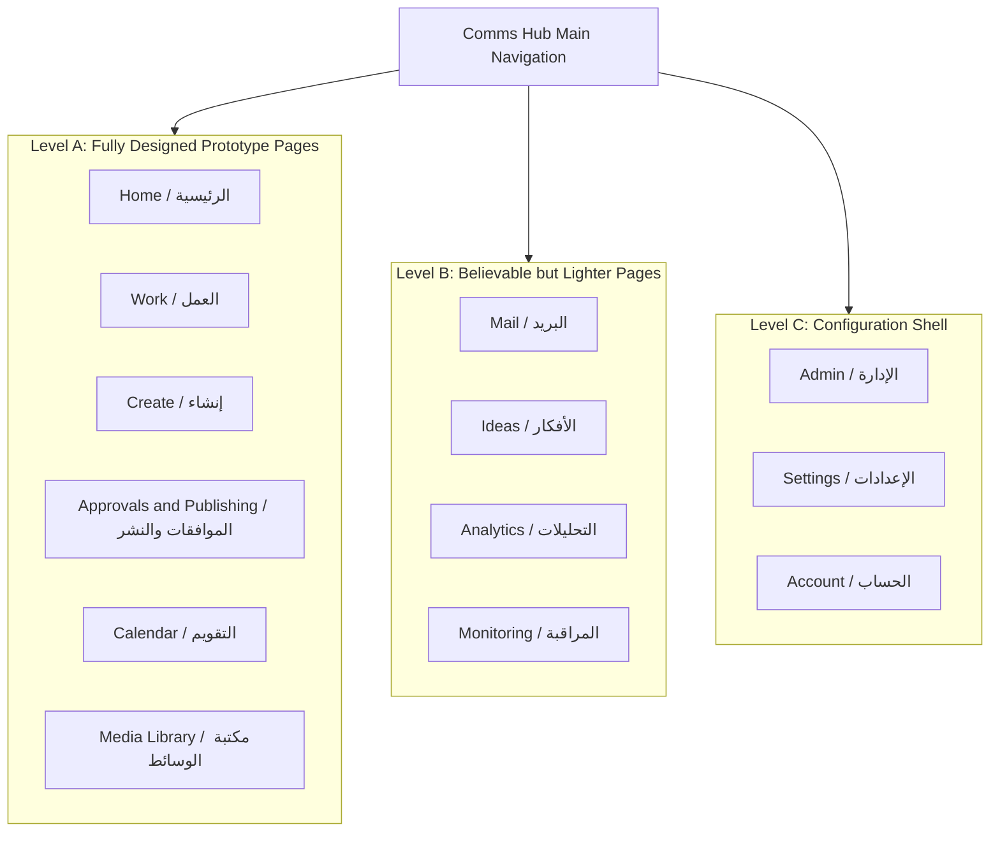

[[projects/ideas/Comms_Hub/Comms Hub|Comms Hub Overview]] | [[Original_Idea|Original Concept]] | [[discussions_list|Discussions Index]]

---

# Comms Hub — MVP UI Shell Draft

> [!note] Status: Prototype MVP draft — UI/UX only
> **Status: Prototype MVP draft — UI/UX only**
>
> This document defines the first MVP as the **skeleton and skin** of the Communication Hub.
>
> It intentionally excludes the real backend logic, database, integrations, automation, authentication enforcement, and external services.
>
> The goal is to validate the product structure, pages, navigation, workflows, role experiences, terminology, and responsive UI before building the system’s “nervous system” and “brain.”

---


## Structure Tree & Document Map

- [[#Comms Hub — MVP UI Shell Draft|Overview & Prototype Scope]]
- **Part I: Strategic Foundations & Boundaries**
  - [[#1. Goal of This MVP|1. Goal of This MVP]]
  - [[#2. MVP Definition|2. MVP Definition]]
  - [[#3. Explicitly Out of Scope|3. Explicitly Out of Scope]]
  - [[#4. Mock Data|4. Mock Data]]
  - [[#5. Prototype “View As” Role Switcher|5. Prototype “View As” Role Switcher]]
- **Part II: User Experience Shell & Roles**
  - [[#6. Role-Specific Home Experience|6. Role-Specific Home Experience]]
  - [[#7. Main Information Architecture|7. Main Information Architecture]]
  - [[#8. Page Priority|8. Page Priority]]
  - [[#9. Main Application Shell|9. Main Application Shell]]
  - [[#10. Visual Direction|10. Visual Direction]]
  - [[#11. Sidebar|11. Sidebar]]
  - [[#12. Global Top Bar|12. Global Top Bar]]
- **Part III: Core Operational Screens**
  - [[#13. Home Page|13. Home Page]]
  - [[#14. Specialist Home|14. Specialist Home]]
  - [[#15. Work Page|15. Work Page]]
  - [[#16. Work List|16. Work List]]
  - [[#17. Work Item Detail|17. Work Item Detail]]
  - [[#18. Create Page|18. Create Page]]
  - [[#19. Social Post Form|19. Social Post Form]]
  - [[#20. Platform Variants|20. Platform Variants]]
  - [[#21. Media Attachment UI|21. Media Attachment UI]]
- **Part IV: Approval, Publishing & Operations**
  - [[#22. Approvals / Publishing Page|22. Approvals / Publishing Page]]
  - [[#23. Approvals Tab|23. Approvals Tab]]
  - [[#24. Review Screen|24. Review Screen]]
  - [[#25. Publishing Tab|25. Publishing Tab]]
  - [[#26. Mock Publishing Interaction|26. Mock Publishing Interaction]]
  - [[#27. Calendar|27. Calendar]]
  - [[#28. Media Library|28. Media Library]]
  - [[#29. Media Card|29. Media Card]]
  - [[#30. Asset Detail|30. Asset Detail]]
- **Part V: Secondary & Administrative Modules**
  - [[#31. Mail Page|31. Mail Page]]
  - [[#32. Ideas Page|32. Ideas Page]]
  - [[#33. Analytics Page|33. Analytics Page]]
  - [[#34. Monitoring Page|34. Monitoring Page]] (since 2026-10-15 the team panel of «سجل النشاط»)
  - [[#35. Admin Page|35. Admin Page]] (dissolved 2026-10-15 into «الحسابات» and «الإعدادات»)
  - [[#36. Users Page|36. Users Page]]
  - [[#37. Integrations Page|37. Integrations Page]]
  - [[#38. Settings Page|38. Settings Page]] (since 2026-10-15 the system's page only: six tabs)
  - [[#39. Account Page|39. Account Page]] (since 2026-10-15 opened from the name badge; carries the appearance choices)
- **Part VI: Cross-Cutting Interactions & Mobile**
  - [[#40. Notification Center|40. Notification Center]]
  - [[#41. Global Search|41. Global Search]]
  - [[#42. UI States to Prototype|42. UI States to Prototype]]
  - [[#43. Responsive Targets|43. Responsive Targets]]
  - [[#44. Mobile Priorities|44. Mobile Priorities]]
  - [[#45. Mobile Work Item|45. Mobile Work Item]]
  - [[#46. Prototype Interactions|46. Prototype Interactions]]
- **Part VII: Verification Scenario & Standards**
  - [[#47. One Coherent Demo Scenario|47. One Coherent Demo Scenario]]
  - [[#48. Use Real-Looking Arabic Content|48. Use Real-Looking Arabic Content]]
  - [[#49. Keep Clean Internal Status Vocabulary|49. Keep Clean Internal Status Vocabulary]]
  - [[#50. Features Not Worth Deep Prototyping Yet|50. Features Not Worth Deep Prototyping Yet]]
  - [[#51. Provisional End-to-End Demo Workflow|51. Provisional End-to-End Demo Workflow]]
  - [[#52. What Success Looks Like|52. What Success Looks Like]]
  - [[#53. Recommended Prototype MVP 0.1 Boundary|53. Recommended Prototype MVP 0.1 Boundary]]
  - [[#54. Development Sequence|54. Development Sequence]]
  - [[#55. Relationship With Astra Workflow Discovery|55. Relationship With Astra Workflow Discovery]]
  - [[#56. Core MVP Principle|56. Core MVP Principle]]

---

# 1. Goal of This MVP

The purpose is **not** to prove Supabase, Google Drive, social APIs, automation, or publishing.

The purpose is to answer:

> **Does this feel like the correct working environment for the Communication Department?**

The prototype should be realistic enough that the Director, Assistant Director, Writer, Designer, Media Producer, Publishing Officer, Members, and Admin can navigate it and give meaningful feedback.

The prototype should help us discover:

- Which pages matter
- Which pages are unnecessary
- Which workflows feel natural
- Which actions take too many clicks
- Which terminology is wrong
- Which roles need different views
- Which information belongs together
- Which screens need to work better on mobile
- Whether the approval and publishing experiences make sense
- Whether the Work page matches real department operations

---

# 2. MVP Definition

This MVP is a **high-fidelity operational prototype**.

It contains:

```text
Pages
Navigation
Layouts
Cards
Tables
Forms
Modals
Drawers
Tabs
Filters
Search UI
Empty states
Loading states
Error states
Status chips
Role-specific UI
Mobile layouts
Mock notifications
Mock files
Mock tasks
Mock approvals
Mock campaigns
Mock publishing
Mock analytics
```

Buttons should work visually.

Example:

```text
[Create Task]
```

opens a realistic modal.

The user can fill it out and click:

```text
[Create]
```

and the mock task may appear in the UI.

But the prototype does not need permanent data storage.

A refresh may reset the mock state.

---

# 3. Explicitly Out of Scope

> [!important] Scope Enforcement & Deferred Systems
> See architectural context in [[disscussios/security_discussion|Security Architecture]] and [[disscussios/First_idea_darft|First Idea Draft]].

The prototype must **not** accidentally become a backend implementation project.

The following are explicitly excluded:

```text
NO Supabase

NO Vercel production integration

NO Google Drive API

NO real authentication

NO real authorization enforcement

NO production database

NO social-media APIs

NO real publishing

NO real email sending/receiving

NO background workers

NO real automation engine

NO real AI API

NO OAuth

NO secret storage

NO NAS integration

NO production analytics

NO real push/email notifications

NO backup system

NO disaster-recovery implementation
```

All of these may be simulated visually where useful.

---

# 4. Mock Data

The prototype should use static/mock data for concepts such as:

```text
Users
Campaigns
Tasks
Assets
Approvals
Publications
Notifications
Integrations
Analytics
```

Example users:

```text
Mohammed
Role:
مدير الاتصال المؤسسي

Ahmed
Role:
المنتج الإعلامي

Sara
Role:
المصمم

Khalid
Role:
كاتب المحتوى
```

Example campaign:

```text
Saudi National Day 2026

Status:
Active

Progress:
72%

Team:
5 members

Content:
8 pieces

Pending approvals:
2
```

---

# 5. Prototype “View As” Role Switcher

> [!tip] Role Architecture
> Complete role models, permissions, and operational duties are defined in [[disscussios/organizational_role_discussion|Organizational Role Discussion]].

A development-only role switcher should allow the prototype to show different role experiences.

Example:

```text
VIEW AS

[مدير الاتصال المؤسسي ▼]
```

Options:

```text
مدير الاتصال المؤسسي
مساعد مدير الاتصال المؤسسي
كاتب المحتوى
المصمم
المنتج الإعلامي
مسؤول النشر وإدارة الحسابات
عضو
Admin
```

This is not real authorization.

It is a prototype tool for answering:

> What should this role see and prioritize?

---

# 6. Role-Specific Home Experience

## Director

Home should emphasize:

```text
Pending approvals
Department workload
Today's publishing
Needs Attention
Campaign status
```

## Assistant Director

Home should emphasize:

```text
Operational queue
Approvals
Assignments
Workload
Upcoming deadlines
```

## Content Writer

Home should emphasize:

```text
Copy tasks
Requested revisions
Upcoming deadlines
Awaiting review
```

## Designer

Home should emphasize:

```text
Design tasks
Requested revisions
Assets awaiting review
Upcoming deadlines
```

## Media Producer

Home should emphasize:

```text
Production tasks
Uploads
Media processing
Deadlines
Review status
```

## Publishing Officer

Home should emphasize:

```text
Ready to publish
Scheduled today
Publishing failures
Connected account health
```

## Member

Home should emphasize:

```text
Assigned work
Deadlines
Comments
Calendar
```

## Admin

Home should emphasize:

```text
System health
Users
Integration health
Storage
Security events
```

---

# 7. Main Information Architecture

The prototype should keep the current navigation structure:

```text
Home

Work

Create

Approvals / Publishing

Calendar

Mail

Media Library

Ideas

Analytics

Monitoring

────────────────

Admin

Settings

Account
```

Not every page needs equal depth in this first prototype.

---

# 8. Page Priority

## Level A — Fully Designed Prototype Pages

These are the core of the MVP:

```text
Home
Work
Create
Approvals / Publishing
Calendar
Media Library
```

These should feel genuinely usable.

## Level B — Believable but Lighter

```text
Mail
Ideas
Analytics
Monitoring
```

These should look complete enough to test layout and workflow assumptions.

## Level C — Configuration Shell

```text
Admin
Settings
Account
```

These only need enough UI to establish structure and future configuration direction.

### Information Architecture & Priority Map



---


# 9. Main Application Shell

Desktop structure:

```text
┌─────────────────────────────────────────────────────────┐
│ Top Bar                                                 │
│ Search        Notifications       Help        User      │
├─────────────┬───────────────────────────────────────────┤
│             │                                           │
│ Sidebar     │                                           │
│             │              PAGE CONTENT                 │
│ Home        │                                           │
│ Work        │                                           │
│ Create      │                                           │
│ Approvals   │                                           │
│ Calendar    │                                           │
│ Mail        │                                           │
│ Media       │                                           │
│ Ideas       │                                           │
│ Analytics   │                                           │
│ Monitoring  │                                           │
│             │                                           │
│ Admin       │                                           │
│ Settings    │                                           │
│ Account     │                                           │
└─────────────┴───────────────────────────────────────────┘
```

The prototype should be **RTL-first**.

Arabic should be the primary UI direction.

The component system should still be designed so English/LTR can be supported later.

### Shell Architecture & Responsive Diagram

```mermaid
flowchart TB
    subgraph Viewport [Desktop Application Shell - RTL Direction]
        TopBar[Top Bar: Global Search | Quick Create | Notifications | Profile]
        
        subgraph MainBody [Main Workspace Layout]
            Sidebar[Sidebar Navigation: Home, Work, Create, Approvals, Calendar, Mail, Media, Ideas, Analytics, Monitoring, Admin, Settings, Account]
            ContentArea[Page Content Viewport]
            DrawersModals[Contextual Drawers and Modals: Work Item Details, Asset View, Creation Forms]
        end
        
        TopBar --- MainBody
        Sidebar --- ContentArea
        ContentArea -.-> DrawersModals
    end
```

> [!note] Technical Framework References
> - [Next.js App Router Documentation](https://nextjs.org/docs)
> - [Tailwind CSS Direction & RTL Guide](https://tailwindcss.com/docs/hover-focus-and-other-states#rtl-support)
> - [Radix UI Accessible Primitives](https://www.radix-ui.com/primitives)
> - [Lucide Icons Library](https://lucide.dev/icons)
> - [Mermaid.js Documentation](https://mermaid.js.org/)

---


# 10. Visual Direction

The target feel should be:

> **Professional operational dashboard for a Communication Department**

Characteristics:

```text
Light background
White cards
Soft borders
Moderate corner radius
Green primary accent
Clear status colors
Strong Arabic typography
Comfortable whitespace
Dense enough for real work
Modern but restrained
```

The UI should feel:

```text
Official
Calm
Efficient
Modern
Professional
Saudi organizational software
```

Avoid:

```text
Gaming aesthetics
Overly futuristic styling
AI-first visual identity
Excessive animation
Social-media-app styling
Extreme minimalism
```

---

# 11. Sidebar

Potential Arabic navigation:

```text
الرئيسية

العمل
إنشاء
الموافقات والنشر
التقويم
البريد
مكتبة الوسائط
الأفكار
التحليلات
المراقبة

────────────────

الإدارة
الإعدادات
الحساب
```

**Amendment of 2026-10-15** (owner directive after the health check, `progress.md`, `Action_Plan.md`
Part B). The list above is the first sketch; the sidebar is now: الرئيسية، العمل، إنشاء،
الموافقات والنشر، التقويم، المشاريع، الطلبات، مكتبة الوسائط، المهام، سجل النشاط، استوديو الحركة،
البريد، «حسابات المنصات»، الأفكار، التحليلات، الحسابات، الإعدادات. «المراقبة» لم تعد صفحة: صارت لوحة «الفريق» في «سجل النشاط» (`/monitoring` يفتح السجل) لمن يرى السجل كاملاً.
«الإعدادات» is the system's page only (six tabs); the appearance choices are on «الحساب».
«الإدارة» no longer exists (`/admin` opens «الحسابات»). «الحساب» is opened from the name badge at
the foot of the sidebar. «التحليلات» is back in the menu since 2026-10-15, reading the database (flow of work, review, platforms; publishing numbers are the simulation's). The component gallery page was removed with the prototype's sample model. «الحسابات المرتبطة»
is called «حسابات المنصات». Each person sees only the pages their role, page grants and capabilities
allow (`src/lib/access.ts`).

### Access by role (generated 2026-10-15, `Action_Plan.md` B4)

What a new account of each role sees and may open, computed from `src/lib/access.ts` and the
capability templates by `qa/access-matrix.mjs` (result in `qa/access-matrix.json`) and held by
`tests/access-matrix.test.mjs`. «نعم» is in the menu and opens; «بالعنوان» opens by address only; «لا» is
refused. It is the default: an account's own page list and grants change it, and inside a page the
database decides which rows come back.

| الصفحة | Admin | مدير الاتصال المؤسسي | مساعد مدير الاتصال المؤسسي | كاتب المحتوى | المصمم | المنتج الإعلامي | مسؤول النشر وإدارة الحسابات | عضو | كيف تُفتح |
|---|---|---|---|---|---|---|---|---|---|
| الرئيسية | نعم | نعم | نعم | نعم | نعم | نعم | نعم | نعم | القائمة |
| العمل | نعم | نعم | نعم | نعم | نعم | نعم | نعم | نعم | القائمة |
| إنشاء | بالعنوان | نعم | نعم | نعم | نعم | نعم | لا | نعم | القائمة |
| الموافقات والنشر | نعم | نعم | نعم | نعم | نعم | نعم | نعم | نعم | القائمة |
| التقويم | نعم | نعم | نعم | نعم | نعم | نعم | نعم | نعم | القائمة |
| المشاريع | نعم | نعم | نعم | نعم | نعم | نعم | نعم | نعم | القائمة |
| الطلبات | نعم | نعم | نعم | نعم | نعم | نعم | نعم | نعم | القائمة |
| مكتبة الوسائط | نعم | نعم | نعم | نعم | نعم | نعم | نعم | نعم | القائمة |
| المهام | نعم | نعم | نعم | نعم | نعم | نعم | نعم | نعم | القائمة |
| سجل النشاط | نعم | نعم | نعم | نعم | نعم | نعم | نعم | نعم | القائمة |
| التحليلات | نعم | نعم | نعم | نعم | نعم | نعم | نعم | نعم | القائمة |
| استوديو الحركة | نعم | نعم | نعم | نعم | نعم | نعم | نعم | نعم | القائمة |
| البريد | نعم | نعم | نعم | نعم | نعم | نعم | نعم | نعم | القائمة |
| حسابات المنصات | نعم | نعم | نعم | لا | لا | لا | نعم | لا | القائمة |
| الأفكار | نعم | نعم | نعم | نعم | نعم | نعم | نعم | نعم | القائمة |
| الحسابات | نعم | نعم | نعم | لا | لا | لا | لا | لا | القائمة |
| الإعدادات | نعم | نعم | لا | لا | لا | لا | لا | لا | القائمة |
| الحساب | نعم | نعم | نعم | نعم | نعم | نعم | نعم | نعم | الاسم أسفل القائمة |
| المراقبة | - | - | - | - | - | - | - | - | يفتح «سجل النشاط» |
| الإدارة | - | - | - | - | - | - | - | - | يفتح «الحسابات» |

Reading it:

- **What differs by role, by default, is small:** «إنشاء» (not the publisher, and not offered to the
  administrator), «حسابات المنصات» (administrator, director, assistant, publisher; with «الموافقات والنشر»),
  «الحسابات» (the administrator, the director and the assistant, by the capability «فتح صفحة الحسابات»
  their templates carry since Step P2; the table of 2026-10-15 first listed it for the administrator
  alone because the interface's mirror of the templates was out of date: corrected the same day), and what
  «سجل النشاط» shows (the whole log and the team panel for the administrator, director and assistant;
  everyone else sees their own actions and the files they reach).
- **«الإعدادات» is the administrator's and the Director's by default** (decisions of 2026-10-15, B4b and
  B9). The Director opens it because the template carries «settings.view», «settings.manage»,
  «platforms.manage», «integrations.secrets», «storage.manage» and «whatsapp.system.manage»: the Director
  connects the platforms, the mail, Drive and the WhatsApp bridge from the site (tab «الاتصالات», tab
  «المنصات», tab «واتساب النظام»). Another person has the page only with the page grant, or by holding
  «settings.view» or «settings.manage». The assistant has none of these. Backups and moving files stay
  the administrator's (`backups.*`, `storage.migrate`).
- **An administrator viewing as a role** (`عرض بصفة`) still opens every page; only «إنشاء» and «الحسابات»
  follow the viewed role (leaders see «الحسابات», the publisher does not see «إنشاء»).
- **The member creates** (decision of 2026-10-15, B4b): «إنشاء» is offered to the member and the capability
  `page.create` is held by the member as by the other creating roles (migration `member_creates`); the
  publisher stays without it.
