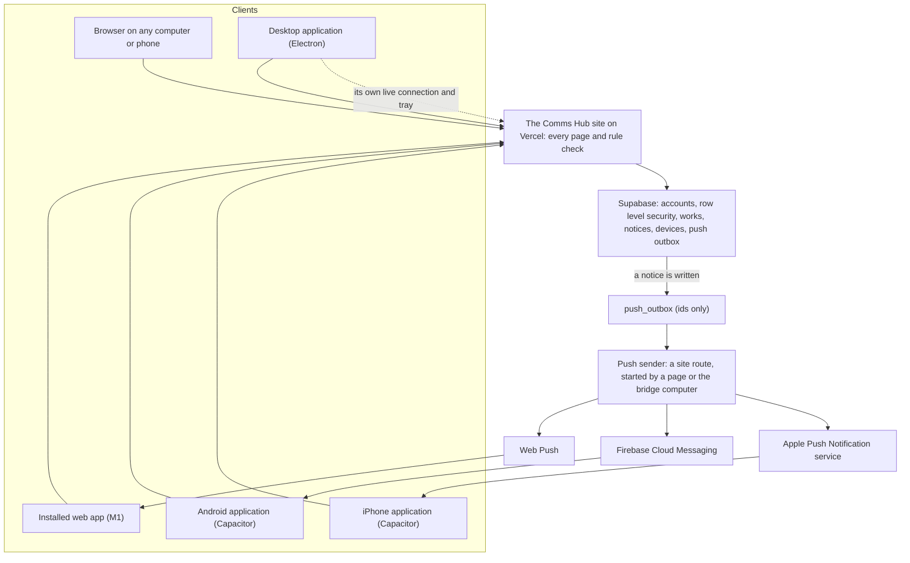

# Comms Hub on Android and iPhone, and the three clients together: research and build plan

Research and plan of 2026-10-20, from the owner's request of the same day: "do the same research
but for the Android and iPhone plans; with this research we would have web, desktop, and phone
versions that are all connected."

Status: **proposal for the owner's decision.** Nothing is built, installed, bought, registered or
deployed by this document. It pairs with `Desktop_App_Plan.md` (same day). Section 5 describes
how the website, the desktop application and the phone applications form one connected system,
and section 9 gives one roadmap for all three.

Companion documents: `Desktop_App_Plan.md`, `Studio_Feasibility_and_App_Path.md` (sections 7.5
and 12), `Studio_Build_Plan.md` (section 7, "Phone applications (Capacitor)" deferred),
`disscussios/notification_model.md` (the attention model, push and lock screens), `MVP_draft.md`
sections 44 to 45 (mobile priorities), 60 (the phone approval sheet) and 62 (the studio on phones),
`Settings_Integrations_Plan.md` (E-1), `AGENTS.md`.

## Contents

1. [The answer in short](#1-the-answer-in-short)
2. [What phones add](#2-what-phones-add)
3. [What in the current code decides the design](#3-what-in-the-current-code-decides-the-design)
4. [The options, and why Capacitor](#4-the-options-and-why-capacitor)
5. [The three clients together](#5-the-three-clients-together)
6. [The phone applications](#6-the-phone-applications)
7. [Distribution through the stores](#7-distribution-through-the-stores)
8. [Phases for the phones](#8-phases-for-the-phones)
9. [One roadmap for web, desktop and phones](#9-one-roadmap-for-web-desktop-and-phones)
10. [Security](#10-security)
11. [Costs](#11-costs)
12. [Decisions for the owner](#12-decisions-for-the-owner)
13. [Tests and evidence](#13-tests-and-evidence)
14. [Findings that matter today](#14-findings-that-matter-today)
15. [Risks](#15-risks)
16. [Method and sources](#16-method-and-sources)

---

## 1. The answer in short

**Two store applications, Android and iPhone, built with Capacitor 8. Like the desktop
application, each opens the live Comms Hub site and adds a native layer for what a phone does
best.** That means:

- notices on the lock screen;
- photos and videos taken in the field and uploaded while the phone is locked;
- files shared in from the gallery, Files or WhatsApp;
- links that open in the application at the right page;
- a face or fingerprint lock;
- saving and sharing files out.

What this covers:

- **One system, three clients.** The website, the desktop application and the phone applications
  share one account per person, one database, one set of rules and one site. Four pieces are added
  once and used by all: a native contract the site calls (`src/lib/native/`), a list of each
  person's devices («أجهزتي»), one push path to every device, and one link format that opens the
  right client. A studio project already moves between devices through its editing lease.
- **Start with the web (M1).** An installed web app with web push gives phones lock-screen notices
  before any store. Android Chrome supports it directly; an iPhone supports it after «إضافة إلى
  الشاشة الرئيسية», iOS 16.4 or newer. It builds the push core that the store applications then
  reuse. It is cheap and reaches every role first.
- **Phones are not editing workstations.** Every iPhone application shows web content with Safari's
  engine, so the studio on an iPhone keeps the phone tool set. Its exports run only while the
  application is in front. Android's system WebView is Chromium, so the studio there behaves like
  Chrome, within a phone's memory, heat and battery. Long exports belong to a computer: the
  desktop application, or later «صدّر على حاسوبي» (M7).
- **One caveat, stated plainly.** Capacitor's own documentation says that loading an external
  address is "not intended for use in production". The plan accepts that, gates it with a spike
  (M2) that has written pass criteria, and keeps a fallback: two thin native shells behind the same
  contract. The site side does not change if the shell does.
- **Push needs a sender, and the site has no worker.** Section 5.5 gives a design that keeps the
  current rule (nothing moves unless someone asks), and one that would need the owner to change it.
- **Costs.** Google Play is 25 USD once. Apple's 99 USD a year is the same membership the Mac
  desktop application needs. APNs, Firebase Cloud Messaging and Web Push are free. Organisation
  accounts (a D-U-N-S number, free) avoid Google's twelve-tester rule for new personal accounts and
  allow private distribution on iPhone.

---

## 2. What phones add

| Need | Today | With the phone applications | Phase |
|---|---|---|---|
| Know that a work needs me | Notices reach a phone only while the site is open in front (`notices.tsx` reloads only when visible). WhatsApp covers urgent messaging only, by an unofficial method that may be blocked. | Lock-screen notices for «قرار» and, if chosen, «انتباه» items, with a badge. Tapping one opens the right page. | M1 (web), M3 (apps) |
| Approve on the move | The review screen has a phone approval sheet (`MVP_draft.md` 60). | The notice brings the director or the assistant straight to it. Approval stays on the review screen with its held key and the exact version in view, never as a button on the notice. | M3 |
| Field capture to the library (idea I-015) | A phone browser uploads only while the page stays in front; locking the screen stops a large upload. | Shoot or pick, choose the folder or the work, and the upload continues with the screen locked or another app in front. | M4 |
| Bring in a file from another app | Not possible: share targets work only for installed web apps on Android Chrome. | «مشاركة» from the gallery, Files or WhatsApp to «مركز الاتصال», then choose: a library folder, a work, or a conversation. | M4 |
| Open links from mail and WhatsApp | They open in a browser where the person may not be signed in. | Links of the site open the application at that page. Links meant for outside people (`/r/…`, `/m/…`) still open in the browser. | M3 |
| Keep a lost phone harmless | The session lasts until it expires or the person signs out. | An optional face or fingerprint lock on opening; «أجهزتي» to remove a device; «تسجيل الخروج من الأجهزة الأخرى». | M1, M3 |
| Save or send a file onward | The studio's download (`<a download>`) does not work inside phone web views. | «حفظ في الصور» and «مشاركة» from a library file or a studio export. | M4, M5 |
| Voice notes and voice-over | Work in the browser after its prompt. | The same, with the system's Arabic permission text. | M2 |

What the phone applications do **not** change: no rendering in the background (an iPhone pauses a
page's JavaScript when the application leaves the screen), no more memory than the phone has, the
same studio access (the Admin and the director only), no AI, and publishing stays a simulation.

---

## 3. What in the current code decides the design

| Fact | Evidence | Consequence |
|---|---|---|
| The site is rendered on the server, holds secrets, and reads the session from cookies. | `Desktop_App_Plan.md` section 3: 47 route handlers in `src/app`, `src/proxy.ts`, `serverClient()`. | As on the desktop, the applications **open the site**. They cannot contain it. |
| A phone layout already exists. | `globals.css` below 700 px: the sidebar hides, `.mobile-nav` is a bottom bar; `MVP_draft.md` 44 lists the phone priorities; 60 the phone approval sheet; 62 the studio's phone tool set below 760 px. | The applications show the existing phone pages. No second interface is built. |
| The phone layout does not handle safe areas. | No `viewport-fit` or `env(safe-area-inset-*)` in the site's styles. | In a full-screen application the bottom bar would sit under the iPhone's home indicator. A small style change is needed (M2). |
| Notices are rows in one table, written by one function. | `public.notifications` with tiers `decide`, `attention`, `info` (`*work_cycle*` migration); `work_notify` and `work_notify_many` insert them. | A trigger on that table can queue a push for each device without touching any writer. |
| Outside delivery already has a pattern: ids in an outbox, routing in the database, a sender that pulls. | `whatsapp_outbox` holds ids, never text; `/api/whatsapp/dispatch` moves only when the bridge asks with its key, whose hash alone is stored. | The push outbox copies that pattern (section 5.5). |
| The attention model already rules on push. | `disscussios/notification_model.md` 23 lists push as a future channel, 33 says lock screens need sensitivity rules, 28 sets quiet hours, 22 sets mandatory notices. | Push follows those rules; it is not a copy of every notice. |
| Uploads open a resumable Drive session on the server, and the bytes go straight to Google. | `/api/media/upload-session` checks the folder right and returns the session; `/api/media/complete` records the file. | A native background transfer can carry the bytes without holding the person's session. The page opens and completes the session as today. |
| Some links are for people without accounts. | `/r/[token]` (review links), `/m/[token]` (answers to our mail). | These stay out of the application's link list and keep opening in the browser. |
| The sign-in screen lets people ask for access, and nobody can delete their own account. | «طلب وصول» in `auth-gate.tsx`; accounts are removed by administrators. | Apple's guideline 5.1.1(v): an application that supports creating an account must offer deleting it inside the application. Decision M-10. |
| No web app manifest or service worker exists. | Nothing in `src/app` or `public`. | M1 adds them, following the installed Next.js 16.3 guide `progressive-web-apps.md` (manifest, web push with VAPID keys, iOS 16.4 on the home screen, service worker headers). |
| The studio skips video adjustments silently where canvas filters are missing. | `supportsFilter()` in `src/lib/studio/compose.ts` is checked only there, and nothing tells the person. | Every iPhone and Safari on a Mac export video without brightness, contrast or saturation, and without effect blur, today. Finding F-1 (section 14). |

---

## 4. The options, and why Capacitor

| Option | What it is | Verdict |
|---|---|---|
| A. Installed web app (PWA) with web push | The site with a manifest and a small service worker. Android Chrome installs it; an iPhone adds it to the home screen. | **Do it first (M1)**, for every role. On an iPhone it has no share-in and no background upload, and the home-screen app signs in separately from Safari. The push core it needs is shared by everything after it. |
| **B. Capacitor 8, opening the live site** | A native project per platform with official plugins (push, camera, share, haptics, status bar, app links, local notices) and small plugins of our own in Swift and Kotlin. | **Recommended for the store applications**, gated by the M2 spike because of the caveat below. |
| C. Expo or React Native with a web view | A React Native application that shows the site and adds native screens. Expo can build iPhone applications in its cloud. | Supported pattern, but a second application layer, a hand-made message bridge, and native screens that would repeat web screens. Second fallback. |
| D. Thin native shells | One small Swift application (WKWebView) and one small Kotlin application (WebView with `addWebMessageListener`, which restricts messages to named origins), each with push, links, share-in, upload and lock. | **The fallback** if M2 fails. Most control and fewest dependencies, but two languages to maintain. |
| E. Tauri mobile | Same system web views, Rust native layer. | No gain over B. The desktop chose Electron, so no code is shared. Out. |
| F. Native applications for everything | SwiftUI and Kotlin screens for every page. | A rewrite of every page and rule screen. Out. |
| G. Trusted Web Activity (Android only) | The installed web app shown by Chrome, listed on Google Play. | Android only, with no native layer for background upload. Option A already covers Android Chrome. Out. |

### 4.1 The engines, with evidence

MDN's browser compatibility data, version 8.1.6 of 2026-10-15:

| What is used | Android Chrome (installed web app) | Android WebView (store application) | iPhone (every application and Safari) |
|---|---|---|---|
| Canvas `filter` (studio video adjustments, blur) | 52 | 52 | 18, behind a preference that is off |
| `AudioEncoder` (studio sound) | 94 | 94 | 26 |
| `createWritable` (studio streamed export, cache) | 109 | 109 | 26 |
| `VideoEncoder` | 94 | 94 | 16.4 |
| Screen wake lock | 84 | 84 | 18.4 |
| `MediaRecorder`, microphone | yes | yes | yes |
| Web notifications | partial | **no** | 16.4, home-screen apps |
| Web push (`PushManager`) | 42 | **no** | 16.4, home-screen apps |
| `navigator.share` | 61 | **no** | 12.2 |
| App badge (`setAppBadge`) | no | no | 16.4, home-screen apps |
| Share target in the manifest | 76 | **no** | **no** |

What follows from the table:

- **iPhone.** Apple's guideline 2.5.6 requires WebKit for web content. Outside the regions where
  Apple allows other engines, and Saudi Arabia is not one of them, every iPhone application sees
  the same engine as Safari. There is no Electron-like choice on iPhone. The studio's iPhone limits
  are the same in Safari and in our application: no canvas filter, and iOS 26 needed for AAC sound
  and streamed export.
- **Android.** The store application's WebView is Chromium, so the studio there matches Chrome.
  Notices, push and sharing do not exist inside a WebView and must be native plugins.
- **Both.** Everything outward-facing (notices, push, sharing, saving) is native work in the store
  applications. That native work is also what makes them more than a repackaged website for App
  Review (guideline 4.2).

### 4.2 The Capacitor caveat

Capacitor's configuration reference says of `server.url`: "This is intended for use with
live-reload servers. **This is not intended for use in production.**" It says the same of
`allowNavigation`. In practice, Capacitor's team does not test that mode for releases. The
application depends on the network, and App Review may see a repackaged website.

The plan accepts the mode because the site cannot be bundled (section 3). It contains the risk as
follows:

- **M2 is a spike with written pass criteria** (section 8): the session survives restarts, the
  bridge exists only on the allowed address and never in frames, the file chooser and microphone
  work, there is an Arabic offline screen, and installation through TestFlight and Play internal
  testing works. Any failure moves to option D.
- **The site never imports Capacitor directly.** It talks to `src/lib/native/` (section 5.2), so
  replacing the shell does not touch the site.
- **Native value beyond the website:** push, capture, share-in, links, lock, save and share
  (guideline 4.2).
- **Capacitor is pinned** (newest 8.x at least fourteen days old, the project's rule) and upgraded
  deliberately.

---

## 5. The three clients together



### 5.1 One site, one account, one database

Every client signs in with the site's own form. Each device holds its own session as a cookie in
its own store. Row level security and the database functions decide everything, so no client
carries permission logic. A person removed by an administrator loses every device at once, because
every request is checked on the server. No client ever has a sign-in bypass, a stub session or a
stored password.

### 5.2 One native contract for every shell

`src/lib/native/` in the site (plain TypeScript, tested):

```text
native() -> { platform: 'web' | 'desktop' | 'android' | 'ios', shell, version, bridge, has(feature) }
```

| Feature | Web | Desktop (Electron) | Android and iPhone (Capacitor) |
|---|---|---|---|
| `notify`, `badge` | browser notices where allowed | tray notice, badge (desktop D2) | local notice, badge |
| `push` | Web Push (M1) | none: its own live connection | APNs, FCM (M3) |
| `keepAwake`, `busy` | screen wake lock | system sleep blocked, close to tray (D2) | screen kept on |
| `files.pick`, `files.fromDropped` | browser picker | tokens for files in place (D4) | system picker, camera (M4) |
| `upload.background` | none | none needed | native transfer (M4) |
| `share.incoming` | Android Chrome installed app only | none | share extension or intent (M4) |
| `files.share`, `files.saveToPhotos` | download | download, drag out (D8) | share sheet, Photos or gallery (M4) |
| `links` | none | `commshub://` later (D8) | universal links, app links (M3) |
| `lock` | none | none | face or fingerprint (M3) |
| `cache`, `media`, `windows` | none | desktop D4 to D6 | none |

The desktop plan's bridge (`Desktop_App_Plan.md` 5.2) becomes the desktop implementation of this
contract, exposed as `window.commsHubNative` with `platform: 'desktop'`. Every feature is detected
before use, and without it the site does what it does today in a browser.

### 5.3 «أجهزتي»: one list of each person's devices

A table `devices`: id, the person, platform, shell version, push channel and push token, a name the
person may change, created, last seen, removed.

- The person sees and manages only their own devices, in «الحساب» then «أجهزتي». Push tokens are
  never sent back to any page; only the sender's security-definer function reads them.
- «إزالة الجهاز» deletes its push token and marks it removed. On its next start, that application
  finds itself removed and signs out locally.
- «تسجيل الخروج من الأجهزة الأخرى» uses the sign-out of other sessions that Supabase Auth provides
  to the signed-in person. No service key is needed.
- Each device reports its shell version, so the site can ask an old one to update.

### 5.4 One push path, with the attention model's rules

| Rule | Decision proposed |
|---|---|
| What is pushed | «قرار» items (`decide`) with sound. «انتباه» items (`attention`) silently, if the person keeps them on. «للعلم» items (`info`) never. Messaging: direct messages and mentions. Mail: action cards addressed to the person. |
| What a lock screen shows (notification model 33) | Work notices show their text, which is already short and work-level, unless the person turns on «إخفاء نص التنبيهات». Messaging and internal mail show only «رسالة جديدة من …», never the message, because they are private and the payload passes through Apple or Google. |
| What a payload holds | The notice id, the in-site destination (`go`), the tier and the text allowed above. Never a token, a secret, an address with a query string or a message body. |
| Quiet hours (28) and mandatory notices (22) | Later, with the person's settings. Version 1 sends at once. |
| Once per device | One push per notice per device. Reading on any device marks it read for all (`read_at`). The badge is recomputed at each send and on each opening. |
| Not about my own actions | Already true: `work_notify` does not notify the actor (notification model 39). |
| WhatsApp | Stays as it is. The person can choose channels later («قنوات التنبيه»). |

### 5.5 Sending pushes when the site has no worker

The rule today is that nothing moves unless someone asks: a page or the bridge computer (`AGENTS.md`,
E-1). The design:

1. **A trigger on `notifications`** writes a row to `push_outbox` for each live device of the
   recipient that wants that tier. The outbox holds ids, never text, like `whatsapp_outbox`.
2. **The sending route** `/api/push/flush`. With the server key, it claims a bounded batch through
   a security-definer function and builds each payload by the rules of 5.4. It sends through Web
   Push, FCM or APNs, with credentials read from Vault (VAPID private key, the FCM service account,
   the APNs key), then reports each result. Claims expire, and a failed row waits for the next
   flush.
3. **Who starts the route:**

| Starter | How | Boundary |
|---|---|---|
| S-1. The writer's page | After a database write succeeds, the page that made it calls the flush route. The route returns at once when nothing is queued, and it is rate-limited per session. | No change: the person's own action starts it, like the mail page syncing while open. |
| S-2. The bridge computer | The WhatsApp bridge's loop also calls the flush route every few seconds. | No change: "nothing moves unless the bridge asks", as today. |
| S-3. The database | A database webhook (`pg_net`) calls the flush route on each insert. | **A change.** It is a call started inside the database. It needs an owner directive and an `AGENTS.md` update. |

**Recommendation:** S-1 together with S-2. S-1 delivers almost every push at once, because almost
every notice is caused by someone's action in a page. S-2 catches what a closed page left behind,
while the bridge computer is on. S-3 only if the owner wants delivery not to depend on either
(decision M-3).

### 5.6 One link format that opens the right client

- The site's addresses stay the links (`/works/<id>`, review addresses, mail and messaging
  addresses).
- On a phone with the application, they open the application at that page: iOS universal links
  (`/.well-known/apple-app-site-association`) and Android app links (`/.well-known/assetlinks.json`,
  with the signing certificate's fingerprint), served by the site from `public/.well-known/`.
- Excluded: `/r/*` and `/m/*` (outside people), `/api/*`, and the entry and password pages, which
  open in the browser where first sign-in is simplest.
- On a computer, links open in the browser. A `commshub://` link to the desktop application is
  later (desktop D8).
- These files bind the applications to the site's address. That makes the address decision
  (desktop D-5) more pressing: changing the address later needs new application versions first.

### 5.7 Working across devices

| Situation | What happens |
|---|---|
| A studio project opened on a second device | The existing lease shows who is editing, and «تولّي التحرير» (long press) takes it over. Nothing new is needed. |
| A studio project that uses files from «هذا الجهاز» on a phone | Unchanged rule: they show «على هذا الجهاز فقط» elsewhere, and the phone offers «رفعه إلى المكتبة ثم استخدامه». |
| A notice read on the phone | Read everywhere (`read_at`). Other clients update on their next load. |
| A draft after a crash | Stays on its device (IndexedDB), as today. Saved revisions are shared. |
| A long export started from a phone | Later (M7): «صدّر على حاسوبي» queues the saved revision for the person's own desktop application. That application, while open, claims it, exports with the same compositor, saves a new library version and notifies the phone. It needs a jobs table and an owner decision (M-14). It is the agent-computer job model (desktop D7) run by a person's own computer. |

### 5.8 Versions and compatibility

- The site is always the newest. Desktop and phone applications update on their own schedules: the
  desktop at least every three to four months for Chromium security, the phones through store
  review (usually a day or more).
- Each device reports its version in `devices`. The site keeps a minimum version per platform; below
  it, a banner «حدّث التطبيق» links to the store or the download page.
- Yearly store duties: Google Play requires new applications and updates to target Android 16 (API
  36) since 31 August 2026 (an extension to 1 November 2026 could be requested), and the level rises
  each year. Apple raises the SDK required for uploads each year.

### 5.9 One repository, one set of accounts

```text
src/lib/native/          the shared contract, in the site
public/.well-known/      link files for iPhone and Android
desktop/                 the Electron application (Desktop_App_Plan.md)
mobile/                  the Capacitor project: capacitor.config.ts, ios/, android/, plugins/
.github/workflows/       desktop.yml, mobile.yml (started by hand)
```

`tsconfig.json` includes only `src/**`, so `desktop/` and `mobile/` stay outside the site's build.

| Account | Covers |
|---|---|
| Apple Developer Program (one membership) | Mac signing and notarisation of the desktop application; the iPhone application; APNs |
| Google Play Console | The Android application |
| Firebase project (free) | FCM for Android; iOS may use APNs directly |
| Web Push key pair (VAPID) | Installed web apps and browsers |
| Code-signing route for Windows | The desktop application (desktop 7.2) |

Every secret (APNs key, FCM service account, VAPID private key, signing keys) lives in Supabase
Vault or the build system's secret store, never in the repository. The client configuration files
(`google-services.json`, `GoogleService-Info.plist`) are not secrets, but they are also kept out
of the repository and added at build time, to keep the rule simple.

---

## 6. The phone applications

### 6.1 The window and its rules

| Rule | Behaviour |
|---|---|
| Allowed address | The production address (desktop D-5). Others open in the system browser, which is Capacitor's default. |
| Outside connections | Drive, OneDrive and platform connections open in the system browser, as on the desktop (Google refuses embedded sign-in). |
| Permissions | Notices, camera, microphone and photo saving, each asked when first needed. The system texts (`NSCameraUsageDescription`, `NSMicrophoneUsageDescription`, `NSPhotoLibraryAddUsageDescription` and the Android strings) are in Arabic. Location is not asked. |
| Downloads | Replaced by «حفظ في الصور», «حفظ في الملفات» and «مشاركة». |
| No connection | An Arabic screen with «إعادة المحاولة» (`errorPath`). |
| Android back key | Back through the site's history, then leave. |
| Safe areas | The site adds `viewport-fit=cover` and safe-area padding to the top bar and `.mobile-nav` (M2). |
| Debugging | Web view inspection off in release builds. |

### 6.2 Native features, and the rule for large files

**Large files never cross the JavaScript bridge.** Passing a video as text over the bridge would
multiply its memory, so each path keeps bytes on one side:

| Path | How the bytes move |
|---|---|
| Camera or shared-in file to the library | The page asks the site for an upload session as today (folder rights checked). It hands the session and a file token to the native layer. The native transfer sends the file to Google directly, in the background. The page, or the next opening, records completion. |
| Library file to Photos or the share sheet | The native layer fetches the file from the site's own file address with the session of the application's web view. The session never leaves the phone. |
| Studio export on a phone | Saved to the library through the existing browser upload, then «حفظ في الصور» as above. |

Plugins:

| Need | Plugin |
|---|---|
| Push, local notices, app links and back key, camera (photos), share sheet, haptics, system bars | Capacitor's official plugins |
| Background upload | Ours: iOS background `URLSession` from a file; Android WorkManager with a foreground notice «جارٍ رفع الملفات» |
| Incoming share | Ours: an iOS share extension that hands files to the application through an App Group; Android `ACTION_SEND` and `ACTION_SEND_MULTIPLE` |
| Save to Photos or gallery | Ours, small |
| Face or fingerprint lock | Ours, small: LocalAuthentication, BiometricPrompt |

Community plugins exist for several of these. The two critical paths (upload, incoming share) are
written and pinned in the repository, as the project prefers few dependencies.

### 6.3 Behaviour in the background

- **iPhone.** A page's JavaScript stops soon after the application leaves the screen. Exports and
  long page work run only in front, with the screen kept on, and the studio says so. Uploads
  continue through the system's background transfer. If the person swipes the application away,
  iOS cancels them; the next opening says «توقف الرفع لأن التطبيق أُغلق. أعد المحاولة.» and offers
  to resume.
- **Android.** A background WebView may be paused or reclaimed. Uploads run in WorkManager with a
  visible notice. Exports run in front. Android 15 limits how long some foreground-service types
  may run, so the upload worker is checked against the limits of its type.

### 6.4 What is kept on the phone

| Data | Where | Removed by |
|---|---|---|
| The site's session | The web view's own cookie store | The site's sign-out, «إزالة الجهاز», «مسح بيانات هذا الجهاز» |
| Studio cache and drafts | The web view's private storage, as in a browser | The ten-day sweep, «حذف ملفات المعاينة المؤقتة», the same clear |
| Files waiting to upload | The application's own folder | Completion or cancel |
| The push token | The phone and the `devices` row | «إزالة الجهاز» |

### 6.5 The studio on phones

Studio access is unchanged: the Admin and the director. On phones the studio keeps the tool set of
`MVP_draft.md` 62 for phones.

| | Android application | iPhone application | Phone browser |
|---|---|---|---|
| Engine | Chromium (WebView) | WebKit | Chrome or Safari |
| Video adjustments, effect blur | Yes | **No** (canvas filter off): must be said, finding F-1 | As the engine |
| AAC sound, streamed export | Yes | iOS 26 or newer | As the engine |
| Export | In front, screen on | In front, screen on | In front |
| Saving the export | Library, then «حفظ في الصور» | Same | Library, or download |
| Long exports | «صدّر على حاسوبي» (M7) | Same | Same |

### 6.6 Arabic and right to left

The application's name, store listings, permission texts, notices and native screens (offline,
lock, update) are Arabic and right to left, with the established terms and no emoji. The site's
pages are the same pages as in the browser.

---

## 7. Distribution through the stores

### 7.1 iPhone

| Step | Detail |
|---|---|
| Account | Apple Developer Program, 99 USD a year, the same membership as the Mac desktop application. As an organisation (needs a D-U-N-S number), so the organisation's name shows (decision M-6). |
| Building | Xcode on macOS. The owner works on Windows, so GitHub Actions macOS runners build, sign and upload (or a Mac is used). |
| Capabilities | Push (an APNs key, kept in Vault for the sender), Associated Domains (universal links), an App Group (share extension). |
| Pilot | TestFlight internal testing: up to 100 testers who are members of the App Store Connect team. Builds stop working 90 days after upload, so a new build goes up before then. |
| Lasting distribution | A **Custom App** through Apple Business Manager, private to the organisation (needs Business Manager, free with the D-U-N-S number), given out by the organisation through device management or redemption codes. Or **Unlisted** distribution: on the App Store but reachable only by a link. Both pass App Review. Apple offers private distribution **only before the application's first approval**, so decision M-7 must be taken before the first submission. |
| App Review | Needs a reviewer account (decision M-9). Apple asks for sample data and a way to sign in when an application holds sensitive data. Also needed: a privacy policy address (`public/privacy.html` exists), privacy details, and in-app account deletion if the application lets people ask for an account (decision M-10). Guideline 4.2: the native features of section 6.2 are the answer to "a repackaged website". |
| Minimum system | Decision M-11. Full studio features need iOS 26. Notices and the rest need much less: set by the pinned Capacitor's floor, to be confirmed in M2. |

### 7.2 Android

| Step | Detail |
|---|---|
| Account | Google Play Console, 25 USD once. A **personal** account created after 13 November 2023 must run a closed test with at least 12 testers for 14 continuous days before production. An **organisation** account (D-U-N-S) does not (decision M-6). |
| Pilot | The internal testing track: up to 100 testers, available within minutes. |
| Lasting distribution | Google Play production, possibly with restricted countries. Or a private application through managed Google Play, if the organisation manages its phones with Android Enterprise. |
| Requirements | Target API 36 (Android 16) since 31 August 2026, rising yearly; Play App Signing; the data-safety form; the notification permission asked at run time (Android 13 and later). |
| Outside Play | Installing an APK directly is possible for a pilot. Google's developer verification is enforced since 30 September 2026 in Brazil, Indonesia, Singapore and Thailand, and is planned worldwide in 2027. Not recommended beyond a pilot. |
| A note from Capacitor | From Android 15, an application in the private space shows no notices while that space is locked. People are told not to install Comms Hub there. |

### 7.3 The installed web app

No store. The site gains «تثبيت التطبيق» instructions: one tap on Android Chrome; on iPhone,
«مشاركة» then «إضافة إلى الشاشة الرئيسية», needed for web push there. It remains for people who do
not install a store application.

---

## 8. Phases for the phones

Each phase ends as the project's phases do: `npm run typecheck`, `npm run build` and `npm test`
pass, plus the application's own tests and SQL rule runs where there is a migration. A re-runnable
check is saved under `qa/` with its JSON result, followed by a local commit and a dated
`progress.md` entry. Nothing is pushed, released, registered or bought unless the owner asks.
Sizes are relative.

### M0. Decisions and specification, S

Accept or amend, with decisions M-1 to M-14 and the desktop's D-5 (the address). Then
`MVP_draft.md` sections 63 (desktop) and 64 (phones and the connected clients), an `AGENTS.md`
paragraph, and `Roadmap.md` and `Status.md` lines. Gate: the owner's acceptance recorded.

### M1. The installed web app and the push core, M

- `src/app/manifest.ts` with the brand icons. A service worker that handles only push and
  notification taps, with no page caching, so no stale or private page stays on a device. Its
  headers and a Content-Security-Policy follow the Next.js guide; the page policy is shared with
  desktop D4.
- Migration `*push*`: `devices`, `push_outbox`, the trigger on `notifications`, the claim and
  report functions with the server key, row level security (a person sees only their own devices,
  never a token).
- `/api/push/flush` with Web Push; the VAPID private key in Vault; senders S-1 and S-2.
- «أجهزتي» and «إعدادات التنبيهات» (tiers, lock-screen text) in «الحساب»; «تثبيت التطبيق».
- Gate: SQL rules (devices private to their owner, outbox ids only, one push per notice per device,
  nothing to the actor). Payload tests (no message text, no query strings). A fixture in which a
  service worker receives a push from a local sender with test keys made for the run. Then the
  owner on a real Android phone and a real iPhone (home-screen app).

### M2. The Capacitor spike, then the shell, M

- `mobile/`: Capacitor 8 pinned, iOS and Android projects, the allowed address, the offline screen,
  the back key, system bars; the site's safe-area change; `src/lib/native/` detection for the
  phones.
- Spike pass criteria, all required:
  - the session survives closing and reopening on both systems;
  - the bridge exists on the allowed address only, never in frames;
  - the file chooser, camera input and microphone work;
  - outside links and provider connections open in the system browser;
  - the Arabic offline screen shows;
  - installation through TestFlight internal testing and the Play internal track works.
- Gate: those criteria recorded with screenshots from both phones. On failure, the owner chooses
  option D (decision M-1), and M3 onward is built on it.

### M3. Native push, links, lock, M

- APNs and FCM in the sender; the application registers its token in «أجهزتي»; a tapped notice
  opens its `go`; the badge.
- `public/.well-known/` link files with the exclusions of 5.6.
- «قفل التطبيق ببصمة الوجه أو الإصبع» (decision M-12); the «حدّث التطبيق» banner.
- Gate: a fixture notice reaches both test phones locked; a link from mail and from WhatsApp opens
  the right page; removing a device stops its pushes and signs it out at next opening.

### M4. Capture, share-in, background upload, save and share, L

- The two plugins of our own. A site page «استلام ملفات» (`/share`) to choose a library folder
  (create right checked by the server), a work, or a conversation. Progress in a native notice;
  resuming after a lost network.
- «حفظ في الصور» and «مشاركة» from a library file.
- Gate: a 2 GB video from the camera roll uploads with the iPhone locked and with the Android
  application in the background; the checksum matches; a locked folder is refused by the server;
  a swipe-away on iPhone gives the honest message and the resume.

### M5. The studio on phones, S to M

- The contract's `keepAwake` and `busy` in the export panel; the iPhone messages of 6.5; the F-1
  fix; exports to Photos through the library.
- Gate: the studio fixtures (`qa/studio-engine.cjs`, `qa/studio-export.cjs`) run in an Android
  WebView (Playwright can drive WebViews over ADB) and in the iOS Simulator's WebKit, with the
  differences recorded, and none of them silent.

### M6. Store releases, M

- Arabic store listings and screenshots, privacy details and the data-safety form, the reviewer
  account, Custom App or Unlisted on iPhone, Play production, `.github/workflows/mobile.yml`
  (started by hand), version rules.
- Gate: both applications approved and installed from their store on the pilot phones.

### M7. Working across devices, M, gated on desktop D2 and decision M-14

«صدّر على حاسوبي» (section 5.7) with a jobs table, claimed only by the person's own desktop
application while it is open. «متابعة على جهاز آخر» sends oneself a push with the current address.
Gate: SQL rules (only one's own jobs, a fixed revision, no double claim), and an export queued from
a phone completes on the desktop and arrives in the library as a new version.

### M8. Later, gated on owner decisions

Home-screen widgets (pending approvals, today's works); offline reading of today's works and
notices; a capture screen with framing guides for vertical video; quiet hours and digests
(notification model 26 and 28); location on captured media only with the consent rules of idea
I-006; no AI until Version 0's boundary changes.

---

## 9. One roadmap for web, desktop and phones

| Step | Web (the site) | Desktop | Phones | Delivers |
|---|---|---|---|---|
| 1 | Decisions (D0, M0); F-1 fix | | | Agreed scope; honest studio output in Safari |
| 2 | Push core, installed web app (M1) | Shell and studio gains (D1, D2), pilot | | Lock-screen notices for every role; background exports for the studio |
| 3 | Safe areas; `src/lib/native/` | | Spike and shell (M2), then push, links, lock (M3) | Store-ready applications in pilot |
| 4 | Download page; minimum versions | Signing, updates (D3) | Store releases (M6) | Installed through official channels; one Apple membership for both |
| 5 | Page Content-Security-Policy; «استلام ملفات» | Files in place, disk cache (D4) | Capture, share-in, background upload (M4) | Field media straight to the library |
| 6 | Proxy use in the studio | FFmpeg (D5), second screen (D6) | Studio on phones (M5) | Heavy footage on computers; honest phone studio |
| 7 | Jobs table | Claims «صدّر على حاسوبي» | Queues it (M7) | Start on the phone, finish on the computer |
| 8 | | Agent computer mode (D7) when the hardware exists | | Exports and backups with every laptop closed |
| Later | | D8 | M8 | By owner decision |

Steps 2 and 3 can run side by side, because they touch different folders. Every step keeps the site
working in an ordinary browser.

---

## 10. Security

| Threat | Control |
|---|---|
| A lost or stolen phone | The optional lock; «إزالة الجهاز»; «تسجيل الخروج من الأجهزة الأخرى»; suspension by an administrator acts on every request. |
| Private text on a lock screen, or at Apple and Google | Payload rules of 5.4: no messaging or mail text, work text only if the person allows, never secrets. |
| A push token read by someone else | Tokens never returned to pages; read only by the sender function with the server key; useless without our sender credentials. |
| Another application claiming our links | Universal links and app links are verified against files on our address. |
| A script injected into the site reaching native features | The contract is narrow: no paths, no commands, tokens only. The bridge is checked against the allowed address and absent in frames. Plus the page Content-Security-Policy. |
| A hostile file shared in | The server's existing type and size checks (`mediaKind`, the 5 GB limit) and the folder's create right. |
| An upload landing in the wrong folder | The session is opened by the signed-in page after the server checks the folder right. The native layer only carries bytes to that one session. |
| Signing keys or push credentials leaking | In Vault or the build system's secret store only; never logged; never in the repository. |
| Web view inspection of a release build | Off in release builds. |

---

## 11. Costs

| Item | Cost | When |
|---|---|---|
| Google Play Console | 25 USD once | M2 (internal testing) |
| Apple Developer Program | 99 USD a year, shared with the Mac desktop application | M2 (TestFlight) |
| D-U-N-S number, Apple Business Manager | Free; the D-U-N-S number can take days to weeks | Before M6, best started at M0 |
| APNs, Firebase Cloud Messaging, Web Push | Free | M1, M3 |
| Build machines | GitHub Actions macOS minutes for iPhone builds (charged at a higher rate than Linux); Android builds on Linux runners | M2 onward |
| Test phones | None bought: one iPhone on iOS 26 and one Android phone, the pilot users' own | M1 onward |
| Vercel, Supabase | Small: the flush route, two tables | M1 |
| A Mac | Optional; CI covers building and signing | |

---

## 12. Decisions for the owner

| ID | Decision | Recommendation |
|---|---|---|
| M-1 | Capacitor opening the live site (with the caveat of 4.2), thin native shells, or Expo | Capacitor, gated by the M2 spike; thin native shells on failure. |
| M-2 | The installed web app with web push first | Yes: it reaches every role first and builds the shared push core. |
| M-3 | How pushes are started: the writer's page and the bridge computer (no rule change), or the database itself (a rule change) | S-1 and S-2 now; S-3 only by directive. |
| M-4 | What is pushed | «قرار» with sound, «انتباه» silent and optional, «للعلم» never; direct messages and mentions; mail action cards. |
| M-5 | Lock-screen text | Work notice text shown unless the person hides it; messaging and mail never. |
| M-6 | Organisation accounts (D-U-N-S) at Apple and Google | Yes: no twelve-tester rule, the organisation's name, Custom App distribution. |
| M-7 | iPhone distribution | TestFlight for the pilot, then a Custom App through Apple Business Manager (or Unlisted). Decide before the first submission: private distribution cannot be chosen after the first approval. |
| M-8 | Android distribution | Play internal testing for the pilot, then Play production (or managed Google Play). |
| M-9 | A reviewer account for the stores | A real account approved by an administrator, the lowest role «عضو», no access beyond it, its password only in the store consoles. It is an account, not a bypass. |
| M-10 | Apple 5.1.1(v), account deletion | Add «طلب حذف حسابي» in «الحساب» (it reaches the administrators, who delete), or hide «طلب وصول» in the iPhone application. The first is recommended. |
| M-11 | Minimum phone systems | Notices for older systems (set in M2); the full phone studio on iOS 26 or newer. |
| M-12 | Application lock | Off by default and offered at first sign-in; required for the Admin and the director if the owner wishes. |
| M-13 | Who sees devices | The person only; administrators see version counts for support, never tokens or names. |
| M-14 | «صدّر على حاسوبي» | Yes, after desktop D2, as M7. |
| D-5 | The site's address (from the desktop plan) | Decide before M3: universal links and app links bind to it. |

---

## 13. Tests and evidence

| ID | Test | Required result | Phase |
|---|---|---|---|
| MT-01 | Devices and outbox rules | A person sees only their own devices, never tokens; the outbox holds ids; one push per notice per device; nothing to the actor | M1 |
| MT-02 | Payload rules | No messaging or mail text; no query strings; work text only when allowed | M1 |
| MT-03 | Web push fixture | A service worker receives and shows a push from a local test sender | M1 |
| MT-04 | Spike criteria | All six criteria of M2 on both systems | M2 |
| MT-05 | Native push | Delivered to a locked iPhone and Android phone; the tap opens `go` | M3 |
| MT-06 | Links | Site links open the application; `/r/` and `/m/` open the browser | M3 |
| MT-07 | Device removal | Pushes stop; the device signs out at next opening | M3 |
| MT-08 | Background upload | 2 GB with the screen locked; checksum equal; resume after network loss | M4 |
| MT-09 | Folder rights | Upload to a locked folder refused by the server | M4 |
| MT-10 | Share-in | From the gallery, Files and WhatsApp on both systems | M4 |
| MT-11 | Studio on phones | Fixture results in Android WebView and iOS WebKit; every difference shown to the person | M5 |
| MT-12 | Store review | Both applications approved | M6 |
| MT-13 | Across devices | A phone-queued export completes on the desktop and lands as a new version | M7 |

The owner's walkthrough on real phones (no agent may sign in, by rule): install, sign in, allow
notices; receive an approval request with the phone locked, open it, approve on the review screen
with the held key; confirm that the director's own export is still refused for the director; take a
video and send it to a folder with the screen locked; share a photo in from WhatsApp; open a work
link from mail; remove the phone from «أجهزتي» on the computer and see it sign out.

---

## 14. Findings that matter today

These were found by this research and do not depend on any application.

| ID | Finding | Evidence | Suggested action |
|---|---|---|---|
| F-1 | Wherever the canvas filter is missing (every iPhone, Safari on a Mac), video brightness, contrast and saturation, and effect blur, are skipped silently in preview and export. Nothing tells the person. | `supportsFilter()` in `src/lib/studio/compose.ts` is checked only where the filter is applied. | Say it in the inspector and the export panel, or draw these adjustments without the canvas filter (as photos already are, by pixel functions). Part of the pending "Safari and phone" walkthrough of `Studio_Build_Plan.md` section 8. |
| F-2 | Notices reload only while the page is visible. | `src/components/notices.tsx`. | Shared with desktop D2 and M1. |
| F-3 | The site's pages send no Content-Security-Policy. | Only file and link routes set one. | Before any native file feature (desktop D4, M4). |
| F-4 | The phone layout ignores safe areas. | No `viewport-fit` or `env(safe-area-inset-*)`. | Needed for full-screen applications (M2), harmless in browsers. |

---

## 15. Risks

| Risk | Effect | Mitigation |
|---|---|---|
| Capacitor's live-site mode is unsupported | Breakage on an upgrade | The M2 gate, pinned versions, the shell-independent contract, the option-D fallback |
| App Review rejects a "repackaged website" (4.2) | No iPhone store application | Native features of 6.2; Custom App distribution still passes review, so plan the review account early |
| Push depends on someone or the bridge asking | A notice caused by a closed page waits | S-2 on the bridge computer; S-3 by directive |
| iPhone background limits | Long work stops when the application leaves the screen | Native background transfer for uploads; honest messages; exports on computers (M7) |
| Store policy changes every year | Forced updates | Yearly target-API and SDK tasks in `Roadmap.md` |
| D-U-N-S or account delays | M6 waits | Start registration at M0; pilots run on TestFlight and internal tracks meanwhile |
| Phone memory and heat in the studio | Crashes or slow exports | The phone tool set; the studio is limited to two people; M7 |
| Private text through Apple and Google | Exposure | Payload rules (5.4) |

---

## 16. Method and sources

### 16.1 What was done for this plan

- The repository was read: `src/components/notices.tsx`, `src/components/auth-gate.tsx`,
  `src/app/globals.css` (the phone layout), `src/lib/studio/compose.ts` (`supportsFilter`),
  `src/app/api/media/upload-session/route.ts`, `src/app/api/whatsapp/dispatch/route.ts`, the
  `/r/[token]` and `/m/[token]` routes, and the `*work_cycle*` and `*whatsapp*` migrations
  (`notifications`, `work_notify`, `whatsapp_outbox`). Also `MVP_draft.md` 44 and 60 to 62, and
  `disscussios/notification_model.md` (read only, not changed).
- The installed Next.js 16.3 guide `progressive-web-apps.md` was read.
- MDN's browser compatibility data, version 8.1.6 (2026-10-15), was queried for the Android Chrome,
  Android WebView and iPhone columns of section 4.1.
- Capacitor's documentation was read through Context7 (configuration, push notifications). Store
  rules and platform behaviour came from the web sources below.
- Not done: nothing was built, installed or registered; no phone was used; no store was contacted.
  Durations, sizes and behaviour in this document are expectations for the gates of section 8 to
  prove.

### 16.2 External sources

| Topic | Source |
|---|---|
| Capacitor | [Configuration (server.url, allowNavigation)](https://capacitorjs.com/docs/config), [Push Notifications](https://capacitorjs.com/docs/apis/push-notifications), [Firebase push guide](https://capacitorjs.com/docs/guides/push-notifications-firebase), [Capacitor 8 announcement](https://ionic.io/blog/announcing-capacitor-8) |
| Browser support data | [MDN browser-compat-data](https://github.com/mdn/browser-compat-data) 8.1.6 |
| WKWebView in the background | [Apple Developer Forums](https://developer.apple.com/forums/thread/111247) |
| iPhone background transfers | [Downloading files in the background](https://developer.apple.com/documentation/foundation/downloading-files-in-the-background), [forum on terminated apps](https://developer.apple.com/forums/thread/686711) |
| App Review | [Guidelines](https://developer.apple.com/app-store/review/guidelines/) (2.5.6, 4.2, 5.1.1(v)); [forum on account deletion](https://developer.apple.com/forums/thread/681790) |
| iPhone distribution | [TestFlight](https://developer.apple.com/testflight/), [Custom apps and Apple Business Manager](https://developer.apple.com/custom-apps/), [distribution guide 2026 (secondary)](https://foresightmobile.com/blog/ios-app-distribution-guide-2026) |
| Google Play testing rule | [Closed testing requirement (secondary)](https://www.testerscommunity.com/blog/google-play-closed-testing-requirements-2026) |
| Google Play target API | [Target API level requirements](https://developer.android.com/google/play/requirements/target-sdk), [Play Console Help](https://support.google.com/googleplay/android-developer/answer/11926878) |
| Android developer verification | [Android Developers Blog](https://android-developers.googleblog.com/2025/08/elevating-android-security.html), [Android Developer Console Help](https://support.google.com/android-developer-console/answer/16561738) |
| Next.js installed web apps and web push | `node_modules/next/dist/docs/01-app/02-guides/progressive-web-apps.md` (local, Next.js 16.3.8) |
