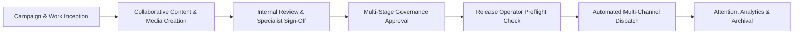
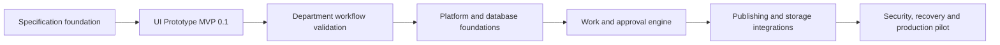

[[projects/ideas/Comms_Hub/Comms Hub|Comms Hub Overview]] | [[Status|Current Status]] | [[progress|Progress Log]] | [[MVP_draft|MVP Draft UI Shell]] | [[discussions_list|Master Discussions Index]] | [[Ideas_Backlog|Ideas Backlog]]

---

# Communication Department Hub — Product Roadmap

> [!note] Update as you work
> This roadmap is a living operational document. It establishes the planning rules, delivery horizons, and workflow boundaries for the Communication Department Hub. Update timelines, progress markers, and horizon items as real development proceeds.

---

## Product Purpose

The **Communication Department Hub** is a specialized, institutional management and operations platform engineered for corporate communications teams. It provides a unified workspace that bridges campaign planning, collaborative content creation, multi-tier approval governance, secure multi-channel publishing, and long-term digital asset preservation.

The hub serves eight confirmed organizational and administrative roles:
1. **مدير الاتصال المؤسسي** (Director of Corporate Communication) — Strategic authority and executive release governance.
2. **مساعد مدير الاتصال المؤسسي** (Assistant Director) — Operational oversight, task allocation, and delegated review.
3. **كاتب المحتوى** (Content Writer) — Editorial drafting, messaging alignment, and revision iteration.
4. **المصمم** (Designer) — Visual assets, brand identity consistency, and multi-format exports.
5. **المنتج الإعلامي** (Media Producer) — High-resolution video, motion graphics, and media pipeline processing.
6. **مسؤول النشر وإدارة الحسابات** (Publishing & Account Officer) — Channel scheduling, token verification, and release execution.
7. **عضو** (Department Member) — Collaborative contribution, campaign participation, and internal review.
8. **Admin** (System Administrator) — Infrastructure configuration, integration secrets, security policies, and user management.

---

## Core Operational Journey

The primary workflow routes work items smoothly from initial campaign assignment to verified external distribution:



---

## Delivery Horizons

The active scope is the UI Prototype MVP 0.1 in [[MVP_draft]]. Validate the prototype with department users before platform implementation. Future production work remains planned below; dates will be set after validation.

Two additions as of 2026-10-10. Department validation has begun: the first response (R01, the Director) is recorded, and its findings drive a first round of corrections from 2026-10-11. A new visual identity, «الهوية الجديدة لمركز الاتصال», is planned as an **optional** Checkpoint 0.3 that starts only if the Director approves it; Direction A stays in force until then.



> [!important] Scope and Planning Boundaries
> Detailed implementation tracking begins once development commences. Specific development cycles, milestones, and work packages must be defined collaboratively as each horizon approaches, ensuring that real learning from early stages directly informs subsequent engineering work.

---

## Planning & Operating Rules

### Document Responsibilities

The vault maintains a strict separation of document concerns across four core operational files:

| Document | Primary Responsibility | Update Frequency |
|---|---|---|
| `Roadmap.md` | Planned directions, dependency order, delivery horizons, and exit gates. | At milestone boundaries and major scope alignments. |
| `Status.md` | Present condition, active focus, capability health matrix, and next actions. | At the conclusion of every active work session. |
| `progress.md` | Dated outcomes, verified evidence, benchmark results, and limitations. | Whenever a meaningful change is completed and verified. |
| `MVP_draft.md` | Authoritative UI shell layout, page specifications, and user flows. | When interface requirements or user interactions change. |
| `validation/` | Checkpoint 0.2 workflow map, guided session scripts, and feedback rubric. | During Checkpoint 0.2; frozen at the 0.2.4 gate. |
| `validation/responses/` | One capture sheet per validation response or session (`R01`, `R02`, ...), transcribed in the rubric's format. | When a response arrives. |
| `Ideas_Backlog.md` | Extra ideas outside this roadmap: owner ideas, agent suggestions, Severity 4 preferences. Nothing there is planned. | When an idea is added, promoted or rejected. |

### Work Hierarchy & Breakdown Standards

Implementation work across the Communication Department Hub follows a four-tier breakdown structure modeled on proven project governance standards:

```
Version (X.0)
└── Checkpoint (X.Y)
    └── Phase (X.Y.Z)
        └── Task (X.Y.Z.W)
```

1. **Version (`X.0`) — Major Release Generation:**
   - Represents an overarching strategic milestone or product release lifecycle.
   - Contains high-level strategic objectives, core architectural boundaries, and the group of sequential checkpoints required for release.
2. **Checkpoint (`X.Y`) — Functional Capability Gate:**
   - Represents a major sequential milestone delivering an end-to-end usable capability.
   - Contains a concrete **Outcome Statement** (what capability is unlocked), prerequisite dependencies, and an **Exit Gate** (the strict verification criteria that must pass before advancing).
   - Exactly **one** checkpoint is actively in progress at any given time.
3. **Phase (`X.Y.Z`) — Thematic Subsystem Work Package:**
   - Represents a cohesive grouping of tightly coupled tasks focusing on a single subsystem (such as database schema, auth policies, queue worker, or UI shell).
   - Contains the specific set of atomic tasks needed to implement and verify that subsystem.
4. **Task (`X.Y.Z.W`) — Atomic Executable Unit:**
   - Represents an individual, bounded engineering task designed for completion within a single focused session.
   - Contains a standardized status marker (`[ ]`, `[/]`, `[x]`, `[-]`), an unambiguous definition of done, and an evidence requirement (unit test, terminal output, or artifact log) required for completion.

### Task State Conventions

When work items are scheduled in future planning iterations, use these standardized status markers:
- `[x]` = Completed and verified with concrete evidence (passing tests, recorded commands, or logs).
- `[/]` = Actively in progress in the current work session.
- `[ ]` = Planned and specified, but implementation has not started.
- `[-]` = Deliberately cancelled or superseded, accompanied by an explicit recorded reason.

### Engineering Truth & Safety Principles

1. **Evidence Over Assertion:** A feature is never marked completed simply because code was written or a mock interface was rendered. A capability is verified only when its real execution path runs successfully against real or realistic test fixtures.
2. **Recoverable Baselines:** Every significant file mutation must be preceded by a clean, recoverable baseline (Git commit or verified backup snapshot). Uncommitted work must never be silently overwritten, merged, or discarded.
3. **Prototype Boundary:** Version 0 uses local mock state only. For future production versions, long-running or external platform interactions belong in durable background jobs. This rule does not authorize workers or integrations in MVP 0.1.
4. **Zero Data Loss:** All modifications to documentation and code must preserve existing institutional context, Arabic terminology, and domain requirements.

The agent-facing copy of these principles, together with the zero-emoji policy, the Arabic terminology rules, and the prohibition on editing `disscussios/`, is kept in `AGENTS.md`. Keep the two in step.

---

## How to Proceed from This Scaffolding

When starting active implementation on the Communication Department Hub, follow this sequence:

1. **Review Current Status:** Consult `Status.md` to confirm the baseline state and identify the current active focus.
2. **Consult Architectural Specifications:** Reference the 11 companion documents in `disscussios/` for deep architectural guidance:
   - **Foundational Ideation Drafts:**
     - [[disscussios/First_idea_darft|First Idea Draft]] — Foundational technical ideation.
     - [[disscussios/Second_discussion_draft|Second Discussion Draft]] — Storage, AI controls, and publishing.
   - **Detailed Architecture Specifications:**
     - [[disscussios/organizational_role_discussion|Organizational Roles & Permissions]] — 8 confirmed roles and authority model.
     - [[disscussios/approval_policy_design|Approval Policies & Version Binding]] — Multi-stage approval and version binding.
     - [[disscussios/storage_lifecycle_disaster_recovery|Storage Lifecycle & 3-2-1 Disaster Recovery]] — Hybrid storage and backup.
     - [[disscussios/failure_handling_background_jobs|Background Jobs & Reliability Architecture]] — Queue and failure routing.
     - [[disscussios/connected_account_secrets_management|Connected Accounts & Secrets Management]] — OAuth and secret envelopes.
     - [[disscussios/notification_model|Three-Tier Attention & Notification Model]] — Action, Attention, Notification.
     - [[disscussios/search_and_metadata|Search, Metadata & Arabic Taxonomy]] — Full-text search and Arabic taxonomy.
     - [[disscussios/security_discussion|Security, Zero-Trust & Audit Logging]] — Defense-in-depth and immutable audit log.
     - [[disscussios/emergency_workflows|Emergency Workflows & Kill-Switch Controls]] — Crisis governance and freeze switch.
3. **Structure Initial Work Packages:** When ready to commence coding, define the initial milestone block with clear acceptance criteria and exit gates.
4. **Maintain Cadence:** Work on one bounded problem at a time, verify the result, log evidence in `progress.md`, update `Status.md`, and advance `Roadmap.md`.

---

## Version 0: UI Prototype

### Work plan from 2026-10-11

Written 2026-10-10 from response R01 (`validation/responses/R01-2026-10-10-director.md`)
and the identity proposal (<https://claude.ai/artifact/51Rsuxkv8LeDK1JJEpq6nr>). Day
targets are an order of work, not commitments; one bounded task at a time, each
verified before the next.

**Two tracks run side by side, kept apart.**

1. **Validation track.** The remaining participants test a frozen copy of today's
   prototype (task 0.2.2.6), so every participant sees the same starting state, as
   `validation/owner-input.md` section 7 requires.
2. **Correction track.** Round 1 corrections (Phase 0.2.3, tasks 0.2.3.5 to 0.2.3.10)
   are built on `main`. Each one cites the finding that justifies it. Under the
   rubric, a Severity 1 finding is corrected and re-checked with the participant who
   raised it; a Severity 2 finding qualifies because it arose on a daily task.

**Owner decisions needed first (2026-10-11).**

| ID | Decision | Recommendation |
|---|---|---|
| D-01 | Approve, adjust or decline the new identity (Checkpoint 0.3) | Send the artifact link to the Director with the three questions on its last screen. No identity work, other than the colour clean-up in 0.3.1, starts before an answer |
| D-02 | Do self-administered form responses count as sessions? The exit gate asks for a named facilitator; the form has none | Count them when the owner confirms the respondent and role, recording "facilitator: none, self-administered, reviewed by the owner" |
| D-03 | Confirm the provisional severities in R01 and the Round 1 list below | Confirm as listed; hold the Severity 2 items not on a daily task until a second participant raises them |

**Week of 11 to 15 October 2026.**

| Day | Work | Tasks |
|---|---|---|
| Sun 11 | Owner sends D-01 to the Director. Start the overdue count. (Freeze, R01 anomaly and recruitment skipped 2026-10-10: Director's input only) | 0.2.3.5 |
| Mon 12 | Finish the overdue count and filter. Stale-variant flag | 0.2.3.5, 0.2.3.7 |
| Tue 13 | Team workload and stage view on Work and Home | 0.2.3.6 |
| Wed 14 | Highlighted version difference. Early reconnect warning | 0.2.3.8, 0.2.3.9 |
| Thu 15 | Timestamped video notes. Round 1 browser QA script and `progress.md` entry. Re-check session with P01 | 0.2.3.10, 0.2.3.11 |

**Following week.** Transcribe each new response into `validation/responses/` as it
arrives and merge it into the register (0.2.3.1). Write the design notes for the
structural findings (0.2.3.12). If D-01 is approved, start Phase 0.3.2.

### Requested scope addition, 2026-10-08: local motion studio

Integrate the existing `motion_design` library into `/motion` using the established Arabic shell. Preserve 16 source designs and add ten more (26 in total), with the controls of the source library restored (timing, motion intensity, frame ratios, window preview) and fast browser-only downloads at up to 4K and 60 frames per second. Revised the same day after first review. This is independent of Phase 0.2.2 department validation and does not count as stakeholder acceptance.

Access restrictions, persisted assets, video uploads and workflow attachment remain future work. The revised scope, export behavior and prototype limits are specified in `MVP_draft.md` section 57. Verification and critic-round results are recorded in `progress.md` and `qa/motion-studio.json`.

### Checkpoint 0.1: UI Prototype MVP 0.1

**State:** Complete and verified (2026-09-19). **Authority:** [[MVP_draft]].
**Outcome:** A runnable Arabic RTL product prototype for eight roles, using one connected Saudi National Day 2026 scenario.  
**Exit Gate:** Selected design; six high-fidelity Level A pages; lighter B/C pages; role simulation; verified end-to-end mock workflow and responsive layouts. No real backend, authentication, integrations, or publishing.

> [!note] Acceptance State (2026-09-19)
> READY FOR CHECKPOINT 0.2. All eight personas and central supporting actions verified; 14 Level A desktop/mobile screenshots visually inspected; complete publication journey and 60 viewport checks pass. Build, typecheck and five domain tests pass. Focused keyboard/contrast review complete, not a formal accessibility certification. Retained local release snapshots added; upload/playback deliberately deferred. Evidence and accepted limitations: `qa/ACCEPTANCE.md`. No production services.

#### Phase 0.1.1: Scope and visual decision

- [x] 0.1.1.1 Inspect specifications and reconcile UI-first scope. Evidence: repository review and reordered roadmap, baseline commit `7e45e2b`.
- [x] 0.1.1.2 Produce three distinct visual directions, each with Home, Work, Work detail, Create, Approvals/Publishing, and Media at desktop and mobile. Evidence: `design-review/index.html`, 36 screenshots, three desktop boards, and `design-review/verification.json` with 72 viewport checks passing. Visual boards inspected.
- [x] 0.1.1.3 Record the user's selected or combined direction. User selected A on 2026-09-19; B contributes only larger media previews. Exact boundary recorded in `DESIGN.md`.

#### Phase 0.1.2: Selected foundation

- [x] 0.1.2.1 Scaffold Next.js, TypeScript and Tailwind; establish selected RTL tokens, shell and responsive navigation. Evidence: start/build checks and browser navigation.
- [x] 0.1.2.2 Add coherent mock entities and eight-role View As simulation. Evidence: linked campaign data and visible role-specific priorities.

#### Phase 0.1.3: Core workflow

- [x] 0.1.3.1 Implement Home, Work, Work detail and Create with forms, tabs, search, comments and mock review submission. Evidence: browser interaction walkthrough.
- [x] 0.1.3.2 Implement Approvals/Publishing, Calendar and Media Library with revision review, scheduling, previews and per-channel results. Evidence: approve/schedule/publish/partial-failure walkthrough.

#### Phase 0.1.4: Supporting experiences

- [x] 0.1.4.1 Add believable Mail, Ideas, Analytics and Monitoring, plus Admin, Settings and Account shells. Evidence: page and central-action checks.
- [x] 0.1.4.2 Connect notifications, activity, empty/loading/error states and mock outcomes. Evidence: cross-page state checks; notification read state separate from approval state.

#### Phase 0.1.5: Acceptance and handoff

> [!note] Phase Scope & Execution
> Phase 0.1.5 is executed as a unified verification and handoff package. Astra completes both the remaining multi-persona/accessibility verification in 0.1.5.1 and the final acceptance, demonstration, and documentation closure in 0.1.5.2.

- [x] 0.1.5.1 Persona, responsive, keyboard, and QA verification. Verify remaining persona experiences (designer, producer, member), 1440/1280 desktop, 768–1024 tablet and ~390 mobile layouts, central dialogs, and keyboard/accessibility navigation. Evidence: screenshots, verification test fixtures, and focused QA log.
- [x] 0.1.5.2 Final prototype acceptance, handoff, and tracking closure. Demonstrate the complete mock workflow end-to-end, verify clean production build and absence of production secrets/services, document verified limits, and synchronize tracking across Status, progress, and Roadmap. Evidence: acceptance walkthrough record and runnable setup instructions.

---

### Checkpoint 0.2: Department Validation

**State:** In progress. Phase 0.2.1 complete (2026-09-19). Phase 0.2.2 closed 2026-10-10 on one response (R01, Director, desktop); the remaining participants are skipped by owner directive. Phase 0.2.3 Round 1 corrections start 2026-10-11 on R01's findings.
**Outcome:** Validate the prototype against actual Communication Department work, record operational corrections, and authorize production architecture planning.

**Exit Gate (measurable).** All six criteria must hold before Checkpoint 0.2 closes:

1. **Role coverage.** At least one real participant has completed a guided session in each of these five role groups: Director, Assistant Director, a content specialist (Content Writer or Designer), Media Producer, and Publishing Officer. Department Member and Admin sessions are recorded when available but do not block the gate.
2. **Participant count.** At least six distinct human participants in total, of whom at least two hold department leadership positions (Director or Assistant Director). No participant may be counted for more than one role group.
3. **Scenario completion.** In each session the participant completes the assigned end-to-end scenario in `validation/validation-scripts.md` unaided, meaning without the facilitator naming the control to use. A session where the facilitator must intervene on more than two steps is recorded as a failed scenario.
4. **Pass threshold.** At least 80 percent of attempted scenarios complete without a structural blocker, where a structural blocker is any finding scored Severity 1 in `validation/feedback-rubric.md` (the participant cannot complete the task, or the model contradicts how the department actually works).
5. **Zero unresolved Severity 1 findings.** Every Severity 1 finding is either corrected in Phase 0.2.3 and re-checked with the participant who raised it, or explicitly deferred with a written, dated reason in `progress.md` and a recorded decision in `disscussios/` follow-up notes.
6. **Recorded evidence.** Every session has a completed rubric sheet, a dated findings entry in `progress.md`, and a named facilitator and participant role. Sessions without a completed rubric do not count toward criteria 1 or 2.

> [!note] Gate standing, 2026-10-10
> After R01: criterion 1 at one of five role groups (Director); criterion 2 at one of six participants, one of two leadership. R01 answered every role section, but a participant counts for one role group only, so the other sections are findings, not coverage. Criterion 6 asks for a named facilitator, while the Google Form was built to be self-administered. Owner decision D-02 settles whether form responses count; the criteria themselves are unchanged until it does.

> [!important] Gate standing, 2026-10-10 (after the directive)
> The owner directed that the Director's input alone is enough and the other members are skipped (Phase 0.2.2). Criteria 1 and 2 (five role groups, six participants, two leadership) therefore cannot be met as written and are waived by that directive, not satisfied. Criteria 3 to 6 still apply to R01: zero unresolved Severity 1 findings (corrected and re-checked with the Director in 0.2.3.11, or deferred with a dated reason), and a recorded rubric for R01. This waiver is to be restated in `Status.md` when task 0.2.4.3 checks the gate.

> [!important] Agent vs. Human Responsibilities in Checkpoint 0.2
> - **Astra / Agent Responsibility:** Conduct pre-validation workflow mapping (0.2.1), analyze prototype interaction bottlenecks, prepare structured guided interview scripts, validation rubrics, and feedback collection instruments, and synthesize evidence-based corrections into the specification and freeze gate (0.2.3, 0.2.4).
> - **Human Department Responsibility:** The actual execution of Phase 0.2.2 (Guided Department Validation) requires real human department leadership (Director, Assistant Director) and staff specialists (Writers, Designers, Producers, Publishing Officers) testing and evaluating the prototype against their real day-to-day operational realities. An agent cannot simulate or substitute for real department validation.

#### Phase 0.2.1 — Workflow Mapping

**State:** Complete (2026-09-19). Agent-executed; no human participation required.

- [x] **0.2.1.1 Map representative real workflows for the eight confirmed roles.**
  *Definition of done:* Each of the seven department roles plus Admin has at least one documented end-to-end workflow, written as ordered steps with the acting role, the trigger, the decision points, and the handoff to the next role. Workflows cite the specification section or discussion document each step rests on.
  *Evidence:* `validation/workflow-map.md`, sections 2 and 3.
  *Status:* Nine workflows recorded (W1 to W9), covering campaign inception, content authoring, design, production, review, release, member contribution, intake, and system administration.

- [x] **0.2.1.2 Compare the mapped workflow to the prototype's current assumptions.**
  *Definition of done:* Every mapped step is marked as supported, partially supported, or unsupported by the prototype, with the specific screen or reducer action that implements it, or a statement that none does.
  *Evidence:* `validation/workflow-map.md`, section 4 (assumption comparison table, one row per assumption).
  *Status:* 25 assumptions classified: 15 supported, 6 partially supported, 4 unsupported.

- [x] **0.2.1.3 Record exceptions, bottlenecks, and terminology corrections.**
  *Definition of done:* A numbered register in which each entry states what was observed, why it matters to the department, and whether it is a question for the human sessions or an agent-side correction. Terminology entries give the current string and the proposed Arabic wording.
  *Evidence:* `validation/workflow-map.md`, sections 5, 6 and 7.
  *Status:* 11 exceptions, 7 bottlenecks and 9 terminology items recorded, each tagged with the validation question that will test it.

- [x] **0.2.1.4 Prepare structured validation scripts and feedback rubrics.**
  *Definition of done:* One runnable session script per role group, each with a fixed setup state, timed tasks, unaided-success criteria, and the exact questions to ask; plus a scoring rubric with defined severity levels and a per-session capture sheet a non-technical facilitator can fill in.
  *Evidence:* `validation/validation-scripts.md` and `validation/feedback-rubric.md`.
  *Status:* Seven session scripts and a four-level severity rubric with a per-session capture sheet and a consolidated findings register.

- [x] **0.2.1.5 Correct the defects found in the pre-validation review.**
  *Definition of done:* Defects identified by review of the prototype against `MVP_draft.md` before human validation are corrected to the Phase 0.2.3 standard, meaning evidence-based only, each recorded with what changed and why. Corrections must not pre-empt findings that belong to the human sessions.
  *Evidence:* Commits `079cd5d` and `221477c`; `qa/checkpoint-02-corrections.cjs` with `qa/checkpoint-02-corrections.json` (34 browser checks passing); `npm test` 8 of 8 passing; clean `npm run typecheck` and `npm run build`; dated entry in `progress.md`.
  *Status:* Role-specific home experiences, notice scoping, Admin and Settings shells, calendar weekday alignment, post-publication edit policy, source reformatting and the smaller content gaps. Workflow questions raised by the mapping are left open for Phase 0.2.2 rather than decided here.

#### Phase 0.2.2 — Guided Department Validation (Human Department Execution)

**State:** Closed 2026-10-10 by owner directive. The Director stated that his input alone is enough, so the other members are not being asked. R01 (the Director's response, all seven role sections) is the department's validation input. Every remaining task below is marked skipped (`[-]`) with that reason. The response sheet was re-checked on 2026-10-10: it still holds one response, R01.

> [!note] Owner directive, 2026-10-10: Director's input only
> The remaining participants are skipped, not pending. Consequences for the exit gate are recorded in "Gate standing, 2026-10-10 (after the directive)" above. If other members are asked later, reopen the skipped tasks rather than writing new ones.

- [-] **0.2.2.1 Director and Assistant Director strategic and review validation.**
  *Definition of done:* Both leadership roles complete scripts S1 and S2 unaided, including approving an exact revision and rejecting a superseded one.
  *Evidence:* Two completed rubric sheets with named participants and dated findings in `progress.md`.
  *Status:* Director done through the Google Form on 2026-10-10 (R01): S1 5 of 7 scenario passes, failing task 3 (the purpose of «العمل») and task 6. The Director also answered S2. Assistant Director part skipped 2026-10-10 by owner directive (Director's input only).

- [-] **0.2.2.2 Content Writer, Designer and Media Producer specialist validation.** Skipped 2026-10-10 by owner directive (Director's input only). The Director's S3 to S5 answers in R01 stand in.
  *Definition of done:* At least one participant per specialism completes scripts S3, S4 and S5, including a revision round after a change request.
  *Evidence:* Three completed rubric sheets and the recorded terminology verdicts from section 7 of the workflow map.

- [-] **0.2.2.3 Publishing Officer release, scheduling and channel governance validation.** Skipped 2026-10-10 by owner directive (Director's input only). The Director's S6 answers in R01 stand in.
  *Definition of done:* The publishing officer completes script S6, including scheduling, a partial failure, and a retry that does not republish a successful channel.
  *Evidence:* One completed rubric sheet plus the participant's verdict on the connected-account health surface.

- [-] **0.2.2.4 Department member and administrative feedback collection.** Skipped 2026-10-10 by owner directive (Director's input only). The Director's S7 and Admin answers in R01 stand in.
  *Definition of done:* Script S7 completed by a department member, and the Admin surfaces reviewed by whoever actually administers systems for the department.
  *Evidence:* Completed rubric sheets, or a dated record that no such administrator exists yet, which is itself a finding.

- [-] **0.2.2.5 Mobile workflow review for on-call and remote scenarios.** Skipped 2026-10-10 by owner directive (Director's input only). R01 was on desktop, so no real-phone evidence exists; phone layouts rest on the 390 px browser checks.
  *Definition of done:* At least two participants, one of them leadership, complete their approval or release steps on a real phone.
  *Evidence:* Rubric sheets marked mobile, with the device and browser recorded.

- [-] **0.2.2.6 Freeze the validation build.** Skipped 2026-10-10: with no further participants there is nothing to freeze for. Correction work proceeds on `main` directly.
  *Definition of done:* The commit the remaining participants test is tagged (`validation-0.2`, today's `dd55cc3` unless Round 1 is approved for testing), served from its own working copy on the LAN port the form names, while correction work runs elsewhere. The form's instructions still match what that build shows.
  *Evidence:* Tag name, the serving command and a `/health` check recorded in `progress.md`.

- [-] **0.2.2.7 Resolve the R01 anomaly.** Skipped 2026-10-10 by owner directive. R01's S3 to S7 answers are taken as the Director's own and weighted as findings at face value.
  *Definition of done:* P01 confirms whether they completed sections S3 to S7 themselves, and the form is tested once with a dummy role to confirm the branching sends each role to its own section only. R01 is annotated with the answer.
  *Evidence:* Dated line in `validation/responses/R01-2026-10-10-director.md` section 9.

- [-] **0.2.2.8 Recruit the remaining role groups.** Skipped 2026-10-10 by owner directive (Director's input only).
  *Definition of done:* Named invitations sent for the Assistant Director, a content specialist, the Media Producer and the Publishing Officer, and a sixth participant, with at least two asked to use a phone (0.2.2.5).
  *Evidence:* Invitation list with roles and dates in `progress.md`.

#### Phase 0.2.3 — Prototype Corrections

**State:** Round 1 starts 2026-10-11 on the findings of R01, while Phase 0.2.2 continues. Later rounds follow as responses arrive. Tasks 0.2.3.2 to 0.2.3.4 stay open until the last session; 0.2.3.5 to 0.2.3.12 are Round 1.

- [/] **0.2.3.1 Synthesize human validation findings into a single ranked register.**
  *Definition of done:* Every finding from every session appears once, deduplicated, severity-scored, and attributed to the session that raised it.
  *Evidence:* Consolidated findings register in `validation/feedback-rubric.md`, plus a dated summary entry in `progress.md`.
  *Status:* R01 transcribed with 19 findings, 8 of them provisionally Severity 1. Register entry waits for decision D-03 on the severities.

- [ ] **0.2.3.2 Apply evidence-based workflow and interface corrections only.**
  *Definition of done:* Each applied correction cites the finding that justifies it. Changes with no finding behind them are not made. Typecheck, tests, build and a browser check pass after each correction.
  *Evidence:* Commits referencing finding identifiers, and passing `qa/` runs recorded in `progress.md`.

- [ ] **0.2.3.3 Remove or simplify interactions the department did not need.**
  *Definition of done:* Each removal names the sessions in which the interaction went unused or caused confusion.
  *Evidence:* Dated entry in `progress.md` listing what was removed and on what observation.

- [ ] **0.2.3.4 Correct role-specific experiences and Arabic terminology.**
  *Definition of done:* Every terminology item from section 7 of the workflow map has a recorded department verdict, and accepted corrections are applied across interface strings and `MVP_draft.md` consistently.
  *Evidence:* Terminology table with verdicts, and a passing browser check of the corrected strings.

**Round 1 corrections, from R01.** Every task below follows the same rule: the commit
message cites the finding; `npm run typecheck`, `npm test` and `npm run build` pass; a
browser check is saved under `qa/` as a script and its JSON result; `MVP_draft.md` is
amended where the interface changes; Arabic strings follow the established terms.

- [ ] **0.2.3.5 Overdue count and filter.** Finding F-R01-02 (Severity 1), B4, E5.
  *Definition of done:* The prototype states its scenario date on screen (it has no notion of "today": `dueSoon` in `src/lib/domain.ts` counts every item due on or before the campaign date, and all seed due dates are 22 or 23 September, so a tester on 10 October sees everything as late). Overdue and due-soon are measured against that scenario date, and the seed holds a realistic mix of on-time, due-soon and overdue items. Home for the Director and Assistant Director shows both counts, each a link to Work filtered to exactly those items; Work has an «متأخر» filter.
  *Evidence:* Domain test for the overdue rule against the scenario date; browser check that each count equals its filtered list for both roles.

- [ ] **0.2.3.6 Team workload and stage view.** Findings F-R01-01 and F-R01-17 (Severity 1), A25, B4, T6.
  *Definition of done:* Seed work is assigned to named people within each role, and the Work page gains a team view: per person, their items, each item's status and stage, what is overdue, and what awaits review or approval. Home for leadership shows the load per person. The page states its purpose in one line, since P01 could not tell what «العمل» is for. The section name «العمل» is not changed until T6 has a verdict.
  *Evidence:* Browser check for the Director and Assistant Director; screenshot at 1440 and 390 inspected.

- [ ] **0.2.3.7 Stale channel variants.** Finding F-R01-05 (Severity 2, a writer's daily task), B5.
  *Definition of done:* Editing the master text marks each channel variant written before the edit as needing review, shown on the variant and in the release the reviewer sees, cleared when the variant is edited or confirmed.
  *Evidence:* Domain test; browser check of edit, flag, confirm.

- [ ] **0.2.3.8 Highlighted version difference.** Finding F-R01-06 (Severity 2, a reviewer's and writer's daily task), B3.
  *Definition of done:* Between any two submitted revisions, changed text is highlighted and changed fields (asset version, channels) are listed, on the review screen and the writer's history.
  *Evidence:* Domain test of the text difference on Arabic text; browser check on revisions 1 and 2 of the seed item.

- [ ] **0.2.3.9 Early reconnect warning.** Finding F-R01-07 (Severity 2, the publisher's daily task), B6, E4.
  *Definition of done:* Scheduling onto a channel whose authorization expires before the publication time shows the warning at scheduling, and the Publishing Officer's home lists scheduled items at risk.
  *Evidence:* Browser check scheduling onto the seeded LinkedIn account.

- [ ] **0.2.3.10 Timestamped video review notes.** Finding F-R01-03 (Severity 1), B2, W4.
  *Definition of done:* A reviewer can add a note with a time (mm:ss) to a video asset version; notes are listed in time order on the review screen and the producer's work page; a change request can carry them. Playback stays deferred, so the time is typed, not picked from a player, and the interface says so.
  *Evidence:* Domain test; browser check of add, list, change request.

- [ ] **0.2.3.11 Round 1 re-check with P01.**
  *Definition of done:* P01 repeats S1 tasks 3 and 6 and S2 task 4 on the corrected build and confirms or rejects each Round 1 correction. Results recorded against the finding identifiers.
  *Evidence:* Addendum in `validation/responses/R01-2026-10-10-director.md` and a dated `progress.md` entry. Exit gate criterion 5 requires this re-check before a Severity 1 finding closes.

- [ ] **0.2.3.12 Design notes for the structural findings.** Findings F-R01-04, 09, 10, 11, 12, 13, 18 and 19.
  *Definition of done:* One short note per topic under `validation/design-notes/`, each stating the department's answer, the conflict with the current model and specification, the options, and a recommended Version 2 checkpoint: component-scoped approval (F-R01-04, E6), close and archive with a reason (F-R01-09, E11), configurable stages per content type (F-R01-10, B7, O-009), delegation with automatic expiry (F-R01-11, E2), urgent path (F-R01-12, E3), work linked to several campaigns (F-R01-13, E8), stage deadlines (F-R01-18), edit attribution (F-R01-19, E9). Existing `disscussios/` documents and `discussions_list.md` are not edited.
  *Evidence:* The notes, and a decision per note recorded in `progress.md`: build in the prototype now, defer to Version 2 with a dated reason, or ask the next participants.

#### Phase 0.2.4 — Product Freeze Gate

**State:** Not started. Depends on 0.2.3.

- [ ] **0.2.4.1 Freeze the Version 1 workflow assumptions on human sign-off.**
  *Definition of done:* A named department representative signs off the corrected workflow, and the frozen assumption set is written down as the Version 1 input.
  *Evidence:* Dated sign-off record and a frozen assumption list in `progress.md`.

- [ ] **0.2.4.2 Record unresolved questions separately.**
  *Definition of done:* Every question the sessions raised but did not settle is captured as a new discussion note, not silently dropped.
  *Evidence:* New follow-up notes under `validation/design-notes/`, alongside those of task 0.2.3.12. Existing `disscussios/` documents and `discussions_list.md` are not edited (`AGENTS.md`); corrected 2026-10-10, as this task previously pointed to `discussions_list.md`.

- [ ] **0.2.4.3 Authorize production architecture planning.**
  *Definition of done:* All six Exit Gate criteria above are demonstrably met and recorded, and Checkpoint 1.1 is opened.
  *Evidence:* Exit gate checklist completed in `Status.md` with a pointer to the evidence for each criterion.

---

### Checkpoint 0.3: Visual Identity Option — «الهوية الجديدة لمركز الاتصال»

**State:** Built as an option, not approved as the default (2026-10-10). By owner directive the second design is in the prototype behind a toggle: a double-click on the sidebar logo switches between Direction A and the new identity, remembered per browser. Direction A (`DESIGN.md`) stays the default. D-01 now decides which design is the default, or whether the option is removed. Phase 0.3.1 done; Phase 0.3.2 mostly done (light mode only); Phases 0.3.3 and 0.3.4 not started.
**Source:** the proposal artifact <https://claude.ai/artifact/51Rsuxkv8LeDK1JJEpq6nr> (read 2026-10-10).
**Outcome:** The prototype carries the emerald-and-gold identity: Reem Kufi headings, IBM Plex Sans Arabic text, an Aref Ruqaa accent on one word per page, the mashrabiya lattice and four gradients, eleven status colour pairs, light and evening modes, and the motion rules of the proposal, without changing roles, statuses, Arabic terms, version-bound approval or the local-simulation boundary. The proposal itself lists these as unchanged.
**Exit Gate:** Approval recorded; `DESIGN.md` rewritten to the new identity; all existing browser regressions (`qa/checkpoint-02-corrections.cjs`, `qa/motion-studio.cjs` and the Round 1 scripts) and domain tests pass; contrast of at least 4.5 to 1 computed for every text pair in both modes; reduced motion respected; zero emoji; no request leaves the local machine (fonts are served from the app, not Google Fonts).

> [!important] How this stays an option
> The new look is introduced behind one switch on the root element, so Direction A and the new identity can be compared on the same build and the change can be undone in one line. The switch is `data-identity="emerald"` on `<html>`, set by a double-click on the sidebar logo (`src/lib/identity.ts`) and restored before first paint; every rule of the second design lives in `src/app/identity.css` under that attribute. The validation build freeze (0.2.2.6) was skipped with Phase 0.2.2, so no participant is affected. The owner authorized running this checkpoint alongside Checkpoint 0.2 on 2026-10-10; the exception is recorded in `progress.md`.

#### Phase 0.3.1 — Colour clean-up (identity-neutral)

- [x] **0.3.1.1 Move hard-coded colours into tokens.**
  *Definition of done:* `src/app/globals.css` defines six colour variables and hard-codes most other colours inline (status chips, panels, media art, calendar, toasts). Every colour becomes a named token, mapped first to today's Direction A values, so the rendered prototype does not change. Useful whether or not the identity is approved, and the only Checkpoint 0.3 task allowed before D-01.
  *Evidence:* Screenshots of every Level A page at 1440 and 390 before and after, compared pixel by pixel with zero differences; regression scripts pass.
  *Status:* Done 2026-10-10, commit `91b67b4`. 73 tokens (70 colours, 3 shadows); no colour literal remains outside the token block. `qa/colour-tokens.cjs`: 63 captures (15 routes, two roles, 1440 and 390, plus overlays), 63 of 63 pixel-identical, re-confirmed on the final toggle build. The Motion Studio's own stylesheet and its canvas colours are out of scope: they are artwork settings, not interface colours.

#### Phase 0.3.2 — Foundation (after approval)

- [/] **0.3.2.1 Identity tokens and fonts.** The proposal's tokens for both modes, under the switch; Reem Kufi, IBM Plex Sans Arabic, Aref Ruqaa and IBM Plex Mono served locally (all four are under the SIL Open Font License; confirm each licence file is kept). *Evidence:* contrast table generated by script for both modes.
  *Status:* Light mode done 2026-10-10 in `src/app/identity.css`. Reem Kufi and IBM Plex Sans Arabic served from the app through `@fontsource` 5.3.0 (OFL licence files kept in `node_modules/@fontsource/*/LICENSE`); Aref Ruqaa and IBM Plex Mono are not installed until a screen uses them (0.3.3). `qa/identity-toggle.cjs` computes 48 contrast pairs from the live tokens: every text pair at least 4.5 to 1, the gold logo 3.59 to 1 against the 3 to 1 rule for graphics. Two proposal values were adjusted to pass: sidebar small text `#a3c4b4` to `#bad3c6`, and gold behind text uses a lighter gradient end (`#c99a3c` instead of `#a8761f`). Evening mode is open, with task 0.3.4.3.
- [x] **0.3.2.2 Shell.** Emerald-depth sidebar with the lattice texture, top bar with role and notifications, the gold active marker. *Evidence:* screenshots of all eight role homes in both identities.
  *Status:* Done 2026-10-10. Eight role homes in both designs captured by `qa/identity-toggle.cjs` (16 screenshots, `qa/artifacts/identity/home-*.png`) and inspected.
- [/] **0.3.2.3 Shared components.** Buttons, chips, fields, tabs, segmented control, switch, dialogs, toasts, empty and loading states, each with normal, hover, focus, disabled and loading states. *Evidence:* a QA component page showing every state, checked by a `qa/` script.
  *Status:* Re-skinned 2026-10-10: buttons, fields, pill chips with a status dot (production and publishing states gain their own colours), tabs, dialogs, toasts, empty and loading states, with motion only when reduced motion is not requested. The QA component page is not built, so this task stays open.

#### Phase 0.3.3 — Decision screens (after approval)

- [ ] **0.3.3.1 Home: «قراراتك الآن», campaign pulse and team load.** Re-skins the Round 1 overdue and workload views (0.2.3.5, 0.2.3.6); it does not rebuild them.
- [ ] **0.3.3.2 Approvals with the version difference and the approval stamp.** Re-skins 0.2.3.8. The stamp is the one celebrated moment, and respects reduced motion.
- [ ] **0.3.3.3 Three-tier notifications** (قرارك، انتباه، للعلم), per `disscussios/notification_model.md`.
- [ ] **0.3.3.4 Command palette** (Ideas Backlog I-021), only if the Director wants it.

#### Phase 0.3.4 — Time and phone (after approval)

- [ ] **0.3.4.1 Calendar week view with channel lanes and drag to reschedule.** Drag only moves a requested time; the Publishing Officer still confirms (A12).
- [ ] **0.3.4.2 Motion Studio from the work item** (I-023) and media library in the new identity.
- [ ] **0.3.4.3 Phone approval sheet with 44 px targets, and evening mode** (I-022). Tested on a real phone as in task 0.2.2.5.

**If declined.** Keep Direction A and the token clean-up from 0.3.1.1. Record the decision and reason in `progress.md`; the proposal's interface ideas stay in `Ideas_Backlog.md` (I-021 to I-023). **If adjusted.** Record the requested changes, revise the proposal artifact, and ask again before 0.3.2.

---

## Version 1: Production Foundation

**State:** Planned (blocked on prototype validation).  
**Authority:** Architectural specifications in `disscussios/`.  
**Goal:** Convert the validated prototype into a secure, persistent, deployable multi-user application foundation.

### Checkpoint 1.1 — Platform & Environment Foundation

**Outcome:** Reproducible development, staging, and deployment environment with hardened boundaries.

Phases:
- **1.1.1 Codebase & Tooling Cleanup:** Production build configuration, linting, and dependency sanitization.
- **1.1.2 Vercel Environment Setup:** Deployment targets, preview branches, and edge runtime configuration.
- **1.1.3 Supabase Environment Setup:** Project initialization, database connection pooling, and client SDK bindings.
- **1.1.4 Configuration & Secrets Boundary:** Strict separation of client/server environment variables and key management.
- **1.1.5 Migration & Seed Baseline:** Deterministic database migration tooling and baseline test seed data.
- **1.1.6 Build & CI Verification:** Continuous integration pipeline running typecheck, unit tests, and build checks.

**Exit Gate:** Fresh environment can be configured, migrated, built, and deployed reproducibly.

### Checkpoint 1.2 — Identity & Organizational Authorization

**Outcome:** Real authenticated users operate under the confirmed institutional organizational model.

Phases:
- **1.2.1 Authentication & Session Management:** Supabase Auth integration, session tokens, and refresh flows.
- **1.2.2 User Profile & Lifecycle:** Account states (active, suspended, offboarded) and profile metadata.
- **1.2.3 Organizational Positions & Hierarchy:** Department positions, reporting lines, and organizational units.
- **1.2.4 Role Permissions & Capabilities:** Fine-grained permission assignments mapping to the eight confirmed roles.
- **1.2.5 Resource-Level Access Control:** Scoped access to campaigns, work items, and internal documents.
- **1.2.6 Delegation Foundations:** Temporary and delegated authority mechanisms for review and approvals.
- **1.2.7 Server-Side & RLS Enforcement:** Row-Level Security policies ensuring no client can bypass authorization rules.

**Exit Gate:** Authorization tests prove users cannot read or mutate data exceeding their verified authority.

### Checkpoint 1.3 — Persistent Core Domain

**Outcome:** Campaigns, Work Items, participants, comments, and core Asset metadata persist durably.

Phases:
- **1.3.1 Relational Schema & Constraints:** Tables, foreign keys, constraints, and indexes for core entities.
- **1.3.2 Domain Repositories & Services:** Clean application service layer mediating between UI and database.
- **1.3.3 Migration Pipeline & Baseline:** Fully versioned, reversible schema migration scripts.
- **1.3.4 Realistic Seed Fixtures:** Realistic department test data reflecting institutional workflows.
- **1.3.5 UI State Binding:** Replacement of local mock state with server-backed data fetching and mutations.
- **1.3.6 Concurrency Controls & Data Validation:** Optimistic locking, input validation, and transaction boundaries.

**Exit Gate:** Core work survives browser sessions and redeploys, maintaining full consistency across concurrent users.

### Checkpoint 1.4 — Event & Audit Foundation

**Outcome:** Meaningful organizational changes emit structured events and durable, immutable audit records.

Phases:
- **1.4.1 Structured Event Vocabulary & Schemas:** Defined event types covering all state transitions and governance actions.
- **1.4.2 Immutable Audit Logging Model:** Append-only audit table tracking actor, timestamp, action, and payload diffs.
- **1.4.3 Actor & Resource Context Propagation:** Request context tracing ensuring every mutation captures the initiating identity.
- **1.4.4 Sensitive Action & Security Records:** Dedicated audit capture for permission changes, emergency actions, and logins.
- **1.4.5 Audit Query & Compliance Display Foundation:** Admin interface for querying and inspecting audit trails.

**Exit Gate:** Representative workflows produce complete, tamper-resistant, and trustworthy audit histories.

### Checkpoint 1.5 — Version 1 Acceptance Gate

**Outcome:** Secure, persistent multi-user foundation fully validated against staging environments.  
**Exit Gate:** Real authentication, roles, persistent database, core work workflows, audit logging, and automated deployment operate correctly without external publishing integrations.

---

## Version 2: Workflow & Operations

**State:** Planned (follows Version 1).  
**Goal:** Turn the production foundation into the department's real internal operating system.

### Checkpoint 2.1 — Work & Campaign Engine
- **Scope:** Campaigns, Work Items, participants, priorities, deadlines, comments, revision tracking, and complete lifecycle states.
- **Outcome:** Full operational tracking of all departmental content initiatives from concept to readiness.
- **Validation input (R01, 2026-10-10, one participant, to be confirmed):** assignment to a named person by specialty and load; one work linked to several campaigns; a final deadline per work with optional stage deadlines; close or cancel with a reason and an archive; a source on each work so planned and unplanned work can be measured (Ideas Backlog I-010).

### Checkpoint 2.2 — Asset Management Core
- **Scope:** Provider-agnostic core domain logic. Establishes the Asset, Version, Location abstraction (`AssetLocation`), metadata schemas, MIME validation, thumbnail extraction pipeline, and Work/Campaign bindings. Real external storage integrations (Google Drive, NAS, etc.) are strictly deferred to Checkpoint 3.2.
- **Outcome:** Unified, provider-agnostic asset domain model supporting version immutability and multi-format bindings without external provider lock-in.

### Checkpoint 2.3 — Approval & Release Engine
- **Scope:** Version-bound release packages, multi-stage approval requests, formal decisions, delegation, and revision invalidation.
- **Outcome:** Strict governance ensuring approved content cannot be modified without re-triggering the approval chain.
- **Validation input (R01, to be confirmed):** the Director holds approval, and the path may later differ by content sensitivity and type; a design-only change needs a new approval of the design version, not of unchanged text; temporary delegation to a named person that expires by itself; an urgent path that is faster but still ends in the Director's approval; post-publication correction by edit or delete-and-republish, decided by the Director; edits by the Director attributed without taking the author's credit.

### Checkpoint 2.4 — Actions, Attention & Notifications
- **Scope:** Three-tier attention model: Action Items (blocking), Attention Items (informational), and Notifications (activity feed).
- **Outcome:** Role-tailored operational inbox preventing notification fatigue while ensuring critical approvals are never missed.
- **Validation input (R01, to be confirmed):** alerts on delay, a named owner per stage, and organised intake of requests from other departments, named as the biggest current blocker.

### Checkpoint 2.5 — Search & Metadata
- **Scope:** Permission-aware global search, tag taxonomy, faceted filtering, full-text indexing, and Arabic text normalization.
- **Outcome:** Fast discovery across campaigns, work items, and media assets with full dialectal Arabic tolerance.

### Checkpoint 2.6 — Durable Job Foundation
- **Scope:** Background job execution, scheduled triggers, retry policies, exponential backoff, dead-letter queues, and Needs Attention triage.
- **Outcome:** Resilient asynchronous task engine capable of handling media processing and batch tasks without data loss.

### Checkpoint 2.7 — Internal Operations Pilot

**Exit Gate:** The department can plan, assign, create, review, revise, approve, and track real internal work end-to-end without external publishing integrations.

---

## Version 3: Connected Operations

**State:** Planned (follows Version 2).  
**Goal:** Safely connect Comms Hub to external storage, communication channels, and publishing systems.

### Checkpoint 3.1 — Connected Account Infrastructure
- **Scope:** OAuth 2.0 flows, token encryption envelopes, token refresh workers, health monitoring, reauthorization alerts, and revocation.
- **Outcome:** Secure external platform connection management without exposing raw secrets to client code.

### Checkpoint 3.2 — Production Storage Adapter
- **Scope:** Implement the `AssetLocation` / Storage Adapter interface with the selected first production storage provider (evaluating Google Shared Drive as the primary institutional candidate, without locking into an unearned S3/hybrid decision prematurely).
- **Outcome:** Seamless large-file asset preservation adhering to the 3-2-1 backup lifecycle specification with the chosen initial storage provider.

### Checkpoint 3.3 — Publication Orchestrator
- **Scope:** Publication bundles, platform adapters (X/Twitter, LinkedIn, Instagram, etc.), preflight checks, and child publication records.
- **Outcome:** Unified multi-channel publishing interface with channel-specific validation rules.

### Checkpoint 3.4 — Scheduling & Failure Recovery
- **Scope:** Durable scheduling, platform rate limit respect, idempotency keys, transient error retries, and partial failure isolation.
- **Outcome:** Dependable publishing that isolates failed channels without re-publishing or duplicating successful ones.

### Checkpoint 3.5 — External Mail & Intake
- **Scope:** Inbound press releases, media inquiries, official correspondence intake, and automatic work item drafting. Delivery sequence and depth are subject to validated department priority established in Checkpoint 0.2 (retaining its position if email intake is central to daily operations, or deferred/reordered if other integrations take precedence).
- **Outcome:** Direct translation of inbound external communications into actionable departmental work items aligned with verified department intake habits.

### Checkpoint 3.6 — External Reconciliation
- **Scope:** Webhook receivers and polling workers to track and reconcile posts modified, scheduled, or deleted directly on native platforms.
- **Outcome:** Synchronized truth between external social channels and the internal Comms Hub calendar.

### Checkpoint 3.7 — Real Analytics Collection
- **Scope:** Platform metrics collection (impressions, engagement, clicks, reach), campaign-level rollups, and reporting exports.
- **Outcome:** Automated performance reporting linked directly to originating campaigns and work items.

### Checkpoint 3.8 — Controlled Production Pilot

**Exit Gate:** Selected real departmental communication workflows can be planned, approved, scheduled, executed, reconciled, and monitored live through Comms Hub.

---

## Version 4: Intelligence & Automation

**State:** Future / intentionally un-decomposed.  
**Goal:** Use the trusted data, workflows, and external execution capability from Versions 1–3 to provide controlled automation and contextual intelligence.

### Candidate Capabilities
- Rule-based workflow automation and routing.
- AI drafting assistance and Arabic-language stylistic refinement.
- Automated diff comparison between approval revisions.
- Inbound mail summarization and metadata extraction.
- Automatic OCR, speech-to-text transcription, and video captioning.
- Semantic vector search across institutional media archives.
- AI-derived taxonomy tagging and tone compliance checks.
- Executive analytics summarization and trend explanations.
- Human-in-the-loop policy boundaries and AI confidence scoring.
- AI usage, latency, and cost governance controls.

> [!important] Planning Rule for Version 4
> Detailed checkpoints, phases, and atomic tasks for Version 4 will not be defined until empirical operational evidence and user feedback from the Version 3 production pilot have been collected and analyzed.

---

^comms-hub-roadmap-boundary
