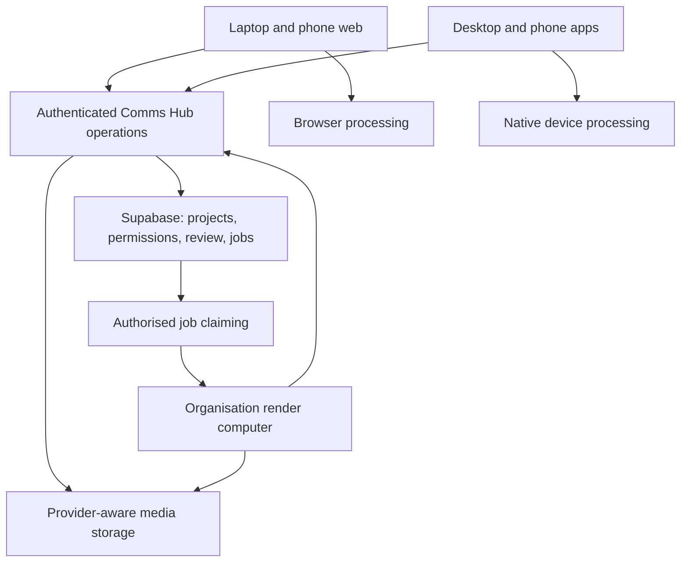

# Comms Hub studio: feasibility, web-to-app path, and research decisions

Research date: 2026-10-15, Asia/Riyadh.

Status: research and proposed direction. This document does not approve implementation, select a final editing engine, change existing permissions, or change the product specification.

Requested scope: explore a full photo and video studio integrated with Comms Hub, beginning with laptop web, extending to phone web with a smaller feature set, and later reaching desktop applications and the Apple App Store and Google Play.

Only this research document is created for this request. The application, database, integrations, deployment, and existing project documents are unchanged.

## Contents

1. [Assessment and recommendation](#1-assessment-and-recommendation)
2. [What exists in Comms Hub today](#2-what-exists-in-comms-hub-today)
3. [Browser limits and what an application changes](#3-browser-limits-and-what-an-application-changes)
4. [Open-source projects investigated](#4-open-source-projects-investigated)
5. [Recommended technology direction](#5-recommended-technology-direction)
6. [Architecture and a shared editing-project format](#6-architecture-and-a-shared-editing-project-format)
7. [Path from laptop web to desktop and phone applications](#7-path-from-laptop-web-to-desktop-and-phone-applications)
8. [Media-library and storage integration](#8-media-library-and-storage-integration)
9. [Tasks, review, notes, roles, and approvals](#9-tasks-review-notes-roles-and-approvals)
10. [Cache, temporary uploads, and ten-day cleanup](#10-cache-temporary-uploads-and-ten-day-cleanup)
11. [Processing jobs and the organisation computer](#11-processing-jobs-and-the-organisation-computer)
12. [Native applications, offline work, and distribution](#12-native-applications-offline-work-and-distribution)
13. [Tests and evidence still required](#13-tests-and-evidence-still-required)
14. [Open decisions and research order](#14-open-decisions-and-research-order)
15. [Evidence and source register](#15-evidence-and-source-register)

## 1. Assessment and recommendation

A substantial photo and video studio is feasible in a website. Reliable heavy editing on every phone browser is not a sound product promise. A downloaded application helps when it adds native file access, processing, and recovery. Packaging the existing website alone does not provide those improvements.

The recommended direction to investigate is one studio connected to Comms Hub, with shared projects, media references, review, and permissions. Its interface and processing capabilities can differ by platform.

| Question | Assessment | Consequence |
|---|---|---|
| Can the website become a full studio? | Yes, within a declared and tested feature set. | Begin with qualified laptop browsers and representative media. |
| Can phone web support it? | Yes, with a deliberate touch interface and selected editing tools. | Keep complex projects readable even when some tools are unavailable. |
| Will a desktop app help? | Yes, especially through native processing and disk-based caches. | Reuse the interface where useful and add a native processing option. |
| Will phone apps help? | Yes, through native media and device integration. | Measure memory, heat, background execution, and recovery on actual devices. |
| Can Vercel and Supabase stay? | Yes. | Keep their existing application responsibilities and add suitable processing execution where needed. |
| Can reviewers work outside the studio? | Yes. | Give access to specific previews and notes through tasks without granting editing access. |
| Can temporary data expire after ten days? | Yes. | Classify the data first and provide a process that actually removes remote files. |
| Is an open-source editor a complete integration solution? | No candidate has been demonstrated as one. | Test the engine separately from permissions, storage, workflow, and native packaging. |

No engine performance, mobile reliability, Arabic export fidelity, or cross-platform project compatibility has been established by this research. Source inspection identifies candidates and risks; it does not replace running them.

### 1.1 Working recommendations

- Retain the React, TypeScript, Next.js, Vercel, and Supabase application stack.
- Develop the laptop web experience first, with project persistence and review included in its foundation.
- Use a smaller phone-web feature set and preserve advanced project content when a simpler client saves it.
- Investigate OpenCut Classic as the closest video-editor reference to the current web stack.
- Evaluate miniPaint and PhotoCraft for different levels of photo editing. Do not assume a custom canvas framework is the cheapest complete editor.
- Investigate Mediabunny for browser media input/output if the chosen engine permits that integration.
- Prefer Tauri for the first desktop feasibility experiment if a native bridge is needed. Compare Electron only where its consistent Chromium and Node environment solves a measured problem.
- Evaluate Capacitor for mobile reuse of the web interface. Reconsider Tauri mobile if a selected Rust engine provides a clear advantage.
- Use native FFmpeg or platform media APIs where they prove useful. Treat browser FFmpeg.wasm as a selective fallback or utility, rather than the default answer to every processing task.
- Design saved projects so that browser, native, and organisation-computer processing can be added without replacing system identity, storage records, or approvals.

These recommendations are conditional. The tests in section 13 may change the shortlist.

## 2. What exists in Comms Hub today

The current page remains «استوديو الحركة» at /motion. The following observations describe the inspected code and project records, not a new production verification.

| Existing part | Observed state | Relevance to a full studio |
|---|---|---|
| Motion page | A local Arabic motion-template editor with 26 templates. | Useful motion tools and brand assets can remain available inside a wider studio. |
| Project state | Template drafts are local component state and reset on refresh. | Durable editing projects, autosave, and recovery would be new. |
| Video loading | A local clip can be loaded for preview context. | This does not establish a general imported-video editing and audio-export pipeline. |
| Exports | Canvas-based motion rendering with PNG, PNG sequence ZIP, transparent MOV, and MP4 options. | Existing exports should remain supported until any replacement is verified. |
| Export memory | ZIP/MOV have a 1.6 billion byte in-memory ceiling; encoded video chunks are accumulated. | These are implementation limits and growth points, not universal browser ceilings. |
| Media serving | Authenticated, version-aware, provider-aware streaming supports byte ranges for video seeking. | A useful starting point for editor imports and review previews. |
| New library uploads | Resumable uploads send bytes from the browser to Google Drive. The current application ceiling is 5 GB, with a configurable lower limit. | This ceiling belongs to Comms Hub today. It is separate from browser and provider limits. |
| Storage providers | Google Drive is the upload destination. Existing files can be read from OneDrive or S3-compatible storage after a move. | Arbitrary provider selection for new editor uploads is not already implemented. |
| OneDrive | The adapter is built. Project records describe fake-Graph testing and an outstanding first real move. | Treat real-account operation as a test requirement. |
| NAS | The design depends on the planned agent computer or a separately arranged reachable connection. | Do not describe NAS integration as already operational. |
| Accounts and permissions | Supabase-backed accounts, roles, page rights, capabilities, RLS, and database write functions. | Extend this model rather than building separate studio accounts. |
| Work and media workflow | Tasks, versioned media, work records, comments, review, and approvals have existing foundations. | Connect an editing project to these records instead of creating a second task system. |
| Publishing | Still a simulation. | A completed studio export must not imply real platform publishing. |
| Scheduling and workers | The current site has no scheduled cleanup or media-processing worker. | Automatic remote expiry and unattended rendering need an explicitly introduced executor. |

Local evidence includes the [motion component](D:/Agents/main/projects/ideas/Comms_Hub/src/components/motion-studio.tsx), [motion exporter](D:/Agents/main/projects/ideas/Comms_Hub/src/lib/motion/export.js), [storage core](D:/Agents/main/projects/ideas/Comms_Hub/src/lib/storage/index.ts), [provider interface](D:/Agents/main/projects/ideas/Comms_Hub/src/lib/storage/provider.ts), [upload-session route](D:/Agents/main/projects/ideas/Comms_Hub/src/app/api/media/upload-session/route.ts), and [media-content route](D:/Agents/main/projects/ideas/Comms_Hub/src/app/api/media/[id]/content/route.ts).

The existing 4K and 60 fps motion-template options do not prove that an arbitrary multi-track 4K editing project will perform well. Those are different workloads.

### 2.1 Existing project boundaries that continue to apply

- [MVP_draft.md](D:/Agents/main/projects/ideas/Comms_Hub/MVP_draft.md), including the motion-studio specification, remains the product authority until an explicit decision changes it.
- [Reference_Build_Plan.md](D:/Agents/main/projects/ideas/Comms_Hub/Reference_Build_Plan.md) and the reference model continue to govern the work cycle.
- [Settings_Integrations_Plan.md](D:/Agents/main/projects/ideas/Comms_Hub/Settings_Integrations_Plan.md), decision E-1, places unattended and NAS work on the organisation computer when it arrives. This document does not authorise a site scheduler.
- [disscussios/approval_policy_design.md](D:/Agents/main/projects/ideas/Comms_Hub/disscussios/approval_policy_design.md) remains relevant to approval of exact versions.
- [disscussios/storage_lifecycle_disaster_recovery.md](D:/Agents/main/projects/ideas/Comms_Hub/disscussios/storage_lifecycle_disaster_recovery.md) remains relevant to retention and recovery.
- [disscussios/failure_handling_background_jobs.md](D:/Agents/main/projects/ideas/Comms_Hub/disscussios/failure_handling_background_jobs.md) remains relevant to retries and unattended processing.

The institutional documents under disscussios are references only and are not changed.

## 3. Browser limits and what an application changes

### 3.1 What is practical in the browser

| Workload | Feasibility assessment | Main constraints to measure |
|---|---|---|
| Crop, resize, rotate, text, and ordinary photo adjustments | Strong candidate for laptop and phone web. | Image dimensions, layers, text correctness, memory, and export fidelity. |
| Photo layers, masks, brushes, and undo history | Feasible with a suitable engine. | Tile caching, history size, device memory, and touch interaction. |
| Video trim, split, crop, titles, captions, and audio | Feasible within a qualified project profile. | Codec support, decoding, audio synchronisation, and export path. |
| Multi-track editing and transitions | Feasible, with workload limits. | Simultaneous decoders, compositing, seek latency, and memory pressure. |
| Heavy effects and long 4K/60 projects | Conditional. | Hardware, codec profile, input structure, effects, output buffering, and heat. |
| Reliable export after the page is closed | Requires processing outside that page. | A browser tab cannot be the durable execution owner for this promise. |
| Full RAW, colour-managed print, complex PSD, or professional HDR round trips | Separate advanced requirements. | Importing a format is not proof of lossless edit/export compatibility. |

There is no evidence-based universal rule such as five minutes maximum, 2 GB maximum, or four layers maximum for all web editors. Limits must be tied to an implementation, a device, and a workload.

### 3.2 Memory and large files

A decoded 3840 by 2160 image uses about 33.2 MB for one 8-bit RGBA frame before other overhead. A 24-megapixel photo uses about 96 MB for one such pixel buffer. Working copies, masks, decoder queues, effects, undo steps, and export buffers add to that requirement.

A small compressed file can therefore require substantial working memory. Conversely, a large input can sometimes be processed efficiently through streaming and small frame queues.

Read input in ranges or chunks where possible. Prefer disk or stream-backed output when supported. Avoid treating a whole-file ArrayBuffer or final Blob as the default path for every export.

### 3.3 Codecs, graphics, and browser differences

WebCodecs provides media encoding and decoding APIs. It does not supply the complete editor, timeline, effects engine, or container muxer. A browser may decode a format without being able to encode the desired output configuration. Probe the actual codec, resolution, frame rate, and audio configuration.

Hardware availability varies by browser, operating system, device, and media profile. WebGPU or WebGL support also does not establish acceptable performance by itself. A software fallback may make an operation technically available but too slow for the intended experience. See the [WebCodecs API](https://developer.mozilla.org/en-US/docs/Web/API/WebCodecs_API) and [Mediabunny codec documentation](https://mediabunny.dev/guide/supported-formats-and-codecs).

### 3.4 Storage and lifecycle

IndexedDB and the Origin Private File System, or OPFS, can hold local project data and cache. Their quotas and eviction behaviour depend on the browser and device. A persistence request improves the position in some environments but does not turn local browser storage into an organisational backup.

Background tabs may be throttled, frozen, or discarded. A service worker or a PWA installation does not guarantee unlimited rendering after the interface closes. Local cache cleanup also cannot execute at an exact deadline while its application is not running. See [browser storage and eviction](https://developer.mozilla.org/en-US/docs/Web/API/Storage_API/Storage_quotas_and_eviction_criteria) and [page lifecycle](https://developer.chrome.com/docs/web-platform/page-lifecycle-api).

### 3.5 Downloadable applications

| Delivery form | Useful gains | What it does not automatically provide |
|---|---|---|
| PWA | Installation, standalone launch, some offline behaviour, and supported web device integrations. | A native media engine or removal of browser API limits. |
| Native container with web interface | Native file selection, app storage, sharing, camera access, and plugin APIs. | Faster canvas rendering or native video export without additional work. |
| Desktop app with native processing | Disk-backed caches, native codecs/tools, larger local workflows, and more control over execution. | Unlimited hardware resources or progress while the computer is asleep. |
| Mobile app with native processing | Access to platform media facilities and native background-task mechanisms. | Unlimited memory, guaranteed background completion, or freedom from heat and battery limits. |

Apple's continued-processing API explicitly accommodates tasks such as exports, with progress and cancellation. Resource conditions can still terminate a task. Platform-specific interruption handling remains necessary. See [Apple continued processing](https://developer.apple.com/documentation/BackgroundTasks/performing-long-running-tasks-on-ios-and-ipados) and [BGContinuedProcessingTask](https://developer.apple.com/documentation/BackgroundTasks/BGContinuedProcessingTask).

## 4. Open-source projects investigated

The findings below consolidate repository, source-file, licence, and documentation inspection from this research. No candidate was built, benchmarked, or used with confidential organisational media.

### 4.1 OpenCut and OpenCut Classic

The main [OpenCut repository](https://github.com/OpenCut-app/OpenCut) describes an active rewrite. Its planned Rust core, editor API, plugins, mobile/desktop/browser clients, and headless mode are future direction rather than demonstrated capabilities of a ready integration. The maintainers direct users to [OpenCut Classic](https://github.com/OpenCut-app/opencut-classic) for current use.

Classic is the closer video reference for the current React/Next.js stack. Inspected code includes a Mediabunny exporter, canvas scene rendering, browser project storage, and OPFS media storage.

| Finding in Classic | Integration implication |
|---|---|
| The inspected exporter uses BufferTarget and returns a complete output buffer. | Large exports need a memory test and possibly a different output target. |
| Audio is assembled into an AudioBuffer for the inspected export path. | Long projects and multiple tracks may have substantial audio memory requirements. |
| MP4/WebM and codec selection exist in the exporter. | Actual device and codec configurations still need qualification. |
| Browser persistence exists. | Replace or connect its project ownership and asset references to Comms Hub rather than adopting an isolated identity model. |
| Text rendering is implemented. | Arabic shaping, mixed direction, wrapping, captions, and export must be tested. |

Recommendation: include Classic in the first video feasibility comparison. Do not commit to the rewrite's roadmap or assume Classic becomes a native editor through packaging alone.

Evidence: [Classic scene exporter](https://github.com/OpenCut-app/opencut-classic/blob/main/apps/web/src/services/renderer/scene-exporter.ts), [storage service](https://github.com/OpenCut-app/opencut-classic/blob/main/apps/web/src/services/storage/service.ts), and [MIT licence](https://github.com/OpenCut-app/opencut-classic/blob/main/LICENSE).

### 4.2 PhotoCraft

[PhotoCraft](https://github.com/storytold/photocraft) uses a Rust engine and egui interface, with GPU work, layers, masks, and other advanced photo-editing ambitions. A browser build exists through WebAssembly. It is an early-alpha candidate, not an established replacement for professional daily work.

The inspected web packaging documentation does not provide document autosave and crash recovery comparable to an integrated cloud project system. Imported presets and preferences are a different kind of persistence. Its web bundle and runtime costs require measurement.

Arabic support is partial. The text engine contains shaping and bidirectional layout work, while the localisation record describes missing Arabic translations and incomplete RTL interface parity. Text-engine capability must not be confused with a complete Arabic interface.

Recommendation: evaluate PhotoCraft if advanced photo editing is a real requirement and a Rust engine remains attractive for later native work. Compare it against a simpler editor on startup time, integration effort, document persistence, and Arabic output.

Evidence: [web packaging](https://github.com/storytold/photocraft/blob/main/packaging/web/README.md), [text layout](https://github.com/storytold/photocraft/blob/main/crates/text/src/layout.rs), and [localisation parity](https://github.com/storytold/photocraft/blob/main/docs/localization-parity.md).

### 4.3 FilmCraft

[FilmCraft](https://github.com/storytold/filmcraft) has a Rust engine, egui interface, and a browser build. Desktop capability should not be used as a claim about web parity.

Its web documentation describes cooperative execution on a single browser thread. Several desktop facilities, including proxy/render-preview workflows and tracking-related operations, are unavailable or constrained in that web configuration. WebCodecs decoding support does not establish native hardware-accelerated export.

The inspected filesystem code supports chunked local reads, while generated output and browser download paths still need memory evaluation. The exposed JavaScript commands API is useful evidence for possible integration. OPFS recovery is promising but does not establish cloud recovery or another device's ability to reopen the project.

The localisation record identifies substantial RTL and Arabic-title concerns.

Recommendation: retain FilmCraft as a deeper engine candidate. It needs more proof before becoming the default for an Arabic phone-web product.

Evidence: [web scope](https://github.com/storytold/filmcraft/blob/main/docs/web.md), [browser filesystem](https://github.com/storytold/filmcraft/blob/main/apps/filmcraft-web/src/fs.rs), [commands API](https://github.com/storytold/filmcraft/blob/main/apps/filmcraft-web/src/api.rs), and [localisation parity](https://github.com/storytold/filmcraft/blob/main/docs/localization-parity.md).

### 4.4 Other candidates and building blocks

| Project | Useful role | Main limitation or question | Research position |
|---|---|---|---|
| [miniPaint](https://github.com/viliusle/miniPaint) | Browser photo editor with layers, filters, brushes, and project saving. | Its text-tool source explicitly describes RTL direction as partial work. Test Arabic and large images. | Practical photo-editor comparison candidate. |
| [Graphite](https://github.com/GraphiteEditor/Graphite) | Procedural graphics, vectors, and raster design. | Alpha state; broader animation/video ambitions are not a completed conventional video editor. | Investigate if graphics workflows justify it. |
| [Mediabunny](https://mediabunny.dev/) | Browser media input/output, codecs, muxing, and output targets. | A library, not an editing interface or complete rendering engine. | Preferred browser-media building-block candidate. |
| [Fabric.js](https://github.com/fabricjs/fabric.js) | Editable canvas objects, text, images, and filters. | Building an editor around it adds substantial product work; RTL requires direct testing. | Consider for a deliberately bounded graphic/photo feature set. |
| [Revideo](https://github.com/midrender/revideo) | Programmatic motion/video composition and server-assisted rendering. | Not a ready general-purpose editing interface. | Relevant to templates and an external render process. |
| [Editly](https://github.com/mifi/editly) | Declarative Node/FFmpeg rendering of clips, images, audio, and titles. | A processing tool, not a browser timeline interface. | Relevant to bounded automated compositions. |
| [DesignCombo / OpenVideo](https://github.com/designcombo/react-video-editor) | Web-editor reference with commercial SDK options. | The inspected README applies company-size licence conditions. Confirm the exact edition and terms. | Do not treat it as an unrestricted MIT dependency. |
| [Photopea](https://www.photopea.com/api/) | External embedding/integration comparison. | Source availability, licensing, privacy, and deployment assumptions require separate review for an external service. | Reference only; not the recommended open-source foundation. |

Mediabunny's [output documentation](https://mediabunny.dev/guide/writing-media-files) distinguishes a complete in-memory buffer from streamed output. That distinction matters more for large exports than the presence of an export button in a demo.

### 4.5 Licence and maintenance findings

| Candidate | Inspected source licence position | Follow-up before adoption |
|---|---|---|
| OpenCut / Classic | MIT in the inspected repositories. | Preserve notices and audit included assets and dependencies. |
| PhotoCraft / FilmCraft | Source offered under MIT or Apache 2.0. Branding and some assets have separate conditions. | Audit redistribution, fonts, artwork, third-party components, and fork branding. |
| miniPaint | MIT. | Audit bundled assets, dependencies, and any added plugins. |
| Graphite | MIT or Apache 2.0 source, with separate branding considerations. | Check assets and redistribution details for the actual build. |
| Mediabunny | MPL 2.0. | Account for file-level source obligations when modifying and distributing covered files. |
| Revideo / Editly | MIT in the inspected source. | Review transitive media dependencies and the shipped processing build. |
| FFmpeg.wasm | Wrapper and FFmpeg core components have different licence considerations. | Audit the exact compiled libraries and intended distribution. |
| DesignCombo / OpenVideo | The inspected README describes conditional free use and company licensing. | Obtain the applicable terms for the exact package and organisation. |

Source availability is not evidence of project maturity, mobile parity, or inexpensive maintenance. Any fork needs an owner, a pinned revision, an update process, and a record of local changes.

## 5. Recommended technology direction

### 5.1 Keep the current application stack

The installed application uses Next.js 16.3.8, React 19.3.0, TypeScript, and Supabase clients, according to the inspected package manifest. This document does not propose upgrading or replacing them.

| Responsibility | Recommended starting point | Reason and boundary |
|---|---|---|
| Website and system interface | Existing React/Next.js application. | Reuse accounts, navigation, Arabic terms, tasks, and help patterns. |
| Studio interface | Client-side editor module with explicit backend calls. | It can later be packaged separately from Next.js server code. |
| Video editing | Compare OpenCut Classic with FilmCraft on the test corpus. | Classic is closer to the web stack; FilmCraft has a potentially useful native engine but larger current web/RTL risks. |
| Photo editing | Compare miniPaint and PhotoCraft. | They represent different complexity and integration costs. |
| Browser media handling | Evaluate Mediabunny where compatible with the chosen engine. | Range-based inputs, codec checks, and streamed output are relevant. |
| Laptop browser persistence | OPFS/IndexedDB cache plus server project saves. | Local speed and recovery complement, rather than replace, shared project persistence. |
| Desktop packaging | Tauri as the first experiment. | Useful native bridge with web-interface reuse. The final engine may change this choice. |
| Mobile packaging | Capacitor as the first web-interface reuse experiment. | Native plugins can add phone-specific functions without immediately replacing the interface. |
| Native processing | Evaluate FFmpeg and platform media APIs. | Choose based on export consistency, codec needs, licensing, and device support. |
| Shared records and access | Existing Supabase Postgres, Auth, RLS, and database functions. | Studio permissions must fit existing system authority. |
| Live review and progress | Supabase Realtime with authorised, bounded updates. | Persist authoritative state; reconnecting clients fetch the current record. |
| File bytes | Existing provider abstraction, extended for studio needs. | Keep logical media references independent of physical locations. |
| Unattended processing and cleanup | Organisation computer as the first architecture to investigate. | Fits the current E-1 boundary and NAS direction. |

Do not add all of these technologies by default. A selected engine may already supply several of the required functions.

### 5.2 Vercel's role

Vercel can continue to host the website and authenticated coordination APIs. It can authorise requests, initiate resumable transfers, accept job requests, return current state, and receive authenticated results.

The documented Function limits at research time include bounded memory and duration. The ordinary request/response body limit is 4.5 MB. Certain Pro and Enterprise configurations can use an extended duration beta of up to 30 minutes. These details must be rechecked for the actual plan and runtime before implementation.

Those limits do not mean Vercel cannot process any media. Small bounded work may fit. They mean a durable, potentially large render should not depend on one ordinary interactive HTTP request completing successfully. See [Function limits](https://vercel.com/docs/functions/limitations) and [maximum duration](https://vercel.com/docs/functions/configuring-functions/duration).

Large uploads should transfer through a supported resumable or direct provider path. Large downloads and seeking need a tested serving path. The existing authenticated range-streaming route is useful, but its throughput, cost, duration, and reconnection behaviour need testing under editor use.

Vercel Function local disk is not the place to promise a ten-day shared media folder. Keep durable file data in a storage provider. See [Vercel's explanation of ephemeral serverless storage](https://vercel.com/kb/guide/is-sqlite-supported-in-vercel).

### 5.3 Supabase's role

Supabase should hold project identity, access, saved revision references, asset bindings, review records, job state, and cache manifests. Small structured project documents may also be suitable in Postgres; large project blobs and frequent snapshots need a measured storage decision.

The existing external storage providers can continue to hold media bytes. Supabase Storage is an optional additional provider, not a prerequisite for this studio proposal.

Realtime can notify authorised viewers of saved previews, notes, and job changes. Postgres Changes applies RLS checks; do not substitute a subscription filter for access control. Broadcast channels, if chosen instead, need their own authorisation design. See [Supabase Postgres Changes](https://supabase.com/docs/guides/realtime/postgres-changes).

Postgres and Realtime should not receive per-frame image data or an update for every rendered frame. Persist meaningful transitions and throttle progress updates. Rendering belongs in the processing executor.

### 5.4 Browser FFmpeg

FFmpeg.wasm is useful for selected conversion or fallback tasks, but its memory and performance need measurement. Its documented input limit is specific to that implementation; it is not a universal web-editor limit. Multithreading adds resource and deployment requirements.

SharedArrayBuffer-dependent paths require cross-origin isolation. Required headers can affect external fonts, media, frames, and other integrations. Test that deployment configuration before adopting it. See the [FFmpeg.wasm FAQ](https://ffmpegwasm.netlify.app/docs/faq/), [performance notes](https://ffmpegwasm.netlify.app/docs/performance/), and [SharedArrayBuffer requirements](https://developer.mozilla.org/en-US/docs/Web/JavaScript/Reference/Global_Objects/SharedArrayBuffer).

## 6. Architecture and a shared editing-project format

### 6.1 Responsibility boundaries

The arrows describe a proposed division of work. They do not create integrations or permit an executor to bypass current permissions.

### 6.2 What an editing project must represent

A project is the saved set of editing instructions and exact source references. It is distinct from its preview and final exported file.

| Information | Why it matters |
|---|---|
| Stable project ID, schema version, and owning work/task | Every client can locate the same project and apply compatible save rules. |
| Editor engine/version and effect versions | Later clients know what is required to reopen or render it. |
| Source asset IDs and exact media versions | A library upload cannot silently change an existing cut. |
| Tracks, clips, layers, trims, transforms, effects, and transitions | The edit remains reproducible rather than becoming only a flat preview. |
| Frame rate, duration, dimensions, timing units, and colour assumptions | Different executors can agree about placement and output. |
| Audio placement, gain, fades, and sample-rate handling | Preview and export stay synchronised. |
| Text, captions, fonts, text direction, and style | Arabic output remains reproducible on another device. |
| Saved revision ID and concurrency information | A late save cannot silently replace a newer revision. |
| Proxy and cache references | Clients can find disposable working copies without treating them as originals. |
| Preview and export bindings | Review notes and approvals can identify the exact artifact. |

This is a required information model for evaluation, not a proposed migration or an instruction to invent a new media engine. Prefer a selected engine's project format where it can meet these needs, with a small Comms Hub envelope around it.

### 6.3 Cross-platform preservation

- A client must declare which project schema and effects it can read and edit.
- A phone that cannot edit an effect should preserve its data, show the existing preview where possible, or open the project read-only.
- A save from a simpler client must not silently flatten or discard unsupported tracks, layers, fonts, or effects.
- Changes to a project schema need an explicit migration and recovery path.
- Export jobs must use a fixed saved revision rather than a project that changes during rendering.
- Cached proxies must identify their source version and processing recipe. The same filename is not enough.

## 7. Path from laptop web to desktop and phone applications

This is a proposed sequence with exit evidence, not a dated delivery commitment. No cost or duration estimate is justified until the engine experiments are complete.

### 7.1 Stage 0: prove the foundation

Before a full studio implementation, run isolated experiments against a fixed media corpus. Compare at least one plausible photo engine and two plausible video approaches. Add a thin native export experiment before a final engine commitment if native applications remain a firm objective.

The result should identify supported inputs/outputs, memory behaviour, Arabic correctness, project reopen behaviour, and a credible native path. If no candidate passes, narrow the promised features or revise the processing model.

### 7.2 Stage 1: laptop web

| Area | Proposed scope |
|---|---|
| Devices | Qualified laptop/desktop browsers, beginning with an explicit browser/OS support matrix. |
| Photo work | Agreed crop, resize, text, adjustments, layers, and export capabilities. |
| Video work | Agreed timeline, trim/split, basic composition, titles, audio, captions, and export capabilities. |
| System connection | Select permitted library media; attach a project to a task/work; save projects; create review previews; save exported media. |
| Reliability | Autosave acknowledgement, local recovery, missing-source handling, progress/cancel, interrupted transfer recovery. |
| Initial collaboration | One active editor per project; authorised shared review and notes. |

Exit evidence must demonstrate save/reopen after refresh and crash, Arabic correctness, actual decoded outputs, permission enforcement, source/version consistency, and acceptable performance on the minimum supported laptop.

A project is not safely saved merely because its timeline JSON reached the server while its only source files remain on one browser's local disk.

### 7.3 Stage 2: laptop and phone web

Create a touch interface for selected tasks instead of squeezing the full laptop timeline onto a small screen.

| Feature area | Proposed phone-web position |
|---|---|
| Task review, preview playback, and timestamped notes | Primary supported workflow. |
| Import, crop, resize, text, and ordinary photo adjustments | Evaluate for full support within a tested image profile. |
| Video trims, ordering, captions, text, and simple audio changes | Evaluate for a selected tool set and project profile. |
| Complex masks, many tracks, precision keyframes, and expensive effects | Initially restricted, read-only, or delegated to stronger processing. |
| Heavy final exports | Offer a qualified local path or a reachable external executor. |
| Advanced project reopen | Preserve unsupported content and explain the available actions. |

Exit evidence includes iOS Safari and Android Chrome on real devices, touch selection and scrubbing, keyboard interactions, interrupted uploads, low storage, backgrounding, unsupported effects, and cross-device reopen.

Exact phone restrictions must follow evidence. They are not universal limits derived from screen width.

### 7.4 Stage 3: desktop application

The first desktop experiment should test Tauri with the chosen editor interface and a native processing adapter. It should prove local files, disk cache, authentication, export, and project exchange with the website.

Keep the existing server online. Provider credentials and privileged operations do not move into the downloaded application. Tauri's documented Next.js frontend integration uses static exports; current server routes and other server-dependent code need to remain backend services rather than being assumed to run inside that static bundle. See [Tauri with Next.js](https://tauri.app/start/frontend/nextjs/).

Evaluate Electron if a consistent Chromium environment, Node integration, or a required dependency produces a measured advantage that justifies its distribution characteristics. See [Electron's architecture scope](https://www.electronjs.org/docs/latest/tutorial/tutorial-prerequisites).

Exit evidence includes installation, signing, updates, native/web rendering comparisons, large files without whole-output RAM growth, interrupted renders, disk-full recovery, and safe sign-out.

### 7.5 Stage 4: iOS and Android applications

Evaluate Capacitor as a way to reuse the web interface with native plugins. A mobile app still needs a phone-specific interface and deliberate native media operations. Evaluate Tauri mobile if it reduces integration work for the selected Rust engine; it is not automatically the best choice because the desktop experiment used Tauri.

Phone applications can add camera and photo-library imports, share actions, app storage, native processing, notifications, and selected offline workflows. Each platform integration needs permission handling, interruption handling, and recovery.

Exit evidence includes native-device codec behaviour, prolonged editing and export, thermal behaviour, system background restrictions, app termination, offline/online transitions, secure session storage, and store submission requirements. See [Capacitor plugins](https://capacitorjs.com/docs/plugins) and [supported development environments](https://capacitorjs.com/docs/getting-started/environment-setup).

### 7.6 Feature continuity across stages

| Property | All stages should preserve |
|---|---|
| Identity | The same Comms Hub account and server-side authority. |
| Project | The same stable project identity and compatible saved revision. |
| Sources | The same exact asset versions. |
| Review | Notes remain attached to the preview version that was reviewed. |
| Approval | Existing approval authority and exact-version binding. |
| Cache | Disposable data can disappear without deleting the saved edit or permanent source. |
| Unsupported tools | Their data survives or editing is explicitly blocked. |

The entire Comms Hub does not have to be rebuilt as a native application to achieve this. A studio-focused native client can remain connected to the same system. Whether to package the full system or only studio workflows remains an open product decision.

## 8. Media-library and storage integration

### 8.1 Opening existing media

1. A person opens a task, work, asset, or the studio.
2. The media picker shows only assets that person may use.
3. Selection binds the editing project to an asset ID and a specific version.
4. The processing client reads the authorised source or a derived proxy through a supported serving path.
5. Saving the project records those bindings without overwriting the original asset.

Where possible, reference existing originals rather than uploading duplicate permanent copies. A device or render executor may need a working copy, but that copy belongs to cache management.

### 8.2 New imports from the editor

The editor should explain whether an import is local-only, still uploading, temporarily stored, or saved permanently. Proposed Arabic wording includes «على هذا الجهاز فقط»، «جارٍ رفع الملف»، «محفوظ مؤقتًا»، and «محفوظ في المكتبة».

A shared or reviewable saved project should not claim all media is available until its required source uploads are complete. A local file that has not been uploaded must be visibly marked as unavailable on other devices.

Saving an imported source to the library must use the existing create/write rights for the destination folder. Studio access alone must not permit writes to a restricted or locked media folder.

### 8.3 Provider independence

| Concern | Proposed rule |
|---|---|
| Project references | Use logical asset/version references. Do not store expiring download URLs as the identity of a source. |
| Provider location | Resolve through file-location records and the existing provider abstraction. |
| Provider credentials | Keep them on the authorised server/agent path. Never embed them in the client project. |
| Range reads | Test seeking through Google Drive, OneDrive, S3, and eventually NAS. |
| Direct upload | Use provider-supported resumable or signed transfer mechanisms with project and destination checks. |
| Moving storage | Existing project references must keep working after a verified move. |
| Disconnected provider | Explain that the source is temporarily unavailable; do not silently substitute different media. |
| Checksums | Use an appropriate content identity for integrity and cache invalidation. Account for differing provider hash semantics. |

The current storage-role type covers library, mail, chat, and backup. A studio scratch area is not already a defined role. A future implementation must decide whether it uses a dedicated role/provider configuration or a distinct, protected area of an existing provider.

### 8.4 NAS access

A NAS is a file location, not automatically an internet service. A phone away from the office cannot use an arbitrary local filesystem path.

Investigate an authenticated pull agent on the organisation network, a managed access path, or a carefully arranged gateway. The existing E-1 direction favours an organisation computer for this work. A studio project should still use logical media references so that NAS topology does not appear inside its editing instructions.

NAS hardware also does not automatically make it a good render machine. Its CPU/GPU, storage throughput, and supported software need separate assessment.

### 8.5 Saving output

An exported preview is a review artifact. A final output is a media asset or a new version of the intended output asset. Both should record the editing-project revision and source bindings that produced them.

Do not silently overwrite an approved source or treat a new export as already approved. The existing work-cycle approval rules apply to the exact submitted output. Publishing remains a simulation until separately implemented.

## 9. Tasks, review, notes, roles, and approvals

### 9.1 Example integrated workflow

1. A permitted person assigns a video-editing task and links its work and source assets.
2. The editor chooses «فتح في الاستوديو» and opens or creates the linked editing project.
3. Saved revisions update the task's editing-project reference and last-saved information.
4. The editor chooses «إرسال نسخة للمراجعة». A preview is generated from a fixed saved revision.
5. An authorised reviewer watches it inside the task and adds timestamped or frame-area notes.
6. The editor sees those notes in the studio and resolves them against a later revision.
7. A subsequent preview keeps its own version identity. Earlier notes remain historically meaningful.
8. The final export enters the existing media/work review and approval flow.

These are proposed connections to existing records. They do not require every participant to have studio access.

### 9.2 Separate permission questions

| Action | Authority to evaluate |
|---|---|
| Open the studio page | Existing page/capability model. |
| Open a particular editing project | Project/work assignment and explicit access rules. |
| Import an original source | Source asset and folder permissions. |
| Edit a project | Project edit authority, including any temporary or one-time grant. |
| See a task preview | Access to that specific review artifact through its task/work rules. |
| Add a review note | Comment authority on that review. |
| Download originals | Separate source-media authority. |
| Save an export to a library folder | Existing create/edit rights on that destination. |
| Run a render | Project authority plus bounded job/executor rights. |
| Clear cache | Ownership or management of the particular disposable cache. |
| Approve or publish | Existing fixed approval and publishing rules. No generic studio grant changes them. |

The current media-content route requires access to the media page. Supporting a task reviewer without that page right needs a resource-specific review-serving operation. Do not bypass that check by granting broad media access or exposing provider links.

The database and authorised backend must enforce these rules. Hiding a studio button or filtering a picker is not access control.

### 9.3 Role fit

The following describes proposed workflows, not automatic new role grants. Existing capabilities, assignments, folder restrictions, and testing exceptions remain authoritative.

| Established role | Potential studio-related workflow |
|---|---|
| مدير الاتصال المؤسسي | See authorised work progress and previews, leave direction, and exercise existing approval authority. |
| مساعد مدير الاتصال المؤسسي | Follow authorised production and review, coordinate corrections, and exercise existing approval authority. |
| كاتب المحتوى | Prepare or review titles, captions, and text in an authorised project without requiring every advanced editing tool. |
| المصمم | Work on photos, graphics, layout, brand elements, and authorised video graphics. |
| المنتج الإعلامي | Edit video/audio, manage cuts, generate previews, and prepare exports. |
| مسؤول النشر وإدارة الحسابات | Inspect approved outputs and platform suitability, then use the existing publishing workflow. Studio editing requires its own authority. |
| عضو | See and comment on specifically authorised tasks or previews. Membership alone does not grant editing or source access. |
| Admin | Configure integrations and capabilities under existing rules. Preserve the documented scope of administrative testing exceptions and private-data restrictions. |

### 9.4 Progress that means something

| Information | How to obtain it |
|---|---|
| Editing stage | Explicit task/editor update or an established workflow transition. |
| Last saved revision | A successful server save acknowledgement. |
| Upload progress | Actual bytes transferred against expected bytes. |
| Preview/export progress | Executor-reported phase and completed work against a meaningful total. |
| Waiting for feedback | A submitted review preview with an open review state. |
| Activity indicator | A current session heartbeat, clearly distinct from completed work. |

Do not infer a creative completion percentage from the studio being open, mouse activity, or a render counter. Show separate operation labels such as «جارٍ رفع الملفات» and «جارٍ التصدير». Any ETA should admit uncertainty and should not be presented before useful progress exists.

### 9.5 Notes and version binding

Every review note should identify its preview version, author, creation time, and resolution state. Video notes can include a timestamp or interval. Photo notes can include a marked region. A saved still can help preserve the visual context.

Changing the timeline can move or remove the material at a timestamp. Keep the original note anchored to its original preview. Linking it to a later corrected version can be explicit; automatic remapping should not be assumed correct.

Initial collaboration should use one active editor per project, with safe lease/concurrency behaviour and recoverable drafts. Simultaneous timeline editing needs conflict-resolution design beyond Realtime notifications.

## 10. Cache, temporary uploads, and ten-day cleanup

### 10.1 Proposed data classes

The distinction is between what can be recreated and what would be lost. A provider folder named temporary is not sufficient evidence that every file inside it can be removed.

| Data class | Examples | Proposed treatment |
|---|---|---|
| Permanent library original | A source photo, clip, audio file, or original media version. | Existing library retention. Cache cleanup never deletes it. |
| Temporary source import | A new upload that has not been retained as permanent project/library media. | Explicit temporary status and expiry. Warn before loss; provide a retain action. |
| Retained project source | An import required to reopen a saved project, even if not browsable in the shared library. | Durable storage and project retention. Do not classify it as cache. |
| Editing-project revision | Timeline, photo layers, text, and exact source references. | Persist independently of disposable previews. |
| Reproducible local cache | Downloaded working copies, thumbnails, waveforms, and proxies on a device. | Disposable with clear local scope. Recreate when necessary. |
| Reproducible shared cache | Proxies or render intermediates in a provider or on the render machine. | Eligible for ten-day expiry when no active operation needs them. |
| Saved review artifact | A preview that was shared and has review history or notes. | Keep under review retention. It is not ordinary expiring cache. |
| Final media output | Approved/submitted output and its versions. | Existing output/version retention. |
| Incomplete transfer or failed-job output | Abandoned upload parts and uncommitted temporary exports. | Clean through a tracked recovery/expiry policy after verifying they are unused. |

### 10.2 Proposed ten-day rules

These are suggested defaults for a later decision, not an enabled policy.

| Rule | Proposed meaning |
|---|---|
| Reproducible cache lifetime | Eligible for cleanup ten days after its last actual use. Use server time for shared records. |
| What counts as use | Reading or updating that cache for an editing/processing operation. Merely visiting a dashboard should not extend every file's lifetime. |
| Active operation | A valid processing or editing-use lease protects required cache until the operation releases it or its stale lease is resolved. |
| Temporary import lifetime | Ten days from completed upload unless retained. Show an explicit expiry date. Any extension should be deliberate and visible. |
| Saved-project dependency | Before saving/sharing a project as durable, retain its unique sources. If that cannot finish, show the project as incomplete or temporary. |
| Manual cache deletion | Delete only eligible reproducible cache in the stated device/project/shared scope. Explain if active operations temporarily block deletion. |
| Review previews with notes | Keep as review records until the review retention policy permits removal. |
| Permanent originals and outputs | Never expire through the cache policy. |

A user may intentionally abandon temporary imports. That is distinct from deleting cache. It requires wording that identifies the affected files and the impact on reopening a project.

### 10.3 Local and shared cleanup

| Location | How cleanup runs | Timing promise |
|---|---|---|
| Browser OPFS/IndexedDB | On startup and during safe active-session maintenance. | Best effort after expiry. The OS/browser may also evict data earlier. |
| Native app cache | Through native cache management and supported lifecycle opportunities. | Best effort if the app is not running. Do not promise an exact unopened-app deadline. |
| Organisation render computer | Its authorised cleanup process scans due cache and transfer records. | Runs while the machine and provider are reachable. |
| Shared cloud provider | An authorised scheduled cleanup executor removes or trashes due objects through the provider API. | Automatic only once that executor is built and operating. |
| NAS | Agent-mediated cleanup with the same manifest and permission rules. | Delayed when the agent, NAS, or network is unavailable. |

The current architecture has no scheduled site executor. E-1 makes the organisation computer the first option to investigate. If it is offline at expiry, the record becomes due and cleanup resumes later. The interface should show that state rather than claiming the bytes are gone.

Supabase Cron is a technical alternative if a later decision changes the scheduling boundary. It can schedule database functions or HTTP requests, but it does not automatically remove a Google Drive or OneDrive object because a row expired. Provider operations and retries still need implementation. See [Supabase Cron](https://supabase.com/docs/guides/cron).

### 10.4 Cache manifest and identity

A cache record should identify the project, source asset/version, processing recipe, owner or visibility scope, provider/device location, expected bytes, creation time, last-used time, expiry, operation lease, and deletion state.

Use source content/version plus processing settings and engine version to identify a derivative. A 720p proxy for one source version is not valid for another version with the same filename.

A reference shared by several projects needs dependency tracking. Do not delete its only retained source merely because one project releases a cache entry. Physical deduplication must not reveal that a restricted asset exists to an unauthorised person.

### 10.5 Cleanup execution and recovery

1. Identify due entries from the manifest, rather than deleting everything older than a date under a path.
2. Claim a bounded cleanup batch and recheck active use, dependencies, retention class, and provider identity.
3. Mark entries as pending deletion so new work can recreate or reacquire cache deliberately.
4. Invoke the appropriate provider or local filesystem operation.
5. Record the observed result. Keep a failed or offline deletion pending for retry.
6. Record deletion only after the provider operation confirms its result. Keep enough non-secret audit evidence to investigate failures.
7. Expire abandoned claims safely. Re-running cleanup must not delete unrelated media or fail on an object already removed.

Follow the current recoverable-trash approach unless a later decision explicitly establishes another policy for disposable derivatives. Moving an item to trash is different from permanent erasure and may not immediately release quota. Provider recovery and quota behaviour need testing.

Purging a source does not automatically purge every backup copy. Backup retention and provider trash must be included in any later promise about permanent removal.

The current backup record exporter uses an allow-list. New studio records and project files are not automatically covered by it. Define and verify their backup and restore treatment explicitly, while preserving the existing exclusions for private personal data and secrets.

### 10.6 Proposed Arabic wording

| Situation | Proposed wording |
|---|---|
| Clear reproducible preview files | «حذف ملفات المعاينة المؤقتة» |
| Explanation | «لن تُحذف الملفات الأصلية أو المشروع المحفوظ. قد يلزم إنشاء المعاينات مجددًا.» |
| Device-only scope | «سيُحذف التخزين المؤقت من هذا الجهاز فقط.» |
| Temporary source expiry | «هذا الملف محفوظ مؤقتًا حتى {date}. احتفظ به مع المشروع أو في المكتبة لتتمكن من استخدامه لاحقًا.» |
| Retain unique source | «الاحتفاظ بالملف مع المشروع» |
| Save source to library | «حفظ الملف في المكتبة» |
| Local-only source | «هذا الملف على جهازك فقط. ارفعه لتتمكن من فتح المشروع من جهاز آخر.» |
| Cleanup awaiting agent | «انتهت مدة الاحتفاظ بهذه الملفات المؤقتة. سيُنفّذ الحذف عند اتصال جهاز المعالجة.» |
| Cache in use | «تستخدم عملية تصدير بعض الملفات المؤقتة. يمكنك حذفها بعد انتهاء العملية.» |
| Missing reproducible cache | «أُزيلت ملفات المعاينة المؤقتة. سنُنشئها مجددًا من الملفات الأصلية.» |

Any implemented wording must use real dates and measured sizes. A destructive action must follow the project's existing hold-button interaction rules.

## 11. Processing jobs and the organisation computer

### 11.1 Three places processing can run

| Executor | Strength | Limitation |
|---|---|---|
| Browser | No installation and immediate interaction with local media. | Browser lifecycle, codec availability, memory, output persistence, and device performance. |
| Native user application | Local files, native processing, and disk cache. | The user's hardware, power state, app lifecycle, and platform-specific implementation. |
| Organisation computer or render service | Shared processing that can continue after a user closes the page. | Availability, queue capacity, transfer time, monitoring, and operational ownership. |

A browser can remain a complete editing interface while final rendering happens elsewhere. A native app can still choose external processing for a project beyond its tested local limits.

The organisation computer can be investigated as a pull agent, matching the existing direction for WhatsApp and NAS. It claims authorised jobs through the site instead of requiring an unrestricted inbound port on the office network.

### 11.2 Required job behaviour

| Requirement | Why it is necessary |
|---|---|
| Fixed project revision and source versions | Reproducible output and stable review binding. |
| Bounded job authority | The executor can process the assigned media without receiving general database or provider authority. |
| Claim, lease, and heartbeat | A crashed executor does not leave a job permanently marked as running. |
| Idempotent submission and completion | Reconnection does not create duplicate outputs or attach the wrong result. |
| Progress phases | A task can distinguish waiting, downloading, processing, uploading, and verifying. |
| Cancellation | Stop future work and clean incomplete outputs without removing permanent sources. |
| Retry and restart rules | Explain which work resumes and which operation must restart. |
| Validated output | Confirm the file, media structure, and destination before marking completion. |
| Concurrency and quotas | One large project cannot consume every worker or fill the scratch disk. |
| Health and availability | Users can see that processing is waiting for a machine or disconnected provider. |

Any example internal job states are separate from the established Arabic work statuses. Do not add a second conflicting meaning of «قيد الإنتاج» or «قيد المراجعة».

Closing the editor must not mark an unfinished export successful. A reconnecting task view should read persisted job state and clearly identify stale progress.

### 11.3 Cost and capacity measurements

Measure input transfer, source reuse, proxy generation, review playback, output upload, cache storage, and native/cloud compute separately. A small project document does not imply a small media bill.

Repeated playback through a server proxy can consume bandwidth even when the originals live in Drive or OneDrive. Rendering a low-resolution review preview can reduce repeated transfer, but it adds processing and storage. The best balance requires measured workloads.

Do not choose a cloud GPU service or buy a render machine from this document alone. First identify concurrency, media profiles, processing speed, and existing hardware.

## 12. Native applications, offline work, and distribution

### 12.1 Authentication and authority

Use the same account and server-side permission model across clients. Native session storage, OAuth callbacks, cookies versus bearer-token APIs, sign-out, and expiry need explicit implementation and tests. An existing browser cookie flow is not automatically a complete native authentication flow.

Provider refresh tokens, application secrets, MAIL_SERVER_KEY, WHATSAPP_SERVER_KEY, and Supabase privileged keys do not belong in a downloaded client or saved project. Continue using the existing authorised server and Vault mechanisms. A worker needs deliberately scoped authority rather than a general service-role credential.

Local filesystem access and media processing must also be constrained. A project file should not be able to invoke arbitrary shell commands or request unrestricted file paths merely because the app has a native bridge.

### 12.2 Offline editing

Offline support should initially mean a person can continue editing a previously prepared project with available sources and save a local recoverable revision.

Server permissions must be rechecked when uploading, sharing, exporting to shared storage, or submitting for review. A revoked account cannot be allowed to commit a queued privileged operation just because it was authorised before going offline.

Revoking access cannot recall pixels or files already legitimately downloaded to a device. Local cache separation, sign-out cleanup, and device policy need a clear product position.

If two devices edit offline, their revisions can diverge. Preserve both and require an explicit conflict decision. Do not silently use the last network request as the winner.

### 12.3 Background work

Native apps have more options than a web tab, but processing must use the platform's supported mechanisms. Design for interruption, user cancellation, app termination, low memory, battery conditions, and device restart.

A desktop process may keep working after its window closes if deliberately designed to do so. It does not keep working while the computer is powered off. Mobile background execution is subject to system policy. An organisation render job remains the option for processing independent of the user's device.

### 12.4 Distribution and maintenance

Desktop distribution needs platform builds, signing, updates, and tests on each supported operating system. iOS development and distribution need the Apple toolchain and signing process; Android has its own packaging, signing, and store requirements.

Apple's minimum-functionality guidance expects useful app behaviour beyond a repackaged website. Native imports, offline projects, device integration, and native processing are meaningful reasons to ship an application. Acceptance is not established by choosing Capacitor or Tauri. See [Apple review guidelines](https://developer.apple.com/app-store/review/guidelines/#minimum-functionality).

Decide later whether the apps are public products, organisation-only clients, or a combination. That decision affects distribution and support. It does not require changing the editing-project identity or backend.

Downloaded clients update at different times. API and project-schema compatibility must survive older installed clients, with a clear read-only or update-required response when necessary.

## 13. Tests and evidence still required

All items in this section are pending studio-expansion research. Existing motion-studio checks do not count as passes for a new photo/video engine.

### 13.1 Representative media corpus

Build a non-confidential corpus with known properties. Use synthetic or licensed test media; do not upload organisational assets to third-party demos.

| Corpus area | Include |
|---|---|
| Photos | Small and large JPEG/PNG, transparency, EXIF orientation, phone photos, 24 MP or larger inputs, and relevant wide-gamut/HEIF cases. |
| Video | 720p/1080p/4K, 24/25/30/60 fps, variable frame rate, portrait rotation, H.264, and the HEVC/VP9/AV1 profiles actually required. |
| Audio | AAC and other required inputs, mono/stereo, 44.1/48 kHz, silence, fades, clipped peaks, and long tracks. |
| Arabic | Joined letters, diacritics, mixed Arabic/English, numerals, punctuation, multiline captions, alignment, selection, and brand fonts. |
| Projects | Simple cut, several video/audio layers, multiple masks, long undo history, many source files, unsupported effects, and missing sources. |
| Duration | A short piece, a medium piece, and a substantially longer piece matching plausible work. Record actual durations. |
| Failures | Truncated input, corrupt container, unsupported profile, lost network, disk full, and unavailable provider. |

JPEG/PNG and H.264 examples are test inputs, not an already approved product support list. Final formats depend on the corpus results and actual workflow requirements.

### 13.2 Device and browser matrix

| Target | Required evidence |
|---|---|
| Minimum Windows laptop | Playback, seeking, text editing, save/reopen, peak memory, export and recovery. |
| Stronger Windows laptop/desktop | Scaling with tracks, 4K workloads, native processing, and thermal behaviour. |
| macOS laptop | Safari and Chromium differences, codecs, fonts, native/web output consistency. |
| Lower-memory iPhone in intended support range | Mobile Safari lifecycle, source imports, memory pressure, upload recovery, and touch editing. |
| Newer iPhone | Native export, prolonged use, background processing, and native/web differences. |
| Mid-range Android phone | Chrome behaviour, native processing, storage pressure, heat, and interruptions. |
| Tablet if included | Touch precision, keyboard interaction, orientation changes, and the chosen interface mode. |
| Organisation computer | Concurrent jobs, source transfer, scratch disk, native rendering, restarts, and cleanup. |

Record exact model, RAM, OS version, browser/app version, GPU, free storage, power state, engine revision, and codec configuration. A desktop emulator is not evidence of phone memory or heat behaviour.

### 13.3 Engine and media tests

| ID | Test | Required result or evidence |
|---|---|---|
| E-01 | Import every required format/profile. | Accurate accepted/rejected list; no silent corruption. |
| E-02 | Decode and seek repeatedly. | Measured seek latency, dropped frames, and stable memory. |
| E-03 | Trim and export at known boundaries. | Decoded output follows the declared timing semantics. |
| E-04 | Mix tracks and export long audio/video. | Measured sync and drift against reference signals. |
| E-05 | Arabic preview and export. | Visual comparison of shaping, wrapping, direction, numerals, and fonts. |
| E-06 | Layer/mask/effect project reopen. | Saved properties and visual output survive reopen. |
| E-07 | Browser/native/remote rendering. | Documented output differences within an agreed tolerance. |
| E-08 | Long and large output. | Peak memory, output buffering, disk usage, duration, and failure point. |
| E-09 | Cancel and restart export. | No false success, stuck job, leaked encoder, or lost source. |
| E-10 | Colour, alpha, orientation, and metadata. | Declared output colour behaviour and correct transparency/rotation. |
| E-11 | Unsupported feature on phone. | Preserve data or block editing explicitly. |
| E-12 | Licence/build audit. | Exact dependency versions, assets, notices, and redistribution requirements recorded. |

### 13.4 System and storage tests

| ID | Test | Required result or evidence |
|---|---|---|
| S-01 | Library picker under different accounts and folder rights. | Restricted assets do not appear or load through direct requests. |
| S-02 | Bind an old source version, then add a new library version. | Existing project continues using its bound version. |
| S-03 | Save an export to an allowed and a locked destination. | Correct success and rejection enforced by backend/database. |
| S-04 | Seek and read from each actual provider. | Valid ranges, correct bytes, measured throughput, and reconnect behaviour. |
| S-05 | Move a source to another provider. | Same project opens the correct version after the verified move. |
| S-06 | Interrupt/resume large uploads. | Correct offsets, integrity, no duplicate source record. |
| S-07 | OneDrive real account and real move. | Replace fake-provider evidence with an actual controlled test. |
| S-08 | NAS unavailable, agent offline, or connection changed. | Honest unavailable/waiting state and successful later recovery. |
| S-09 | Token expiry and reauthorisation. | No leaked secrets and no false source-missing conclusion. |
| S-10 | Concurrent review playback and editor reads. | Measured Vercel/provider traffic, throttling, duration, and cost profile. |

### 13.5 Review, permission, and workflow tests

| ID | Test | Required result or evidence |
|---|---|---|
| R-01 | Reviewer has task-preview access but no studio/media-page access. | Can watch the authorised preview and comment; cannot open sources or project internals. |
| R-02 | Direct preview/project URL from an unauthorised account. | Backend rejects it, regardless of UI navigation. |
| R-03 | Review note at a timestamp, followed by timeline changes. | Original note remains bound to its original preview version. |
| R-04 | New export after approval. | Existing approval does not silently cover the changed output. |
| R-05 | Editor submits their own work. | Existing self-approval prohibition remains enforced. |
| R-06 | Capability expires during a session. | Protected operations check authority at use. |
| R-07 | Two clients save simultaneously or reconnect out of order. | Acknowledged revisions remain recoverable; no silent overwrite. |
| R-08 | Realtime disconnects and reconnects. | Current authoritative state reloads; missed events do not lose notes or completion state. |
| R-09 | Sign out, switch account, revoke access. | Local data and API access follow the defined policy. |
| R-10 | Each established role and relevant grant combination. | Workflows match actual authority, including administrative testing boundaries. |

### 13.6 Cache and retention tests

| ID | Test | Required result or evidence |
|---|---|---|
| C-01 | Reproducible cache reaches ten days. | Becomes due based on the stated clock and last-use rule. |
| C-02 | Permanent source and cache have similar names/paths. | Cleanup never deletes the permanent source. |
| C-03 | Saved project depends on its only temporary import. | Retain is required, or the temporary/incomplete state remains explicit. |
| C-04 | Delete device cache. | Saved project and permanent sources survive; cache can regenerate. |
| C-05 | Delete shared cache during an active render. | Valid lease prevents premature deletion or produces an explicit safe block. |
| C-06 | Agent is offline beyond expiry. | Pending cleanup remains honest and completes after reconnection. |
| C-07 | Provider deletion fails or response is lost. | Safe retry; no false deleted state or unrelated deletion. |
| C-08 | Shared derivative is referenced by two projects. | Dependency handling avoids breaking the other project. |
| C-09 | Browser evicts OPFS/IndexedDB. | Durable projects reopen from retained sources. |
| C-10 | Review artifact has notes. | Ordinary cache expiry does not erase the review record. |
| C-11 | Provider trash and quota. | Document actual recoverability, quota release, and permanent-erasure behaviour. |
| C-12 | An abandoned upload has no completed project record. | Orphan cleanup finds and removes only the intended incomplete data. |
| C-13 | Backup contains an expiring source or derivative. | Retention and restore behave according to the separate backup policy. |

### 13.7 Native and distribution tests

| ID | Test | Required result or evidence |
|---|---|---|
| N-01 | Native sign-in, expiry, OAuth callback, and sign-out. | Same server authority, secure session persistence, no provider secrets in client. |
| N-02 | Native bridge receives a malicious project/path. | No arbitrary command execution or unauthorised filesystem access. |
| N-03 | App/window closes during work. | Defined processing behaviour and recoverable saved state. |
| N-04 | Mobile app backgrounds or is terminated by the OS. | Export interruption is handled honestly and can recover or restart. |
| N-05 | Offline edits conflict with a newer server revision. | Preserve both revisions and request a deliberate resolution. |
| N-06 | Client is older than the current project schema. | Compatible open, read-only mode, or explicit update requirement. |
| N-07 | Install, signing, and update. | Valid package on each supported target; project and cache survive intended updates. |
| N-08 | File picker, photos, camera, sharing, and permission denial. | Correct behaviour for accepted, denied, limited, and revoked platform permissions. |
| N-09 | Store requirements and distribution model. | Review the actual application behaviour and package before submission. |

### 13.8 Evidence to record

For each experiment, record the source revision, dependency/build versions, device, test media identity, project properties, elapsed time, peak memory where measurable, temporary disk use, output size, and recovery result.

Decode and inspect generated media instead of trusting a download notification. Check video/audio properties and representative rendered frames. Record visual Arabic review and any differences between preview and export.

Performance thresholds must be selected before an acceptance run using the intended minimum devices. This research does not invent passing frame rates, export ratios, or maximum durations without measurements.

When implementation begins, follow the repository's typecheck, build, test, and real-browser QA rules. This document does not supply that implementation evidence.

## 14. Open decisions and research order

### 14.1 Decisions still open

| Decision | Why it matters | Recommended way to resolve it |
|---|---|---|
| Minimum photo/video tool set | Full editing can mean very different products. | List actual editing tasks and test representative projects. |
| Minimum supported devices | Determines useful performance and recovery promises. | Select actual organisation laptops and representative phones. |
| Photo engine and video engine | Largest effect on product work and portability. | Run the comparative experiments before committing to a fork. |
| Shared processing need | Determines whether large phone exports can be independent of the phone. | Compare local capability with real queue and transfer expectations. |
| Organisation computer hardware | Affects processing, NAS access, and availability. | Inventory existing or proposed hardware, then benchmark the selected engine. |
| Project-source retention | Prevents saved projects losing their only sources. | Decide whether sources live in the library, project-owned storage, or both. |
| Ten-day expiry definition | Affects storage cost and user expectations. | Adopt or revise the distinct source/cache rules in section 10. |
| Saved-review retention | Notes and approval evidence must remain intelligible. | Align with existing review, audit, and backup policies. |
| Studio storage destination | Current new uploads use Drive. | Decide whether to extend upload-provider selection or begin with Drive. |
| Full-system app or studio client | Changes packaging, navigation, and offline scope. | Begin with the narrower client unless system-wide native needs justify more. |
| Public versus internal distribution | Changes app-store and organisation support work. | Decide before production packaging, without blocking browser research. |
| Advanced colour/RAW/PSD/HDR requirements | Can change the engine shortlist substantially. | Test actual fidelity needs rather than format labels alone. |
| Simultaneous editing | Adds conflict-resolution complexity. | Begin with one active editor unless multi-editor work is essential. |

### 14.2 Suggested research sequence

1. Define the actual editing corpus and minimum devices.
2. Compare the shortlisted video and photo engines using the same cases.
3. Prove save/reopen with exact source versions and Arabic text.
4. Prove a minimal native processing path and compare output with the browser.
5. Prove one system workflow: library source, linked task, saved project, review preview, note, and new export version.
6. Prove cache expiry and recovery against a disposable provider folder, with no permanent organisational media at risk.
7. Measure phone-web behaviour and select a supported phone tool set.
8. Decide the engine, executor model, native packaging direction, and support promises from that evidence.
9. Only then turn the agreed scope into an implementation plan with estimates and specification changes.

These steps describe further research. No installation, deployment, provider connection, database change, worker, or application implementation is authorised by creating this file.

## 15. Evidence and source register

### 15.1 Method and limits

The discussion used repository/source inspection, local Comms Hub code reads, current primary documentation, and Context7 documentation queries. It distinguished actual source paths from README ambitions and product-roadmap claims.

The following repository revisions identify the earlier source-inspection snapshots. They are useful comparison points, not selected implementation baselines:

| Repository | Inspected snapshot |
|---|---|
| OpenCut main | e668010778568641babef2cc40be4703ae6916d6 |
| OpenCut Classic | cf5e79e919144200294fb9fed22a222592a0aeea |
| PhotoCraft | df055f3dcb0bb0312af97548ee6c6f9628f21dd7 |
| FilmCraft | 8309f21a6c3f34ddf190af7fd9bfd913053a1fd5 |

Sources linked to main/master can change. Recheck the exact intended revision, dependency licence, mobile parity, and deployment limits before implementation. The source snapshot and device/build under test must accompany any future benchmark.

Not performed for this research: candidate builds, phone benchmarks, Arabic export verification, a studio-to-database implementation, real NAS testing, native packaging, app-store submission, or a running ten-day cleanup process.

For this documentation request, verification is limited to the Markdown file's structure, local links, required content, and change scope. Application typecheck, build, tests, and browser QA are not rerun for this documentation-only artifact. Existing application QA does not establish the proposed studio's behaviour.

### 15.2 Primary external references

| Topic | Sources |
|---|---|
| OpenCut rewrite and current Classic | [OpenCut](https://github.com/OpenCut-app/OpenCut), [Classic](https://github.com/OpenCut-app/opencut-classic), [Classic exporter](https://github.com/OpenCut-app/opencut-classic/blob/main/apps/web/src/services/renderer/scene-exporter.ts) |
| PhotoCraft | [Repository](https://github.com/storytold/photocraft), [web packaging](https://github.com/storytold/photocraft/blob/main/packaging/web/README.md), [text layout](https://github.com/storytold/photocraft/blob/main/crates/text/src/layout.rs), [localisation](https://github.com/storytold/photocraft/blob/main/docs/localization-parity.md) |
| FilmCraft | [Repository](https://github.com/storytold/filmcraft), [web scope](https://github.com/storytold/filmcraft/blob/main/docs/web.md), [web filesystem](https://github.com/storytold/filmcraft/blob/main/apps/filmcraft-web/src/fs.rs), [web API](https://github.com/storytold/filmcraft/blob/main/apps/filmcraft-web/src/api.rs), [localisation](https://github.com/storytold/filmcraft/blob/main/docs/localization-parity.md) |
| Other photo/graphics candidates | [miniPaint](https://github.com/viliusle/miniPaint), [miniPaint text tool](https://github.com/viliusle/miniPaint/blob/master/src/js/tools/text.js), [Graphite](https://github.com/GraphiteEditor/Graphite), [Fabric.js](https://github.com/fabricjs/fabric.js), [Photopea API](https://www.photopea.com/api/) |
| Browser media library | [Mediabunny output](https://mediabunny.dev/guide/writing-media-files), [formats and codecs](https://mediabunny.dev/guide/supported-formats-and-codecs), [MPL licence](https://github.com/vanilagy/mediabunny/blob/main/LICENSE) |
| Motion/rendering references | [Revideo](https://github.com/midrender/revideo), [Revideo FFmpeg exporter](https://github.com/midrender/revideo/blob/main/packages/core/src/exporter/FFmpegExporter.ts), [Editly](https://github.com/mifi/editly) |
| DesignCombo/OpenVideo terms | [Repository](https://github.com/designcombo/react-video-editor), [README inspected during research](https://raw.githubusercontent.com/designcombo/react-video-editor/main/README.md) |
| Browser media and memory | [WebCodecs](https://developer.mozilla.org/en-US/docs/Web/API/WebCodecs_API), [FFmpeg.wasm FAQ](https://ffmpegwasm.netlify.app/docs/faq/), [performance](https://ffmpegwasm.netlify.app/docs/performance/), [SharedArrayBuffer](https://developer.mozilla.org/en-US/docs/Web/JavaScript/Reference/Global_Objects/SharedArrayBuffer) |
| Browser persistence and lifecycle | [Storage quotas and eviction](https://developer.mozilla.org/en-US/docs/Web/API/Storage_API/Storage_quotas_and_eviction_criteria), [page lifecycle](https://developer.chrome.com/docs/web-platform/page-lifecycle-api), [save picker availability](https://developer.mozilla.org/en-US/docs/Web/API/Window/showSaveFilePicker) |
| PWA | [MDN overview](https://developer.mozilla.org/en-US/docs/Web/Progressive_web_apps) |
| Desktop and mobile containers | [Tauri](https://tauri.app/start/), [Tauri and Next.js](https://tauri.app/start/frontend/nextjs/), [Electron](https://www.electronjs.org/docs/latest/tutorial/tutorial-prerequisites), [Capacitor setup](https://capacitorjs.com/docs/getting-started), [plugins](https://capacitorjs.com/docs/plugins), [environment](https://capacitorjs.com/docs/getting-started/environment-setup) |
| Vercel | [Function limits](https://vercel.com/docs/functions/limitations), [duration](https://vercel.com/docs/functions/configuring-functions/duration), [ephemeral filesystem explanation](https://vercel.com/kb/guide/is-sqlite-supported-in-vercel) |
| Supabase | [Postgres Changes](https://supabase.com/docs/guides/realtime/postgres-changes), [RLS](https://supabase.com/docs/guides/database/postgres/row-level-security), [Cron](https://supabase.com/docs/guides/cron) |
| Apple background work and distribution | [Continued processing](https://developer.apple.com/documentation/BackgroundTasks/performing-long-running-tasks-on-ios-and-ipados), [task behaviour](https://developer.apple.com/documentation/BackgroundTasks/BGContinuedProcessingTask), [review guidelines](https://developer.apple.com/app-store/review/guidelines/#minimum-functionality) |

### 15.3 Local references

- [AGENTS.md](D:/Agents/main/projects/ideas/Comms_Hub/AGENTS.md) for current boundaries, permissions, storage, terminology, and verification rules.
- [MVP_draft.md](D:/Agents/main/projects/ideas/Comms_Hub/MVP_draft.md) for the current product specification.
- [Status.md](D:/Agents/main/projects/ideas/Comms_Hub/Status.md) and [progress.md](D:/Agents/main/projects/ideas/Comms_Hub/progress.md) for dated project evidence and outstanding real-provider checks.
- [Settings_Integrations_Plan.md](D:/Agents/main/projects/ideas/Comms_Hub/Settings_Integrations_Plan.md) for E-1, storage, agents, and scheduling boundaries.
- [Permissions_Plan.md](D:/Agents/main/projects/ideas/Comms_Hub/Permissions_Plan.md) for capability and grant design.
- [Reference_Build_Plan.md](D:/Agents/main/projects/ideas/Comms_Hub/Reference_Build_Plan.md) for work-cycle integration.
- [Storage_Provider_Setup.md](D:/Agents/main/projects/ideas/Comms_Hub/Storage_Provider_Setup.md) and [Owner_Handoff.md](D:/Agents/main/projects/ideas/Comms_Hub/Owner_Handoff.md) for outstanding storage and hardware work.
- [Motion studio](D:/Agents/main/projects/ideas/Comms_Hub/src/components/motion-studio.tsx), [exporter](D:/Agents/main/projects/ideas/Comms_Hub/src/lib/motion/export.js), and [containers](D:/Agents/main/projects/ideas/Comms_Hub/src/lib/motion/containers.js) for current motion behaviour.
- [Storage interface](D:/Agents/main/projects/ideas/Comms_Hub/src/lib/storage/provider.ts), [provider resolution](D:/Agents/main/projects/ideas/Comms_Hub/src/lib/storage/index.ts), and [OneDrive adapter](D:/Agents/main/projects/ideas/Comms_Hub/src/lib/storage/onedrive.ts) for current file-location behaviour.
- [Media upload session](D:/Agents/main/projects/ideas/Comms_Hub/src/app/api/media/upload-session/route.ts) and [media content serving](D:/Agents/main/projects/ideas/Comms_Hub/src/app/api/media/[id]/content/route.ts) for current upload, access, and range-streaming boundaries.
- [Work data access](D:/Agents/main/projects/ideas/Comms_Hub/src/components/work/data.tsx) and [media data access](D:/Agents/main/projects/ideas/Comms_Hub/src/components/media/provider.tsx) for current shared records.

The next concrete output, if research continues, should be an evidence-backed engine comparison using the corpus and devices above. Application changes should follow a separate approved scope.
