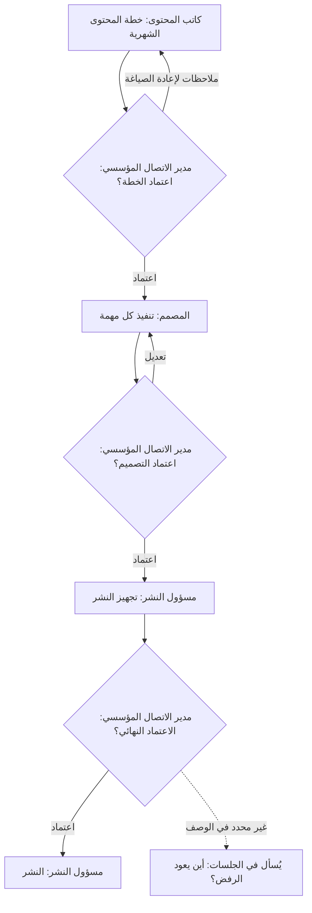
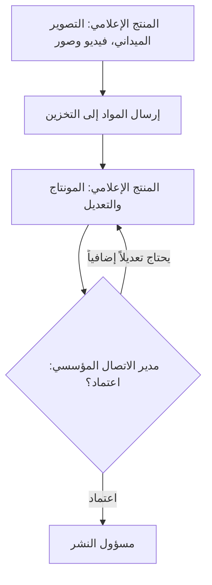

[[Roadmap|Product Roadmap]] | [[workflow-map|Workflow Map]] | [[validation-scripts|Validation Scripts]] | [[feedback-rubric|Feedback Rubric]] | [[MVP_draft|MVP Draft UI Shell]]

---

# Checkpoint 0.2 — Owner Input Log

## 1. What this file is

A running, append-only record of what the project owner has learned from his own
investigation of the department, kept **separate** from tester findings and from
the roadmap. Input arrives in batches. Each item is logged once, classified,
cross-referenced to the existing workflow map, and given a route for what happens
to it after the guided sessions.

**Why a separate file.**

- `Roadmap.md` holds planned direction and exit gates. Unverified requests do not
  belong there until they are scoped.
- `feedback-rubric.md` requires that consolidated findings come from sessions.
  Owner input is a legitimate source, but it is a different one, so it is labelled
  and kept apart. It never counts toward the exit gate scenario pass rate.
- Phase 0.2.3 applies only evidence-based corrections. This file is the evidence
  trail for the corrections that come from the owner rather than from a session.

**What this file does not do.** It does not change the prototype, the Roadmap, the
validation scripts, the tester packet or the Google Form. Nothing here is built
until Phase 0.2.3 or later.

**Two kinds of text in every entry.** *Owner input* is what the owner said, lightly
cleaned for spelling with the meaning unchanged. *Agent notes* are analysis added
afterwards: they are labelled, unverified, and may be wrong.

## 2. How to read an entry

**Types.**

| Type | Meaning | What happens to it |
|---|---|---|
| Decision | The owner has decided how something should be | Applied in Phase 0.2.3 unless a session raises a Severity 1 finding against it, in which case it returns to the owner |
| Workflow fact | How the department works, as the owner understands it | Verified with a participant who performs the step, then written into `workflow-map.md` |
| New capability | Something the prototype does not do and the specification does not fully describe | Needs design. Goes to a discussion document or a scoped Roadmap checkpoint, never straight into code |

**Statuses.** Logged, Needs clarification, Needs verification, Needs design,
Decided, Promoted (with a link to where it went), Deferred, Rejected. Deferred and
Rejected carry a dated written reason.

**Sources.** Every entry states its source. Today that is always
`Owner (Amir), own investigation`. When team members contribute directly, use the
role and session, for example `Session 3, Content Writer`.

**IDs.** `O-001`, `O-002` and so on, in order received. Never renumbered, never
reused. Cross-references to the workflow map use its own identifiers: W (workflow),
A (assumption), E (exception), B (bottleneck), T (terminology), Q (open question).

## 3. Summary

Batch 1, received 2026-09-20.

| ID | Type | Item | Status | Route |
|---|---|---|---|---|
| O-001 | New capability | Per-user permission editor with checkboxes, reversible at any time | Needs design | Prototype shell in 0.2.3; real system in Checkpoint 1.2.4 |
| O-002 | Decision | Only Admin and the Director may edit permissions | Decided | Phase 0.2.3; `organizational_role_discussion.md` update |
| O-003 | New capability | Audience comment inbox: store, classify good/mixed/bad, show platform, reply | Needs design | New discussion document; Version 3 candidate |
| O-004 | Decision | Analytics becomes post analytics; work-status reading and attention alerts both live in Monitoring | Decided | Phase 0.2.3 |
| O-005 | Decision | Member role limited to sending mail and adding ideas or notes | Decided, clarification open | Phase 0.2.3; workflow map W7 |
| O-006 | New capability | Department-tagged members, for example عضو\تسويق, so the origin of a note is visible | Needs design | Prototype label in 0.2.3; Checkpoint 1.2.3 |
| O-007 | New capability | Global Member for anyone, with special grants per email through Add User and the permission editor | Needs clarification | Discussion first; Checkpoints 1.2.1 and 1.2.2 |
| O-008 | New capability | Unified publishing in مساحة الإنشاء: one title, date/time and description for all connected platforms, with per-platform opt-out | Needs design | MVP_draft sections 18 to 20; Phase 0.2.3 |
| O-009 | Workflow fact | Monthly content plan chain: Writer, Director, Designer, Director, Publishing Officer, Director | Needs verification | `workflow-map.md` W1 to W6; Checkpoint 2.3 input |
| O-010 | Workflow fact | Media Producer chain: shoot, store, edit, Director, Publishing Officer or back to edit | Needs verification | `workflow-map.md` W4; asset decisions A17 |

---

## 4. Entries

### O-001 — Per-user permission editor

| Field | Value |
|---|---|
| Type | New capability |
| Received | 2026-09-20, batch 1 |
| Source | Owner (Amir), own investigation |
| Status | Needs design |
| Route | Prototype: Admin > Users shell in 0.2.3. Real: Checkpoint 1.2.4 (Role Permissions & Capabilities) |
| Related | A23, W9, Q1 |

**Owner input.** Permissions need simplifying. Click a user (an employee), tick
checkboxes for the permissions, so that today he can be given access to something
and tomorrow it can be closed off again.

**Prototype today.** Roles are fixed keys with four yes/no flags (create, review,
publish, system). There is no per-user setting. Admin > Users is a shell.

**Agent notes (unverified).**

- Fits the specification. `organizational_role_discussion.md` section 14 says
  the role profiles are "defaults, not rigid hard-coded limits", and section 12
  says additional permissions can be assigned when needed. The specification
  already sketches permission keys such as `content.create`, `media.upload`,
  `publishing.schedule` and `publishing.execute`.
- The design question is the list of checkboxes: which permissions, how they are
  grouped so the screen stays simple, and whether a role supplies the default
  ticks that an individual then overrides.
- Every change to a permission should be recorded (who, whom, what, when).
  Roadmap Checkpoint 1.4.4 already plans audit capture for permission changes.
- Revoking a permission must not silently undo history. An approval given while
  the approver held the right stays valid because it is bound to the release.
- Prototype scope, if approved for 0.2.3: a visual shell only. Ticking a box
  changes what that user sees in View As, with no real enforcement.

### O-002 — Who may edit permissions

| Field | Value |
|---|---|
| Type | Decision |
| Received | 2026-09-20, batch 1 |
| Source | Owner (Amir), own investigation |
| Status | Decided |
| Route | Phase 0.2.3. Update `organizational_role_discussion.md` after 0.2.4 |
| Related | O-001, A23, Q3 |

**Owner input.** The ability to edit permissions is for only the Admin and the
main Manager (مدير الاتصال المؤسسي).

**Agent notes (unverified).**

- Consistent with the specification on user administration: the acting-authority
  example in `organizational_role_discussion.md` lists user administration as
  **not** automatically delegated to the Assistant Director. This decision
  therefore excludes the Assistant Director unless the Director delegates
  explicitly. Confirm in C4.
- Tension with A23, "Admin holds no content authority". If Admin can edit
  permissions, Admin could grant itself approval rights. Decide whether the
  separation survives, and whether a Director must confirm any grant of approval
  or publishing rights. Confirm in C4.

### O-003 — Audience comment inbox and reply

| Field | Value |
|---|---|
| Type | New capability |
| Received | 2026-09-20, batch 1 |
| Source | Owner (Amir), own investigation |
| Status | Needs design. The owner noted this may need a discussion |
| Route | New file `disscussios/comment_inbox_and_replies.md` plus an entry in `discussions_list.md`. Roadmap: Version 3 candidate, adjacent to 3.6 and 3.7 |
| Related | 3.1, 3.6, 3.7, notification model, Version 4 candidates |

**Owner input.** A respond-to-comments feature. A place to store comments, sorted
into three classes (good, mixed, bad), showing where each came from (which
platform), and the ability to respond to them. How to store and build this may
need a discussion.

**Prototype today.** Nothing. The specification and Roadmap contain no comment
feature. The closest items are External Reconciliation (3.6), Real Analytics
Collection (3.7) and Connected Account Infrastructure (3.1).

**Agent notes (unverified). Questions the discussion document should settle.**

1. **Roles.** None of the eight confirmed roles is a community manager. Who reads
   and answers comments today? This may be a new duty for an existing role.
2. **Storage.** One record per comment with platform, post reference, author
   handle, time, language, class, status and reply. What identifies a comment
   across platforms, and what happens when the original is deleted on the platform.
3. **Classification.** By staff, or automatic? Automatic Arabic sentiment
   classification is already a Version 4 candidate in the Roadmap. What exactly
   does "mixed" mean, and can staff correct a class?
4. **Replying.** A reply on an official account is publication. Who may send it,
   from which account, and does it need approval? Roadmap principle: the
   Publishing Officer holds channel authority.
5. **Workflow states.** New, assigned, replied, ignored, escalated. Whether a bad
   comment becomes an Attention item in the three-tier notification model.
6. **Moderation.** Hide, delete or report abusive comments, and who may.
7. **Privacy and retention.** Comments contain personal data of the public.
   How long they are kept, and who can see them.
8. **Platform reality.** Whether each platform lets an application read and answer
   comments, and on what limits, differs by platform and changes over time. This
   must be checked before any promise is made. It also means real comments cannot
   be validated in the prototype; only the screen and workflow can.
9. **Where it lives.** A tab inside Monitoring, a page of its own, or part of the
   Publishing Officer's home. See C7.

### O-004 — Analytics versus Monitoring

| Field | Value |
|---|---|
| Type | Decision |
| Received | 2026-09-20, batch 1 |
| Source | Owner (Amir), own investigation |
| Status | Decided |
| Route | Phase 0.2.3. Real post metrics are Checkpoint 3.7 |
| Related | A24 is unrelated; see `MVP_draft.md` sections 33 and 34 |

**Owner input.** التحليلات should be for post analytics. Both "قراءة سريعة لحالة
العمل في الحملة" and "آخر التغييرات والتنبيهات التي تحتاج انتباهاً" belong in
المراقبة.

**Prototype today.** Both strings are page subtitles in
`src/components/supporting.tsx`: the first on Analytics, the second on
Monitoring. The Analytics page currently shows counts derived from work items,
not post performance.

**Agent notes (unverified).**

- This matches the specification. `MVP_draft.md` section 33 defines Analytics as
  content, campaign and platform performance with mock data. Section 34 defines
  Monitoring as workflow and workload. The current Analytics page drifted from
  section 33, so this is a correction toward the spec.
- Interpretation used: both descriptions and their content move to المراقبة, and
  التحليلات becomes purely post analytics (posts published, reach, engagement,
  top platform, per campaign and per platform), populated with clearly labelled
  mock data. Confirm in C1.
- Low risk and small. Good first candidate for Phase 0.2.3.

### O-005 — Member role limited to mail and ideas

| Field | Value |
|---|---|
| Type | Decision |
| Received | 2026-09-20, batch 1 |
| Source | Owner (Amir), own investigation |
| Status | Decided, clarification open (C2) |
| Route | Phase 0.2.3. Rewrite W7 and the role inventory in `workflow-map.md` |
| Related | W7, W8, A3, T1, Q7 |

**Owner input.** The عضو role should only have the ability to send mail, or add an
idea or note in الأفكار.

**Prototype today.** Member can create work, submit it for review, comment on it
and see the Work page. Workflow W7 and validation script S7 are written for that
role.

**Agent notes (unverified).**

- `organizational_role_discussion.md` section 12 gives Member broader default
  permissions, but it also says: "Until management defines a more specific
  meaning, عضو can be treated as a general Communication Department member".
  This decision is management defining that meaning.
- Consequence: a Member contribution is an idea or a mail, not a work item. The
  Assistant Director (W8) or another reviewer turns it into work when worth
  doing. The sender stays visible, see O-006.
- Interpretation used: "mail" means sending a note or request into the
  department's inbox, which the Assistant Director sees on the Mail page. It does
  not mean giving Members a mailbox of their own. Confirm in C2.
- Affects running sessions. See section 7.

### O-006 — Department-tagged members

| Field | Value |
|---|---|
| Type | New capability |
| Received | 2026-09-20, batch 1 |
| Source | Owner (Amir), own investigation |
| Status | Needs design |
| Route | Prototype: display tag in 0.2.3. Real: Checkpoint 1.2.3 (Organizational Positions & Hierarchy) |
| Related | O-005, O-007, T1, Q7 |

**Owner input.** More flexibility by allowing several kinds of member, for example
"عضو\تسويق", where تسويق is a department in the charity. Then a note or mail can be
shown as coming from Ahmad, عضو\تسويق.

**Agent notes (unverified).**

- This is an organizational attribute rather than a new role. The specification
  already separates organizational position (who the person is) from permissions
  (what they may do). Modelling it as a tag on a Member keeps the eight-role list
  intact.
- Open design points: who maintains the list of departments (Admin), whether a
  tag affects only the label or also permissions or routing (for example sending
  marketing requests to a particular reviewer), and whether a person can carry
  more than one tag. See C5.
- Presentation is undecided. The backslash form "عضو\تسويق" is the owner's
  shorthand; the interface may prefer a separator such as "عضو · التسويق". Also
  interacts with the terminology question T1.

### O-007 — Global Member and email-based grants

| Field | Value |
|---|---|
| Type | New capability |
| Received | 2026-09-20, batch 1 |
| Source | Owner (Amir), own investigation |
| Status | Needs clarification (C3) |
| Route | Discussion first. Real: Checkpoints 1.2.1 (Authentication), 1.2.2 (User Profile & Lifecycle) |
| Related | O-001, O-005, O-006, security discussion |

**Owner input.** Anyone can be a عضو, so this is the global user. Special users can
be given the عضو role with additional permissions, depending on their email. Done
again through the Add User and edit-permission features.

**Agent notes (unverified).**

- Two readings are possible and they lead to different systems. Either anyone in
  the organization with an organization email signs in and becomes a Member
  automatically, or an Admin or the Director creates every Member by email. Only
  the owner can say which. See C3.
- "Depending on his email" could mean a per-email assignment, or a rule such as a
  domain or address list. Clarify with C3.
- An open global role means many people can send mail and ideas into the
  department. That raises spam and abuse questions, and touches the zero-trust
  principles in `security_discussion.md`. Not a blocker for the prototype, but
  worth deciding before Version 1.
- The prototype's Admin > Users shell is the natural place for Add User.

### O-008 — Unified publishing in مساحة الإنشاء

| Field | Value |
|---|---|
| Type | New capability |
| Received | 2026-09-20, batch 1 |
| Source | Owner (Amir), own investigation |
| Status | Needs design |
| Route | Amend `MVP_draft.md` sections 18 to 20 after design; build in Phase 0.2.3 if approved |
| Related | A5, A6, A12, A15, B5 |

**Owner input.** In مساحة الإنشاء there should be a global button for unified
publishing. The user ticks a simple checkbox and can then set one title, date/time
and description that apply to all connected platforms. Some platforms can be left
out of the unified push. The idea is to give options and flexibility.

**Prototype today.** The composer has a master text, per-channel variant tabs and
channel checkboxes. Scheduling is done later, by the Publishing Officer, on the
Approvals page. The Phase 0.2.1 handoff states the composer was not restructured.
Verify against the source before building.

**Agent notes (unverified).**

- Partly in the specification. `MVP_draft.md` section 19 lists Title, Platforms
  and Schedule as composer fields, and section 20 gives per-platform variants.
  Master-plus-variants already behaves like a unified push with overrides.
- Authority conflict to resolve: assumption A12 says only the Publishing Officer
  schedules and dispatches. If the author enters a date and time, it must be a
  requested time that the Publishing Officer confirms, unless the department wants
  it otherwise. See C6.
- "Title" and "description" mean different things on different platforms. Some
  have no title at all. The design must say which fields map where.
- Whatever the unified fields contain becomes part of the release that the
  Director approves (A5, A6), so editing them after approval invalidates it.
- "Connected platforms" depends on the Integrations shell. The prototype knows
  Instagram, X and LinkedIn only. See C8.

### O-009 — Monthly content plan chain

| Field | Value |
|---|---|
| Type | Workflow fact |
| Received | 2026-09-20, batch 1 |
| Source | Owner (Amir), own investigation |
| Status | Needs verification |
| Route | Verify in sessions S1, S3, S4, S6. Then update `workflow-map.md` W1 to W6, A9, A19, B1. Input to Roadmap Checkpoint 2.3 |
| Related | W1, W2, W3, W5, W6, A9, A13, A19, B1, Q1, Q3 |

**Owner input.** The كاتب المحتوى makes the content plan for the month and sends it
to the مدير الاتصال المؤسسي, who approves it or adds a note for remake or edit. If
approved, it goes to the المصمم, who does the work. Each time he finishes a task he
sends it to the مدير الاتصال المؤسسي for approval or edit. If approved, it goes to
the مسؤول النشر, who does his job and sends it. But there is a last checkpoint where
the مدير الاتصال المؤسسي must approve it again.



*Diagram drawn from the owner's description. The dashed branch is not something the
owner said; it marks a gap.*

**Comparison with what the prototype and workflow map assume.**

| Point | Owner's description | Workflow map and prototype today |
|---|---|---|
| Starting object | A monthly content plan written by the Writer | Campaign and work items created by the Director or Assistant Director (W1) |
| Director approvals per piece | Three: the plan, each design, and a final one after preparation | One, at the release (W5, A9) |
| Order of work | Sequential handoff: plan first, then design, then publishing | Work items are parallel and owned by a role (A3, A25) |
| Publishing Officer step | Prepares, then routes back for a final approval | Schedules and dispatches after a single approval (W6) |
| Assistant Director | Not mentioned | Reviews and can approve anything (W5, A9) |
| Rejection at the final gate | Not stated | Not applicable |

**Agent notes (unverified).**

- The Director sits at every gate. That sharpens bottleneck B1 and open question
  Q3 (delegation) into something concrete.
- The Roadmap already plans multi-stage approval for Version 2 (Checkpoint 2.3).
  This description is real input for it.
- A monthly plan may be a container above work items, a campaign, or a document
  of its own. The prototype cannot say which until C9 is answered.

### O-010 — Media Producer chain

| Field | Value |
|---|---|
| Type | Workflow fact |
| Received | 2026-09-20, batch 1 |
| Source | Owner (Amir), own investigation |
| Status | Needs verification |
| Route | Verify in session S5. Then update `workflow-map.md` W4. Revisit A17 |
| Related | W4, W5, A17, B2, Q1 |

**Owner input.** The المنتج الإعلامي's main job is to go out, film and take pictures,
send them to storage, then edit them, and send them to the مدير الاتصال المؤسسي.
The edited work then goes to the مسؤول النشر if approved, or back to the المنتج
الإعلامي if it needs more editing.



*Diagram drawn from the owner's description.*

**Comparison with what the prototype and workflow map assume.**

| Point | Owner's description | Workflow map and prototype today |
|---|---|---|
| First step | Field capture, then storing the raw material | Producer receives a work item and shoots outside the hub (W4 steps 1 and 2) |
| Storage | Raw material goes to storage before editing | Upload and storage are deferred; assets are fixed illustrations (A17) |
| Loop | Back to the Producer for more editing | Supported as a change request (W4 step 5) |
| Approver | Director, then the Publishing Officer | Director or Assistant Director |
| Final gate | Not stated whether the last Director approval of O-009 also applies here | Not applicable |

**Agent notes (unverified).**

- The deferral of upload and playback was recorded as acceptable because
  illustrative assets are enough to test the workflow. For this role the first
  half of the job is capture and storage, so session S5 should test that
  assumption hard. Keep the scope at what to expect, not a build decision.
- Real storage belongs to Roadmap Checkpoints 2.2 (asset model) and 3.2
  (storage adapter). No prototype change is implied by this entry.

---

## 5. Clarifications needed from the owner

Answer inline, beside the question, then update the affected entry's status.

| # | Affects | Question | Answer |
|---|---|---|---|
| C1 | O-004 | Confirm: both the campaign work-status reading and the attention alerts move to المراقبة, and التحليلات becomes purely post analytics (posts, reach, engagement, per platform and campaign)? | |
| C2 | O-005 | For Members, does "mail" mean sending a note or request into the department's inbox that the Assistant Director sees? Or should Members also read incoming mail? | |
| C3 | O-007 | Does "anyone" mean every person in the organization with an organization email becomes a Member automatically, or does an Admin or the Director create each Member? And does "depending on email" mean per-address assignment or a domain rule? | |
| C4 | O-002 | Can the Assistant Director edit permissions? Can Admin grant itself approval or publishing rights, or does the rule that Admin has no content authority still hold? Should any grant of approval rights need the Director's confirmation? | |
| C5 | O-006 | Does a department tag change only the label, or also permissions or where the mail is routed? Can one person carry several tags? Who maintains the list of departments? | |
| C6 | O-008 | When the author sets a date and time in the unified box, is it a request that the Publishing Officer confirms, or does the author's time stand? | |
| C7 | O-003 | Who reads and answers comments today? Which role should own the comment inbox in the hub? | |
| C8 | O-003, O-008 | Which platforms does the charity actually publish on? The prototype only knows Instagram, X and LinkedIn. | |
| C9 | O-009 | Is the monthly content plan a document, a container of posts, or the same thing as a campaign? What exactly does the Director approve at the plan stage, and what is checked at the last gate that was not checked at the design gate? Is the last gate needed for every post or only some? | |
| C10 | O-009, O-010 | Where does a rejection at the final gate go? Does the Assistant Director play any part in these chains, or does the Director act alone? | |

## 6. Cross-cutting observations

Agent analysis, unverified, kept here so it is not confused with owner input.

1. **The Director is the single approval point in every chain**, three times in the
   content chain, and also the person who edits permissions. This is the heaviest
   version of bottleneck B1. Delegation (Q3) will very likely be a real finding.
2. **The Assistant Director appears in neither workflow.** Either the Assistant is
   outside the approval chain in practice, or the description simply left the role
   out. Sessions S1 and S2 should ask directly.
3. **Handoffs are sequential and named**, and the prototype models parallel work
   owned by a role. If the sessions confirm this, the domain model needs a stage
   concept: a defined order of stages per content type, with a named approver at
   each. That is a bigger change than any single entry above, and belongs to a
   design discussion rather than a patch.
4. **Storage and platform connections underlie four entries** (O-003, O-008, O-010
   and part of O-006). None can be validated against real data in the prototype.
   Only the screens and workflow can.

## 7. Effect on sessions already running

The tester packet and the Google Form describe the current prototype. Do **not**
change them, or the prototype, while responses are coming in, because the rubric
assumes every participant sees the same starting data. Instead, read the answers
through the lens below during consolidation.

| Session or form part | Assumption that this input challenges | How to handle |
|---|---|---|
| S7 Member, tasks 2 to 4 | Member submits work and follows comments on it | Treat answers as feedback on the old Member role. Record that management has since narrowed it (O-005) |
| Google Form, section 8 | Groups "عضو بالقسم أو مسؤول النظام" together | Leave as is. Split only if a second round is run |
| S1 Director, tasks 3 to 6 | One approval decides a release | Ask the follow-up: is one approval enough, or do three gates apply (O-009) |
| S6 Publishing Officer, task 7 | Publishing Officer never approves | Add the question: does the Director give a final approval after the Officer prepares a release |
| S5 Media Producer, task 5 | Upload is a deferred nicety | Weigh the answer against O-010, where storage is the first step of the job |

## 8. Template for the next entry

Copy this block, take the next free ID, and append it to section 4. Add a row to
the summary in section 3 and note the batch in section 9.

```markdown
### O-0__ — Short title

| Field | Value |
|---|---|
| Type | Decision / Workflow fact / New capability |
| Received | YYYY-MM-DD, batch N |
| Source | Owner (Amir), own investigation  /  Session N, Role |
| Status | Logged |
| Route | Where it goes after the sessions |
| Related | W_ A_ E_ B_ T_ Q_ O-0__ |

**Owner input.** The words as received, lightly cleaned.

**Prototype today.** What exists now, checked against the source.

**Agent notes (unverified).** Analysis, risks, questions. Anything that needs the
owner goes into section 5 as a numbered clarification.
```

**Rules for adding.**

1. Never edit the owner's words after logging. Add a dated clarification beneath.
2. When a team member contributes, the source names the role and session.
3. A Decision is never downgraded silently. Changing one needs a dated line and a
   reason.
4. When an entry is applied, set its status to Promoted and link to the commit or
   document.

## 9. Log

| Date | Batch | Change |
|---|---|---|
| 2026-09-20 | 1 | File created. Entries O-001 to O-010 logged from the owner's own investigation. Checked against `MVP_draft.md` sections 19, 20, 33 and 34, `organizational_role_discussion.md` sections 12 to 14, `workflow-map.md`, and `src/components/supporting.tsx`. No other file changed |
